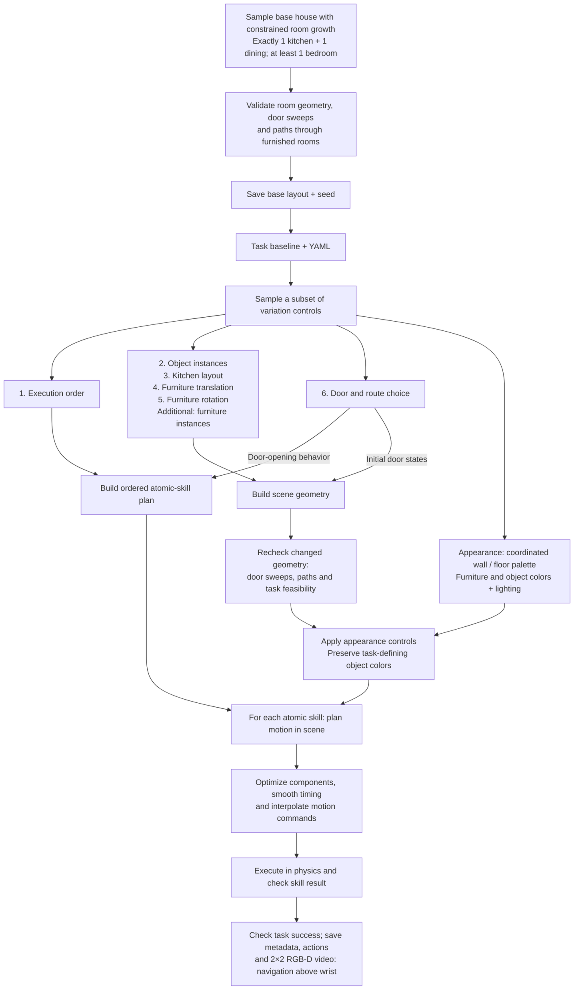
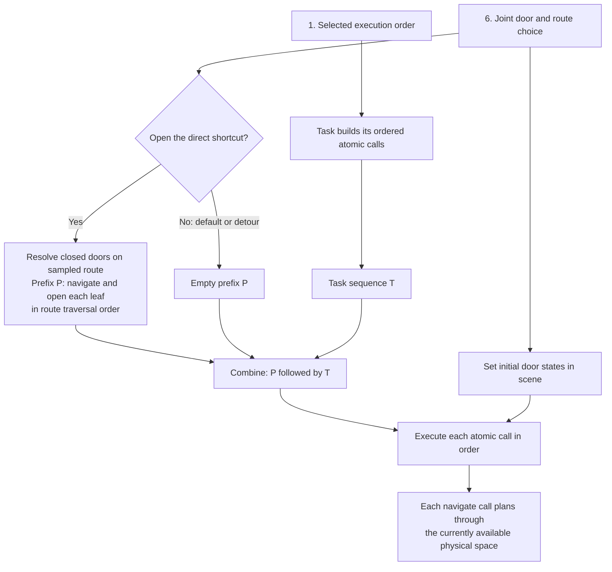
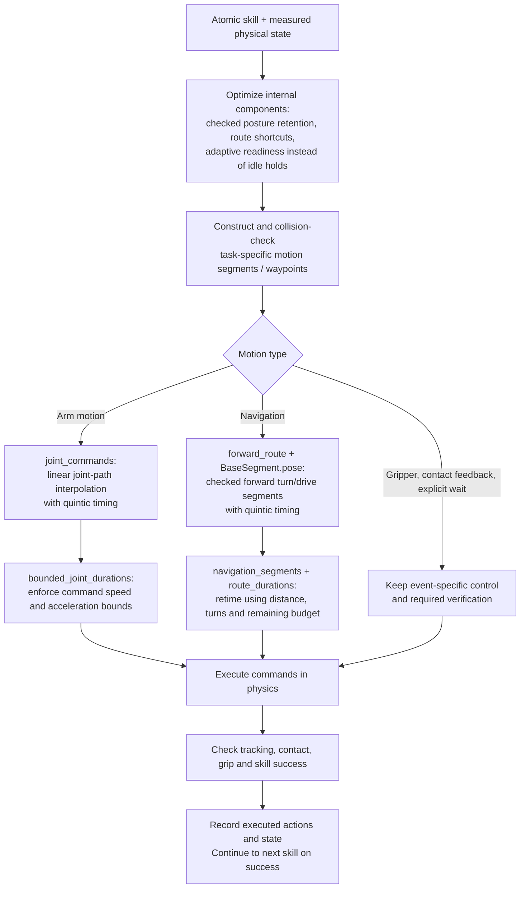

# Cross-Episode Robotics Sim

A MuJoCo/RoboCasa household simulation and demonstration generator for studying
**compositional planning, reusable robot skills, and generalization to new tasks
and settings**. A TidyBot++ mobile base carries a Franka FR3 arm and Robotiq 2F-85
gripper. Composite policies act through a fixed atomic interface in one persistent
physical scene.

## Qualified controller backend: MolmoSpaces

Absolute-position replay now uses **MolmoSpaces native controllers** for the
base, arm and gripper. All five composite replay checks passed.
[Setup, function interface, qualification scope and commands](docs/molmospaces_controllers.md).
The full native-environment migration is separate and remains unfinished.

## Project direction and current status

The intended dataset is a **shared corpus of past training episodes**, with held-out
composite tasks or out-of-distribution settings for evaluation. It is not a fixed
package of specially selected history videos attached to every test example.
Memory models may later learn from or retrieve that corpus.

| Workstream | Current implementation | Next milestone |
| --- | --- | --- |
| Benchmark and composite data | Five tasks, configurable procedures, randomized houses/objects/furniture/appearance, physical goal checks, recorded demonstrations | Define reproducible training/test splits and measure reliability across new samples |
| Atomic skills and VLA training | Fixed 16-function oracle interface, physical atomic demos, shared motion components, dataset/policy utilities | Validate a synchronized training action/observation contract; train and evaluate VLA baselines |
| Memory and planning | Intended planner queries memory, decomposes a task into subtasks and ordered skills; skills can be executed by a VLA | First establish VLA generalization baselines; memory learning/retrieval is later work |

A single planner can produce both the subtask decomposition and ordered skill
calls. “Bag of skills” describes the fixed capabilities available to the planner;
it does not remove execution order or physical preconditions. Current generation
uses oracle recipes and simulator-aware controllers, not a trained memory model.

**Latest saved-batch evidence:** `composite_pilot_k8yxo0si` has **35/35 successful
reports**, including the two repaired grocery runs and finalized videos. See
[recovery evidence](docs/batch_failure_recovery_2026_10_22.md). This is a resumed
batch with fixes, not a first-attempt success rate or a guarantee for unseen houses.
Some door calls still take about 60 simulated seconds, exceeding the 5–15 s target.

**Read before changing execution:** [AGENTS.md](AGENTS.md),
[mandatory motion defaults](docs/human_like_motion.md#mandatory-defaults), and
[onboard observation requirements](docs/onboard_observations.md).

## Start here

1. Install the two environments and assets using [setup below](#installation).
2. Read the [ownership map](#code-ownership-and-extension-points) before editing.
3. Preview configurations, then run one example before a large batch.
4. Inspect physical outcomes and executed skill calls, not just videos or plans.
5. Use a new batch for a changed sampling distribution; resume only to keep the
   saved configurations and retry unfinished/failed examples.

## Current composite tasks

| Task key | Goal | Supported procedure variation |
| --- | --- | --- |
| `set_table` | Serve the requested bowls and cups at the dining table | Complete each setting, or bowls then cups |
| `clear_and_store` | Put vessels in appropriate cabinet/drawer storage | Finish one storage unit, or open both before storing and closing |
| `prepare_and_serve_meal` | Microwave a meal and retrieve/serve refrigerated items | Retrieve the other items during heating, or before heating |
| `unpack_and_sort_groceries` | Drinks into the purple basket, snacks into the orange basket | Drinks first or snacks first; baskets stay at their initial supports |
| `warm_two_pots` | Warm two graspable vessels on separate burners, then switch off | Start the first burner early, or place both vessels before starting |

Heating is a **duration predicate, not simulated heat transfer**. The prompt states
the minimum (normally 30 simulated seconds). The private evaluator counts only
qualifying appliance-on time with the object properly placed; the planner can
wait or do other work. There is no public “ready” signal. Atomic knob/button
qualification does not require waiting through a heating task.

## Generation logic

Sample the base-house seed and room count **before** task variations. Default
YAMLs sample 5–7 rooms: exactly one kitchen and dining room, at least one bedroom.
The selected native kitchen then determines how the house geometry is fitted.
Validate doors and furnished circulation before and after scene changes.

The original six controls are **execution order, object instances, kitchen layout,
furniture translation, furniture rotation, and door/route choice**. Furniture
instances and appearance extend that pool. The original case is the empty subset,
not a seventh control. Any subset can be sampled, including one control; selected
values can still equal baseline values. Task-defining sorting colors are protected.



Static scene checks do not prove that the loaded robot can reach every target.
Failed layout candidates and physical attempts remain recorded. The generator
never silently substitutes the old three-room house when house sampling fails.

### Execution order and doors are composed together

The procedure creates the task calls. The route choice determines both initial
door states and any required opening prefix on the accepted room graph. A* finds
motion paths through the resulting physical scene; it does not invent door-opening
calls. The stove task stays in the kitchen and omits the door-route control.



### Motion optimization inside every atomic call

Optimize internal navigation, posture changes and pauses first, then construct
checked motion segments and retime/interpolate their commands. This applies to
fixture-local repositioning too. The next skill receives the actual resulting
physical state. This is not video acceleration or only a post-generation replay.



The default arm path uses **piecewise-linear joint interpolation with quintic
timing**, not a Hermite spline across every skill. Navigation uses checked forward
turn/drive geometry with quintic timing. The timing function is
`10u³ − 15u⁴ + 6u⁵`. See [functions and interpolation details](docs/composite_variation_pipeline.md#functions-used-by-the-current-default).

The nominal command grid is 50 Hz; retained path knots and bounded timing can
change intervals. Do not assume recordings already satisfy a particular VLA's
uniform action-rate convention. Preserve grasp/release verification, contact
feedback and explicit waits. Omit tuck/redocking only after swept collision
checks; faster execution must pass physics, with backoff on failure. Record actual
per-call duration and exceptions. See [motion policy and implementation gaps](docs/human_like_motion.md).

## Robot observations

Exactly **two physical onboard RGB-D cameras** provide robot observations:

- `robot_0/navigation_cam`: base-fixed mast behind the arm.
- `robot_0/wrist_cam`: wrist-mounted camera.

New demo videos have four synchronized panels: navigation RGB/depth above wrist
RGB/depth. Depth visualization uses a fixed 0–8 m range. Colored depth video is
not raw metric depth; check the recording/export path before assuming a dataset
contains metric depth for every frame. Fixed room and overhead cameras are for
diagnostics only, never planner/VLA inputs. `house_overview.png` is a diagnostic
3D view, not an extra robot observation.

Keep mast collision geometry enabled. Camera changes require saved-trajectory
clearance checks and fresh composite physics tests, not just an initial-tuck render.
Older saved videos retain their original camera conventions.

## Installation

Two Python 3.11 environments are used, because RoboCasa pins `mujoco==3.3.1` while the
simulator here uses `mujoco==3.5.0`. The RoboCasa environment is only needed to download its
assets and to regenerate starting scenes.

Run these from the root of this checkout. robosuite and robocasa are cloned into `external/`
(git-ignored); cloning them directly into the root would shadow the installed packages on import.

```bash
# RoboCasa at the tested commit, with the three-room house patch (environment: robocasa)
python3.11 -m venv ~/.venvs/robocasa && source ~/.venvs/robocasa/bin/activate
git clone https://github.com/ARISE-Initiative/robosuite external/robosuite
git -C external/robosuite checkout 5ce6643
git clone https://github.com/robocasa/robocasa external/robocasa
git -C external/robocasa checkout 4f8a298
git -C external/robocasa apply "$PWD/third_party/robocasa/three_room_house.patch"
pip install -e external/robosuite -e external/robocasa
python -m robocasa.scripts.setup_macros
python -m robocasa.scripts.download_kitchen_assets      # ~23 GB on disk
deactivate

# This package (environment: sim; needs a CUDA GPU for cuRobo)
python3.11 -m venv ~/.venvs/sim && source ~/.venvs/sim/bin/activate
pip install -r requirements-lock.txt -e ".[dev]"     # exact versions the demos were validated with
export ROBOCASA_DIR="$PWD/external/robocasa/robocasa"   # the inner package directory
python scripts/install_data.py                           # starting scenes, grasp registry (~500 MB)
# Check the actual local asset installation before launching a long example:
python -c 'from cross_episode_sim.manipulation.molmo_objects import assets_root; print(assets_root())'
# MolmoSpaces downloads robot models and object assets (~20 GB) on first use into ~/.cache;
# to put them elsewhere, set these before the first run:
#   export MLSPACES_CACHE_DIR=/big/disk/molmo-spaces-resources
#   export MLSPACES_ASSETS_DIR=/big/disk/molmospaces-assets

export MUJOCO_GL=egl
export OPENBLAS_NUM_THREADS=1 OMP_NUM_THREADS=1
```

See [installation and troubleshooting](docs/installation.md). Asset downloads and
scene authoring must finish before judging controller failures. Set
`CES_ROBOCASA_PYTHON` if the separate RoboCasa interpreter is not discovered; set
`PYTHON=/path/to/sim/bin/python` when invoking shell launchers outside the sim environment.

## Run and resume generation

```bash
# Preview sampled configurations without physics or rendering.
python -m cross_episode_sim.generation.composite_pilot \
  --suite randomized --write-configs /tmp/composite_configs

# Check dependencies/assets; this does not validate physical task success.
bash scripts/generate_composite_variations.sh --preflight

# One task, one sampled example.
bash scripts/generate_composite_variations.sh \
  --task set_table --count-per-task 1 --workers 1

# Default: 7 sampled attempts per task, 35 total; unique output folder.
bash scripts/generate_composite_variations.sh --workers 8

# A new reproducible distribution/batch.
bash scripts/generate_composite_variations.sh \
  --seed 123 --count-per-task 100 --workers 8

# Preserve successes and saved configurations; retry failed/unfinished examples.
bash scripts/generate_composite_variations.sh \
  --resume runs/YOUR_BATCH --workers 8

# Custom per-task sampling specification.
bash scripts/generate_composite_pilot.sh \
  --sampling-yaml configs/composite_sampling/randomized/set_table.yaml --workers 1
```

Eight workers share an **episode queue**, not one GPU per task. Each running
example leases an idle visible GPU through execution and rendering. Restrict the
pool with `CUDA_VISIBLE_DEVICES`; fewer available GPUs or pending examples means
fewer active workers. GPU assignments are printed and saved. Progress includes a
tqdm batch bar and episode-specific `[step/total]` skill stages.

**Counts are attempts, not guaranteed successes.** Failures stop that episode;
other queued episodes continue. `--timeout` bounds each episode (default 7200 wall
seconds). Rendering follows physics, so “goal passed; rendering video” is not yet
a completed video. Resume does not regenerate successful videos or adopt new YAML
settings. Use a fresh batch for those changes.

The shell variation launcher defaults to `--suite randomized`. The Python module
and `generate_composite_pilot.sh` retain the legacy `pilot` default unless a suite
or sampling YAML is supplied. `--suite variations` explicitly selects the older
fixed coverage suite. Do not confuse those suites with random subset sampling.

Edit the [per-task YAMLs](configs/composite_sampling/randomized) to control counts,
seeds, room counts, subset sizes and parameter distributions. See
[randomized generation](docs/randomized_composites.md) and
[YAML schema](docs/composite_sampling.md). Sampling supported procedures does not
synthesize arbitrary valid permutations, and asset pools are qualified selections,
not every installed asset. Train/test splits must still be designed explicitly.

## What each example saves

| Artifact | Use |
| --- | --- |
| `config.json`, `instruction.txt`, `oracle_plan.json` | Reproduction settings, task prompt, intended atomic order |
| `skill_calls.json`, `run.log` | Actual calls, arguments, outcomes, timings and planning/contact diagnostics |
| `report.json`, `physics_result.json` | Measured outcome; physics completion and rendering status |
| `scene.xml`, `model.mjb`, `initial_state.npz` | Authored scene, compiled robot-inclusive model and initial physical state |
| `base_layout.json`, `room_graph.json`, `resolved_route.json` | Accepted house and route decisions |
| `scene_setup_attempts.json`, `rejected_setups/`, `rejected_trials/` | Rejected setup/physical attempts, when produced |
| `gpu_assignment.json`, `house_overview.png` | Worker GPU and diagnostic 3D house view |
| `trace.json`, `action_recording/` | Recorded state/action evidence; consult export conventions before training |
| `composite.mp4`, `head_camera.mp4` | Final rendered outputs; inspect camera metadata rather than infer views from legacy filenames |

Oracle generation may restore checkpoints after rejected trials and retain the
successful physical branch. A recovered demo is not evidence of single-attempt
online-policy success. Keep rejection provenance when reporting reliability.
Machine-local `runs/` links in engineering notes are not portable GitHub assets.

## Code ownership and extension points

| Layer | Entry points | Contract |
| --- | --- | --- |
| Sampling and workers | [composite_pilot.py](cross_episode_sim/generation/composite_pilot.py), [sampling configs](configs/composite_sampling/randomized) | Choose configurations, lease GPUs, resume, collect results |
| Scene setup | [episode_setup.py](cross_episode_sim/generation/episode_setup.py), [composite_scenes.py](cross_episode_sim/generation/composite_scenes.py), [household_scene.py](cross_episode_sim/generation/household_scene.py), [household_native_scene.py](cross_episode_sim/generation/household_native_scene.py) | Construct the scene once, allocate objects and save setup evidence |
| Composite policies | [base.py](cross_episode_sim/tasks/composites/base.py), [task subclasses](cross_episode_sim/tasks/composites) | Implement `make_prompt()` and `make_plan()`; call atomics, do not construct scenes or judge success |
| Atomic API | [fixed_interface.py](cross_episode_sim/skills/fixed_interface.py), [atomic.py](cross_episode_sim/skills/atomic.py) | Fixed vocabulary, argument/precondition checks and physical postconditions |
| Simulator adapter | [household.py](cross_episode_sim/env/household.py) | Maintain persistent state and bind atomic behaviors to the scene |
| Motion and contact | [control](cross_episode_sim/control), [navigation](cross_episode_sim/navigation), [manipulation](cross_episode_sim/manipulation), [fixtures](cross_episode_sim/fixtures) | Checked trajectories, actuator commands, grasp and fixture interaction |
| Independent evaluation | [composite_goals.py](cross_episode_sim/evaluation/composite_goals.py), [heating_duration.py](cross_episode_sim/evaluation/heating_duration.py) | Measure goal predicates and qualifying appliance time independently of recipe completion |
| Training/evaluation utilities | [policy guide](docs/policies.md), [data package](cross_episode_sim/data) | Export and policy adapters; verify support for the intended task and action representation |

### Adding or modifying a task

1. Add the task-specific prompt and ordered recipes under `tasks/composites/`,
   inheriting the shared policy initialization. Reuse the fixed interface.
2. Declare scene requirements in datagen: object pools, receptacles, appliances,
   room requirements and parameters. Atomic skills must not spawn/reset scenes.
3. Implement independent physical goal predicates. Generic prompt categories must
   not accidentally become one hidden required instance ID. Preserve explicit
   semantic constraints such as correct storage type or basket color.
4. Add sampling controls and validate their combinations, including closed-door
   routes, transformed furniture, object fit and grasp feasibility.
5. Test schema/plan/setup/goal logic, then run representative physical examples.
   Include sequential use: isolated atomic success does not guarantee a composite.
6. Inspect videos, measured timings, reports and rejected trials. Document any
   remaining limits before launching a large batch.

See [adding a task](docs/adding_a_task.md) and [composite ownership/timing](docs/composite_pilot.md)
for details. Some older pages describe earlier pilot snapshots; the current
randomized suite and dated physical evidence above take precedence for batch status.

## Atomic skills and videos

Trajectory construction: [Motion shaping toward human-like demonstrations](docs/human_like_motion.md).
Optimize internal navigation, posture changes, and readiness first; then apply
trajectory smoothing/interpolation. See the [component audit and validation](docs/atomic_component_optimization.md)
for separate component-only and smoothed commands and local review videos.

Post-generation interpolation of recorded actions: [Smooth Action replay](docs/action_replay.md).
Composite generation preserves successful sources: [workflow and current validation](docs/composite_optimized_defaults.md).
Optional live motion experiments (not generation defaults): [timing setup and validation](docs/smooth_action.md).

The fixed public vocabulary has **16 functions**, including generic waiting.
Each link below opens a separate successful physical demonstration. Opening and
closing are separate clips; all clips preserve normal playback speed.

| Atomic function | Purpose | Video |
|---|---|---|
| `navigate` | Approach a target; transport a held object when a destination is supplied. | [Watch navigate](docs/videos/atomic/navigate.mp4) |
| `pick` | Grasp and lift an object using top grasps first, then physically checked side or angled rim grasps if top candidates fail. | [Watch pick](docs/videos/atomic/pick.mp4) |
| `place` | Place the held object, release it, and withdraw. | [Watch place](docs/videos/atomic/place.mp4) |
| `open_door` | Open a hinged fixture using checked handle/contact motions and local repositioning. | [Watch open_door](docs/videos/atomic/open_door.mp4) |
| `close_door` | Close a hinged fixture using checked handle/contact motions. | [Watch close_door](docs/videos/atomic/close_door.mp4) |
| `open_drawer` | Open a drawer with a top-down handle grasp. | [Watch open_drawer](docs/videos/atomic/open_drawer.mp4) |
| `close_drawer` | Close a drawer with a top-down handle grasp. | [Watch close_drawer](docs/videos/atomic/close_drawer.mp4) |
| `open_lid` | Open a hinged lid or remove a detachable lid. | [Watch open_lid](docs/videos/atomic/open_lid.mp4) |
| `close_lid` | Close a hinged lid or reseat a detachable lid. | [Watch close_lid](docs/videos/atomic/close_lid.mp4) |
| `push_button` | Press a button and withdraw. | [Watch push_button](docs/videos/atomic/push_button.mp4) |
| `turn_lever` | Turn a rotary lever to the requested state. | [Watch turn_lever](docs/videos/atomic/turn_lever.mp4) |
| `push_lever` | Push a sliding lever and withdraw. | [Watch push_lever](docs/videos/atomic/push_lever.mp4) |
| `rotate_knob` | Rotate a knob to the requested state. | [Watch rotate_knob](docs/videos/atomic/rotate_knob.mp4) |
| `insert` | Insert an already-held object into a receptacle and release. | [Watch insert](docs/videos/atomic/insert.mp4) |
| `slide_oven_rack` | Slide an oven rack in or out when its path is clear. | [Watch slide_oven_rack](docs/videos/atomic/slide_oven_rack.mp4) |
| `wait` | Advance simulated time; does not require an empty hand. | [Watch wait](docs/videos/atomic/wait.mp4) |

**Validation (13 October 2026):** all 16 functions have successful physical demos
in their tested scenes. These selected successes are not a dataset-wide success
rate or a guarantee for every object/layout. The linked October 13 clips demonstrate native
cabinet/oven fixtures. Later room-door execution is validated in the randomized
batch below; these older clips are not evidence of its latest timing or cameras.
A removable lid can remain held after opening. Waiting advances simulation time;
it does not independently heat objects or mark a task successful.

The [video provenance manifest](docs/videos/atomic/manifest.json) records the source
run, call arguments, and duration for every clip. Videos are downloadable from their
GitHub file pages if the browser does not play them inline.

The active direction uses these fixed capabilities for new composite tasks and
later VLA training. Coffee pouring and portafilter operations are legacy workflows,
not additional functions in this fixed vocabulary.


## Development and validation

```bash
# Focused interface, composition, setup and timing checks.
pytest -q tests/test_composite_tasks.py tests/test_composite_pilot.py \
  tests/test_episode_setup.py tests/test_heating_duration.py

# Relevant regression checks for the latest basket/carry fixes.
pytest -q tests/test_remaining_batch_recovery.py tests/test_carry_posture.py

# Broader checks when appropriate for the change.
pytest
ruff check .
ruff format --check .
```

Unit tests establish geometry/state/control logic, not real rollout success.
For motion changes, run a standalone atomic test and a representative composite,
check physical postconditions and inspect the video. Never fix a failure by
teleporting objects, disabling collisions, weakening success checks or accelerating
playback. Save the exact configuration, failed stage and rejected-attempt evidence.

If a batch fails, distinguish **scene setup**, **navigation/IK**, **grasp retention**,
**placement/withdrawal**, **task goal**, and **rendering** before changing policy.
A failed planning candidate is not itself a failed episode. Check `skill_calls.json`
and the final report. Resume preserves successful examples, so do not delete the
batch just to retry a failure.

## Documentation map

| Guide | Contents |
| --- | --- |
| [Installation](docs/installation.md) | Asset setup, environments and troubleshooting |
| [Randomized composites](docs/randomized_composites.md) | Current generation defaults, validation, retries and artifacts |
| [Variation pipeline](docs/composite_variation_pipeline.md) | Three diagrams, route composition and exact smoothing functions |
| [Sampling YAML](docs/composite_sampling.md) | Control subsets and distributions |
| [Base layouts](docs/base_layout_sampling.md) | Room growth and static validation scope |
| [Fixed atomic skills](docs/fixed_atomic_skills.md) | Interface and qualification context |
| [Human-like motion](docs/human_like_motion.md) | Mandatory defaults and implementation gaps |
| [Onboard observations](docs/onboard_observations.md) | Camera geometry and RGB-D conventions |
| [Latest recovery evidence](docs/batch_failure_recovery_2026_10_22.md) | Resumed 35/35 batch, fixes and remaining timing gap |
| [Policies and export](docs/policies.md) | Existing model adapters and training utilities |
| [Architecture](docs/architecture.md) | Broader package structure and controller stack |

## Legacy workflows

Breakfast/espresso, paired history/current generation, and earlier Qwen/EQA
experiments remain in the repository for provenance. They are not the current
five-task benchmark definition or evidence of completed memory/VLA training.
Coffee pouring and portafilter operations are outside the fixed public skill set.
See [legacy tasks](docs/tasks.md), [history design](docs/history_task_design.md),
[generation interfaces](docs/generation_interfaces.md), and
[Qwen results](docs/qwen_test_set_v1_results.md).

The [project page](https://plnguyen2908.github.io/cross-episode-robotics-sim/) includes
older previews, some accelerated; do not use their playback duration to measure
current physical motion. Current composite videos play at normal speed.

## Acknowledgments

Built on [RoboCasa](https://github.com/robocasa/robocasa), [RoboSuite](https://github.com/ARISE-Initiative/robosuite),
[MolmoSpaces](https://github.com/allenai/molmospaces) (robot models, object assets, planners),
[cuRobo](https://github.com/NVlabs/curobo) and [MuJoCo](https://github.com/google-deepmind/mujoco).
The TidyBot++ base model comes from [tidybot2](https://github.com/jimmyyhwu/tidybot2) (MIT) and
the espresso machine from [MoonlakeAI sim-env-builder](https://github.com/MoonlakeAI/sim-env-builder)
(Apache-2.0); their license files ship with the assets.

## License

Apache-2.0, see [LICENSE](LICENSE).

## Training/test duration pilot

The [training/test driver](docs/train_test_dataset.md) targets **60 successful
training minutes per task in two rooms**, plus **30 testing minutes per task** split between new
variations in two rooms and 5–7-room houses. Training requires successful room-door
opening and open-route examples, plus both supported procedures per task.
Each split saves layout previews, actual object inventories, configs, prompts,
executed sequences, videos, duration/coverage summaries and an asset-overlap audit.

```bash
bash scripts/generate_train_test.sh --output runs/train_test_v1 --prepare-only
bash scripts/generate_train_test.sh --output runs/train_test_v1 --workers 8
```

The two-room profile has passed static furnished-scene validation, not full robot
rollout qualification. Quotas count whole successful episodes; totals can exceed
the targets. Replacement sampling has no round limit. See the guide for resume and remaining OOD limits.

Per-task fine-tuning/test indices are saved under `tasks/TASK/SPLIT/manifest.json`,
with a task-specific object inventory. For five tasks the targets total **5 hours
training and 2.5 hours testing**; all tasks share the same GPU worker pool.
