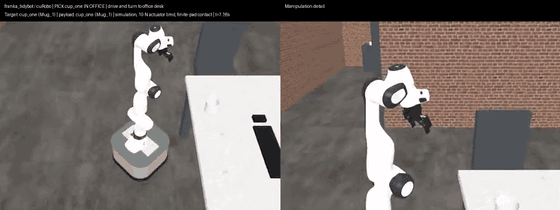
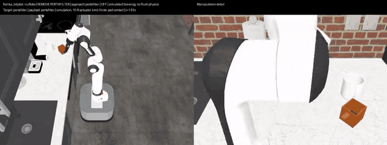

# Cross-Episode Robotics Sim

Multi-room household tasks for a mobile manipulator in [RoboCasa](https://robocasa.ai), built
for studying how a robot can use its past episodes to finish the current one.

A TidyBot++ holonomic base carries a Franka FR3 arm with a Robotiq 2F-85 gripper through a
kitchen, dining room and living room. Everything is physically simulated in MuJoCo: objects move
only through gripper contact, food and coffee grounds are free rigid bodies, and doors, drawers,
knobs and buttons move on their native joints.

The repository provides

- **two composite tasks** with oracle demonstrations: breakfast for two (gather empty vessels
  from three rooms, a person fills them, serve them) and making espresso;
- **a fixed interface of 16 atomic functions**, each with a successful physical demonstration
  and a [separate normal-speed video](#atomic-skills-and-videos);
- **a template task** (`tidy_up`: return a mug and a book to their rooms) that shows how tasks are
  composed from the skills;
- **a Gymnasium environment** where a learned policy drives the same robot and is scored by the
  same measured goal predicates;
- **dataset export** from demonstrations to robomimic-style HDF5, with a minimal behavior
  cloning example.

The latest atomic demonstrations are listed [below](#atomic-skills-and-videos).
The [project page](https://plnguyen2908.github.io/cross-episode-robotics-sim/) and
the composite examples below contain earlier demonstrations. Those previews are
time-lapses and their full videos are 3× speed; the new atomic clips are **1× speed**.

| Breakfast for two | Making espresso |
|---|---|
|  |  |
| [▶ breakfast.mp4](docs/videos/breakfast.mp4) · 816 s simulated | [▶ coffee.mp4](docs/videos/coffee.mp4) · 330 s simulated |
| Collect two mugs and two bowls from three rooms, wait while a person fills them with randomly chosen food, then carry each filled vessel to the office desk (the dining-room table). | Twist out the portafilter, pour 32 grounds from a box, reinstall and lock it, put a cup under the spout, press power, then brew. |

## Atomic skills and videos

The fixed public vocabulary has **16 functions**, including generic waiting.
Each link below opens a separate successful physical demonstration. Opening and
closing are separate clips; all clips preserve normal playback speed.

| Atomic function | Purpose | Video |
|---|---|---|
| `navigate` | Approach a target; transport a held object when a destination is supplied. | [Watch navigate](docs/videos/atomic/navigate.mp4) |
| `pick` | Grasp and lift an object using a top-down approach. | [Watch pick](docs/videos/atomic/pick.mp4) |
| `place` | Place the held object, release it, and withdraw. | [Watch place](docs/videos/atomic/place.mp4) |
| `open_door` | Grasp a handle and open a hinged fixture. | [Watch open_door](docs/videos/atomic/open_door.mp4) |
| `close_door` | Grasp a handle and close a hinged fixture. | [Watch close_door](docs/videos/atomic/close_door.mp4) |
| `open_drawer` | Open a drawer with a top-down handle grasp. | [Watch open_drawer](docs/videos/atomic/open_drawer.mp4) |
| `close_drawer` | Close a drawer with a top-down handle grasp. | [Watch close_drawer](docs/videos/atomic/close_drawer.mp4) |
| `open_lid` | Open a hinged lid or remove a detachable lid. | [Watch open_lid](docs/videos/atomic/open_lid.mp4) |
| `close_lid` | Close a hinged lid or reseat a detachable lid. | [Watch close_lid](docs/videos/atomic/close_lid.mp4) |
| `push_button` | Press a button and withdraw. | [Watch push_button](docs/videos/atomic/push_button.mp4) |
| `turn_lever` | Turn a rotary lever to the requested state. | [Watch turn_lever](docs/videos/atomic/turn_lever.mp4) |
| `push_lever` | Push a sliding lever and withdraw. | [Watch push_lever](docs/videos/atomic/push_lever.mp4) |
| `rotate_knob` | Rotate a knob to the requested state. | [Watch rotate_knob](docs/videos/atomic/rotate_knob.mp4) |
| `insert` | Insert an already-held object into a receptacle and release. | [Watch insert](docs/videos/atomic/insert.mp4) |
| `slide_oven_rack` | Slide an oven rack in or out when its path is clear. | [Watch slide_oven_rack](docs/videos/atomic/slide_oven_rack.mp4) |
| `wait` | Advance simulated time; does not require an empty hand. | [Watch wait](docs/videos/atomic/wait.mp4) |

**Validation (13 October 2026):** all 16 functions have successful physical demos
in their tested scenes. These selected successes are not a dataset-wide success
rate or a guarantee for every object/layout. The door clips demonstrate native
cabinet/oven fixtures; opening the newly added room doors is not yet validated.
A removable lid can remain held after opening. Waiting advances simulation time;
it does not independently heat objects or mark a task successful.

The [video provenance manifest](docs/videos/atomic/manifest.json) records the source
run, call arguments, and duration for every clip. Videos are downloadable from their
GitHub file pages if the browser does not play them inline.

The active direction uses these fixed capabilities for new composite tasks and
later VLA training. Coffee pouring and portafilter operations are legacy workflows,
not additional functions in this fixed vocabulary.

## Why

Given past episodes, either the most similar ones or all of them, how can a robot use that
experience to finish the current episode?

Physical agents today pair a planner with skill policies and start every episode from scratch,
even when they have done something similar before. A past episode records what worked and what
did not: the sequence of subtasks that completed a similar task, which dock reached a crowded
counter, which grasp slipped, where the mugs were put away, how long the machine took to warm up.
Retrieving that experience should let the robot replace search with recall in the current
episode.

The tasks here generate those episodes. Every run is a complete record (the instruction, the
plan of operations, every action and measured outcome, and the attempts that failed and were
rolled back) in a house whose layout and objects change from day to day. That gives both the
experience to retrieve from and a way to measure whether using it helps finish a new episode,
compared with starting from scratch.

## Quick start

Two Python 3.11 environments are used, because RoboCasa pins `mujoco==3.3.1` while the
simulator here uses `mujoco==3.5.0`. The RoboCasa environment is only needed to download its
assets and to regenerate starting scenes.

Run these from the root of this checkout. robosuite and robocasa are cloned into `external/`
(git-ignored); cloning them directly into the root would shadow the installed packages on import.

```bash
# RoboCasa at the tested commit, with the three-room house patch (environment: robocasa)
python3.11 -m venv ~/.venvs/robocasa && source ~/.venvs/robocasa/bin/activate
git clone https://github.com/ARISE-Initiative/robosuite external/robosuite
git -C external/robosuite checkout 5ce6643
git clone https://github.com/robocasa/robocasa external/robocasa
git -C external/robocasa checkout 4f8a298
git -C external/robocasa apply "$PWD/third_party/robocasa/three_room_house.patch"
pip install -e external/robosuite -e external/robocasa
python -m robocasa.scripts.setup_macros
python -m robocasa.scripts.download_kitchen_assets      # ~23 GB on disk
deactivate

# This package (environment: sim; needs a CUDA GPU for cuRobo)
python3.11 -m venv ~/.venvs/sim && source ~/.venvs/sim/bin/activate
pip install -r requirements-lock.txt -e ".[dev]"     # exact versions the demos were validated with
export ROBOCASA_DIR="$PWD/external/robocasa/robocasa"   # the inner package directory
python scripts/install_data.py                           # starting scenes, grasp registry (~500 MB)
# Check the actual local asset installation before launching a long example:
python -c 'from cross_episode_sim.manipulation.molmo_objects import assets_root; print(assets_root())'
# MolmoSpaces downloads robot models and object assets (~20 GB) on first use into ~/.cache;
# to put them elsewhere, set these before the first run:
#   export MLSPACES_CACHE_DIR=/big/disk/molmo-spaces-resources
#   export MLSPACES_ASSETS_DIR=/big/disk/molmospaces-assets

# Run demonstrations (headless rendering through EGL)
export MUJOCO_GL=egl
python -m cross_episode_sim.tasks.breakfast.gather --seed 17 --output runs/breakfast
python -m cross_episode_sim.tasks.coffee.workflow --output runs/coffee
python -m cross_episode_sim.tasks.coffee.workflow --output runs/coffee2 --cups 2   # two cups
python -m cross_episode_sim.tasks.full_breakfast --seed 7 --output runs/example7   # 2 histories + current
# Default: 1–3 paired settings, added furniture, randomized furniture/vessel/machine poses.
python -m cross_episode_sim.tasks.full_breakfast --seed 19 --prepare-only   # scene checks, no robot execution
python -m cross_episode_sim.tasks.full_breakfast --seed 19 --people 3 --extra-furniture 2 --gpus 0 1 2
# Reproduce the earlier two-setting layout profile:
python -m cross_episode_sim.tasks.full_breakfast --seed 7 --layout-profile baseline --gpus 0 1 2
scripts/run_skill.sh drawer runs/drawer      # skill demos, see docs/tasks.md
scripts/run_skill.sh detach-portafilter runs/pf_detach
scripts/run_skill.sh attach-portafilter runs/pf_attach
```

Each run directory holds `report.json` (measured outcome and every stage), `trace.json`
(simulator state at 25 Hz), the scene, and videos rendered after physics ends.
See [docs/installation.md](docs/installation.md) for details and troubleshooting.

## Documentation

| | |
|---|---|
| [Installation](docs/installation.md) | Environments, RoboCasa patch, MolmoSpaces assets, data bundle |
| [Tasks](docs/tasks.md) | Breakfast, coffee, cross-episode examples and the atomic skills: what they do, success criteria, commands |
| [Generation interfaces](docs/generation_interfaces.md) | JSON and Python APIs for reusable histories and composed current examples |
| [History task design](docs/history_task_design.md) | Three task layers, four history categories, and reusable histories for current-task generation |
| [Running and training policies](docs/policies.md) | VLM/agent evaluation with oracle or VLA skills, `TaskEnv`, rollouts, dataset export, behavior cloning |
| [Adding a task](docs/adding_a_task.md) | Scene preparation, transactional skills, composite episodes, goals |
| [Architecture](docs/architecture.md) | Package layout, controller layers, navigation and manipulation stack |
| [Data](docs/data.md) | What the data bundle contains and how to regenerate it |

## Repository layout

```
cross_episode_sim/
  tasks/breakfast, tasks/coffee   composite tasks: scene preparation, episode controller, CLI
  tasks/full_breakfast            cross-episode example generator: two histories and the episode to solve
  fixtures/                       atomic fixture skills (doors, drawers, knobs, levers, buttons, ...)
  skills/                         transactional skill runner, checkpoints, composite episodes
  manipulation/                   RoboCasa manipulation: grasp qualification, recovery, placement
  navigation/                     SE(2) route planners and holonomic route execution
  controller/                     shared base controller: scene, physics, grasping, arm motion
  robot/                          TidyBot++/FR3 embodiment, robot profile, cuRobo arm planner
  env/                            Gymnasium environment and task hooks for learned policies
  data/                           dataset export, trajectory cleanup, run provenance
  grasping/                       grasp-qualification sweep that builds the grasp registry
scripts/                          data install, skill launcher, policy rollouts, bundle builder
examples/                         replay policy, behavior cloning
third_party/robocasa/             three-room house patch for RoboCasa
```

## Development

```bash
pytest                 # unit tests: geometry, state logic, skill wiring
ruff check . && ruff format --check .
```

Full demonstrations are the integration tests: run breakfast, coffee and `scripts/run_skill.sh`
for each skill, and check `report.json` for `"success": true`.

## Status and scope

- Demonstrations come from an **oracle controller** that reads simulator state (object poses and
  geometry). They are ground truth for evaluating memory and policies, not a camera-only policy.
- Coffee brewing is a timed state model without fluid or heat simulation. Grounds and food are
  free rigid bodies.
- Model evaluation supports **VLM planners and agents**, with oracle skills, VLA skills, or
  direct actions on breakfast. Coffee/current supports both planners with oracle skills;
  VLA/direct coffee still needs machine events independent of demonstrator phase flags.
  See the [evaluation interfaces and commands](docs/policies.md#evaluating-vlm-planners)
  and [batch generation, collection, and Qwen evaluation](docs/policies.md#batch-generation-and-qwen-evaluation).
- Legacy composite validation is described in [docs/tasks.md](docs/tasks.md). The latest
  [16 atomic demonstrations](#atomic-skills-and-videos) each passed in their tested scene;
  this does not establish reliability across all RoboCasa assets or validate every legacy
  composite/round-trip task.

## Acknowledgments

Built on [RoboCasa](https://github.com/robocasa/robocasa), [RoboSuite](https://github.com/ARISE-Initiative/robosuite),
[MolmoSpaces](https://github.com/allenai/molmospaces) (robot models, object assets, planners),
[cuRobo](https://github.com/NVlabs/curobo) and [MuJoCo](https://github.com/google-deepmind/mujoco).
The TidyBot++ base model comes from [tidybot2](https://github.com/jimmyyhwu/tidybot2) (MIT) and
the espresso machine from [MoonlakeAI sim-env-builder](https://github.com/MoonlakeAI/sim-env-builder)
(Apache-2.0); their license files ship with the assets.

## License

Apache-2.0, see [LICENSE](LICENSE).
