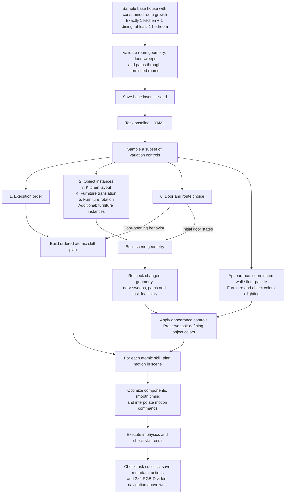
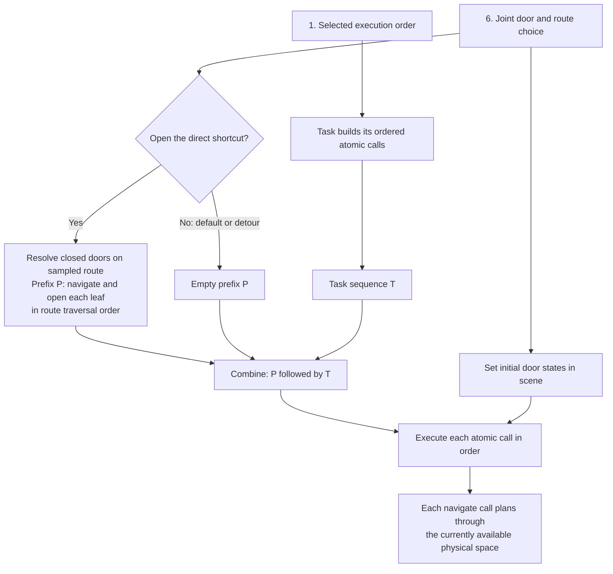
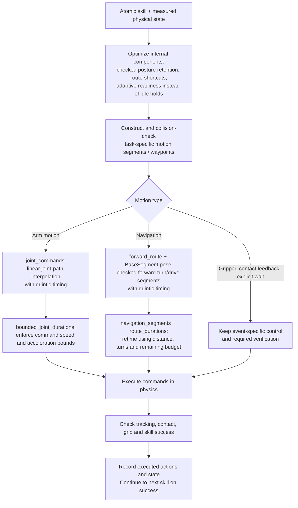

# Composite variation pipeline

Original = no variation controls selected. The six original controls remain
available, with appearance and furniture-instance controls added to the pool.
Any subset can be sampled, including a single control or combined controls.



The randomized composite suite now uses this pipeline. Base-house seed/count are
drawn before the variation subset; geometry is fitted to the selected native
kitchen and validated before and after furniture transforms. See
[randomized generation](randomized_composites.md). Door IDs and open/detour routes
are resolved from the accepted graph during environment setup.
Appearance controls are implemented in `generation/appearance.py` and consumed by
household scene generation. The new demos are rendered appearance previews, not
new composite execution videos. Color/light changes preserve physical geometry;
object/furniture replacements and pose changes require fresh feasibility checks.

### Appearance demo configuration

`scene.appearance.preset` selects `warm_home`, `cool_daylight`, or `sage_neutral`.
Individual `wall_rgb`, `floor_rgb`, `furniture_rgb`, `object_rgb`, and `light_rgb`
values can override the preset. Floors/furniture retain their texture maps with
color tinting; walls receive a flat color. This adds palettes and light color,
not a new material/texture asset library. Explicit task color labels and baskets
are protected from object recoloring.

```bash
python scripts/render_appearance_demos.py
```

The script renders original + three themes on the validated clear-route layout,
with diagnostic overhead images and the two onboard RGB views. It compares
compiled physical arrays, collision masks and mesh geometry to the original,
and reruns room-local furniture circulation checks. It does not run a policy.
See `configs/composite_sampling/examples/appearance_demo.yaml` for mix-and-match sampling.

## Combining execution order and door-opening behavior

Execution order builds the task sequence. For sampled houses, setup resolves the
route on the actual graph and records which closed doors must open. The policy
prepends navigate/open calls in traversal order; detour mode leaves those doors
closed and navigation uses the open graph. It does not arbitrarily interleave
door opening into the task. Legacy fixed cases retain their original route recipe.



For set-table's category-first procedure:

- Task sequence T: transfer each bowl, then transfer each cup. Each transfer
  consists of navigate to object, pick, navigate carrying it, and place.
- Shortcut: start with the direct door closed, execute the opening prefix,
  then T.
- Detour: start with the same direct door closed and the living-room
  connections open; execute T without an opening prefix. Navigation must
  find a collision-free route through the available connections.

`route_plan` in `cross_episode_sim/tasks/composites/room_route.py` performs
this composition. Clear-and-store opens the dining-side leaf first; other
cross-room tasks open the kitchen-side leaf first. Default routes have open
room doors. A* computes navigation paths; it does not choose the procedure or
insert door-opening skill calls. Warm-two-pots stays in the kitchen and does
not use the door-route variation.

See [YAML configuration](composite_sampling.md) for runnable controls.


## Skill motion optimization and interpolation

This is the live execution stage at the end of the pipeline above. It runs
inside each atomic skill, including internal navigation and posture changes.
It is not a post-processing filter on the finished video. The next skill uses
the physical state produced by the preceding skill.



### Functions used by the current default

| Stage | Function and source | Method |
| --- | --- | --- |
| Enable shared defaults | `composite_motion_settings()`, `configure()` in [smooth_action.py](../cross_episode_sim/control/smooth_action.py) | Enables component optimization, forward-route behavior, posture retention, and adaptive settling. Actual omission of movements still requires runtime checks. |
| Arm resampling | `joint_commands()` in [smooth_action.py](../cross_episode_sim/control/smooth_action.py) | Parameterizes the checked joint polyline by cumulative maximum absolute joint displacement. Uses **piecewise-linear `numpy.interp`** along that polyline, with a **quintic time law**. Retains original path knots. |
| Arm timing bounds | `bounded_joint_durations()` in [smooth_waypoints.py](../cross_episode_sim/control/smooth_waypoints.py) | Adjusts per-command durations for segment-average velocity and discrete acceleration bounds, including rest endpoints; rounds to physics ticks. |
| Navigation geometry | `forward_route(..., straight_corners=True)` in [forward_route.py](../cross_episode_sim/control/forward_route.py) | Shortcuts A* paths only when complete turn/drive sweeps are clear; preserves forward-facing travel. |
| Navigation interpolation | `BaseSegment.pose()`, `smoothstep()` in [blended_route.py](../cross_episode_sim/navigation/blended_route.py) | Straight XY interpolation and staged yaw interpolation using the **quintic smoothstep** time law. Default forward routes use turn/drive segments rather than unconstrained sideways blending. |
| Navigation retiming | `navigation_segments()` in [smooth_action.py](../cross_episode_sim/control/smooth_action.py); `remaining_seconds()`, `route_durations()` in [trajectory_budget.py](../cross_episode_sim/control/trajectory_budget.py) | Allocates remaining call time across segments within simulation speed/acceleration limits. Reverse undocking retains its timing; local door repositioning uses separate limits. |

The quintic timing function is:

`ease(u) = 10u³ − 15u⁴ + 6u⁵`, for `u` from 0 to 1.

It eases movement at segment endpoints. For the arm, it changes progress along
the checked polyline rather than replacing that path with a curved spline.
The nominal arm resampling grid is 20 ms (50 Hz), augmented with original
waypoint knots; bounded retiming and physics-tick rounding can change the
actual intervals. This is not a guarantee of an exactly uniform 50 Hz training
recording, nor globally smooth acceleration at every polyline corner.

`CubicHermiteSpline` is used in the optional `smooth_joint_samples()` and
`smooth_route()` experiments in `smooth_waypoints.py`, and in the curved-route
branch of `forward_route.py`. Those are distinct from the current default
straight-corner execution path; the default should not be described as cubic
Hermite interpolation across all atomic skills.

Required grasp/release checks, explicit heating waits and contact feedback
remain task-specific. Contact arm segments can use `joint_commands(contact=True)`
without changing their checked geometry. No interpolation bridges unrelated
skills or removes required contact events. The 5–15 second duration is a target,
not a guarantee; current cabinet calls can exceed it. Arm timing currently uses
its configured compression and joint bounds, whereas navigation additionally
uses the remaining per-call budget.

See [human-like motion requirements](human_like_motion.md) for the broader
component-optimization policy and [cabinet validation](cabinet_panel_contact_refresh.md)
for measured remaining duration exceptions.

## Observation update — October 21, 2026

The saved video stage now uses two onboard views (navigation mast and wrist).
The original six-control diagram remains the core; optional furniture-instance
and wall/object-color groups extend scene setup. See
[onboard observations and extensions](onboard_observations.md).

### Rendered appearance examples

Latest previews (same validated geometry, three palettes):

- [Original overview](../runs/appearance_demos_rgbd_three_panels/original/overview.png)
- [Warm home](../runs/appearance_demos_rgbd_three_panels/warm_home/overview.png)
- [Cool daylight](../runs/appearance_demos_rgbd_three_panels/cool_daylight/overview.png)
- [Sage neutral](../runs/appearance_demos_rgbd_three_panels/sage_neutral/overview.png)
- [Navigation RGB + depth + wrist RGB](../runs/appearance_demos_rgbd_three_panels/cool_daylight/onboard.png)

Each folder includes scene XML, individual onboard frames, and a manifest.
Compiled geometry/physical arrays match the original and room circulation checks
pass for every palette. 16 appearance/sampling/circulation tests pass. Hidden
registration bounding boxes retain zero alpha; collision-only group 0 is not
recolored. The earlier `appearance_demos_clear_layout` previews had exposed
registration boxes and are superseded by the three-panel folder.

## Historical fixed seven-case coverage suite

**Superseded default:** the table below describes the earlier fixed coverage
suite (`--suite variations`), not the current randomized launcher. Current
`scripts/generate_composite_variations.sh` samples seven independent attempts per
task and renders four panels (navigation RGB/depth above wrist RGB/depth).
See [current defaults](randomized_composites.md) and the [README](../README.md).

The earlier coverage suite mixed appearance into these fixed cases:

| Case | Cross-room task control | Appearance |
| --- | --- | --- |
| 1 | Baseline | Original |
| 2 | Execution order | Warm home |
| 3 | Kitchen layout | Cool daylight |
| 4 | Furniture translation + rotation | Sage neutral |
| 5 | Same-category object instances | Warm home |
| 6 | Closed direct door, open shortcut | Cool daylight |
| 7 | Same closed door, take detour | Cool daylight |

The stove task retains its existing seven non-door cases, with the same theme
schedule. Cases 6/7 of cross-room tasks retain identical scene configurations
for a fair route comparison. These are mixed coverage cases, not appearance-only
controlled comparisons. Arbitrary base layouts and new furniture assets are NOT
automatically enabled in this legacy composite suite; those remain a separate
validated sampling stage until route integration is implemented.

The earlier video format had three synchronized panels from two physical cameras:
**navigation RGB | navigation depth | wrist RGB**. Depth visualization uses a
fixed 0–8 m range; invalid depth is black. Raw depth is in metres and is not
recoverable exactly from a compressed video. The shared renderer exposes raw
depth and an optional recording hook; it does not yet persist metric depth for
every frame of a composite episode. Appearance preview renders save `.npy` depth.

```bash
bash scripts/generate_composite_variations.sh --suite variations --workers 5 --people 1
```

Use a fresh output folder for the updated coverage set. Resume preserves stored
configurations and skips completed demos; it does not upgrade old recordings.
