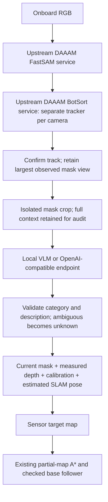

# DAAAM components with local/API VLM grounding

## Current object scope

`DaaamGrounder` defaults to `categories=('cup', 'bowl')`. Furniture proposals
are filtered before tracking/VLM queries in the default hybrid path. The VLM
still has `other`/`unknown` (and table) response categories so an incorrect
proposal can be rejected rather than forced into a vessel category.
Receptacle detection requires an explicit category opt-in and is kept separate
from Hydra object mapping. Collision geometry remains SLAM's responsibility.

## What is reused, and what is not

The integration directly imports upstream `SegmentationService` (FastSAM-s) and
`TrackingService` (BotSort), without copying or changing their implementation.
DAAAM revision: `159f8daf1cf508b316c813890bdc164626842ff4`.
Its boxmot fork revision: `1dfa11e6a33c8172d07b3877a5f27a82ff8fb4cf`.
The tracker uses `with_reid=False` for the first smoke test; the upstream default
CLIP ReID engine is not installed. This is a configuration difference, not a
claim to reproduce paper results.

Our integration owns the synchronous scheduler, largest-mask view selection,
VLM transport, strict response validation, and projection into our SLAM map.
It does **not** run DAAAM's assignment optimizer, DAM grounding worker, full
PipelineOrchestrator. Those remain future work. Native Hydra mapping is now
available separately through [the sensor-only mapping integration](native_hydra_mapping.md),
including a live-process interface; the navigation demo still uses its existing
observed map, not Hydra-based goal selection.
The VLM is replaceable; this is component integration, not complete DAAAM parity.



## Public interface

`DaaamGrounder(vlm, checkpoint, output).detect_camera(camera, timestamp)` returns
`Detection` instances including a boolean pixel mask. Camera data contains RGB,
metric depth, calibration and robot self-mask; no object identities are passed.
Depth localization now uses only pixels inside this mask, instead of a bounding
box's background. Mask filtering rejects mostly-robot regions. A label remains
attached to the camera-local tracked instance, then spatial association combines
observations in the estimated map.

`LocalVLM(model, device).label(images)` and
`EndpointVLM(base_url, model, key_env='VLM_API_KEY').label(images)` return model
text. The default local model is `Qwen/Qwen2.5-VL-7B-Instruct` in bfloat16.
It is not an accuracy-qualified semantic backend. The initial SmolVLM2-500M
smoke test returned non-JSON labels for all 12 queries; every response was
rejected as unknown, rather than accepted through a permissive parser.
The endpoint client reads credentials only from environment variables.

The audit saves full context with a red mask overlay and an isolated crop.
The current VLM request sends only the isolated crop on a gray background: the
small local models ignored the target mask when full-scene context was included. It receives neither target coordinates nor simulator labels. Its response
must be JSON with category (`cup`, `bowl`, `dining table`, `other`, `unknown`) and
short description. Cups include drinking glasses. Counters must be `other`.
Malformed output stays unknown; no heuristic label is silently substituted.

Each track needs two observations before a query. At most two tracks per camera
frame are queried. Confirmed labels are cached; unknown labels may retry after
10 simulated seconds. Tracking failure/identity switches remain a limitation.
VLM inference pauses the synchronous simulation; no real-time guarantee is made.

## Setup and smoke test

Run from `/nobackup/le/cross-episode-sensors`:

```bash
bash scripts/setup_daaam_perception.sh
MUJOCO_GL=egl CUDA_VISIBLE_DEVICES=5 OPENBLAS_NUM_THREADS=1 OMP_NUM_THREADS=4 \
PYTHONPATH=external/DAAAM/src:.:/nobackup/le/cross-episode-robotics-sim/external/molmospaces \
.venv-slam/bin/python scripts/smoke_daaam_grounding.py \
  --source /path/to/two_room/set_table_episode \
  --output runs/daaam_smoke_unique_name
```

This captures real simulator camera frames with the robot stationary, imports
upstream segmentation/tracking, and calls the local VLM. It saves selected views,
raw responses, parsed labels and a report. It does not demonstrate navigation.

The navigation demo now defaults to `--perception daaam`:

```bash
CUDA_VISIBLE_DEVICES=5 bash scripts/test_semantic_navigation.sh \
  /path/to/two_room/set_table_episode --target 'dining table'
# Optional endpoint:
# ... --vlm-url http://localhost:8000/v1 --vlm-model YOUR_MODEL
```

The old detector is available only through explicit `--perception grounding-dino`.
These navigation commands alone do not enable native Hydra. See the linked
mapping documentation for its explicit live and recorded-stream entrypoints.

## Validation record

- The first real-camera test imported upstream services and made 12 local
  SmolVLM2-500M queries. All responses violated the JSON contract; none were used.
- Qwen2.5-VL-3B produced valid responses but confused background regions with
  vessels. Isolating the mask reduced many responses to unknown, but visual
  review still rejected its two positive cup labels (floor and counter regions).
  Valid JSON is explicitly not counted as correct semantic grounding.
- A measured 3D extent check now rejects mask-based cup/bowl hypotheses wider
  than 0.75 m. This is a broad physical prior, not an environment-ID filter;
  it cannot replace correct semantic recognition.
- Nine focused tests cover schema rejection, mask visualization, background-free
  depth projection, oversized false vessels, A* unknown-space exclusion, and
  stale/lost sensor handling.
- Qwen2.5-VL-7B is being tested separately. No cross-room DAAAM navigation pass
  or full set-table success has been established by these stationary tests.

### Completed local 7B smoke test

`runs/daaam_local_vlm_smoke_v8/report.json` records 36 real local VLM queries,
zero JSON parse errors, and projection of mask-derived hypotheses into the
estimated RGB-D SLAM frame across 10 stationary observations per camera.
This verifies the component wiring, not semantic accuracy. The resulting map
contains bowl/cup hypotheses but also implausible floor-level cup hypotheses and
duplicates. Therefore the local semantic backend is **not accuracy-qualified**
and this result is **not** a cross-room navigation success. Raw responses and
both context/mask crops are preserved in `queries/` for inspection. Do not use
JSON-valid response counts as an object-recognition success metric.

## Hybrid recovery (default)

The detector supplies RGB category proposals, DAAAM supplies instance masks and
BotSort tracks, and the local/API VLM independently labels an isolated mask.
Only a tight box/mask association (IoU at least 0.35) is retained. Conflicting
proposal categories on the same mask are discarded. A target is emitted only
when the proposal and VLM categories agree; neither model overrides disagreement.
This is our hybrid integration, not the upstream DAAAM default. The existing
The standalone Grounding DINO path retains its RGB table-versus-counter verifier.
The hybrid path uses masked VLM verification instead: the extra CLIP gate
incorrectly rejected close table views dominated by the robot arm. Table
recognition is now an explicit opt-in, outside the default object scope.

The depth validator now checks the **entire** mask before depth clustering. Its
previous order could turn a huge counter into a small depth slice and incorrectly
pass the vessel-size test. Planar floor patches are also rejected as vessels.
Spatial target association additionally requires the previous 3D observation to
project into the current mask. Repeated detections no longer create extra targets
simply because a target was already matched in that frame; separate adjacent
masks remain distinct. These checks use camera calibration, depth, and estimated
SLAM poses only.

`DaaamGrounder(..., hybrid=False)` retains the segmentation-only ablation.

### Hybrid smoke result

`runs/daaam_hybrid_smoke_v1/report.json`: four VLM queries, with two bowl tracks
and one drinking-glass/cup track accepted in the SLAM frame, each observed nine
times. Visual inspection of the selected masks agrees with those categories.
No floor/counter targets or duplicate hypotheses appeared in this stationary
sample. One additional cup label disagreed with its proposal and was not emitted.
This is a single-scene perception result, not general accuracy or navigation
qualification. Compare against the 36-query segmentation-only tests above.
Physical navigation trials: `daaam_hybrid_cup_nav_v1` and
`daaam_hybrid_table_nav_v1` (failed fresh-target confirmation).
