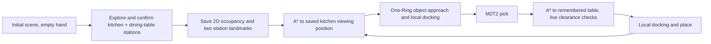
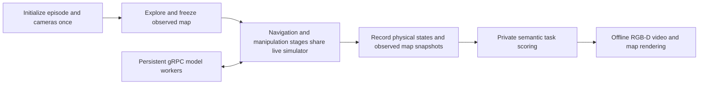
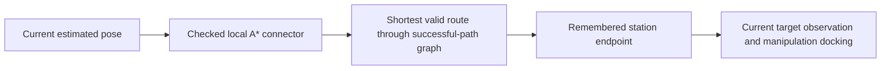

# Exploration-first set-table execution

The sensor pipeline now explores before manipulating. This is a procedural
change, not a claim of a successfully completed full-task rollout.



## Implementation

`SensorSetTablePipeline.explore()` uses onboard RGB-D, CUDA SLAM, frontier
exploration and cached station recognition (Molmo2 + FastSAM). Dense 3D fusion,
room classification and duplicate vessel detection are disabled during this stage.
It stops at the observed table
stand-off; it does not require exhaustive room coverage. The physically executed
exploration route supplies floor and obstacle evidence. The two station landmarks
and table observations are saved in `semantic_memory.json`.

Pickup navigation continues from the exploration checkpoint, without teleporting
or resetting the episode. Transit resolves `--receptacle kitchen` to an observed
viewpoint; local object navigation has no room-classification goal and runs with
`--fixed-map`.
Maps and semantic memory are re-anchored using the previous stage's estimated
SLAM pose, not simulator world pose. First navigating to the table and then back
to the kitchen observes the connection in both directions before the first pick.
No known route is fabricated from simulator room graphs.

Every grasp is gated on both confirmed station landmarks/viewpoints, confirmed-table memory and required continuation
artifacts. The carry stage uses `--known-map-only`: it reuses table memory,
disables frontier exploration and redundant room labeling, and reports
`known_route_unavailable` if observed geometry cannot support a route. Empty-hand
coverage does not guarantee the same route is safe with a carried object. Live
payload, arm and base clearance checks remain mandatory. Table perception stays
active for local refinement and final confirmation.

`stages.json` now contains per-stage `wall_seconds` and `started_unix`. Final
`report.json` includes total elapsed wall time, including exploration. Existing
runs without these fields are legacy artifacts. Exploration failure prevents
all picks; no failed stage is marked successful for continuing.

## Run

From the sensor worktree, with existing perception/model dependencies:

```bash
CUDA_VISIBLE_DEVICES=4,5 MUJOCO_GL=egl \
HF_HOME=/nobackup2/le/.cache OMP_NUM_THREADS=4 OPENBLAS_NUM_THREADS=1 \
PYTHONPATH="$PWD/external/DAAAM/src:$PWD:/nobackup/le/cross-episode-robotics-sim/external/molmospaces" \
.venv-sift/bin/python scripts/run_sensor_set_table.py \
  --source /path/to/set_table_episode --output /path/to/new_run
```

The current runner requires open doors. It uses the semantic category supplied
by the task planner; execution receives no hidden room polygons or object poses.

## Remaining limitations

The stage-based harness still restarts the SLAM tracker at transitions and
restores the observed occupancy and semantic map into its new estimated frame.
This is not yet a single persistent in-process tracker. Dense SLAM fusion and
fine occupancy ray updates remain; global 2D/local 3D separation is not yet
implemented. Held-object reconstruction is still repeated during carry. This
rewrite addresses unnecessary carrying exploration, not all profiled compute
bottlenecks. A blocked carried-object route currently stops with a diagnostic;
a put-down-and-empty-hand-remap recovery is not implemented.

Validation: 33 focused control-flow, mapper-default and navigation tests passed.
Physical candidate run: `runs/set_table_pipeline_development/full_attempt_23_explore_first`.
Do not label it successful until its final semantic score passes.

## Exploration-only qualification

Before full execution, use `scripts/run_sensor_set_table.py --exploration-only`
with the same source/output flags. It stops after confirmed destination memory
is saved and cannot launch any pickup stages. Its `success` means exploration
only; `full_task_success` remains false. It rejects continuation flags so the
qualification starts from the original physical scene.

The already-running attempt 23 was isolated by stopping its orchestrator while
leaving its exploration child running; see `exploration_only.json`. No transfers
are authorized by that run. Qualification must inspect the exploration report,
private room-visit diagnostics, saved floor/obstacle evidence and the video.
A later fixed-map navigation replay is still required: existing code restores
and updates occupancy, so it does NOT yet certify build-once mapping. A* can
reuse a prebuilt map, but localization and local dynamic-obstacle safety remain
live. The plotted image is diagnostic, not the planner's map data.

## Fixed-map transit implementation (subsequent update)

`--known-map-only` carry now uses `FixedMapNavigator`, a read-only observed
occupancy map, and `RGBDMapper(fuse_dense=False)` for localization. The dense TSDF
model is not allocated. It makes no VLM/detection calls during transit and has no
scan/confirmation dwell at the remembered destination. Arrival means reaching
its remembered stand-off; the following local table observation still validates
placement. `fixed_map_unchanged` compares geometry hashes before/after transit.

A current depth endpoint cloud is used only for immediate swept collision checks;
it is never fused into the saved map. Robot/gripper state checks remain active.
The held shape is refined once at the carry boundary and cached during fixed-map
travel; failed initial refinement stops execution. This assumes a rigid retained
attachment; general slip recovery is not implemented. Pose estimation still runs
on every supplied navigation observation. No sensor truth or simulator room map
is used to supply coordinates.

Map re-anchoring at stage boundaries and the explicit one-time invalidation of
the just-picked component still occur before freezing. This is not a persistent
single global-coordinate process. No depth-based rebuilding is done during
fixed-map transit. Return-to-kitchen travel is now a separate fixed-map transit stage. Local
object search, manipulation and local docking still use fresh observations and
local geometry, so those stages are not fixed-map-only. Existing exploratory/manual modes are retained for diagnostics.

`test_fixed_map_transit.py` independently checks empty-handed A* travel on the
exploration map, with no VLM, no scans and no dense reconstruction. A room label
is an observed region, not an exact parking target: a valid waypoint may be
selected within one metre of its observed position, without relaxing collision
margins or inventing free space. Its arrival is a room waypoint, not a fresh
semantic room classification. Closed/changed routes stop; they do not trigger
silent reconstruction.

Exploration 23 passed independently: two rooms visited, table confirmed, zero
external contacts, 52.02 simulated seconds / 507.24 wall seconds. The first
fixed-map return test failed immediately because the exact kitchen-label pose
was too close to the counter for A*'s existing clearance margin. The second test
uses observed-room stand-off goal selection. Full manipulation stays disabled.


## No scheduled dwell during known-route travel

Both directions now have explicit transit stages: `test_fixed_map_transit.py`
for empty-handed return toward the kitchen, `--known-map-only` for carrying to
the remembered table. A* operates on cached fixed 2D clearance layers. Fresh
sensor endpoints remain separate for immediate collision stopping. The collision
checker caches the static map and inherited support history; only local points
and the current robot pose are refreshed.

Known-route arrival does not trigger a scan or VLM confirmation wait. The robot
still turns to face a route segment and must settle its actual motion at arrival;
these are motion, not artificial dwell timers. Carry reports `transit_success`
separately from `docking_success`/`fresh_target_verified`, and the next local
observation stage must succeed before placement. Original full-task semantic
success conditions are unchanged.

Validation: fixed-map return 02 reached the kitchen waypoint in 28.52 simulated
seconds / 145.36 wall seconds, with identical map hashes and zero contacts.
This proves one empty-handed route, not every carried-object route. Run 03 tests
cached support/costmap work and preserves a final physical checkpoint for future
continuation. Full task execution remains disabled pending these component tests.

Final cached fixed-map return test passed: 28.54 simulated seconds / 139.45 wall seconds, 3 A* plans, zero scans, no contacts, identical map hashes. Private post-run room audit: ['kitchen']; not supplied to execution. 43 focused tests passed. Video: `runs/set_table_pipeline_development/fixed_map_return_03_cached/rollout.mp4`.

## Shared local coverage gate (November 3)

`navigation/coverage.py` classifies explicit unknown swept-space/support failures
separately from observed collisions, tracking loss and unreachable grasps.
One-Ring and shaped docking return a zero-motion `exploration_required` command
with `resume_skill` and the sensor-derived failure detail. Hybrid navigation
propagates that request instead of retrying One-Ring or silently exploring.

`demo_semantic_navigation.py --fixed-map --continuation PATH` freezes the restored
map, disables dense fusion and occupancy updates, and retains localization and
live depth collision checks. Local target perception remains enabled. Its report
records the exploration request and whether the map hash remained unchanged.
Frozen-map room-search recovery hands control back for explicit exploration.

Qualification status: regression/unit tests pass; this new local mode has not yet
passed a fresh physical One-Ring/docking rollout. It is therefore opt-in while
being qualified. The separate held-object approach and placement-docking scripts
still need the same frozen-map integration before claiming the entire pipeline
has no implicit mapping. Automatic exploration-and-resume orchestration also
remains outstanding; a coverage request is not task success.

### Physical local-navigation test — November 4

Run: `runs/set_table_pipeline_development/frozen_local_01`, starting at the
saved kitchen return checkpoint, bowl target, native One-Ring plus DAAAM/Hydra.

- 17.26 simulated seconds / 187.39 wall seconds.
- Frozen map hash unchanged; no external contact events.
- Six One-Ring turn predictions; no confirmed bowl or docking attempt.
- Terminal `exploration_required`, reason `search_requires_exploration`.
  This was the stalled-search recovery handoff, **not evidence of an actual
  unknown-floor collision boundary**. The robot stopped instead of silently
  invoking the frontier recovery.
- Video: [onboard views and frozen map](../runs/set_table_pipeline_development/frozen_local_01/navigation_with_map.mp4).
- Regression suite: 55 passed.

This validates the physical stop/handoff path only. Local target search failed;
physical docking, unknown-floor-triggered handoff, and automatic exploration/resume
remain unqualified. The video panel's legacy “Online RGB-D map” title denotes the
map display; this run did not update its geometry.

### Return-route failure and measured repair — November 4

Fresh attempt 26 placed the first bowl, then failed `2_transit_kitchen`.
Offline inspection of the saved sensor map found the initial close-dock cell
outside the conservative room-transit free mask; nearest transit-free center was
0.177 m away. This was a missing departure transition, not evidence that the
kitchen disappeared from the map.

`test_fixed_map_transit.py` now uses `ObservedUndock` with the robot's shaped
swept-volume checker and current depth before handing over to room A*. Collision
margins, observed-floor requirements and scoring remain unchanged.

Physical regression: `runs/set_table_pipeline_development/return_departure_fix_01`
passed: 39.02 simulated seconds, 240.69 wall seconds, four A* plans, zero scans,
zero contact events, identical initial/final map hashes. This is component
qualification only; a fresh full run must still pass.

One-Ring repeated-work fix: cache the shape checker and guard layers per sensor
frame, invalidating shape geometry for changed measured arm/base pose. Every
command still gets its full swept braking check. A test verifies reuse within a
frame and invalidation at the next observation. The first profiled physical run
is `local_cache_profile`; no measured speedup claimed before completion.

### Frozen placement docking — November 4

Placement docking now requires a saved observed map, freezes it before route
planning, uses localization-only SLAM, and reuses the payload collision checker.
Fresh depth endpoints update only transient collision checks, not map evidence.
Legacy `--observed-map` frame conversion is rejected in favor of an explicit
`--continuation-map` (defaults to the physical start checkpoint). Unknown space
is not made free. No initial fixed idle hold is inserted.

Physical test `frozen_place_dock_01`: success, held bowl retained, unchanged map
hash, dense fusion disabled, 129.92 wall seconds versus 272.4 seconds in the prior
full-run docking stage (different process-startup accounting; approximately half
the time). One A* plan. This qualifies placement docking, not the full pipeline.
Other local execution paths still require auditing before claiming all execution
uses frozen maps.

## November 4 integration update

The standard `scripts/run_sensor_set_table.py` runner enables the tested
`--station-exploration` path automatically. The execution chain is:

1. Explore from the initial physical scene; save kitchen and dining-table landmarks.
2. Validate both landmarks and all continuation artifacts before manipulation.
3. A* to a kitchen viewing position using frozen occupancy.
4. One-Ring/local object perception and docking with `--fixed-map`.
5. M2T2 pick, known-map carry, local table observation, frozen-map docking and place.

Dense reconstruction remains disabled for navigation. Local RGB-D perception and
live collision checks remain enabled. An explicit floor-coverage scan may create
a new map snapshot during the existing recovery path; it is a separate exploration
stage, never silent fusion during travel. Other unknown-coverage requests stop
with `Explicit exploration required` rather than blindly retrying unchanged maps.
Automatic recovery for every possible missing-coverage case remains incomplete.

Nineteen focused integration/navigation tests pass. The new full manipulation
chain has not yet been physically qualified. See [station exploration results](semantic_furniture_navigation.md).

Physical handoff test `station_pipeline_handoff_01` passed from the successful
`station_exploration_02` endpoint: kitchen destination resolved from semantic
memory, 30.12 simulated seconds / 147.22 wall seconds, zero contacts and zero
scans. Five A* plans were used; the initial and final occupancy-map hashes match.
This validates exploration-to-transit continuation, not the entire manipulation
chain. The longer cross-room call retains clearance checks/replanning rather
than forcing the typical 5–15-second atomic target.

### Carry collision and map-handoff corrections (November 4)

`full_attempt_28_stations` failed at first carry. Its observed bowl bounding box
included empty corners overlapping mapped points. The payload checker now uses
the convex hull of observed payload points after the box broad phase, retaining
the existing observation and voxel-clearance margins. Degenerate observations
retain the conservative box fallback. The physical `carry_payload_hull_01` retry
cleared that rejection and undocked, but stopped with `known_route_unavailable`.
It did not complete the carry.

The subsequent investigation found repeated obstacle inflation at coordinate
handoffs: occupied area increased from 6.95 to 9.42 to 12.20 square meters across
stages with no new observations. `navigation/occupied_sources.py` now saves the
original observed voxel vertices in `occupied_sources.npz`. Handoffs transform
these volumes and rasterize them once instead of treating the preceding raster
as newly measured geometry. Newly measured occupied cells are retained; fully
cleared sources are removed, while partially cleared sources remain conservative.
Unknown space is not filled. Legacy maps without provenance retain their saved
extents; this cannot undo corruption already present in old checkpoints.

53 focused map, payload and navigation tests pass, including repeated translation
and rotation handoffs, preservation of real collision rejection, and cleared/new
obstacle handling. A fresh run `full_attempt_30_map_sources` starts from the
original scene to validate these corrections. Full physical success is pending;
these tests do not establish general robustness. This remains the height-aware
collision checker, not a strict 2D-only collision experiment.

### Semantic placement scoring update (November 4)

User-approved: remove the per-sample angular/linear velocity veto from the
placement component score. After visual settling, the same initially held
vessel must remain supported by a dining table and free of gripper contact
throughout the one-second scoring window. Velocity remains diagnostic. Falling,
remaining held, or supporting a different object still fails. Execution collision
checks and the full-task semantic scorer are unchanged.

In `full_attempt_30_map_sources`, the first bowl was supported and released in
50/50 samples; one angular-speed sample was 0.1031 rather than below 0.1 rad/s.
The updated semantic rescore passes. `place/semantic_rescore.json` records this
separately; the original failed report is preserved. This is a component rescore,
not completion of the full task. Eight release/support tests pass.

### Lightweight execution checks (user decision, November 4)

Frozen-map transit, carry and placement redocking now use
`control/execution_monitor.py::PlannedMotionMonitor` at the base actuator boundary.
It checks finite commands, accepted/fresh localization (250 ms), and sustained
blocked translation/rotation (three simulated seconds without measurable progress).
It does not reconstruct or repeatedly collision-check the static map. Command
limits, native physics and physical collisions remain enabled.

A* still checks observed free space; loaded undocking and placement docking still
perform swept geometry checks when planning. Carry retains the initial observed
payload/clearance check. This does not turn 2D A* into a whole-body collision
guarantee: map error, tracking error and unmapped obstacles can still cause a
physical collision. No claim of new-obstacle detection is made for this mode.
One-Ring/reactive local navigation and exploration retain their guards because
their commands do not already have a collision-validated path.

Placement keeps cuRobo planning and held-object clearance validation. The exact
reverse of the validated lowering trajectory no longer repeats identical arm
collision queries. Grasp/release verification and visual settling remain enabled;
semantic scoring stays separate from geometry planning. The 50-sample support
window remains; its velocity samples are diagnostic only.

17 focused tests passed. Physical component reruns are
`light_checks_transit_01`, `light_checks_carry_01`, and `light_checks_dock_01`;
all three passed from saved physical checkpoints:

| Component | Simulated seconds | Wall seconds | Outcome |
|---|---:|---:|---|
| Frozen-map transit | 26.82 | 120.70 | Destination reached, map unchanged |
| Loaded carry | 36.52 | 226.67 | Destination reached, map unchanged, no monitor rejection |
| Placement docking | 9.52 | 47.97 | Dock reached, held object retained, map unchanged |

These are component validations, not a fresh full-task success or a controlled
speed benchmark. Transit/carry exceed the typical 5–15-second target because
existing route speeds and departure motion were retained; this change removes
checks rather than retiming physical trajectories. Full batch qualification remains
pending. Reactive navigation guards and the existing visual-settling checks are
still present, so this is not an implementation with all checks removed.

### Reuse confirmed targets during local docking

Frozen-map `HybridNavigator` now suspends detector/VLM/pointing inference after
handoff to a confirmed docking target. Its timestamp is not refreshed artificially.
Search/recovery resumes inference; the subsequent pick stage observes again.
The docking planner still validates candidates, route sweeps and smoothing against
observed geometry. Following that checked route uses `PlannedMotionMonitor` instead
of repeated braking-envelope collision queries at every control step. Live geometry
is captured before planning, not rebuilt while following an unchanged route.
Non-frozen/reactive navigation retains its original checks.

65 focused navigation/docking/monitor tests pass. `cheap_bowl_docking_01` is the
physical comparison from the same kitchen-transit checkpoint used by
`full_attempt_31_light_checks`; compare detection counts, wall time, physical
outcome and final distance before claiming an improvement.

The comparison completed with `docking_success=true`:

| Metric | Previous bowl approach | Target-reuse approach |
|---|---:|---:|
| Reported runtime (excludes earlier model startup) | 314.36 s | 130.89 s |
| Detector calls | 52 | 10 |
| Detection wall time | 52.04 s | 7.94 s |
| Simulated duration | 28.12 s | 25.82 s |
| Estimated final target distance | 0.613 m | 0.667 m |

Runtime decreased about 58% in this one comparison. The target is fixed during
docking, so its final estimate differs from the continuously updated baseline.
Fresh manipulation observation is still required: the terminal status is
`docked_fresh_confirmation_required`, not a successful grasp. This is not a
full-pipeline or multi-scene robustness result. Remaining sensing, tracking,
model startup, geometric planning and rendering overhead is not eliminated.

The high-level oracle is the scripted category sequence in
`SensorSetTablePipeline.run`, not cuRobo or A*. Creating it requires no model
inference. Model loading, scene restoration, perception, geometric planning,
physics and rendering are execution costs, not oracle task-plan creation.

## Persistent execution and deferred video — November 4, 2026

The runtime refactor is being qualified on `feature/onboard-sensor-interface`.
It is not yet a successful full-task or test-set result.



- `runtime/episode.py`: one live MuJoCo model/data and onboard renderer, borrowed
  by stage functions. Checkpoints remain restart artifacts; a stale checkpoint
  cannot silently rewind the live episode.
- `perception/rpc.py`, `scripts/serve_sensor_model.py`: local gRPC workers for
  Qwen, Molmo2, FastSAM, One-Ring and M2T2. Workers retain loaded models.
  Requests contain images/observed points, not hidden simulator scene state.
  NumPy arrays use MessagePack, not executable pickle serialization.
- `recording/deferred.py`: record actual integration states at 10 video frames
  per simulated second; no image encoding on the control path. Offline rendering
  restores these states in an isolated simulator without stepping physics or
  replaying commands. Raw state files are private diagnostic artifacts, not
  policy inputs or a replacement for the 50 Hz training action export.
- Navigation still captures observations for estimation/control. Manipulation
  retains necessary planning/release observations. Removing diagnostic rendering
  does not remove the camera images required by the policies.
- `runtime_metrics.json`: restore/renderer counts, stage duration and in-process
  RPC calls/time. Separate M2T2 client subprocess calls are not included in these
  RPC totals. `offline_render_report.json` reports rendering separately from the
  physical task score, including failures. Rendering failure never changes score.

### Usage

From the sensors worktree, install `grpcio==1.85.1` and `msgpack>=1,<2` in both
`.venv-sift` and `.venv-m2t2`. Keep the service supervisor running:

```bash
.venv-sift/bin/python scripts/launch_sensor_services.py \
  --gpus 0,1,2,4,3 --output runs/my_sensor_services
```

These five assignments are for Qwen, Molmo2, FastSAM, M2T2, One-Ring;
repeated GPU indices are supported. Each log must report `READY`. The episode
runner also checks endpoint readiness before loading the scene.

```bash
export SENSOR_MODEL_ENDPOINTS="$(cat runs/my_sensor_services/endpoints.json)"
CUDA_VISIBLE_DEVICES=6,7 MUJOCO_GL=egl \
  .venv-sift/bin/python scripts/run_sensor_set_table.py \
  --source /path/to/set_table_episode --output runs/new_episode \
  --persistent-runtime --pointing-device cuda:1
```

Use the normal sensor environment/PYTHONPATH setup. Output directories must be
new. The runner renders saved stages after success or failure; add
`--skip-video-render` to move that work to another process. Standalone rendering:

```bash
.venv-sift/bin/python scripts/render_deferred_rollout.py \
  --recording runs/new_episode/STAGE/state_recording \
  --output runs/new_episode/STAGE/rollout.mp4 \
  --diagnostic-output runs/new_episode/STAGE/diagnostic.mp4
```

### Measured qualification so far

| Test | Result |
|---|---|
| Two sequential table-observation stages through gRPC | Passed; 14.18 s then 5.08 s; one checkpoint restore and one camera initialization |
| Bowl 2 placement from the previously failed checkpoint | Semantic support passed; 7.78 simulated seconds; 227.80 s internal wall time |
| Offline rendering of its 78 recorded frames | 6.11 s in the initial rendering test |
| Six worker readiness checks | All ready; M2T2, Qwen and DINO also exercised by actual requests |

The bowl-2 fix bounds inconclusive visual-settling checks to two simulated
seconds and reports a warning; physical release and semantic support determine
success. It does not change collision geometry or support requirements.

Remaining qualification: a continuous physical multi-stage run and full task.
SLAM instances and motion planners are still stage-local; simulator/cameras and
learned model weights are persistent. RPC still copies image/point bytes (no
shared-memory transport). One-Ring is stateful and this launcher supports only
one active episode per worker set; do not share it across concurrent episodes.
Custom checkpoint/config negotiation is not implemented. Candidate scheduling
now tries distinct placement contacts/orientations before millimeter-offset
variants; all previous clearances remain, and physical qualification is pending.

Service sampling qualification found and fixed a real mismatch: resetting M2T2
straight to seed zero skipped random draws consumed during standalone model
initialization. The worker now restores the post-load RNG state for the first
sample. On the saved bowl-2 input, all **100,532** candidates match exactly
between standalone and RPC execution (`services_01/parity_report.json`). FastSAM,
Molmo2 and One-Ring also passed actual inference requests, not just health checks.
The first continuous physical trial was interrupted before arm motion after this
mismatch was identified; it must not be counted as a physical failure or success.

### Continuous physical qualification

`persistent_motion_02` completed both place and empty-arm return successfully:

| Stage | Wall time including stage startup | Simulated duration |
|---|---:|---:|
| Place | 132.95 s | 8.78 s |
| Return | 15.08 s | 2.98 s |

Both stages used **one checkpoint restore and one camera initialization**.
Placement made three DINO calls (0.52 s total) and two Qwen calls (2.28 s total).
The M2T2 subprocess timing is separate. Placement rejected 16 candidates before
succeeding; motion planning still dominates, so this is not a claim that all
execution costs have been eliminated. The validated candidate schedule starts
with 1.5 cm clearance across distinct contacts, then 3 cm and the other retained
clearances. The earlier comparable standalone test rejected 33 candidates.

Offline four-panel videos took 7.00 s and 3.92 s to render. Map diagnostics and
M2T2's saved point-cloud visualization are also rendered after execution.

- [Successful place and return video](../../cross-episode-robotics-sim/runs/navigation_previews/persistent_place_return_02.mp4)
- [Placement with observed reconstruction](../../cross-episode-robotics-sim/runs/navigation_previews/persistent_place_reconstruction_02.mp4)

Reproduce with `scripts/test_persistent_episode.py --place-dock PATH --output NEW_PATH`.
The full initial-state rerun is `full_attempt_32_persistent`; its outcome is
pending. Component success is not full-task success.

The initial-state persistent rerun passed exploration in **258.61 s** (33.50
simulated seconds), confirmed both semantic stations, and advanced to frozen-map
kitchen transit. This is still a partial run; no full-task success is claimed.
The focused regression suite has **60 passing tests**.

## Worker cleanup and shared SIFT — November 4, 2026

At the user's request, stopped attempt 32 and all model workers, including the
obsolete M2T2 worker and its replacement. Do not count the interrupted attempt
as a completed evaluation. No automatic restart was requested.

`KeyframeTracker` now obtains CUDA SIFT via `get_cuda_sift()`: one extractor per
process, selected GPU and feature configuration. Five stage trackers with the
same settings share the extractor, but never share keyframes, estimated poses,
calibration or maps. Extraction is serialized with a lock. `CROSS_SIM_SIFT_GPU`
selects one GPU index **within CUDA_VISIBLE_DEVICES** (default `0`); multi-GPU
strings and negative indices are rejected. `runtime_metrics.json` includes the
extractor count/configurations. Tracker initialization can still occur at stage
boundaries; it no longer reloads the GPU feature extractor.

The configured pipeline now uses five learned model instances when launched:

| Worker | Checkpoint | Purpose | Intended instances |
|---|---|---|---:|
| Qwen | Qwen/Qwen3-VL-8B-Instruct | Visual semantic verification | 1 |
| Molmo2 | allenai/Molmo2-4B | Target pointing | 1 |
| FastSAM | FastSAM-s.pt | Segmentation | 1 |
| One-Ring | AinazEftekhar/OneRING, step 40356421 | Local navigation policy | 1 |
| M2T2 | wentao-yuan/m2t2, m2t2.pth | Grasp and placement proposals | 1 |

CUDA SIFT is a feature-extraction algorithm, not a sixth neural model.
RGB-D SLAM, BoT-SORT with ReID disabled, Hydra mapping, A* and cuRobo are not
additional loaded neural checkpoints. The legacy optional CLIP table verifier is not used in this pipeline. Pi0.5, DA3 and VGGT are not
loaded in this M2T2 baseline. A Python executable named `.venv-sift/bin/python`
does not identify which model the process hosts.


### DINO removed — current implementation

Removed Grounding DINO's implementation, imports, navigation CLI option and
checkpoint argument, gRPC worker, and required endpoint. The new
`PointMaskDetector` preserves the common detection-result interface, but obtains
its labels and points from Molmo2 and its masks from FastSAM. A point without a
mask produces no detection; conflicting labels for one mask are rejected.
DAAAM's tracked proposals reuse the masks already computed for that frame.
Qwen confirmation, RGB-D geometry and physical scoring are retained.

Table observation for M2T2 placement and the standalone table approach also use
this interface, including the actual instance mask for Qwen's crop. There is no
DINO fallback. `--perception point-mask` replaces the old `grounding-dino` option;
`daaam` remains the tracked/verified default. Start a new five-worker endpoint
file; old six-worker files belong to previous experiments.

Historical timing and successful physics results above used the earlier DINO
pipeline. They do **not** qualify the replacement: its focused tests and saved
image checks must be distinguished from a future full physical rollout.

Replacement validation: **58 focused tests passed**, including semantic tracking,
mask selection, map/furniture handling and M2T2 interfaces. A real-model saved
onboard RGB check (`point_mask_replacement_01/report.json`) found two bowls and
the dining table, using Molmo2 + FastSAM only. It took 3.21 s after a 12.17 s
local model load. This is not a speed comparison or a full navigation/physics
qualification. Test workers exited; no full evaluation was restarted.

## Persistent tracking and timestamped logs — November 4

With `--persistent-runtime`, stage handoffs now retain one tracker and its
keyframes, simulator and camera renderer. Intermediate checkpoint and navigation
map handoffs stay in RAM. Final diagnostic recordings/reports remain supported.
Stage-local coordinate views do not restart the underlying tracker. Planner
reuse requires matching robot geometry and sufficient collision buffer capacity.

The place → return component passed physically with one tracker, one SIFT
extractor and one camera initialization. This is not full-pipeline qualification.
A separate two-leg navigation test passed the kitchen leg but failed its dining
viewpoint route (`room_route_unobserved`); that limitation remains under review.

The full runner and persistent stage logs prefix output lines with ISO timestamps
in America/New_York (including UTC offset). Stage completion includes elapsed
wall seconds. `full_attempt_34_memory` starts from the original scene to validate
the complete pipeline; do not infer success from its launch.

## Successful cross-room route reuse — November 4

The persistent episode stores successful measured transit paths in RAM in the
continuous SLAM frame (`navigation/route_memory.py`). Kitchen↔dining routes can
be followed in either direction; waypoint reversal does not command backward
cross-room driving. Failed attempts are not added. Route coordinates are
transformed into a stage view without altering the stored global samples.

Fixed-map transit tries a checked connector to a nearby saved route, validates
its remaining segments against current clearance, and follows it before trying
a fresh A* search. Carry navigation uses the same route memory. A route that
fails clearance is not blindly replayed. Departure candidates are restricted
to destination-connected free space; normal goal selection excludes disconnected
cells before its candidate limit. These changes preserve observation-only input,
physical collision checks, and the frozen map.

Regression tests cover reverse/frame transforms, blocked cached routes, and
exclusion of disconnected departure pockets. Physical out-and-back qualification
is recorded in `memory_navigation_02_routes`; implementation is not by itself
proof of full-task success.

The first cache-only physical test (`memory_navigation_02_routes`) still failed
on its second leg. Persistent tracking alone had retained legacy per-stage map
re-rasterization. Persistent stages now retain one global frame and copy the
frozen grid exactly; standalone legacy file continuations still re-anchor once.
`test_live_map_handoff_is_exact_even_after_robot_turns` checks occupancy, floor,
and semantic landmarks. Previously occupied base footprints are retained as
support without overriding observed obstacles.

Repeatable physical qualification:

```bash
CUDA_VISIBLE_DEVICES=6 MUJOCO_GL=egl .venv-sift/bin/python \
  scripts/test_round_trip_navigation.py --source /path/to/exploration \
  --output runs/new_round_trip
```

Its qualification requires both successful physical legs **and** an explicit
reverse-route-reuse event. Merely finding a different route does not pass this
route-cache test.

## Graph of successful transit routes

`RouteMemory.plan` now performs shortest-path search over the accumulated
successful paths, instead of selecting one whole recorded trajectory. Nodes are
estimated traveled positions; consecutive samples form bidirectional edges.
Station records retain the estimated endpoint pose (including heading). Nearby
paths may connect only when a current clearance test accepts the connecting
segment. Every recorded edge is revalidated for the current clearance envelope.



Query cost includes the local connector. If no valid graph route exists, the
existing frozen-map A* search remains available. No simulator coordinates or
reference trajectories enter this graph. It lives in the episode runtime RAM.
Station endpoints are not certified manipulation poses: a different object,
arm posture, or payload still requires local docking and current clearance.

Physical evidence: `memory_navigation_03_global` completed both legs with no
reported contact: 114.46 s wall / 26.82 s simulated to kitchen, then 105.33 s wall /
27.42 s simulated back using the saved reverse route. This qualified individual
route reuse and the persistent-frame correction, not graph combinations or the
full set-table task. `route_graph_round_trip_01` tests the graph integration;
its `qualification.json` is the result authority.

Tests cover composition across routes, shortest-route choice, reverse traversal,
frame transformations, blocked edges/junctions, destination-connected departure,
and exact map preservation across stage boundaries.

Successful local placement-dock approaches are also recorded by `record_dock`:
the endpoint retains its estimated full pose and is tagged `successful_dock`.
It is a navigation candidate, not an automatic authorization to release or
reuse an arm motion. Local observed surfaces are explicitly transformed from
robot coordinates into the persistent map frame before docking; moved-object
map invalidation uses the same transform. These boundaries matter now that
stage origins no longer reset to the robot.

**Scope (user clarification): cross-room navigation only.** The graph routes
between station areas; it does not replace One-Ring's in-room target approach,
local manipulation docking, or arm/gripper control. Recorded docking approaches
may supply checked arrival/departure connections, but the local docking planner
still verifies the current target and posture.

`route_graph_round_trip_01` qualification: **passed**. Both physical transit
legs succeeded and the return explicitly used the successful-route graph in
reverse (`physical_round_trip=true`, `reverse_route_reused=true`). This is an
empty-hand two-room navigation test, not a complete manipulation-task result.

## Carry startup after a successful pick — November 4

Carry reuses the pre-grasp onboard RGB-D surface transformed into the tool frame
by the executed grasp. It no longer requires a new reconstruction of the held
object. `payload_geometry_unresolved` is not a carry-start termination condition.
For frozen-map transport, the redundant stationary payload-clearance readiness
gate is also removed; localization is still required. The observed undocking
planner retains swept collision checks, and route planning and the execution
monitor remain active. Physics and task scoring are unchanged. The carry report
records `payload_source` and `fresh_payload_reconstruction_required=false`.
This addresses full attempt 35's first-cup startup failure; full physical
qualification requires the next end-to-end run.

Successful station exploration now seeds the cross-room route graph before the
first return trip. It records the actual accepted SLAM path from a confirmed
kitchen viewing position to the reached dining-table station. It requires both
station labels to be confirmed and the exploration to succeed. Failed attempts
and private room-truth diagnostics do not supply graph routes. The exploration
report's `route_graph_seed` states whether insertion occurred and why.

### Robot-mask caching and placement ordering (November 4)

The shared onboard sensor caches per-box camera-ray depth intervals using exact
robot-relative transforms and camera calibration. Each capture still compares
fresh metric depth against those intervals, so foreground occluders are not
blindly masked. Any changed relative transform invalidates the entry. No world
poses or simulator segmentation are used. This applies to empty-hand transit
and carry; moving arm geometry may miss the cache, while fixed geometry can hit.

GPU 7 saved-carry validation: 12 sampled states, two cameras, two evaluations
per state/camera; 14,745,600 compared pixels, zero differing mask pixels.
Previous masking took 7.457 s versus 4.325 s cached (42% lower in this test).
Repeated-pose evaluations favor cache hits; this is not a full-transit speedup
measurement. Full physical pipeline qualification remains outstanding.

Placement release clearances now start at 3 cm, then 5 cm, before the previous
lower-height alternatives. Collision planning and physical support scoring
remain enabled. The new ordering has not yet been physically qualified.

Cross-room no-mask experiment: `SENSOR_CROSS_ROOM_ROBOT_MASK=0` disables
robot masking in fixed-map empty-hand transit and carry, while retaining visual
tracking, the frozen map, and the route follower. Default remains enabled for
other runs. Held-object filtering is separate and remains enabled. Reports
record `robot_mask_enabled`. Full attempt 40 tests this mode on GPU 7; successful
navigation and end-to-end timing are not yet established.

### Mask rollback and departure timing correction

Run 39 did not improve transit (98.1 s); run 40 without robot masking stalled
at `depth_braking_arc` and timed out after 278.7 wall seconds. The original
robot mask is restored as default; the no-mask flag is experimental only.
Keep 3 cm / 5 cm placement prioritization (run 39 first placement passed in
37.8 s).

Run 39 second-bowl departure reached roughly 1.19 m of backward translation
but exhausted an 18 s budget. The follower capped translation at 0.08 m/s and
slowed proportionally near its endpoint. Departure now permits 0.20 m/s with
the existing 0.4 m/s² acceleration ramp and swept braking checks, and budgets
for endpoint slowdown and acceleration. Ordinary docking retains its 0.08 m/s
default. Six focused tests pass; saved second-bowl physics qualification is
running in `undock_fixed_second_bowl_01`. This is an earlier saved checkpoint,
not an exact reproduction of run 39's discarded in-memory map state.

Isolated physics result: `undock_fixed_second_bowl_01` reached the dining
navigation destination with robot masking enabled. Departure completed at
8.2 simulated seconds; entire carry completed at 25.7 simulated seconds with
one route plan. This validates the earlier saved second-bowl checkpoint,
not full run 39 or a complete set-table task.

### Sparse self-filter for no-image-mask transit

The no-mask experiment previously fed robot depth into the braking guard.
`RGBDCamera.robot_bounds_base` now exposes calibrated robot-only bounds computed
from allowed joint readings when the full image mask is disabled. The live
obstacle and route-follower depth consumers reject points inside those bounds
only on their stride-4 sampled point clouds. They retain nearby external depth
points; no radius-based blind zone, simulator segmentation, or world poses are
used. Visual tracking still receives unmasked images in this experimental mode.
Held-object filtering remains separate. This removes full-image mask generation,
not the guard's need to distinguish robot geometry from obstacles.

Ten focused sparse-filter/depth/fixed-map tests pass. Isolated physical tests
`no_mask_sparse_transit_01` (GPU 5) and `no_mask_sparse_carry_01` (GPU 7) use saved
checkpoints from run 31; results must precede promoting this experimental mode.

Physical results: sparse-self-filter no-image-mask transit passed in 71.07 wall
seconds / 32.62 simulated seconds. Carry passed in 79.14 wall seconds / 25.72
simulated seconds, versus 153.10 wall seconds / 25.72 simulated seconds for the
original-mask test at the same saved second-bowl checkpoint (48% wall-time
reduction). Both used one route plan. This is isolated-stage evidence; a fresh
full pipeline with persistent tracking across stage boundaries is still needed.

Run 41 reached `known_destination_reached` at 30.9 simulated seconds, but a
subsequent control tick during base settling called the cached frontier follower
again. It entered scan mode and replaced arrival with
`obstacle_near_scan_envelope`. FixedMapNavigator now latches terminal outcomes
before dispatching any follower. A regression test repeats settling ticks after
cached-route arrival and verifies no further scan/follower calls. This fixes a
control-flow error; it does not waive physical support or navigation checks.

### Frozen-route / live-obstacle disagreement recovery

Run 42 stalled at a real door handle; diagnostic-only truth comparison found
12–13 cm localization error. This does not establish masking as the sole cause.
FixedRoomWaypointFollower now adds the observed blocking endpoint to a local
inflated planning overlay, keeps the station destination, and runs A* around it.
The frozen grid is unchanged and the live braking check remains active. The
same unresolved point stops explicitly instead of causing 163 unchanged retries.

Fourteen focused tests pass. `doorway_recovery_01` restores run 42's physical
state at frame 130 and its recorded observed 2D map, starts a fresh RGB-D tracker
anchored to the saved SLAM pose, and reaches the kitchen in 31.75 wall / 15.02
simulated seconds with no audited contacts and unchanged frozen map. This is
not an exact replay of the old tracker internals. Full run 43 validates the
continuous pipeline separately. Recorded harness state and truth diagnostics
are not policy inputs.

### Undock/transit cell-boundary handoff (run 43)

The return transit failed after a 0.15 m undock. The saved estimated endpoint
was 0.01161 m short of its goal (inside the 0.015 m docking tolerance), but in
an adjacent non-free cell; the goal cell was free. No route can start there
under the frozen-map rules. Departure targets now lie inside the destination's
free region by more than stopping tolerance plus a grid diagonal, and arrival
explicitly checks the estimated endpoint's transit-free cell. Swept shape checks
remain enabled. The original bad goal has only 0.05 m raster interior clearance
and is rejected by the new 0.08571 m threshold. Fifteen tests pass. A physical
return-to-kitchen check runs separately as `return_interior_goal_01` using the
saved run-31 return checkpoint; this is not the full run-43 state.
Physical `return_interior_goal_01` passed: 77.85 wall seconds, 36.52 simulated
seconds, one plan, no audited contacts. Full run 44 checks the integrated
post-placement handoff with continuous tracking.

### Tight detour turn execution (run 44)

Run 44 left the table successfully but cut toward a blocked grid edge while
joining a doorway detour. Fixed-map detours now enable stop/turn/go alignment:
brake along the heading, finish the checked turn, then translate. This keeps
the existing map/depth checks and changes no collision margins. Sixteen focused
tests pass. `doorway_turn_recovery_01` restores transfer 2 at frame 120 from
run 44 and reaches the kitchen with two plans, no audited contacts, 56.41 wall
seconds / 30.32 simulated seconds. Its tracker is freshly initialized at the
saved SLAM estimate, as documented in the harness; it is not a persistent-session
replay. Full run 45 tests integrated execution.

### Actual-pose connector versus planning raster (runs 44 and 45)

Both failed return poses were free in the original frozen map and about 0.531 m
from the retained observed point, outside the 0.49 m live braking footprint.
The local planning overlay marked the whole cell blocked because its inflation
included a cell-diagonal allowance. Execution incorrectly reused that planning
raster as a physical stopping condition. Turning-only changes did not fix this.

FixedRoomWaypointFollower now uses the original frozen grid plus continuous
point-to-segment clearance against retained depth points for execution and
route validation. A* retains its conservative raster; only its current entry
cell can be admitted when the actual pose is continuously clear, and every
returned connector is checked again geometrically. No simulator truth, map
clearing, or reduced physical footprint is used. Offline reconstruction from
both saved failure poses/maps/obstacle constraints now produces validated routes
(44 and 45 waypoints respectively). Seventeen focused tests pass, including
retaining rejection for a genuinely overlapping pose. A stopped-state physical
retry uses `--restore-local-blockers` in the diagnostic harness; its tracker is
still fresh and this does not substitute for continuous full-run validation.
Stopped-state physical retry `overlay_boundary_recovery_01` passed in 40.31
wall / 21.32 simulated seconds, one plan, no audited contacts. Full run 46
validates continuous-session behavior; its success is not assumed from this
isolated retry.
