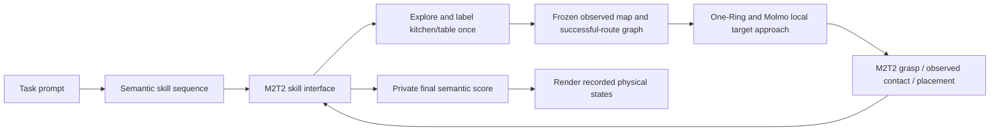

# Five-task M2T2 pipeline qualification

Development worktree: `/nobackup/le/cross-episode-sensors`, branch
`feature/onboard-sensor-interface`. November 9, 2026.

**Status: integration and physical qualification in progress. No five-task pass
claim.** Component-level knob/button and fixture demonstrations do not establish
full composite success. The oracle/datagen interface is preserved separately.

Latest follow-up: [November 10 full-run failures and fixes](#november-10-follow-up-full-run-failures-and-fixes).

November 10 update: `set_table_workspace_full07` passed full set-table semantic
scoring from the initial scene, with all 33 backend stages passing. Two bowls
and two cups were delivered, no wrong table items were added, and the hand was
empty. Total: 1560.23 s wall (26m00s), excluding deferred rendering. All four
carries and free-space-guided placement docks passed after removing the legacy
3D payload veto from frozen-map departure and recovery. This is one development
episode; the other four task recipes still lack full physical qualification.
See [carry correction and timings](cup_recovery_reachability.md#frozen-map-carry-departure-correction-november-10).

## Preserved baseline and other-task batch — November 10

The successful full07 source is archived with checksums in
`runs/five_task_sensor_20261110_baseline`. Keep its set-table behavior fixed;
new fixes belong to the additional task/fixture/appliance integration. The suite
launcher now accepts `--tasks` so qualification does not rerun or alter set-table.

`runs/five_task_sensor_20261110_other_tasks01` tests clear-and-store, meal,
groceries and cookware on the explicit successful two-room source scenes in
`runs/five_task_sensor_20261109/sources.json`. Two simulator slots (GPUs 0 and 5)
share persistent model services. These are development tests, not held-out
benchmark results. Execution omits video encoding; render recorded states later.
That first four-task batch failed: fixture navigation used tabletop assumptions;
generic grasp planning exceeded its obstacle allocation; cookware could be
picked and carried but its destination surface was not observed. Subsequent
component results and the current rerun are recorded below.

### November 10 fixes and physical component evidence

Set-table still dispatches to its qualified implementation. Added fixtures use
vertical-panel docking. Additional generic objects use a checked closer dock,
focused M2T2 sampling of the observed object, learned-confidence/support-aware
ranking, and validated shallow grasp variants. The complete scene remains in
the collision planner. Cups and bowls retain their prior pickup backend.

The handle approach now rejects unreachable contact endpoints before spending
time on full paths, tries checked clearance waypoints and small approach-angle
refinements, and uses the existing articulation planner's calibrated finger
narrow phase. Its optimizer has extra clearance; the validation margin remains
unchanged. Solver caching distinguishes this setting from the baseline solver.

| Component | Physical result | Simulated time | Artifact |
|---|---|---:|---|
| Pot pick | Passed; retained pot, 25 cm lift | 9.64 s | `runs/household_fix_20261110_pot_dock01/physics/report.json` |
| Grocery bottle pick | Passed with focused proposals and checked closer dock | 10.70 s | `runs/household_fix_20261110_grocery_close03/physics/report.json` |
| Cabinet handle grasp | Passed; both pads maintained handle contact | 5.56 s | `runs/household_fix_20261110_cabinet_grasp09/acquire/grasp/report.json` |
| Cabinet opening | Moved to about 77 degrees physically; **full-open check failed**, although observed estimate reached 90 degrees | 39.28 s | `runs/household_fix_20261110_cabinet_open01/report.json` |
| Microwave opening | Passed; observed 89.9 degrees and private full-open check passed | 44.58 s | `runs/household_fixture_20261110_microwave_open02/report.json` |
| Microwave-to-navigation posture | Passed checked stow after opening | 3.50 s | `runs/household_fix_20261110_microwave_posture01/report.json` |

Pot retry success alone does not prove closer docking was responsible: that
retry barely moved the base and selected a near-rim grasp instead of far-rim
proposals. Focused sampling is intended to improve coverage; full-task repeats
are still required. A grocery attempt at `grocery_close02` executed but dropped
the bottle and **failed** private scoring. The old encoder check incorrectly
treated pads meeting before joint hard limits as a held object. New generic
pickup measures opposing pad separation from calibration and encoders instead.

`meal_retry03` passed exploration, microwave docking, grasp and opening, then
stalled at `arm_not_stowed` during food search. It was stopped deliberately.
The new fixture adapter now calls the existing checked post-opening stow before
navigation. Same-station placement also reconstructs its payload handoff from
the already recorded pre-grasp RGB-D and grasp commands; it no longer requests
a payload file which only cross-room carry creates.

Current full rerun: `runs/five_task_sensor_20261110_other_tasks04`, GPUs 0 and 5,
four other tasks queued through the suite. **Full results pending; no 5/5 claim.**
The focused changes pass 45 unit/regression tests. Component retries that were
superseded during diagnosis were stopped explicitly; missing reports are not
successes. Videos are rendered only after physical execution:

- [Pot pickup](../runs/household_fix_20261110_pot_dock01/pick.mp4)
- [Grocery pickup](../runs/household_fix_20261110_grocery_close03/pick.mp4)

```bash
export SENSOR_MODEL_ENDPOINTS="$(cat runs/five_task_sensor_20261109_services/endpoints.json)"
export SENSOR_WORKSPACE_DOCKING=1 TZ=America/New_York
bash scripts/run_sensor_household_suite.sh \
  --manifest runs/five_task_sensor_20261109/sources.json \
  --output runs/five_task_sensor_NEW \
  --gpus 0,5 --skip-video-render \
  --tasks clear_and_store prepare_and_serve_meal unpack_and_sort_groceries warm_two_pots
```

## Scope correction: preserve the working pipeline

The successful open-door set-table baseline is documented in
[run 57](m2t2_interface_run57.md): 17/17 skill calls, 33/33 backend stages and
full physical task success. It used station exploration in
`demo_semantic_navigation.py`, not the later room-coverage/closed-door explorer.

The first attempts below accidentally tested the latter exploration path on new
scenes. They are not regressions of the exact qualified run-57 setup. Per the
user's correction, open-door calls now use the original station-exploration
dispatch. Set-table delegates directly to the existing `SensorSetTablePipeline`
executor. The other four recipes extend its primitives with fixture, appliance
and generic-receptacle handling. Closed-door research stays on its separate
explicit reset path. Furniture query cadence and geometry filtering were
restored to the run-57 defaults rather than retuning the baseline in this task.

`set_table_run57_regression` uses the original successful scene to check this
restoration. This is a regression test, not new-dataset qualification. The 43
dispatch/recipe/furniture tests pass. The regression completed both bowls, then
failed before cup motion: M2T2 proposed no grasps near the target in its three
point-sampling passes. See [cup recovery and reachability](cup_recovery_reachability.md).

## Execution contract



One `EpisodeRuntime` owns the live simulation, two onboard RGB-D cameras and
continuous SLAM session. Stages exchange in-memory artifacts; they do not reset
physics or reload models. Model RPC workers are shared across task processes.
Each simultaneous episode necessarily has its own tracker and renderer.

Only the semantic recipe is oracle. It contains names, counts, receptacles and
an explicit heating duration—not simulator IDs, coordinates, parking poses,
grasp poses or routes. Scene reset and semantic scoring are private harness
operations. The temporal scorer observes actual appliance-on time with an
object physically supported inside/on the appliance. Its results never choose
an action. `commands_completed` is separate from physical task success.

## Task recipes

| Task | Semantic sequence |
|---|---|
| Set table | Explore; bring two bowls and two cups from kitchen to dining table. |
| Clear and store | Explore; open storage cabinet, store bowls from dining table, close cabinet; open drawer, store cups, close drawer. |
| Prepare and serve meal | Explore; open microwave, insert food, close, Start, wait 30 s, Stop; retrieve and serve food; retrieve cold drink from fridge; close both appliances. |
| Sort groceries | Explore; carry dining-table drinks to purple kitchen basket and snacks to orange kitchen basket. Baskets are not carried. |
| Warm two pots | Explore; place cookware on separate burners; turn each on; wait 30 s; turn both off; serve both cookware items on dining table. |

These sequences implement the selected source prompts. Inter-room doors start
open; appliance/storage opening remains part of the task. Counts and duration
are taken from the task request. Test scenes never prescribe the evaluated
planner's route or order; these temporary recipes are the current high-level
oracle baseline.

Navigation accepts semantic targets beyond cups/bowls. Generic targets use the
visual object map, Molmo proposals, FastSAM masks and Qwen confirmation; the
existing vessel Hydra path remains available. Storage/appliance names are not
bound to hidden fixture IDs. An observed hinge reference is remembered across
open/place/close calls and transformed using estimated localization.

## Running

Start the existing service supervisor in a separate terminal. GPU assignments
are in the order Qwen, Molmo, FastSAM, M2T2, One-Ring; repeats are allowed if
memory permits:

```bash
cd /nobackup/le/cross-episode-sensors
PYTHONPATH=. .venv-sift/bin/python scripts/launch_sensor_services.py \
  --gpus 3,7,0,7,5 --base-port 51500 --output runs/my_sensor_services
```

Create a JSON manifest with exactly the five task names as keys and their saved
two-room source episode directories as values. A development selection is in
`runs/five_task_sensor_20261109/sources.json`. Use a fresh output directory:

```bash
export SENSOR_MODEL_ENDPOINTS="$(cat runs/my_sensor_services/endpoints.json)"
bash scripts/run_sensor_household_suite.sh \
  --manifest runs/five_task_sensor_20261109/sources.json \
  --output runs/my_five_task_qualification --gpus 0,5
```

The GPU slots form a queue, not one permanent GPU per task. The suite waits for
every result and exits nonzero if any task fails. It does not replace a failed
episode with a different scene or report component success as composite success.
Model workers remain owned by the separately running supervisor.

Individual task entry point: `scripts/run_sensor_household.py --source ...
--output ...`. `--skip-video-render` records states but defers rendering further;
normal execution renders only after the physical run ends.

Artifacts: timestamped task/stage logs, `semantic_plan.json`,
`sensor_skill_calls.json`, `stages.json`, `report.json`, runtime initialization
counts, physical state recordings and deferred RGB-D videos. New calls also
report simulated and wall time in `skill_timings`. A 5–15 s motion target is not
yet qualified for these new composite paths; over-target calls must be examined,
not hidden by video acceleration.

## Qualification record

| Attempt | Observed result |
|---|---|
| `set_table_01` | Two rooms reached; exploration handoff failed because the kitchen/table semantic memory was incomplete. |
| `set_table_02` | Table confirmed but kitchen missing; additional search lost localization; no manipulation executed. |
| `groceries_01` | Exploration passed (394 s wall); frozen-map table transit passed (19.6 s wall); generic target search rejected by the old cup/bowl-only constructor. |
| `set_table_03` | Stopped when restoring the original station explorer. |
| `groceries_02` | Found drink, docking route unavailable; search requested further exploration. No pickup. |
| `clear_and_store_01` | Reached cabinet; no validated handle grasp approach. No physical grasp. |
| `meal_01` | Microwave local search exhausted observed area. No appliance motion. |
| `pots_01` | Docked at cookware; proposed grasp approaches failed IK. No pickup. |
| `set_table_run57_regression` | Both bowls transferred; cup proposals empty. Failed after 815 s wall. |
| `cup_retry_01` | Saved-state component: cup physically lifted 24.3 cm; 17.64 simulated seconds. |
| `set_table_run57_retry` | Both bowl pickups passed; stopped at repeated corner-skipping replans during second carry. |
| `carry_corner_02` | Physical saved-map corner test: 0.53 m progress, one plan, bowl retained; 7.22 s simulated. |
| `set_table_run57_retry02` | Three transfers passed (two bowls and one cup). Stopped before the final cup with a Python constructor mismatch after a script update reached an already-running process. 1221.5 s wall time; not full task success. |
| `workspace_dock_01` | New workspace-ranked docking and cup pickup passed: 3.52 s dock + 15.10 s pick simulated, zero rejected grasp plans. Component evidence only. |
| `set_table_workspace_full01` | First bowl delivered; second search incorrectly escalated frozen-map recovery to exploration. Stopped after 659.7 s wall time. |
| `set_table_workspace_full02` | Interrupted during first-bowl rejected grasp planning: experimental docking had removed the baseline approach/distance envelope. That envelope is restored. |
| `bowl_workspace_recovery01` | Passed from the failed bowl state: redock 2.62 s, pickup 7.60 s simulated; 27.8 cm lift, zero rejected plans. |
| `set_table_workspace_full03` | First bowl delivered and second bowl found/picked; interrupted during repeated cached-route corner replanning in second carry. |
| `set_table_workspace_full04` | Both bowl searches/pickups and carries passed; stopped in second placement docking on an unhandled `Dock turn drift requires replanning` request. 691.2 s wall time; not full success. |
| `carry_corner_repair05` | Physical approach through the recorded failed corner passed: 1.219 m, one plan, 13.52 s simulated / 18.92 s wall; held bowl retained height. |
| `set_table_workspace_full05` | Both bowls delivered; first cup picked/carried. Failed fresh dining-table perception before cup placement. 933.58 s wall; not full success. Saved-frame replay traced generic table pointing to an existing bowl. Empty-support pointing now passes that frame; physical qualification tracked separately. |
| `set_table_workspace_full06` | Empty-support prompt enabled. First bowl physically placed, second bowl picked; stopped at second-bowl departure (`undock_route_unverified`) before reaching cups. Not full success. Later free-space-guided docking has unit/saved-observation evidence but is not physically qualified yet. |

The constructor mismatch was introduced while integrating workspace docking:
the persistent baseline had cached the old `ShapedDocking` class, while a freshly
loaded stage script passed the new `workspace_ranker` keyword even when disabled.
The disabled path now retains the original constructor signature. The fresh full
run starts all Python modules consistently. Runtime navigation handoffs were
in-memory, so the stopped run was not treated as a resumable complete checkpoint.
See [workspace docking evidence](cup_recovery_reachability.md#integrated-workspace-aware-docking).

Investigation found that a counter mask included mostly cabinet-front pixels.
A proposed station-filter/query-cadence change was tested locally, then reverted
when the user clarified that the working baseline must be reused. Generic
semantic categories pass through the same validated VLM schema. The aborted
replacement-exploration experiments are retained as diagnostics, not successes.

The targeted grounding/recipe/furniture/station suite passed 29 tests. Earlier
interface/exploration/navigation/appliance checks passed 57 tests. Neither is a
substitute for the pending physical runs.

## Remaining physical evidence

- Full semantic success for the other four tasks from an initial scene; broader
  set-table validation beyond the successful development episode.
- Interleaved fixture open, object transfer and close (not only an isolated cycle).
- Basket, shelf, microwave and burner placement with fresh observed support.
- Both correct burner associations and measured 30 s heating before serving.
- Per-call duration and failure videos, with no during-execution video encoding.

Implementation locations: `skills/household_sensor_plans.py`,
`evaluation/sensor_household.py`, `runtime/fixture_controls.py`,
`runtime/appliance_controls.py`, and `scripts/run_sensor_household_suite.py`.


### Follow-up fixes and qualification — November 10, 2026

The `other_tasks04` full runs did **not** qualify the other tasks:

- Clear-and-store opened a cabinet, picked a bowl and carried it back, but the
  kitchen waypoint faced the fridge. Its shelf observation failed. The new
  household executor now remembers the sensor-confirmed fixture approach in
  the continuous SLAM frame, registers that destination in route memory, and
  returns to that view before interior placement. This uses measured poses,
  not scene configuration. Full physical qualification remains pending.
- Meal preparation's new grasp closed in front of the microwave lip. Panel
  alignment had retained a depth offset appropriate to the original M2T2
  orientation. `center_handle_contact` now proposes overlap with the measured
  local lip before ordinary collision-checked insertion. The recorded failed
  view passed physical two-pad grasp verification in
  `runs/household_fix_20261110_microwave_depth02`; this is a grasp component,
  not a full meal pass.
- Grocery picking passed in the full run (5.94 simulated seconds; 300.66 wall
  seconds including candidate search). Placement failed while still outside
  the kitchen. The fixed-transit recorder had assumed every dining-bound leg
  started in the kitchen, registering a same-room dining waypoint as a kitchen
  endpoint. New household calls explicitly pass `--source-station`; the
  protected set-table default remains unchanged. A regression test checks the
  household command and unchanged set-table dispatch.
- The pot run reached the pot but spent minutes rejecting grasp endpoints.
  It was stopped for a dock-distance component investigation; it is not a
  successful full run. Earlier successful pot pickup remains only component
  evidence.

`clear_retry05` and `meal_retry05` were deliberately interrupted to include the
route-label fix; do not classify them as completed physics failures. Corrected
full reruns are in `runs/five_task_sensor_20261110_other_tasks06` (clear/store,
meal, then groceries). Their live logs and final reports are authoritative;
no 5/5 result is claimed. Grocery/fixture placement and complete heating/task
sequences still need physical qualification. Candidate planning remains a
wall-time bottleneck even where the executed grasp is within 5–15 seconds.


Further evidence from the reruns:

- `household_fix_20261110_pot_standoff03` restored the failed full-run dock,
  used fresh onboard pointing, and made a checked 5.6 cm retreat (0.72 simulated
  seconds). The original full-crop M2T2 pickup then passed: 8.32 simulated
  seconds, 26.6 cm lift and sustained private hold, with no rejected planning
  candidates. Cookware now uses the original proposal path and a 0.65 m dock
  candidate in that experiment; production now uses fresh depth and a 0.64 m
  candidate as recorded below. The closer packaged-object path remains separate. This is still
  a component result, not a complete heating/serving pass.
- [Pot grasp video](../runs/household_fix_20261110_pot_standoff03/grasp.mp4)
  and [microwave grasp video](../runs/household_fix_20261110_microwave_depth02/grasp.mp4)
  were rendered after execution from recorded physical states at normal speed.
- The sixth fixture batch failed before manipulation qualification: microwave
  navigation associated a drawer/oven point with the microwave, while cabinet
  acquisition produced no nearby learned grasp for its selected handle.
  `ApplianceAssociatedPointer` adds RGB-only fixture association in the new
  fixture path. In the recorded-view diagnostic it retained three microwave
  points and rejected the drawer point. It does not certify a grasp or use
  simulator object IDs. This diagnostic is not a detection accuracy benchmark.
- Those runs have ended without full task success. Fixture batch 07 failed
  cabinet return/perception and microwave grasp reacquisition. Cookware retry
  06 was stopped after repeated infeasible grasp endpoints. Grocery batch 06
  reached the correct kitchen, then failed to observe the basket interior.
  Subsequent evidence follows; none of these are complete task passes.


### Latest component fixes — November 10, 05:45 EST

| Component | Measured result | Evidence |
|---|---|---|
| Cookware production pickup | **Physical pass**, 26.47 cm lift, sustained grip; **7.72 simulated s** | `household_fix_20261110_pot_production10` |
| Microwave reacquisition | **Physical handle-grasp pass** from the exact failed meal-08 view; opening/full meal not yet repeated | `household_fix_20261110_microwave_crop04` |
| Basket insertion | **Physical containment pass**: bottle 02 supported inside purple basket, hand empty; **12.10 simulated s**, 84.22 wall s | `household_fix_20261110_basket_angles12/private_final_snapshot.json` |
| Cabinet shelf perception | **Passed**: 2,517 fresh depth points selected inside the observed opened aperture | `household_fix_20261110_cabinet_aperture03` |
| Cabinet local placement dock | **Passed**, bowl retained; **14.32 simulated s**, 33.49 wall s; insertion pending | `household_fix_20261110_cabinet_aperture04` |

Cookware now refines the final dock using fresh wrist depth and tries small
contact-preserving pitch alternatives around learned M2T2 rim contacts. The
original top-down approach exceeded arm reach at that dock; tilting the approach
made it reachable. Ordinary IK, arm/payload collision checks and grasp
verification remain enabled. Six candidates were rejected before the passing
7.72-second pickup. Settling holds were 0.10/0.16/0.16 seconds at approach/contact/
lift, plus 0.38 seconds of finger stability. This is an isolated production
wrapper test, not the full heating-and-serving task.

Microwave contact pointing now magnifies the visually identified appliance
before locating its graspable door edge. This fixes reacquisition of the small
edge in the failed meal-08 observation. No simulator fixture IDs or poses are
used for contact selection.

Basket placement uses a magnified interior RGB query and point-seeded depth,
so the rim/counter cannot win merely by being the largest horizontal plane.
M2T2 returned **zero valid interior placements** in this example. The successful
placement used an explicitly marked **measured-support geometry fallback**,
with pitch/yaw candidates and ordinary collision-checked arm and payload paths.
It is not evidence of learned M2T2 placement success. Visual settling remained
inconclusive after two seconds; the separate private final snapshot confirmed
semantic containment and an empty hand. The bottle lies tilted inside the
basket, which is allowed by the prompt. This does not establish the entire
four-object sorting task.

Cabinet interior support can reuse the hinge, closed-handle and panel normal
observed during opening, reanchored with SLAM. That aperture selects a search
region in **fresh RGB-D**; connected horizontal shelf points are measured, never
invented or filled. This avoids a second VLM identity query for the already
identified dark cabinet. It does not read scene geometry or certify insertion.
The earlier cabinet opening physically reached about 79 degrees, not a verified
full mechanical limit.

Videos rendered after physics at normal speed:

- [Cookware pickup](../runs/household_fix_20261110_pot_production10/pick.mp4)
- [Microwave handle grasp](../runs/household_fix_20261110_microwave_crop04/grasp.mp4)
- [Basket insertion](../runs/household_fix_20261110_basket_angles12/placement.mp4)

The focused recipe, routing, grasp, fixture-pointing and support tests pass
**42 tests**. This total includes the new support tests; do not add overlapping
previous totals. Full initial-scene cookware and meal retries are queued in
`runs/five_task_sensor_20261110_components_integrated09`, GPU 5, using persistent
model services. Logs are per task. Videos remain deferred until execution ends.
The protected set-table executor is unchanged. **Only set-table has full-task
qualification; the other four tasks remain in development.**


### Explicit map handoff regression — November 10, 05:54 EST

The first initial-scene cookware run after integration (`components_integrated09`)
failed **before pickup**, after exploration/navigation passed:
`EpisodeRuntime.observed_navigation_map` was absent. The component harness had
supplied this field, concealing the integration defect. The new household helper
now binds the measured map from the explicit stage handoff rather than depending
on an incidental runtime attribute. The household carry path binds its current
map before added fixture/basket local approaches too. This does not restore
simulation state or change the protected set-table dispatch.

The updated component harness no longer prepopulates the attribute. Retrying the
actual new failed navigation state in `household_fix_20261110_pot_handoff11`
passed physical pickup: **8.66 simulated seconds**, **18.67 cm lift**, sustained
grip. Fresh wrist alignment was already inside the accepted distance/heading
band and added no base motion. A regression test checks an initially absent
attribute, exact measured cell/config preservation, and replacement of stale map
evidence on the next handoff. The focused regression suite now includes that
additional test; previous totals overlap.

The queued meal test in integrated09 and grocery integrated10 were intentionally
stopped to repair this shared new-task handoff; do not call them completed
physical failures. Initial-scene reruns launched at that point (completed; see results below):

- `five_task_sensor_20261110_pot_integrated12/warm_two_pots.log`
- `five_task_sensor_20261110_grocery_integrated13/unpack_and_sort_groceries.log`

Cabinet aperture04 passed perception/docking but insertion was interrupted after
repeated infeasible candidates. Experiments insertion06–09 were stopped while
isolating an additional path-search problem: cuRobo treated the fixed base's
normal floor support as a start collision, although full-geometry validation
accepted that stationary pose. The isolated insertion10 experiment excludes only
observed floor cells intersecting calibrated stationary base-support spheres
from the optimizer, validates paths against the original world, and requests
extra optimizer clearance. This is experimental and **not integrated or a
physical success claim**. The implementation experiments remain outside the
production executor until qualified. Cabinet shelf placement and all complete
non-set-table tasks remain unqualified.


### Integrated failures and further component evidence — November 10, 06:25 EST

The two initial-scene tests above finished with failures, not full passes:

- **Warm two pots / integrated12:** exploration, transit and cookware pickup
  passed; placement observation rejected the burner. Pickup took 7.68 simulated
  seconds but about 150 wall seconds due to many rejected candidate plans.
- **Groceries / integrated13:** first bottle pickup, frozen-map carry, retained
  grasp clearance and basket observation passed. Local docking rejected the
  partially visible basket floor before moving. Total run: 531.09 wall seconds.

The basket failure was replayed through normal perception/dock/place stages
with an interior-only viewing approach. It can approach measured free partial
points when every complete support disk is occupied; this does **not** authorize
release. Fresh complete support and collision checks remain mandatory at place.
`household_fix_20261110_basket_partial15` passed: release was visually stable,
private final scoring confirmed bottle 02 inside the purple basket and an empty
hand across the last ten recorded frames. Placement took **8.56 simulated /
60.39 wall seconds**; local docking took **15.22 simulated / 31.13 wall seconds**.
The placement is the explicitly marked measured-geometry fallback, not a learned
M2T2 proposal. [Placement video](../runs/household_fix_20261110_basket_partial15/placement.mp4).

Stove perception now associates the named cooking-zone point with a previously
confirmed stove crop and measured local support. The redundant verifier was
rejecting the support grate as not being a burner. Observation passed in
`household_fix_20261110_burner_associated20`. The subsequent place21 component
stopped before base movement because mapped points overlap the gripper; burner
placement has **not** passed. A held-surface refinement experiment rejected
its attachment match; that rejection is being diagnosed rather than bypassed.

Cabinet insertion remains unresolved. The latest close15 experimental dock
stopped before motion at an observed payload overlap. Successful shelf
perception or docking is not a successful cabinet placement.

The focused suite passes **48 tests**, including metric part-region extraction,
robot/depth discontinuity exclusion and the partial-interior approach regression.
Full groceries then meal retries are running/queued under
`five_task_sensor_20261110_grocery_meal14`, GPU 0. Persistent services are reused;
video rendering is deferred. No protected set-table execution behavior changed.
**Only set-table has full-task qualification.**


### Grocery initial-scene regression and local departure — November 10, 06:38 EST

`grocery_meal14/unpack_and_sort_groceries` advanced through the first complete
transfer. Private snapshot `first_placement_private.json` confirms bottle 02
inside the purple basket, empty hand, and the remaining requested objects still
on the dining table. Second-bottle pickup also passed. The full task then failed
**before motion on the second carry** (7/17 public calls completed, 622.64 wall
seconds). Its frozen column footprint rejects table-edge points at 0.725–0.775 m
height overlapping the already occupied manipulation dock. This is a departure
planning failure, not another failed basket insertion.

The isolated opt-in `LocalOverlapDeparture` prototype only allows a straight
monotonic exit from the existing intersections: every occupied point's overlap
must decrease or stay zero, new overlap is forbidden, observed floor support
remains required, and the endpoint lies inside normal transit-free space. It
does not clear map cells, disable physics, or change cross-room routing. The
first test exited but landed too close to a grid boundary; reusing the normal
departure interior margin corrected that handoff.

`household_fix_20261110_grocery_departure02` then **physically passed the full
carry component** from that failure state: kitchen reached, bottle retained,
frozen-map digest unchanged, **30.10 simulated / 31.21 wall seconds**. Route
length was about 6.69 m; this long carry exceeds the typical atomic duration
target. [Carry video](../runs/household_fix_20261110_grocery_departure02/carry.mp4).
Four tests cover monotonic escape, rejection of new obstacles, unchanged clear
starts, and unknown-floor rejection. This opt-in behavior is now wired only to the added household recipes; the
protected set-table path is unchanged.

Additional experiments: semantic, connected held-pot surface refresh enabled
loaded burner docking in `burner_connected24` (21.62 simulated seconds, grasp
retained), but placement still failed support filtering. Broader support and
remembered burner-point tests remain unqualified. The apparent stove grate
requires different support geometry from a solid tabletop; no success has
been claimed or scoring weakened. Cabinet side-entry and farther stand-off
experiments remain unqualified. The meal preparation run was later interrupted during food navigation for
diagnosis; its microwave grasp/open/release/withdraw sequence passed.


### Further component fixes — November 10, 06:59 EST

Only set-table has a qualified full-task success. Do not interpret the following
component results as completion of the other four tasks.

| Component | Physical result | Simulated / wall seconds | Evidence |
| --- | --- | --- | --- |
| Cabinet bowl insertion, `cabinet_panel20` | Bowl 02 supported inside kitchen cabinet; empty hand; stable visual release | 9.88 / 416.37 for placement | [Video](../runs/household_fix_20261110_cabinet_panel20/placement.mp4), [private support snapshot](../runs/household_fix_20261110_cabinet_panel20/private_final_snapshot.json) |
| Grocery carry, failed-state replay `grocery_station03` | Kitchen reached; bottle retained; frozen-map digest unchanged | 67.20 / 56.46 | [Report](../runs/household_fix_20261110_grocery_station03/report.json) |
| Microwave opening in `grocery_meal14` | Handle grasp, opening, release, withdrawal and navigation posture completed | Full meal not completed | [Task log](../runs/five_task_sensor_20261110_grocery_meal14/prepare_and_serve_meal.log) |
| Cookware release, `burner_grate28` / `burner_center29` | Physical stove contact, but not the requested burner support relation | **Not qualified** | Private snapshots under the component directories |

Cabinet correction: retain the sensor-observed opened panel in the local loaded
base collision geometry, dock facing the observed aperture, then use a side-entry
arm path. The physically tested fallback is geometric, not learned M2T2 placement.
Its implementation is preserved in `scripts/test_aperture_place.py`,
`control/aperture_placement.py`, `control/fixed_base_path.py`, and
`navigation/aperture_dock.py`. Full clear/store integration remains unqualified.
Wall time is dominated by rejected placement paths (67 before the accepted
candidate); meeting the simulated duration target is not a wall-time optimization.
A new isolated test tries 5 cm release clearance first and exports chosen
candidates for diagnosis. It must pass physics before claiming improvement.

`grocery_departure15` failed during first carry after leaving the pickup dock:
`known_route_unavailable`, 42.26 simulated / 63.02 wall seconds. The isolated
passing carry runner used remembered station endpoints, while the full carry
could fall back to a furniture-centroid stand-off search. The new optional
`HouseholdStationNavigator` uses those observed station endpoints with the
existing graph/A* follower even when an exact cached route cannot be reused.
It retains the current SLAM frame transformation, frozen occupancy, actual
collisions and private grasp-retention scoring. It is enabled only for added
household recipes via `--station-endpoints`; qualified set-table dispatch and
defaults remain unchanged. Focused station/departure/route tests: **23 passed**.

Full grocery qualification is running in
[station16 live log](../runs/five_task_sensor_20261110_grocery_station16/unpack_and_sort_groceries.log).
Video rendering is deferred until execution finishes. No full success claimed.


The repository-preserved cabinet executor passed a second physical insertion in
`cabinet_saved21`: **10.38 simulated / 79.00 wall seconds**, three rejected
candidates, stable visual release, and private bowl-in-cabinet/empty-hand checks
passed. It tries 5 cm release clearance before 3 cm; collision and support checks
are unchanged. This repeat starts at the already docked component state, so it
does not establish a full clear/store success or generalized speedup.
[Video](../runs/household_fix_20261110_cabinet_saved21/placement.mp4).

Meal perception diagnosis: on the recorded `confirm_found` view, Molmo pointed
to a small countertop appliance as a food container. Qwen's RGB-only association
identified that point as a toaster and rejected it. The new optional
`PortableFoodPointer` requires a portable food-container interpretation before
accepting that proposal; it is not yet qualified in a full meal rollout.
Other object categories keep their existing pointing behavior. Six portable
and fixture association tests passed. Do not describe this as a general VLM
accuracy benchmark.

`grocery_station16` has passed the first complete bottle transfer (including
basket insertion and arm return), then returned to the dining table for the
second drink. Its first pickup needed about five wall minutes of candidate
search despite ultimately succeeding; runtime optimization is still incomplete.

## November 10 integration retry: support backends and grocery pickup

The later updates below supersede the earlier “running” status for station16.
`grocery_station16` completed its first bottle transfer and returned to the dining
table, but was deliberately interrupted during the second pickup after more than
11 wall minutes of rejected arm paths. No second pickup motion or full-task
success is claimed.

Additional physically measured results:

| Component | Result | Simulated / wall seconds | Evidence |
| --- | --- | --- | --- |
| Named burner placement, `burner_redock36` | Pot 02 supported by burner 1, empty hand (private scoring); visual release stability inconclusive | Dock 45.22 / 104.27; placement 9.12 / 42.83 | [Report](../runs/household_fix_20261110_burner_redock36/report.json), [private snapshot](../runs/household_fix_20261110_burner_redock36/private_final_snapshot.json), [video](../runs/household_fix_20261110_burner_redock36/placement.mp4) |
| Bottle pickup, `grocery_ranked05` | Sustained private grasp, 23.64 cm lift, zero rejected arm plans | 6.30 / not separately measured | [Report](../runs/household_fix_20261110_grocery_ranked05/report.json) |
| Harder second pickup, `grocery_ranked06` | Repeated linkage/path rejection; deliberately interrupted before physical pickup | Not qualified | [Log](../runs/household_fix_20261110_grocery_ranked06/live.log) |

The burner fix clears the wrist view with a checked held-object posture, points
to the named burner in an enlarged RGB stove crop, measures its grate height
from metric depth, and docks toward that burner rather than the nearest free
stove edge. Measured grate support permits holes surrounded by supporting points;
it does not relax final semantic burner scoring. Cabinet placement uses a checked
side-entry geometric fallback. These are not claims that learned M2T2 placement
alone succeeds for either receptacle.

Repository implementations now include `runtime/household_placement.py`,
`scripts/test_aperture_place.py`, `scripts/test_burner_place.py`, and
`scripts/test_burner_place_redock.py`. The added household recipes dispatch these
backends; set-table dispatch remains unchanged. Cabinet open-panel estimates stay
in continuous SLAM coordinates and are reanchored for local insertion.
The production generic grasp branch uses lazy linkage-aware proposal ranking;
this preserves all candidates and final swept/physical checks. It is not yet a
solution for the difficult second pickup.

Focused integration suite: **59 tests passed**, covering new support dispatch,
measured grate support, station-map transforms, overlap departure, route memory,
object association, linkage ranking, aperture support and retained attachments.
These unit tests do not establish full-task physical success.

Fresh full qualification: `five_task_sensor_20261110_support_integrated17`.
[Clear/store live log](../runs/five_task_sensor_20261110_support_integrated17/clear_and_store.log),
[meal live log](../runs/five_task_sensor_20261110_support_integrated17/prepare_and_serve_meal.log),
[stove live log](../runs/five_task_sensor_20261110_support_integrated17/warm_two_pots.log).
Two simulator slots process these tasks; stove is initially queued. Rendering is
deferred. The working set-table task is not rerun or modified by this suite.

### Subsequent corrections and isolated navigation workers

`support_integrated17` is **not qualified**: clear/store stopped after its handle
was grasped because panel association was lost during opening. Meal and stove
were deliberately interrupted after finding a parallel-execution defect: the
old shared One-Ring RPC worker kept one temporal context across both episodes.
Serializing individual RPC calls did not isolate that history.

`run_sensor_household_suite.py --worker-endpoints FILE` now accepts per-GPU model
endpoint overrides and rejects concurrent slots sharing One-Ring. Stateless model
services may remain shared. The new run `five_task_sensor_20261110_isolated18`
uses separate navigation workers (51505 and 51504); groceries and stove run first,
then meal. Its endpoint assignment is saved alongside the suite logs. No model
weights, base navigation algorithm, or qualified set-table dispatch changed.

The grocery diagnosis also changed: station16's first transfer was a correctly
picked drink bottle, but its second target was a snack box mislabeled by Molmo as
a packaged drink. `grocery_straight07` lifted that box by 24.47 cm in 9.88 simulated
seconds. This is a physical grasp component pass **of the wrong task category**,
not a successful drink pickup. The accepted path did not use the experimental
Cartesian fallback. The production change only rejects clearly blocked gripper
endpoints before expensive IK and keeps the original checked insertion path.
New grocery pointing descriptions distinguish beverage bottles/labeled beverage
cartons from plain snack boxes. They selected the correct visible items on the
recorded RGB frame; full-task semantic correctness remains to be tested. Qwen's
marked/cropped classification was unreliable on these small boxes, so that
experiment was not adopted as a grocery acceptance rule.

Food-container confirmation now also applies to location-qualified descriptions
(`food container on kitchen counter` and `food container inside microwave`);
previous exact-string dispatch missed those recipe calls. Focused worker
isolation, pointing, recipe and grasp-ranking tests: **23 passed**.

### November 10: current contact and perception regressions

The runs below are development qualification, **not four additional successful
composites**. The qualified set-table baseline is still `set_table_workspace_full07`.

| Regression | Physical result | Remaining limit |
|---|---|---|
| `cabinet_depth_open30` | Cabinet opened to 89.9°, released and withdrew; 43.08 simulated seconds | Contact/base-follow duration exceeds the typical 5–15 s target |
| `clear_candidate19` | Cabinet opening repeated in the full task | The following `bowl` request actually picked a mug; private bowl score was false. Insertion planning was interrupted after repeated payload collision rejections. This is not a bowl-transfer pass. |
| `pot_backoff40` | Pot lifted 25.23 cm and retained; 9.22 simulated seconds; 3 rejected proposals | Component reset from the exact failed pickup, not a complete heating task |
| `isolated18/unpack_and_sort_groceries` | First bottle physically supported inside purple basket; second pickup lifted the correct other bottle | Second placement stopped at support perception; no full task pass |
| `grocery_parent41` | Whole-basket segmentation recovered 570+ measured floor points | No placement candidate passed the old circular-footprint filter |
| `grocery_shape42` | Measured rotated footprints produced candidate free spots | No reachable validated placement path from that dock; no arm execution |
| `grocery_dock43` | No motion | Proposed closer docks collided with observed geometry for the retained arm posture |
| `isolated18/prepare_and_serve_meal` | Microwave opened | Food search was interrupted; the redundant same-station transit had returned it to a wall-facing exploration viewpoint |

The cabinet fix tries angled **deep** handle contacts before shallow fallbacks.
It is enabled only for cabinet targets in the added fixture adapter. Drawer and
microwave candidate ordering stays unchanged. The successful opening used the
original contact executor; no hinge-state feedback or collision disabling.

Cookware pickup now tries small outward offsets (0–12 mm) along each predicted
approach axis, ranks calibrated linkage clearance cheaply, and retains full IK,
insertion, lift and physical-retention checks. It does not change cup/bowl pickup.
The snapshot test used calibrated finger collision geometry and retained native
physics. The public execution flag is reported separately from private scores.

The basket failure exposed a segmentation hierarchy issue: the smallest mask at
Molmo's point covered just the back wall, excluding visible interior floor.
`perception/container_masks.py` selects a bounded enclosing instance for this
case. The placement prototype also uses the measured footprint at each candidate
orientation rather than requiring one enclosing disk for every orientation.
These geometric fallback candidates are **not learned M2T2 placement outputs**.
Full arm/payload paths and physical release still need qualification; the
experimental basket changes have not been made the default placement backend.

The added household pipeline retains its current observed station when the next
navigation target is in that same station. It no longer first returns to the
exploration-time entry viewpoint. This is a no-motion handoff preserving observed
map memory; it is not a new route or simulator-derived localization. Set-table
continues to use its original dispatch.

Current full reruns, with separate One-Ring temporal contexts:

- [Stove 20 live log](../runs/five_task_sensor_20261110_stove20.log): production rim refinement.
- [Meal 21 live log](../runs/five_task_sensor_20261110_meal21.log): retained same-station viewpoint.
- [Clear/store 22 live log](../runs/five_task_sensor_20261110_clear_candidate22/live.log): snapshot of the cabinet fix plus clearer RGB bowl/mug descriptions. On the recorded distant RGB view, the new bowl query selected the two bowls and excluded the mug selected by the old `bowls` query. Full physical execution is pending.

[Cabinet opening video](../runs/household_fix_20261110_cabinet_depth_open30/open.mp4).
No videos are accelerated. Execution records states and renders afterward.

### November 10 follow-up: successful components and unresolved transfers

This section supersedes the pending statuses above. **Set-table is still the
only qualified full composite.** Additional-task fixes below are intentionally
separate from its frozen execution path.

| Run | Verified result | Remaining issue |
|---|---|---|
| `clear_candidate22` | Opened cabinet and picked the requested bowl, lifting it 23.17 cm in 7.76 simulated seconds | Loaded alignment to the cabinet opening failed before insertion |
| `stove23` | First cookware pickup passed with diverse cropped M2T2 proposals | Loaded docking failed; no heating-task pass |
| `stove_clearance58` | Raised the held cookware and completed loaded docking in 31.22 simulated / 70.49 wall seconds | A second pointing query selected a different cooking location; placement did not satisfy the named burner |
| `burner_memory60` | Retained the same observed burner point across docking; placement executed in 8.42 simulated / 27.42 wall seconds | Pot shifted during release and ended 95 mm from the designated burner, outside the existing 90 mm relation; task scoring remains unchanged |
| `grocery_release59` | Both drink bottles physically inside the purple basket with empty hand; second placement 9.34 simulated / 20.33 wall seconds | Component continuation only; snack transfers and complete sorting remain unqualified |
| `grocery25` | Exploration and first object navigation passed | First bottle grasp closed empty; the new basket placement was never reached |
| `food_navigation63` | Food-container navigation passed in 33.62 simulated / 56.08 wall seconds | Component reset only; no grasp or full meal pass |
| `meal_candidate26` | Exploration and kitchen transit physically completed | Experimental wrapper passed `None` as the success field, falsely treating a successful transit report as failure; corrected in candidate 27 |

Basket placement now has a separate generic-container backend: recover an
appropriate enclosing basket mask, point to visible free interior floor, evaluate
the held object's rotated footprint, observe the floor before raising the arm,
and use a checked loaded dock. The passing bottle test released 10 cm above the
observed floor to avoid inserting the fingers into the rim. This is actual
physical release, not an object snap. Calibrated finger boxes refine conservative
covering spheres; arm/payload collision validation and native collisions remain.
The geometric footprint fallback is explicitly **not learned M2T2 placement**.
The generic basket backend is integrated but its full-task qualification is pending.

The food navigation candidate gives Qwen a crop around Molmo's proposed point in
addition to the complete context. In the failed distant view, the portable green
food box was visible but full-frame verification repeatedly rejected it. The crop
fix passed the recorded-state navigation regression; the full rerun is separate.

[Successful two-bottle placement video](../runs/household_fix_20261110_grocery_release59/placement.mp4).
[Meal candidate 27 live log](../runs/five_task_sensor_20261110_meal_candidate27/live.log).
[Cabinet alignment candidate 71 log](../runs/household_fix_20261110_cabinet_cached71.log).

Focused recipe, worker isolation, portable-object pointing, container-mask and
footprint checks passed: **26 tests**. These checks do not replace physical
qualification. Cabinet alignment, cookware release, generic first-bottle grasp,
and the complete four additional tasks still require successful physical reruns.

### November 10, 09:40 EST: integrated regressions and fresh full reruns

- **Bottle grip:** `grocery_depth69` lifted the correct bottle 24.26 cm and
  retained it, 10.34 simulated seconds. Learned contact depth is now checked
  against calibrated finger-pad depth, including collision-checked deeper
  variants. `scripts/test_household_contact_pick.py` is separate from the
  qualified cup/bowl executor. [Pickup video](../runs/household_fix_20261110_grocery_depth69/pickup.mp4).
- **Basket handoff:** `grocery_candidate28` picked/carried its first bottle and
  completed docking, then exposed missing arrival metadata on the post-raise
  checkpoint. The handoff now preserves that metadata; regression test added.
  `grocery29` physically placed the first bottle inside the purple basket,
  returned and picked the second bottle. It then stopped during local departure.
- **Departure:** the optional overlap-exit follower tried to correct lateral
  SLAM error by alternating turns near the end of a straight reverse route.
  It now retains the validated heading/direction. `grocery_carry81` passed with
  grip retention and the frozen map unchanged: 30.50 simulated / 34.27 wall
  seconds. The qualified set-table path does not enable this optional wrapper.
- **Food search:** `meal_candidate27` opened the microwave but failed food
  navigation after 72.08 simulated / 486.77 wall seconds. `food_counter80`
  starts from that failed search's initial state and first faces a countertop
  point obtained from onboard RGB-D/Molmo, before resuming the existing search.
  It passed in 12.14 simulated / 54.53 wall seconds. This viewing hint is not an
  object confirmation or a grasp target. The extension is scoped to food search;
  the navigator class is restored after the stage.
- **Burner placement:** `burner_settle79` released the cookware onto the requested
  burner with empty hand: 8.28 simulated / 27.76 wall seconds. Private support
  scoring confirms `burner_1`. The added geometric fallback fits an observed
  cookware plane and estimates settling around its low edge; it does not read
  object poses or physics contacts. This is **not a learned M2T2 placement** and
  remains a single qualified component, not evidence of general robustness.
  The burner point is retained across docking only for a matching semantic
  receptacle; depth still supplies current support/collision geometry.
- **Cabinet:** angled loaded docking passed in 5.62 simulated seconds, but
  insertion has not passed. Centered docking intersects the opened leaf; the
  angled insertion trials encounter arm/payload collision rejections. Candidate
  82 refreshes the observed attachment before lowering outside the opening.

Focused tests: **39 passed**, including the handoff contract, contact-depth
calibration and reverse-exit drift regression. Retained holds and collision
validation are not removed to force success. Long carries/exploration still
exceed the typical 5–15 second motion target; timings above disclose this.

Fresh complete runs (all begin from their original scene, through the skill
interface; full semantic outcomes still pending):

- [Grocery 30](../runs/five_task_sensor_20261110_grocery30/live.log)
- [Meal 31](../runs/five_task_sensor_20261110_meal31/live.log)
- [Stove 32](../runs/five_task_sensor_20261110_stove32/live.log)
- [Cabinet attachment/insertion component 82](../runs/household_fix_20261110_cabinet_attachment82.log)

### November 10 follow-up: full-run failures and fixes

The runs listed above are no longer pending. None passed its complete task:

| Run | What actually worked | Stopping issue |
|---|---|---|
| Grocery 30 | Exploration; first bottle pickup, carry and basket placement; return, second pickup and carry | Second placement: all available poses failed arm IK. Closer docking, lower release and additional upright-orientation experiments (92/94/96) also failed. These experiments are not integrated. |
| Meal 31 | Exploration, microwave approach/opening, food search/docking | Stopped after over 1,000 rejected food-box grasp candidates. The subsequent rim-grasp regression fixes this component. |
| Stove 32 | Exploration, pot pickup, placement on the requested burner, navigation to knob | Same-room pickup handoff dropped the previously observed semantic memory. Knob navigation itself succeeded; the subsequent memory requirement rejected the handoff. |
| Cabinet 82–87 components | Raised held-bowl posture and angled docking | The bowl clips the countertop during lowering; alternatives also encounter the cabinet or arm reach/collision limits. No successful insertion. Repetitive searches were stopped explicitly. |

**Integrated fixes:**

- Additional-task pickup now carries the navigation stage's semantic memory into
  its physics handoff. Same-room placement and the next navigation call retain
  the explored kitchen/dining stations. Set-table still delegates directly to
  its existing pickup implementation. Four new regression cases cover bowl,
  cookware, packaged-drink and unchanged set-table dispatch. These plus the
  household recipe tests pass: **16 tests**.
- Portable food containers use the contact-preserving rim approach variants
  already tested for cookware, without bottle-specific candidate ranking.
  They retain exact finger/path collision checks and measured pad separation.
  `food_rim90` physically lifted/retained the correct food box by 26.4 cm in
  **8.76 simulated seconds**. The production wrapper regression
  `food_production95` also passed: **9.26 simulated seconds**, 26.1 cm lift,
  14.8 mm measured pad gap. This is a recorded-state pickup qualification,
  not a complete meal task. [Production pickup video](../runs/household_fix_20261110_food_production95/pickup.mp4).
- The recorded-production-pick harness now publishes the actual state after
  its sensor warm-up; it previously handed the wrapper a stale checkpoint.
- Dedicated basket/burner/cabinet placement logs now name command completion
  separately from the legacy bowl-on-table diagnostic. That diagnostic is not
  the generic task score. In Stove 32, independent private snapshot scoring
  confirmed `pot_02` supported by `burner_1` and an empty hand despite the legacy
  diagnostic printing false. Full heating/delivery success remains false.

**Unresolved perception:** at Stove 32's actual dock, Molmo selected the oven
temperature knob instead of the front-left burner knob. Private diagnosis
measured about 22 cm separation; those truth coordinates are not given to the
controller. The observed −59° angle belonged to that wrong knob. Context/crop
and higher-resolution diagnostic queries did not reliably identify the burner
mapping. Frontal wrist inspection (`stove_front97`) also failed: the closer
view made the oven temperature marking visible, but neither the point model
nor numbered-proposal verification established the front-left burner mapping.
No simulator knob IDs, ordinal bindings derived from truth, or fabricated
indicator angles were added to execution.

Fresh full meal regression with the food-pick and semantic-memory fixes:
[Meal 33 live log](../runs/five_task_sensor_20261110_meal33/live.log).
Meal 33 failed after successful microwave navigation: fresh handle extraction
could not associate the remembered point with the observed edge. It never
reached food pickup, so it does not evaluate that pickup fix.
The source audit confirms optional household branches in shared scripts;
the set-table orchestrator matches its saved baseline checksum. Set-table has
not been physically rerun after these additions, so this is not a new baseline
regression-pass claim.

### November 10 microwave reacquisition regression

At Meal 33's recorded dock, the remembered microwave point lay about 8 cm
from a measured protruding edge. The default 7 cm component-association radius
excluded it. Fresh standalone pointing also failed to recover it. This was not
an absent depth surface or evidence that the door needed a fabricated handle.

Microwave-only remembered-point reacquisition now permits 10 cm, snaps to an
actual connected protruding depth component, and then uses the unchanged local
M2T2/contact, collision and encoder checks. Other fixture types retain 7 cm.
No scene IDs, fixture poses or truth-derived handle positions enter execution.

- `microwave_reacquire100`: physical grasp passed at the failed recorded dock;
  both pads contacted the handle; **8.32 simulated seconds**.
- `microwave_open101`: continuation from that physical grasp opened to
  **89.86 observed degrees**, released and withdrew; private physical opening
  check passed. **43.58 simulated seconds**, above the 15-second target because
  of the 17 incremental base/arm contact motions. This is an opening component
  qualification, not a complete meal episode or optimized-duration claim.
- Seven new depth-component regression cases cover the default association
  bound, explicit wider search, rejection of flat panels and invalid bounds.
  Together with existing handle extraction, pickup-memory and household recipe
  tests, the focused suite passed **32 tests**.
- [Meal 34 live log](../runs/five_task_sensor_20261110_meal34/live.log) tests
  the combined production fixes from the original scene. The first launch used
  an already-created output directory and exited before simulation; the second
  launch in its task subdirectory is the actual physics run. It passed
  exploration, kitchen transit, microwave navigation, grasp and opening
  (89.98 observed degrees), but failed the subsequent navigation-posture sweep.
  It still does not qualify the complete meal task. A fixture-only calibrated
  posture planner passed in `microwave_stow107`: 2.62 simulated seconds,
  148.52 seconds wall time. The follow-up `microwave_stow109` adds a checked
  8 cm withdrawal before folding: **4.60 simulated seconds, 18.46 seconds wall
  time**. `cabinet_stow110` also passed: **4.44 simulated seconds, 17.49 seconds
  wall time**, using the direct checked path. This helper is integrated only in
  household fixture posture transitions; room-door and set-table posture
  implementations remain unchanged. A complete meal rerun after this last
  integration is still required.

Cabinet footprint experiment 98 was stopped after repeated collision/IK
rejections, with no insertion pass. Experiment 104 includes the sensor-derived
payload box in cuRobo's search rather than only rejecting the returned arm path
afterward. It was also stopped after repeated unsuccessful paths and remains
unqualified. Grocery placement experiments 92/94/96 also remain unqualified.
Experiment 106 adds observed principal-axis orientations and completed a release
in 8.66 simulated seconds, but private scoring put the newly released bottle
on the basket rim (`region=default`), not inside. The pre-existing bottle stayed
inside. Therefore this is **not** a successful containment fix and is not
integrated. No new successful full-task result is claimed.

[Microwave grasp and full opening video](../runs/household_fix_20261110_microwave_open101/grasp_and_open.mp4)
shows the recorded physical motion at 1×, without the subsequent posture test.

### November 10: attempt the complete recipe; score at the end

User requested removing extra execution gates and letting the environment score
the final state. The additional household recipes now attempt subsequent public
calls after a failed skill. Failures remain false in the skill history and stage
logs. Reports separately expose `attempted_calls`, `completed_calls`,
`failed_calls`, and `all_calls_attempted`; attempting everything is not success.
Final success is computed from the unchanged private semantic scorer.

- Removed additional recipe-level held-target, destination-active and empty-hand
  vetoes. The caller can attempt the operation from the current physical state.
- A completed backend's negative report does not abort subsequent operations when
  its output exists. Missing geometry, missing artifacts and unsolved IK still
  prevent that individual operation; these are not replaced with fabricated data.
- After exceptions, try to publish the current live state and observed map for
  the next call. Never rewind to a previous successful checkpoint. A new object
  navigation clears the old active dock, preventing use of a stale target.
- Remembered fixture return now uses the existing frozen-map base-footprint
  planner, without the full-stroke gripper/arm volume veto. The map's occupied
  columns and base swept-footprint planning remain; this does not certify arm
  clearance. Physical collisions remain enabled.
- The qualified set-table execution path and datagen success criteria are
  unchanged. `scripts/run_sensor_household.py --fail-fast` restores recipe aborts.
- Native A*/cuRobo collision planning, required numerical inputs, and sensor
  acquisition are retained. This is not a claim that every check in every
  low-level backend has been removed.

Meal 35 passed exploration, microwave opening/retraction, food navigation and
food pickup. Its loaded return was rejected by the former full-stroke gripper
collision envelope. This motivates the return-policy change; no physical pass
for the changed return is claimed yet.

Stove convention 112 passed a pre-docked front-left burner on/off cycle using
[the documented control-panel convention](appliance_control_conventions.md).
The private check verified the requested burner changed, not merely any knob.
This is a component result, not a two-pot task pass.
