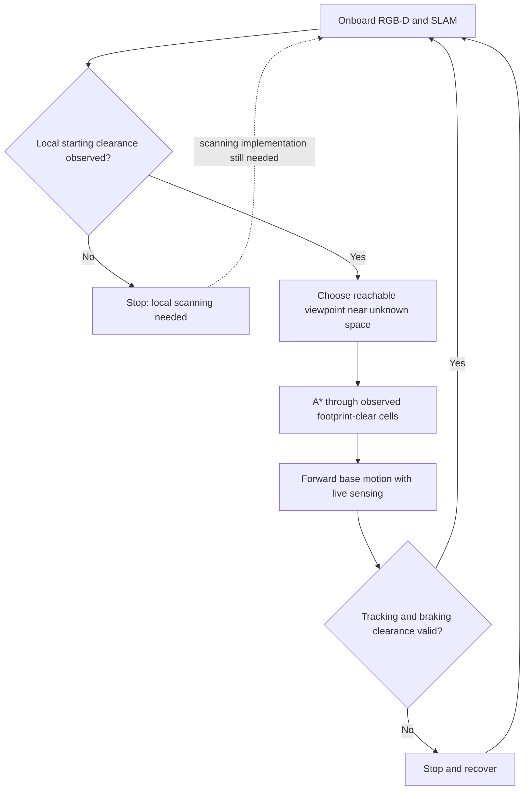

# Step 4: exploration and A* navigation

**Updated status:** [Local scanning now works in physical tests](local_exploration_scan.md). A* route following and whole-house exploration remain unqualified. The startup failures below describe the earlier map-gated runner.

A* does not require the complete house. It needs an observed, connected route to the next viewpoint. Exploration chooses viewpoints that reveal more of the house and repeats this process. It must never use an unseen room graph or treat unknown cells as free.



The conceptual atomic interface is `explore`, distinct from `navigate`. `ExplorationSkill.step(layers, tracking, now)` implements frontier viewpoint selection, A*, and bounded forward/yaw commands. It imports no simulator code. The simulator bridge alone holds native MolmoSpaces controllers and translates body-relative commands using encoder feedback. This experimental skill is not yet registered as a production atomic skill.

## Implemented safeguards

- Unknown and occupied cells cannot appear in A* routes; diagonal corner cutting is forbidden.
- Viewpoints stand off from the frontier in observed footprint-clear cells.
- Lost/stale tracking, an unobserved start, invalid poses, blocked predicted braking sweeps, and budget exhaustion produce zero commands.
- Forward-only translation and bounded acceleration/yaw rate; no sideways travel.
- A budget stop or lack of reachable frontiers is not success or proof that the entire house is explored.
- No camera-mount, geometry, collision or motion-replay changes. Native MolmoSpaces control uses the previously approved unlimited-yaw patch.

## Physical startup tests

Three saved houses were initialized with all inter-room doors open before evaluation. Metadata was used only by scene setup and reporting. The policy received live onboard RGB-D and causal SLAM estimates; it received no metadata, saved action trajectory or simulator map.

| Rooms | Source set-table episode | Simulated test duration | Result | Nonzero command frames |
|---|---|---:|---|---:|
| 5 | 000006 | 3 s | `needs_initial_clearance` | 0 |
| 6 | 000013 | 3 s | `needs_initial_clearance` | 0 |
| 7 | 000008 | 3 s | `needs_initial_clearance` | 0 |

These are safe-stop tests, **not exploration demonstrations**. The four-panel videos show navigation RGB/depth above wrist RGB/depth below, at real simulated speed:

- [5-room startup video](../runs/frontier_5room_v2/exploration.mp4)
- [6-room startup video](../runs/frontier_6room_v2/exploration.mp4)
- [7-room startup video](../runs/frontier_7room_v2/exploration.mp4)

Each folder contains the initial onboard image, per-frame decisions, estimated poses, SLAM output, navigation evidence and report. All three had zero strict navigable area during the stationary startup test.

## What must be fixed next

The current forward-facing observations do not establish the starting swept footprint. Earlier mapping demos used recorded movement to acquire observations; they did not qualify cold-start exploration. A local active-perception stage must establish enough observed space to start. An arbitrary cleared disk, reference-route bootstrap, or simulator collision lookup would violate the observation boundary and is not used.

The route-following branch still needs physical qualification after startup is solved, including all-open doorways, tracking loss, braking, and blocked-route recovery. Controller gains and commanded versus achieved speed must be measured. Exploration of a large house can exceed the normal 5–15 s atomic duration; report travel, sensing and recovery separately instead of accelerating the video. Global coverage and reliable loop closure also remain unqualified.

## Reproduce

```bash
MUJOCO_GL=egl OPENBLAS_NUM_THREADS=1 OMP_NUM_THREADS=4 \
PYTHONPATH=.:/nobackup/le/cross-episode-robotics-sim/external/molmospaces \
.venv-slam/bin/python scripts/demo_frontier_exploration.py \
  --source /nobackup/le/cross-episode-robotics-sim/runs/train_test_v1/test_multi_room/batches/round_continuous/set_table_000006 \
  --output runs/frontier_5room_new --seconds 3
```

Use an unused output folder. The `PYTHONPATH` entry selects the existing upstream checkout with the approved yaw fix; an unpatched installation is rejected. For six/seven rooms use episodes 000013/000008.
