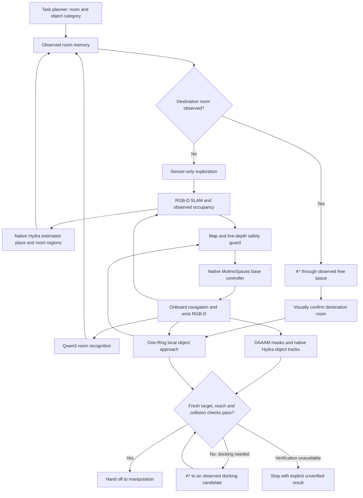
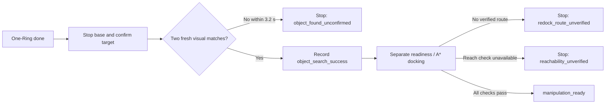
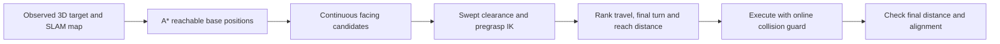

# Hybrid sensor navigation

Experimental implementation on `feature/onboard-sensor-interface`. This is not yet a physically qualified manipulation-ready baseline.



## Interfaces

- `HybridNavigator.step(packet, tracking, now)` coordinates room search, room transit, local approach and redocking. It returns forward/yaw commands and a status. The high-level planner supplies category strings, not simulator IDs or goal coordinates.
- `OneRingProcess.predict(packet, goal)` runs the official checkpoint in an isolated worker. Only the two RGB views and goal text enter the learned model. The model retains its native temporal cache within a local attempt; switching from external A* motion into local approach explicitly resets that cache. Three consecutive collision-blocked predictions with a confirmed target request A* redocking instead of repeatedly querying the same blocked approach.
- `OneRingLocalNavigator` turns the native 20 cm moves and 30°/6° turns into incremental, acceleration-limited, estimated-pose feedback control. Every command is checked against observed free space and live depth, including the reverse braking path. Blocked actions cannot trigger another inference on the same frame. Local approach no longer invokes a full bootstrap scan. The incremental guard checks the proposed braking sweep as RGB-D mapping runs concurrently. It uses a fixed initial parked-envelope prior, kept out of map evidence; observed obstacles always override this prior. Newly swept floor must be observed, including sub-cell leading-edge checks. The prior does not grow with robot motion. A 2 cm estimated-pose tolerance sits inside the existing 4 cm envelope margin. This assumes a collision-free, stowed circular envelope at initialization; it does not certify unseen rear geometry. Unsupported manipulation actions never execute through this bridge.
- `ObservedRoomMemory` asks Qwen3 about the visible room containing the camera. Two high-confidence observations are required. Labels attach only to unambiguous nearby native Hydra place regions. Region changes invalidate the current-room consensus. These regions are estimated partitions, not ground-truth room identities.
- `ManipulationReadiness` requires repeated, fresh target observations, a docking distance band and an injected reach/collision checker. A One-Ring `done` action is not success. The current demo deliberately has no reach provider and reports `reachability_unverified` rather than claiming readiness.

Physics state is available only to the simulation actuator, reset code and diagnostic contact audit. The policy receives camera measurements, calibration, proprioception and SLAM estimates. Diagnostic robot paths and contact events must never feed back into route selection. No camera changes are made.

## Setup and run

The existing sensor, DAAAM and native Hydra environments must be installed first. `scripts/setup_onering.sh` installs an isolated overlay; it does not replace the sensor environment. It pins upstream One-Ring and downloads its checkpoint.

```bash
HF_HOME=/nobackup2/le/.cache bash scripts/setup_onering.sh
CUDA_VISIBLE_DEVICES=2,3 HF_HOME=/nobackup2/le/.cache \
  bash scripts/test_semantic_navigation.sh SOURCE_EPISODE \
  --navigation-mode hybrid --target bowl --goal-room kitchen \
  --ring-checkpoint /path/to/ring_model_step_40356421.ckpt \
  --ring-device cuda:0 --vlm-device cuda:1 --seconds 180
```

Use `--goal-room ''` only to test local approach without claiming room-to-room navigation. `--initial-backoff` is an explicit standalone scene reset variation, never a hidden policy relocation. Use `--explorer frontier` to avoid requiring the separate TARE worker in a local smoke test.

Artifacts include `navigation.mp4` (navigation RGB/depth above wrist RGB/depth), `progress.jsonl`, `report.json`, `onering/predictions.jsonl`, worker logs, room observations, mode transitions and readiness failure reasons. The semantic-only test remains available with `--navigation-mode semantic`.

## Upstream provenance

- [Official One-Ring implementation](https://github.com/Ainaz99/OneRING): `7b658d10b2273ea8add988163290e390d3711f13`.
- [Official checkpoint](https://huggingface.co/AinazEftekhar/OneRING): revision `adf715b75c11ca789a033c9f157360f50c48a6e0`, `ring_model_step_40356421.ckpt`.
- `scripts/onering_patches/runtime_compatibility.patch` makes training-only imports lazy and uses dataclass default factories for Python 3.11. It does not modify model layers, weights, preprocessing, action sampling or camera calibration. The real AllenAct checkpoint loads with upstream strict state-dict loading.

## Validation and remaining work

The relevant regression suite passes 55 tests (the onboard rendering tests require `MUJOCO_GL=egl`). Component tests exercise native-action translation, feedback completion, fresh-frame inference, tracking-loss stops, reverse collision guarding, room-label consensus and readiness rejection. Checkpoint initialization has passed with the actual upstream model.

The first local physics trial (`runs/semantic_navigation_JsDmOU/episode`) stopped without motion: blocked commands repeatedly reused the same frame and the policy then said done without a confirmed target. No contacts occurred. The fresh-frame loop was fixed; this artifact is a failed diagnostic, not a successful demo. A subsequent trial exposed missing map bootstrap; that intermediate implementation used a bootstrap scan, now superseded by the incremental guard below.

Remaining gaps:

1. The default demo lacks a concrete collision-checked arm reach provider. The readiness interface fails closed.
2. The existing full-height circular base footprint is too conservative near counters. Do not reduce its radius blindly: close docking needs height/orientation-aware swept checks using observed 3D geometry and the known robot geometry.
3. Room-region association and One-Ring transfer to this robot/camera need end-to-end physics qualification. A checkpoint loading successfully is not a navigation result.
4. Door-contact pushing is not implemented by this navigation wrapper. A* supplies free-space approach routes; physical door interaction requires its own contact-aware execution.

### Physics smoke test after map bootstrap

`runs/semantic_navigation_2mbvzW/episode` used the real One-Ring checkpoint and Qwen3-VL-8B, with the unchanged onboard cameras and native base controller. It explicitly skipped room selection (`--goal-room ''`) and reset 1.2 m back from the saved start for a local approach test.

- 35.04 simulated seconds; 216.89 wall seconds after model initialization.
- 12 learned action predictions; 1.125 m physical base travel, 0.706 m net displacement.
- Zero audited external contacts.
- Mapping scan completed at 14.9 simulated seconds; subsequent turns and forward/backward movements came from One-Ring.
- Final status: `budget_exhausted`, not manipulation-ready. No successful grasp or cross-room result is claimed.
- [Four-panel video](../runs/semantic_navigation_2mbvzW/episode/navigation.mp4), [report](../runs/semantic_navigation_2mbvzW/episode/report.json), [progress](../runs/semantic_navigation_2mbvzW/episode/progress.jsonl).

The post-trial three-blocked-prediction redocking rule is covered by the shared state-transition implementation/tests but has not yet been physically qualified. A* redocking still inherits the conservative counter-clearance limitation described above.


## Incremental mapping update — November 2, 2026

Local approach and RGB-D mapping run together. There is no mandatory 360-degree scan. One-Ring may still request its own 30-degree or 6-degree turns; these are policy actions, not a scripted room scan. Cross-room exploration remains separate.

If the local safety guard rejects three actions, A* tries an observed docking route. If no route is verified, the coordinator terminates with `redock_route_unverified`; it cannot silently invoke frontier exploration or restart One-Ring. Unknown space and all physical collisions remain enabled.

`navigation.mp4` preserves the four onboard panels. `navigation_with_map.mp4` adds a synchronized diagnostic map beside them: dark gray unknown, light observed floor, orange observed obstacles, blue estimated trajectory and green estimated robot heading. This panel uses only accumulated RGB-D/SLAM evidence, never the simulator house layout or true robot pose. It is not a planner or VLA input. The initial envelope prior is not painted as observed map space.

### No-full-scan retest

`runs/semantic_navigation_gr7BNR/episode` uses the same saved source and 1.2 m backoff as the earlier trial. The run records **zero scripted scan frames**, 15 native One-Ring predictions, 0.758 m total physical travel (0.333 m net displacement), and zero audited external contacts. It ends at the 25.04-second simulation budget (167.35 wall seconds after initialization), without manipulation-ready success. The nine short turn predictions are One-Ring actions, not a full mapping scan.

[Watch onboard views with live map construction](../runs/semantic_navigation_gr7BNR/episode/navigation_with_map.mp4). [Validation metrics](../runs/semantic_navigation_gr7BNR/episode/incremental_validation.json). The map grows from observations during motion and is not a preloaded house map.

The updated navigation/perception/SLAM regression selection passes 53 tests, including forward-corridor motion with unknown surroundings, reverse rejection, fixed initial-envelope behavior, obstacle precedence, and preventing the local redocking-to-full-scan fallback. Full arm reach and counter-close collision qualification remain unfinished.

### Longer One-Ring retest — November 2, 2026

Same source, 1.2 m starting backoff, bowl goal, incremental mapping, no scripted local scan; increased budget to 90 simulated seconds. `runs/semantic_navigation_W4uI5P/episode` ended with `budget_exhausted` after 90.04 simulated seconds / 546 wall seconds (excluding model setup). There were 53 predictions: 30 turns, 19 forward moves, three reverse moves and one done. Total physical travel was 3.691 m, net displacement 1.266 m, closest estimated distance to a confirmed bowl 1.258 m. Zero external contacts and zero scripted scan frames.

The policy did not converge to a manipulation-ready approach. The done action triggered redocking, but no verified close route was found and local observation resumed. Increasing the budget alone did not solve this trial.

[Video with live mapping](../runs/semantic_navigation_W4uI5P/episode/navigation_with_map.mp4) · [Metrics](../runs/semantic_navigation_W4uI5P/episode/retest_metrics.json) · [Full report](../runs/semantic_navigation_W4uI5P/episode/report.json).


## Done/handoff correction — November 2, 2026

The earlier coordinator restarted One-Ring after its done action whenever close docking failed. This made a stopped search look like an uninterrupted wandering episode. The corrected sequence is:



Confirmation requires distinct detection timestamps at or after done, plus a currently fresh track. It is a measured observation hold, not video padding. The A* stage is bound to the verified track. The terminal failure states remain stopped on subsequent control ticks. `object_search_success` and `manipulation_ready` are separate report fields and video labels; a search success never implies grasp readiness or composite-task success. Existing readiness, collision and semantic checks remain intact.

### Handoff correction physics validation

`runs/semantic_navigation_KtnVHU/episode`: One-Ring issued done at 36.22 simulated seconds. The base stopped and remained stopped while fresh observations confirmed the bowl at 39.00 seconds. Object search passed; readiness reported a 1.351 m stand-off and requested docking. A* could not verify a close route, so the episode terminated at 39.04 seconds with `redock_route_unverified`, without resetting One-Ring. Zero external contacts. Wall time after model initialization: 300.20 seconds.

This fixes the misleading restart behavior, not the unresolved close-docking geometry. `object_search_success=true`, `manipulation_ready=false` remain distinct.

[Corrected video with map](../runs/semantic_navigation_KtnVHU/episode/navigation_with_map.mp4) · [Report](../runs/semantic_navigation_KtnVHU/episode/report.json).

### Clean video overlays — November 2, 2026

New demo videos omit detection boxes, category labels and confidence labels on the camera panels. Detection, segmentation, VLM confirmation, tracking, SLAM and collision checking remain active. The stage/status header and diagnostic map panel remain. Existing encoded videos are unchanged.


### Shape-aware close docking — November 2, 2026

The local handoff now uses `ShapedDocking` in
`cross_episode_sim/navigation/shaped_docking.py`. One-Ring still performs visual
object search. After fresh visual confirmation, a local SE(2) A* search finds a
closer base pose using the estimated target and SLAM map. The existing native
MolmoSpaces base actuator executes the route.

Unlike the room-scale full-height circular footprint, docking checks separate
robot geometry at its actual height: base, stowed arm, gripper envelope, camera
mast and mounting plate. Geometry comes only from known robot calibration;
encoder angles determine its configuration. Turns and translations are swept
against observed occupied voxels, with voxel uncertainty and a clearance margin.
New base support must have been observed. Unknown upper volume is not fully
certified free; this is an observation-based guard, not a formal collision proof.
The physical contact audit remains private diagnostics.

Candidate poses must have a robot-only IK solution for a pregrasp point above
the observed target. The candidate generator tries vertical and angled tool
orientations; it does not execute the arm or certify a collision-free arm path.
`docking_success`, `arm_pregrasp_ik_feasible`, `arm_path_validated`, and
`manipulation_ready` are therefore reported separately. Full manipulation
readiness remains false without an arm-path validator. Failed docking never
restarts an unbounded object search.

Validation: synthetic tests check height separation, mast collisions during
turns, unknown-floor rejection, initial collision rejection, and route sweeps.
Robot-only forward kinematics are compared with the calibrated robot. An
offline test of the previous failed run's *sensor-derived* map finds a route
from 1.35 m to approximately 0.70 m from the bowl. Fresh physics qualification
is tracked below; offline feasibility alone is not a successful demo.


Fresh physics result: `runs/semantic_navigation_xWSU6j/episode` completed close
docking in **13.42 simulated seconds** (51.42 seconds including visual search).
The final estimated base-to-bowl distance is **0.715 m**, versus approximately
1.35 m before this change. The target remained visually confirmed and the
private audit recorded **zero robot–environment contact events**. The arm stayed
stowed; route turns and fresh target-confirmation time were retained. No video
acceleration, hidden scene geometry, teleportation, or disabled collisions were
used. This qualifies one local approach, not general manipulation success.

[13-second docking clip](../runs/semantic_navigation_xWSU6j/episode/close_docking.mp4) ·
[Full search, docking and map video](../runs/semantic_navigation_xWSU6j/episode/navigation_with_map.mp4) ·
[Report](../runs/semantic_navigation_xWSU6j/episode/report.json) ·
[Timing and qualification](../runs/semantic_navigation_xWSU6j/episode/docking_qualification.json).

### Continuous-facing docking candidates — November 2, 2026

The close-docking planner now applies the oracle's candidate-selection principle
using sensor-derived inputs. Reachable floor-lattice positions near the detected
target become docking candidates; each receives a continuous heading toward the
target rather than inheriting A*'s 45-degree heading. The final turn is swept
against reconstructed occupied voxels using the robot's calibrated geometry.
Candidates require pregrasp endpoint IK and are ranked by route cost, final-turn
cost and deviation from a preferred 0.60 m reach distance. Clearance is a hard
constraint, not a reason to shrink collision margins.

This does not call the oracle's privileged room/fixture lookup code or copy its
saved docking poses. It also does not yet estimate a supporting-surface normal
or validate an arm approach path. Unknown-upper-volume limitations described
above remain. A final measured heading error below 0.05 radians is required for
docking success; the final heading controller targets 0.015 radians.



Fresh physics qualification: `runs/semantic_navigation_spTItN/episode` passed
close docking with zero recorded robot–environment contacts. Estimated final
base-to-target distance was **0.717 m**, heading error **1.17 degrees**, and
lateral target offset **1.47 cm** (previous run: approximately 10.5 cm).
Docking took **14.72 simulated seconds**, including the swept-checked final
alignment turn; the complete search-and-dock sequence took 52.72 seconds.
The arm remained stowed and no redundant tuck/untuck was introduced. Fresh
visual confirmation was retained. This is one physical approach qualification;
arm-path validation and actual grasping remain untested. The regression suite
passes 60 tests, including continuous heading and swept-turn checks.

[Aligned docking clip](../runs/semantic_navigation_spTItN/episode/aligned_docking.mp4) ·
[Full video with map](../runs/semantic_navigation_spTItN/episode/navigation_with_map.mp4) ·
[Measured alignment](../runs/semantic_navigation_spTItN/episode/alignment_qualification.json).

### cuRobo sensor-map arm continuation — November 2, 2026

`ObservedArmPlanner` (`cross_episode_sim/control/observed_arm.py`) accepts known
robot calibration, observed occupied voxels, an estimated SLAM base transform,
and arm encoder positions. It uses the existing cuRobo planner with self/world
collision checking, then executes the interpolated 50 Hz commands through the
native MolmoSpaces arm controller. The fixed base and gripper hold their current
commands. Calibration export zeros the base frame and copies only robot joint
readings; an isolation test verifies independence from scene and world poses.
No oracle scene geometry or target coordinates are used by planning.

New navigation demos save a private full-state checkpoint solely to reproduce
physical continuation. It is not a planner observation. Run the arm test with:

```bash
CUDA_VISIBLE_DEVICES=0 bash scripts/test_observed_curobo.sh runs/semantic_navigation_VHwWF5/episode
```

The fresh navigation selected the other visible bowl and docked 0.687 m away.
`runs/observed_arm_yBeUWl/episode` successfully reached a point 18 cm above its
observed center. Four tool orientations failed; the fifth, tilted -60 degrees,
planned successfully against 520 observed occupied voxels. Planning attempts
took 20.86 wall seconds. Physical execution and measured settling took 2.18
simulated seconds, with 0.18 mm final encoder-FK position error relative to the
estimated goal and zero audited environment/mast contacts. This error is not a
measure of perception accuracy. Maximum transient joint tracking error was
0.118 rad. No extra padding was added to the sub-five-second motion.

A separate local single-start IK prefilter initially rejected all candidates;
it was removed so cuRobo's multi-seed IK could assess them directly. Collision
checks were retained. This is a non-contact pregrasp test, not grasp/lift success
or a guarantee that unknown space is clear. A straight top-down approach did not
plan from this pose; docking is not yet optimized for that requirement.

[Dock and arm approach](../runs/observed_arm_yBeUWl/episode/dock_and_approach.mp4) ·
[Arm-only video](../runs/observed_arm_yBeUWl/episode/approach.mp4) ·
[Report](../runs/observed_arm_yBeUWl/episode/report.json).

### Actual shared oracle dock generation and rim grasp — November 2, 2026

The earlier continuous-facing sampler was a separate algorithm. It is no longer
used by the live `ShapedDocking.step` path. The generic household oracle and the
sensor-based docker now both call **the same** `household_surface_docks` function
in `cross_episode_sim/navigation/docking_candidates.py`. This extraction retains
the oracle's counter-edge offsets, lateral offsets and candidate ordering;
20 parameterized regression cases check equivalence. Specialized cabinet and
microwave branches remain unchanged and are not claimed as sensor-integrated.

The oracle supplies its known surface bounds. The sensor path estimates a visible
horizontal support patch and front edge from onboard RGB-D, supplies those bounds
to the shared function, then tries candidates in that order with observed-floor,
3D swept-robot and online braking checks. Route computation and localization
remain sensor-based; no oracle room IDs, routes, saved stances or scene poses are
passed into execution. The historical `plan` lattice routine is retained only
for reference/tests; live execution calls `plan_candidates`.

`runs/shared_docking_trial1` physically passed at **0.594 m** and **0.96 degrees**
from the observed bowl, with zero audited contacts. Candidate index 9 was the
first accepted route. Docking took **18.12 simulated seconds**, exceeding the
5–15-second target because the current route retains lateral repositioning,
turns and final alignment corrections. Further motion blending remains a gap;
this is not a claim that docking is fully optimized.

`scripts/test_observed_grasp.py` then continued that private checkpoint with an
actual cuRobo-planned **rim grasp and lift**, executed by the native controller.
The rim is fitted from measured depth after filtering the calibrated robot's own
3D envelope. Nearby collision geometry is refined from depth to 2 cm cells.
Intentional contact is permitted only in the inferred bowl volume in the planner;
physical collisions remain enabled. The counter and surrounding observations
remain collision obstacles. This experimental allowance is not a general
link-specific contact planner or a certification of unknown space/payload motion.

After failed high pregrasp/lift poses, the successful sequence used a low top-down
rim approach, measured gripper settling, a short lift/retraction, and then wrist
rotation during further lifting. **`runs/observed_grasp_trial10` lifted the bowl
13.90 cm and held it for one simulated second**, taking **7.16 simulated seconds**
in total. This includes 0.44 seconds of closing until measured settling and the
required one-second hold. Simulator object heights were read only by the private
final scorer. Target positions, grasp geometry and trajectories came from sensor
estimates and robot calibration. This is one successful case, not a measured
multi-scene success rate. Planning/IK retries took substantially longer wall time
than the executed motion; wall timing was not recorded for this prototype.

A finer 2.5 cm docking-map experiment reintegrated saved RGB-D frames, but stopped
on newly observed base collision risk with no physical contact. It is opt-in and
is not the successful configuration above. A roundoff bug at the initial support
boundary was fixed with a 1e-9 numerical tolerance, without expanding the allowed
motion envelope. The related regression suite passes **82 tests**.

[Dock, grasp and lift video](../runs/observed_grasp_trial10/dock_grasp_lift.mp4) ·
[Grasp-only video](../runs/observed_grasp_trial10/grasp.mp4) ·
[Physical grasp report](../runs/observed_grasp_trial10/report.json) ·
[Docking report](../runs/shared_docking_trial1/report.json).

Reproduce in this worktree, with the simulation environment and a free GPU:

```bash
MUJOCO_GL=egl CUDA_VISIBLE_DEVICES=0 OPENBLAS_NUM_THREADS=1 OMP_NUM_THREADS=4 \
PYTHONPATH="$PWD:/nobackup/le/cross-episode-robotics-sim/external/molmospaces" \
.venv-slam/bin/python scripts/test_shared_docking.py \
  --source runs/semantic_navigation_VHwWF5/episode --output runs/my_shared_dock

MUJOCO_GL=egl CUDA_VISIBLE_DEVICES=0 OPENBLAS_NUM_THREADS=1 OMP_NUM_THREADS=4 \
PYTHONPATH="$PWD:/nobackup/le/cross-episode-robotics-sim/external/molmospaces" \
.venv-slam/bin/python scripts/test_observed_grasp.py \
  --source runs/my_shared_dock --output runs/my_rim_grasp
```

Use fresh output folders. The checkpoint is private simulation initialization,
not a policy observation. Physical qualification must be repeated for new scenes.

### Docking smoothing and close/far rerun (November 2)

`ShapedDocking.smooth_docking` fits a forward cubic Bézier curve between the
estimated starting pose and the accepted shared docking candidate. Endpoint
headings constrain its control points. Every curve segment must pass the same
observed-map swept robot-envelope check; rejection retains the original route.
`curve_command` follows arc-length lookahead with curvature-dependent speed,
then the existing 50 Hz acceleration limits and online braking clearance check
apply. No simulator object poses or hidden collision geometry choose this path.
The arm policy and physical camera mast are unchanged.

| Test | Docking duration | Result |
| --- | ---: | --- |
| Same close checkpoint, previous route | 18.12 s | Passed |
| Close, smoothed | 9.34 s | Passed; 0.579 m target distance, 0.50° facing error, no audited external contacts |
| Fresh far search and docking | No docking executed | Search found bowl, but no candidate route was verified; stopped at 39.04 s total |

Close docking is 48% shorter. Far search handed off at 39.00 s with the target
1.363 m away; `shape_route_unverified` stopped execution immediately. This is
**not** a far docking success or evidence of a far speed improvement. The current
failure report does not distinguish blocked candidate goals from exhausted route
search, so that remains a diagnostic gap. No clearance checks were relaxed.
The relevant navigation/mapping regression suite passes 84 tests.

[Optimized close video](../runs/smooth_dock_close1/docking.mp4) ·
[Close report](../runs/smooth_dock_close1/report.json) ·
[Far attempt video](../runs/semantic_navigation_IHNyNq/episode/navigation.mp4) ·
[Far report](../runs/semantic_navigation_IHNyNq/episode/report.json).

This qualifies the close case only. Far-route recovery and manipulation readiness
remain outstanding; smooth docking alone does not certify a grasp.

### Rolling observed-space approach (November 2 follow-up)

After One-Ring's object-found handoff, `ShapedDocking` first tries the complete
shared dock route. If that fails, `plan_advance` tries a short forward advance
(25, 15, or 8 cm, with nearby headings). Both its turn and translation require
observed floor support and swept clearance for the base, tucked arm, gripper,
and mast. RGB-D mapping continues during movement; after each segment the full
dock is reconsidered. No unknown corridor is treated as free. Small residual
segments below the progress threshold are rejected rather than endlessly
replanned. This is local approach, not a replacement for exploration around walls.

The command selector also tries slower acceleration-bounded commands when the
nominal braking envelope fails. If none is safe, it stops. It does not remove
occupied voxels, shrink the collision margins, or change the arm posture.

| Latest physical test | Outcome | Simulated duration |
| --- | --- | ---: |
| Close checkpoint continuation | Docked at 0.578 m, 0.51° facing error, no audited contacts | 9.44 s |
| Far One-Ring handoff continuation | Advanced from 1.363 m to 0.790 m; safety stop, not docked; no audited contacts | 5.54 s |

Far motion now proceeds without requiring a complete route in advance. However,
fresh occupancy intersected the predicted tucked-arm link-3 envelope and stopped
it. Final docking remains unresolved in this case. These are physical checkpoint
continuations with fresh onboard SLAM, not fresh full One-Ring searches. Neither
run executes or validates a grasp. Earlier `rolling_close1` stopped at clearance;
`rolling_far2` exposed tiny-segment replanning and exhausted its test budget.
They are failed development attempts, not successes.

[Close video](../runs/rolling_close2/docking.mp4) ·
[Close report](../runs/rolling_close2/report.json) ·
[Far approach video](../runs/rolling_far3/docking.mp4) ·
[Far report](../runs/rolling_far3/report.json).

`test_shared_docking.py` saves per-step commands, periodic live estimated poses
and candidate rejection diagnostics. Simulation checkpoints initialize the test;
only observations and estimated state enter execution decisions. Private contact
audits score the result. The arm policy remains unchanged.

### Far docking fix and longer-start qualification (November 2)

The original shared candidate list remains first. If it has no verified route,
`ShapedDocking` additionally samples offsets of ±20/30 cm and 43/50/55 cm surface
standoffs from the **observed** support patch. Additional candidates must pass
observed swept clearance and known-arm pregrasp IK. This is a broader candidate
search, not a simulator destination or a changed success tolerance.

A clearance stop now triggers at most three stationary observation/replanning
attempts. Two fresh SLAM estimates must indicate that the base has settled before
replanning. The map and SLAM tracker remain live; no pose reset, collision
suppression, or margin reduction is used. The final criterion remains <3 cm from
the selected dock and <0.05 rad facing error; grasp success is separate.

`HybridNavigator` can confirm a repeatedly observed target before One-Ring says
`end`. If the observed corridor is insufficient, it returns to One-Ring visual
navigation, with bounded retries and a 25 cm movement requirement before another
early handoff. One-Ring retains its existing live-depth motion guard. A* goals
outside the local lattice window are rejected early, and targets over 1.6 m away
first try a short checked advance. These changes do not certify unexplored space.

Latest checkpoint continuations:

| Case | Start distance | Duration | Final distance | Facing error | Result |
| --- | ---: | ---: | ---: | ---: | --- |
| Close (`rolling_close5`) | ~0.69 m | 10.92 s | 0.586 m | 0.21° | Docked, no audited contacts |
| Previous far (`rolling_far8`) | 1.363 m | 9.42 s | 0.649 m | 0.39° | Docked, no audited contacts |

Both used one clearance replan. These are docking qualifications, not grasp or
complete task successes. The observed arm path has not been executed.

[Close video](../runs/rolling_close5/docking.mp4) ·
[Fixed far video](../runs/rolling_far8/docking.mp4) ·
[Fixed far report](../runs/rolling_far8/report.json).

Development notes: `rolling_far4`–`6` stopped during the final turn;
`rolling_far7` passed in 9.32 s. An endpoint-tangent experiment regressed the
close case (`rolling_close3`/`4`) and was removed. The current implementation keeps
the curve follower with bounded clearance recovery. `semantic_navigation_frrG8d`
confirmed a bowl at 3.358 m but could not verify initial floor support; neither
camera alone filled the missing strip in the diagnostic. That failure motivated
the existing visual-navigation fallback, not inventing floor evidence. The
relevant regression suite passes 90 tests.

#### Latest implementation and qualification

The later checks exposed two additional issues, now addressed:

- The initial support prior was an exact rectangle, while all observed support
  was rasterized into cells. Small SLAM perturbations rejected points in already
  known cells. The prior now uses the same grid-cell representation. It remains
  limited to the initial support cells and never overrides occupied geometry.
- The navigation view can miss near-base floor seen by the wrist. The reusable
  `ObservedNavigationMap.update_support(camera, tracking)` adds only measured
  floor endpoints from the wrist view. It never clears occupancy, extrapolates
  unseen floor, or accepts missing/invalid depth. Collision occupancy remains
  ray-integrated navigation RGB-D; this is not full wrist collision reconstruction.
  Both test runners call this method with the live wrist calibration and SLAM pose.

`turn_rate` reserves angular stopping distance for 0.25 s observation latency and
0.8 rad/s² braking. Curved shortcuts shorter than 15 cm are omitted: these tiny
connectors retain their swept-checked waypoint route rather than creating awkward
curved turns. Base velocity and acceleration limits, the arm posture, camera
geometry, physical collisions, and final success tolerances are unchanged.

| Latest continuation | Estimated start distance | Duration | Final distance | Result |
| --- | ---: | ---: | ---: | --- |
| `rolling_close7` | ~0.69 m | 7.84 s | 0.580 m | Docked, no audited contacts |
| `rolling_far10` | 1.363 m | 6.34 s | 0.641 m | Docked, no audited contacts |
| `rolling_distant7` | 3.358 m | 17.02 s | 0.610 m | Docked, no audited contacts |

The distant approach exceeds 15 s because it travels roughly 2.8 m through
incremental mapped segments and makes two measured clearance-replanning stops.
Videos play at simulated 1× speed. These are checkpoint continuations with fresh
onboard observations; no grasp was attempted. `rolling_distant6` was a failed
final-turn attempt, superseded by `rolling_distant7`. Regression suite: 100 passed.

[Latest close](../runs/rolling_close7/docking.mp4) ·
[Latest previous far](../runs/rolling_far10/docking.mp4) ·
[3.358 m approach](../runs/rolling_distant7/docking.mp4).

Fresh end-to-end qualification (`semantic_navigation_kbKMTN/episode`): the
standalone 2.5 m backoff reset had no audited initial contacts. The first visual
bowl estimate was 3.358 m from the initial SLAM origin. Confirmation completed at
3.10 s, followed by rolling approach and docking. Total: **20.74 simulated s**
(**17.64 s after handoff**), final estimated target distance **0.703 m**, facing
error **0.66°**, **no audited contacts**. Search and docking both passed.
One-Ring made no action predictions because the target was already visibly
confirmed; it remains the fallback for target search/insufficient observations.
The video includes the initial confirmation, with no action replay or speedup.

[Fresh 3.36 m run](../runs/semantic_navigation_kbKMTN/episode/navigation.mp4) ·
[Same run with map](../runs/semantic_navigation_kbKMTN/episode/navigation_with_map.mp4) ·
[Report](../runs/semantic_navigation_kbKMTN/episode/report.json).

The final status is deliberately `docked_reachability_unverified`, with
`docking_success=true` and `manipulation_ready=false`: neither a complete arm
approach nor a grasp was tested here. This must not be reported as task success.

### Frontal pickup alignment correction

User feedback: facing the bowl from a lateral offset is not the same as parking
directly in front of it. The earlier expanded candidate ordering accepted a
20 cm lateral offset before trying farther centered poses.

Sensor docking now uses `frontal_surface_docks`: all centered standoffs
(26/30/35/43/50/55 cm from the observed edge) are tried before lateral alternatives.
Each retained candidate requires observed robot clearance and pregrasp IK using
known arm geometry. Swept-route checks remain mandatory. The original household
oracle candidate ordering/datagen is unchanged. If every centered route fails,
lateral fallbacks remain available and their selected offset is explicitly logged
as `pickup_alignment.lateral_offset_m`; these must not be described as frontal.
The chosen IK solution is retained on the docking object for diagnostics.

Physical checkpoint continuations, after this correction:

| Start | Duration | Final target distance | Final estimated lateral error | Result |
| --- | ---: | ---: | ---: | --- |
| Close (~0.69 m) | 7.74 s | 0.579 m | 0.014 cm | Docked, no audited contacts |
| Previous far (1.36 m) | 8.24 s | 0.678 m | 0.578 cm | Docked, no audited contacts |
| Distant (3.36 m) | 19.94 s | 0.633 m | 0.608 cm | Docked, no audited contacts |

All selected exactly centered planned poses. Lateral errors above are calculated
from final SLAM estimates, not a claim of sub-centimetre ground-truth accuracy.
No new arm approach/grasp was executed. The distant duration includes incremental
approach/map updates and exceeds the typical 15 s target for that longer route.

[Frontal close](../runs/frontal_close1/docking.mp4) ·
[Frontal previous far](../runs/frontal_far1/docking.mp4) ·
[Frontal 3.36 m approach](../runs/frontal_distant1/docking.mp4).

### Broader fresh-reset qualification

The initial eight-case suite found 5/8 selected-dock completions and only 2/8
frontal diagnostic passes. The subsequent robustness fixes are qualified by
**8/8 frontal, contact-free docks** in `runs/docking_distance_suite7` (four
distances, two initial headings, one two-room scene). No grasp was tested;
arm-path readiness remains unverified and six cases also require fresh final
visual reconfirmation before manipulation.

The fixes use both onboard cameras for native Hydra object mapping, continuously
estimated support orientation, calibrated base support, shared 3D swept checks
for search/docking, bounded recovery, confirmed target positions, earlier braking
and final-heading blending. Rolling approaches prefer the target direction when
the turn is clear. Current defaults retain physical collision geometry and
observed-space checks. 118 regression tests pass.

[Qualification, limitations, and implementation details](docking_distance_suite_2026_11_02.md) ·
[All eight rendered videos](../runs/docking_distance_suite7/README.md).

### Longer smooth observed-space advances

The follow-up motion test retains 8/8 frontal, contact-free docks while reducing the four longer approaches by 19–35%. It uses longer swept-clear horizons with the existing cubic Bézier/50 Hz executor; no speed-limit increase or video acceleration. 120 regression tests pass. Grasping remains unvalidated.

[Motion changes, timings, and comparison video](docking_motion_optimization_2026_11_02.md).

### Room entry before local search (November 3)

Room recognition alone no longer hands cross-room navigation to One-Ring.
The hybrid controller first tries a deeper sensor-derived room waypoint using
observed-free A*. If no remembered room waypoint is reachable, it uses the
observed-map frontier planner. Fresh repeated object evidence can interrupt
this approach and start docking; old sightings cannot authorize grasping.
Arrival at a viewing waypoint starts local search. A failed route or timeout
is not treated as arrival. Mapping continues during every mode.

Local search that remains within 0.6 m for 15 simulated seconds uses a
viewpoint recovery: same-episode object hypotheses guide an observed-free route,
with frontier exploration as fallback. These are estimated observations, not
simulator object coordinates. Physical validation is underway; unit-test passes
are not a full-task success claim.
