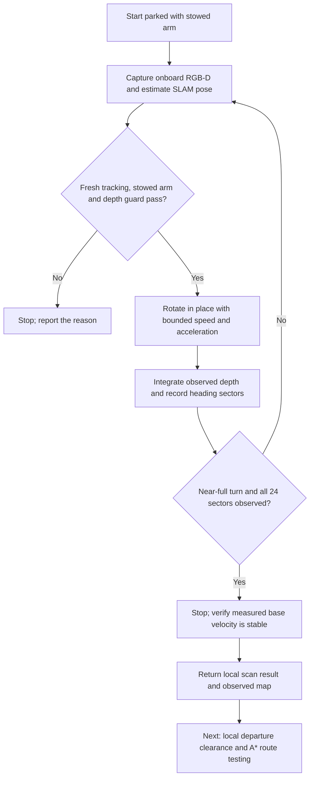

# Local exploration scan before A*

Implemented on `feature/onboard-sensor-interface` in the sensor worktree. This qualifies **in-place visual exploration**, not whole-house exploration or navigation between rooms.

## What changed

The previous exploration runner required a completed navigation map before it would move. It therefore could not perform the initial look-around needed to build that map. `LocalScanSkill` is now a separate bounded active-perception primitive. It rotates without translating, consumes live navigation RGB-D and causal SLAM estimates, and tracks which heading sectors have actually been observed.

A second failure was isolated bad depth returns. In the five-room test a cabinet pixel reported 0.323 m while all eight neighbors were about 1.37 m. Three isolated pixels falsely triggered the proximity guard. `depth_validity()` rejects returns that have no agreeing 8-connected neighbor within max(2 cm, 2% depth). Rejected measurements become **unknown**, never replacement free-space measurements. Connected one-pixel-wide surfaces are retained. `RGBDCamera.raw_depth_m` retains the unfiltered metric measurement for audit/export; `depth_m` and `valid_depth` are used by mapping and control.

The base bridge also previously commanded measured yaw plus only one timestep of motion. The new `OnboardBaseActuator` integrates a commanded target with bounded lead and uses the native MolmoSpaces controller. It holds the stopped target rather than continually moving it to the latest encoder reading. No native controller code, gains, camera mount or collision geometry changed for this fix.



## Reusable interfaces

```python
from cross_episode_sim.navigation import LocalScanSkill, ScanConfig
from cross_episode_sim.control.onboard_base import OnboardBaseActuator

scan = LocalScanSkill(ScanConfig(yaw_speed=0.5, max_seconds=30))
# At each 50 Hz control tick, supply the latest synchronized sensor packet
# and SLAM result. The test captures observations at 10 Hz.
decision = scan.step(packet, tracking_result, control_time)
# The simulator-side bridge owns model/data; the skill never receives them.
actuator.step(forward=0.0, yaw=decision.yaw_rps)
```

The skill returns a status, angular command, observed-sector count, accumulated estimated rotation, nearest observed obstacle and completion flag. It does not call A*, load a route, inspect scene metadata, or emit translational motion. Lost/stale tracking, mismatched timestamps, non-stowed arm, pose jumps and near obstacles produce zero commands. Budget exhaustion is not success. Native MolmoSpaces includes the previously approved unlimited-yaw range fix.

The scan speed ramps up to 0.5 rad/s with a 0.8 rad/s² acceleration limit, then slows before completing the turn. Commands execute at 50 Hz. No tuck/untuck or redocking happens during the scan. The standalone reset initializes the stowed arm before evaluation. Completion uses observed angular coverage, followed by encoder velocity below 1 cm/s translation and 0.02 rad/s yaw for five consecutive control ticks. It does not add a fixed half-second idle hold or accelerate the video.

## Qualification and artifacts

The final suite uses the original base positions from three saved set-table houses: 000006 (5 rooms), 000013 (6 rooms), 000008 (7 rooms). All inter-room doors are initialized open before evaluation. **No parking offset is used in the final suite.** Intermediate tests with a 0.8 m reset offset are retained as debugging artifacts only. No saved action trajectory is replayed.

Final measurements are generated in `runs/local_scan_results.json` and summarized below by the accompanying result table. Each run folder contains:

- `scan.mp4`: navigation RGB/depth on top, wrist RGB/depth below, at original simulated speed.
- `scan_map.png`, `navigation_map.npz`: observed floor, obstacles, unknown cells and conservative clearance.
- `decisions.json`: commands, tracking state, angular coverage and rejected depth-pixel counts.
- `report.json`: simulated/wall duration, stabilization, camera invariance, contact audit and scan result.
- `final_navigation_observation.npz`: processed and raw metric depth, robot mask, RGB and calibration.
- `diagnostic_encoder_poses.npy`: post-run scoring only; never a policy input.

Contact auditing samples every physics step, records robot–environment contacts other than floor support, and checks mast–arm/gripper contacts. It does not feed the policy or select its actions. Ground-truth motion is used only for the reported achieved rotation and drift. The policy uses SLAM estimates, observed depth and measured arm state.


| House | Physical scan | Simulated duration | Settling | Observed floor | Strict clearance area |
|---|---|---:|---:|---:|---:|
| 5 rooms | Pass | 12.90 s | 0.08 s | 34.56 m² | 7.75 m² |
| 6 rooms | Pass | 13.00 s | 0.08 s | 34.45 m² | 7.92 m² |
| 7 rooms | Pass | 12.90 s | 0.08 s | 33.99 m² | 7.72 m² |

All final runs observed 24/24 heading sectors, had no rejected tracking frames, and had no audited external or mast–arm contacts.

- 5 rooms: [video](../runs/local_scan_5room_v6/scan.mp4), [map](../runs/local_scan_5room_v6/scan_map.png), [report](../runs/local_scan_5room_v6/report.json).
- 6 rooms: [video](../runs/local_scan_6room_v6/scan.mp4), [map](../runs/local_scan_6room_v6/scan_map.png), [report](../runs/local_scan_6room_v6/report.json).
- 7 rooms: [video](../runs/local_scan_7room_v6/scan.mp4), [map](../runs/local_scan_7room_v6/scan_map.png), [report](../runs/local_scan_7room_v6/report.json).

## Reproduce

```bash
MUJOCO_GL=egl CUDA_VISIBLE_DEVICES=0 \
OPENBLAS_NUM_THREADS=1 OMP_NUM_THREADS=4 \
PYTHONPATH=.:/nobackup/le/cross-episode-robotics-sim/external/molmospaces \
.venv-slam/bin/python scripts/demo_local_scan.py \
  --source /nobackup/le/cross-episode-robotics-sim/runs/train_test_v1/test_multi_room/batches/round_continuous/set_table_000006 \
  --output runs/local_scan_new
```

Use a new output directory. The upstream checkout in `PYTHONPATH` has the approved yaw patch. Substitute 000013/000008 for the six/seven-room houses. The runner defaults to zero initial base offset. Changing `--initial-backoff` changes the standalone reset, not an executed retreat, and must not be reported as autonomous undocking.

## Limits and next step

A forward camera cannot certify unseen rear clearance before the first rotation. This primitive requires a robot parked with room for its stowed rotation envelope; the three tested starts were checked by physical execution, not an oracle clearance map. The online depth guard is a precaution, not a proof that every unseen surface is collision-free. The controller rejects an unqualified arm posture rather than performing an unchecked tuck.

A scan observes the visible local area; it cannot see through walls or claim to explore all five to seven rooms. Unknown map regions remain unknown. The robot's own footprint also leaves a near-field observation hole; **we have not cleared an arbitrary disk to let A* start**. Validating departure from that footprint and moving between exploration viewpoints is the next stage. Global loop closure, tight-start undocking and autonomous whole-house coverage remain unqualified.
