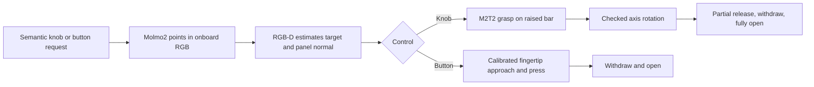

# Sensor appliance controls

Development branch: `feature/onboard-sensor-interface`. These handlers extend
the M2T2 skill interface; the oracle/datagen interface is unchanged.

## Perception and execution



Molmo2-4B identifies the requested control. Wrist and navigation RGB-D provide
metric points in the robot-base frame. Knob orientation comes from the raised
indicator bar, and the rotation axis from its observed silhouette and panel
normal. Small button labels receive a second image crop for pointing.

M2T2 supplies **knob grasp proposals**. Button pressing is a geometric contact
routine; M2T2 has no learned button-press policy here. cuRobo/local inverse
kinematics plan against observed geometry. Exact robot finger convex meshes
resolve overly conservative bounding-box collisions. Intended contact is
permitted only around the observed control; simulation collisions remain active.

The oracle is a procedural reference: pinch the raised bar away from the rim,
rotate about the knob axis, partially release, withdraw, then fully open. None
of its true fixture poses, joint angles, object IDs, or contact flags enter this
backend. A subsequent knob call may reuse the previous M2T2 contact frame,
transformed using the freshly observed indicator orientation. External motion
invalidates this observation/grasp memory.

## Calling the interface

```python
from cross_episode_sim.runtime.appliance_controls import live_appliance_handlers
from cross_episode_sim.skills.m2t2_interface import M2T2SkillInterface

# runtime is the existing live EpisodeRuntime after sensor-based docking.
skills = M2T2SkillInterface(live_appliance_handlers(runtime, output=output))
skills.execute_skill("rotate_knob", {
    "target": "middle stove burner knob directly ahead", "state": "on"})
skills.execute_skill("rotate_knob", {
    "target": "middle stove burner knob directly ahead", "state": "off"})
skills.execute_skill("push_button", {
    "target": "Start key at the bottom of the microwave keypad"})
```

These are **pre-docked, empty-hand** manipulation calls. Navigation remains an
explicit skill. The set-table runtime registers these handlers lazily and
invalidates their target memory before its other motion skills. Other callers
must call `invalidate_appliance_targets(runtime)` before external motion.
Direct hardware integrations can instantiate `SensorApplianceBackend` with
camera, encoder, calibration and command callbacks instead of the simulator
bridge. Its `motion_epoch` must change after external motion.

Supported knob convention: upright OFF indicator and approximately 60 degrees
for ON. This is not a universal appliance-state interpreter. A missing or
ambiguous indicator is reported rather than guessed. Button pointing remains
sensitive to the semantic description and readability of the keypad.

Commands run at 50 Hz. Gripper settling uses encoder stability, and retained
release/withdrawal phases prevent snagging the bar. There is no hidden tuck,
redock, scene restoration, or live video encoding in these calls. Model RPC
services persist across calls; the robot planner is cached. The test harness
records states and renders diagnostic videos separately afterward.

Public results report observed/command completion, **not private appliance
success**. Private tests alone read native knob state and microwave contact
state, without returning those values to the controller. This distinction
matters: a completed twist can slip without changing the burner state.

## Physical qualification, November 9, 2026

| Test | Physical result | Simulated time | Wall time |
|---|---|---:|---:|
| Microwave Start, `button_15` | Contact and ON after withdrawal | 6.82 s | 22.42 s call; 25.36 s harness |
| Knob ON, `knob_21` | ON after release, 49.98 degrees | 13.08 s | 51.15 s call |
| Knob OFF, same continuous run | OFF after release, -0.003 degrees | 9.14 s | 44.41 s call |

The knob cycle is 22.22 simulated seconds total and 101.20 seconds including
harness startup. Both calls completed release/withdrawal. The alternate burner
remained off. The remembered grasp was collision-rejected in this run; a fresh
M2T2 proposal succeeded using the corrected observed indicator fit. Reuse is
an optional checked candidate, not the reason this run passed.

[Knob ON/OFF video](../runs/m2t2_controls_20261109/knob_21/knob_on_off.mp4)
and [private result](../runs/m2t2_controls_20261109/knob_21/report.json).

[Microwave Start video](../runs/m2t2_controls_20261109/button_15/microwave_start.mp4)
and [private result](../runs/m2t2_controls_20261109/button_15/report.json).
The Start button was contacted by a finger pad. Peak recorded contact force was
105.45 N: this is a position-controlled simulation demonstration, not a
force-controlled or hardware-qualified press. These results cover one fixture
and one starting dock, not full composites or varied appliances.

The regression suite for appliance geometry, the skill interface, existing
exploration pipeline contracts and shared handle fitting/candidate generation
passes 46 tests. Tests alone do not establish physical success; the recorded
rollouts above provide the component-level evidence.

## Relevant code

- `control/appliance_controls.py`: public contact sequence and axis waypoints.
- `control/sensor_appliance_backend.py`: observed target acquisition, learned
  grasp selection, checked approach/contact/withdrawal.
- `perception/appliance_controls.py`: RGB-D geometry and indicator fitting.
- `control/convex_finger_contact.py`: precise robot-mesh collision narrow phase.
- `runtime/appliance_controls.py`: live runtime and hardware-style callbacks.
- `scripts/test_sensor_appliance_controls.py`: isolated private reset/scoring.
- `tests/test_sensor_appliance_controls.py`: contracts and geometry regression tests.

Run a pre-docked test with `.venv-sift/bin/python`, the configured Molmo/M2T2
`SENSOR_MODEL_ENDPOINTS`, `--source` pointing at a saved test reset, and a fresh
`--output` directory. The reset is test setup, not a policy observation:

```bash
python scripts/test_sensor_appliance_controls.py \
  --source runs/m2t2_controls_20261109/knob \
  --output runs/knob_check --kind knob \
  --target 'middle stove burner knob directly ahead'
python scripts/render_deferred_rollout.py \
  --recording runs/knob_check/recording --output runs/knob_check/video.mp4
```
