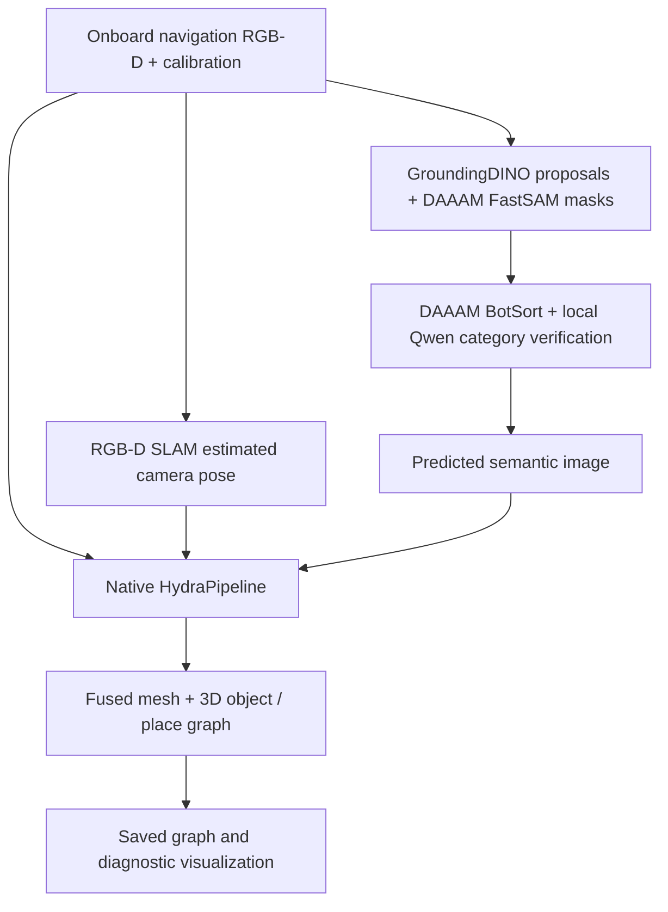

# Native Hydra mapping integration

This integration runs MIT-SPARK Hydra's compiled `HydraPipeline` from the
`project/daaam` branch. It adds a sensor packet interface; it does not implement
an alternative TSDF mapper and call it Hydra. Source revisions are pinned in
`configs/navigation/hydra_sources.json`.



No simulator object IDs, true camera poses, room graph, or hidden object
coordinates enter the mapper. Camera calibration and the robot's self-mask are
robot-owned information. Labels are cup (including drinking glasses), bowl,
and unclassified. Furniture/receptacles are excluded from semantic object nodes,
including legacy table labels in older recordings. Unclassified surfaces still contribute geometry.
Hydra's native `SingleLabelIntegrator` ignores semantic label 0 while still
fusing its depth, so a missed detection does not vote away an earlier label.
This preserves erroneous labels too if perception is wrong; static-map
validation and later dynamic-object handling remain necessary.
This restricted vocabulary is a first test, not general open-world coverage.

## Current scope — user decision, November 1, 2026

- SLAM/observed occupancy and live depth retain responsibility for collision geometry.
- Hydra/DAAAM focuses on manipulable object identity and position. The initial
  supported categories are cups (including glasses) and bowls, not all objects yet.
- Tables, chairs, walls and other unclassified surfaces still contribute their
  measured depth to native fusion. Excluding their semantic labels does not
  erase geometry or turn unknown space into traversable space.
- Table/receptacle detection is a separate navigation/placement capability.
  The navigation demo explicitly opts into its requested category; it is not
  exported as a Hydra object. Reliable table confirmation is still unqualified.
- Native Hydra may produce internal place/room nodes; these are diagnostic and
  are not used to replace SLAM navigation or the collision map.

## Interface

`prepare_frame(camera, tracking, detections, timestamp)` creates the native input:
RGB uint8, depth in meters, int32 semantic image, intrinsics, estimated optical
camera pose, and nanosecond timestamp. Rejected SLAM frames are skipped. Immediately before native fusion, a one-pixel
semantic-mask erosion and 10 cm local depth-discontinuity rejection remove
uncertain silhouettes. This only removes semantic labels; depth geometry is
unchanged. It can reduce small-object recall and needs broader validation. Invalid
or robot depth is zeroed. Conflicting object masks remain unclassified.

`HydraFrameWriter(output).update(...)` records the same contract to NPZ files.
`NativeHydraMapper(first_frame).update(frame)` calls upstream Hydra directly.
`save(output)` saves the native mesh/scene graph and effective configuration.
The optical camera is treated as the input body with identity extrinsics, so its
estimated optical pose is supplied exactly once, not transformed twice.

`NativeHydraProcess(output).update(camera, tracking, detections, timestamp)`
runs a persistent native worker from the simulator/perception environment and
returns Hydra object IDs, categories, estimated positions, and mesh counts.
Use it as a context manager to save and stop cleanly. It accepts sensor data,
never a simulator model or environment. Example:

```python
from cross_episode_sim.mapping.hydra_process import NativeHydraProcess
with NativeHydraProcess("runs/new_live_map") as mapper:
    result = mapper.update(camera, tracking, detections, timestamp)
```

For a live smoke test, add `--native-hydra` to
`scripts/smoke_daaam_grounding.py`. The worker log, raw sensor packets, native
graph, mesh and configuration are retained under `native_hydra/`.

The simulator/perception environment and Hydra environment are separate.
Recorded sensor packets provide a reproducible boundary. A mapping replay does
not prove online navigation using Hydra, nor successful grasping or set-table.
Object navigation now uses native Hydra object positions with independent fresh
confirmation; observed SLAM occupancy and A* still supply routes and collision
checks. See [object navigation](object_navigation.md).

## Setup and commands

```bash
bash scripts/setup_native_hydra.sh
source scripts/native_hydra_env.sh
python scripts/run_native_hydra.py --frames runs/CAPTURE/hydra_frames --output runs/NEW_MAP
python scripts/render_native_hydra.py --map runs/NEW_MAP --frames runs/CAPTURE/hydra_frames
```

The capture scripts `smoke_daaam_grounding.py` and `demo_semantic_navigation.py`
write `hydra_frames/` using navigation-camera observations. Wrist observations
remain available to the perception/navigation test but are not fused into this
single-camera Hydra instance.

## Build compatibility

The isolated Conda environment supplies GTSAM, PCL, OpenCV, Eigen, Boost, and the
compiler. Upstream C++ repositories remain separate from project source.
Patches in `scripts/hydra_patches/` address dependency/compiler compatibility:
Boost.System is header-only; newer Eigen changes its zero-expression type;
newer GCC needs explicit standard-library includes. TEASER's Eigen package
version check needs to accept the installed newer Eigen. No mapping algorithm,
controller, collision check, or success predicate is replaced by these patches.
Conda glog needs pkg-config metadata for Spatial-Hash; setup generates it.

## Validation scope

The sensor-contract tests cover estimated-pose composition, robot masking,
conflicting semantic masks, and rejecting lost tracking. Native mapping results
must be evaluated separately from stationary perception and navigation success.

## Historical integration runs — November 1, 2026

| Test | Result |
|---|---|
| Sensor/perception/navigation unit tests | 43 passed |
| Live simulator → segmentation/VLM → native worker | 10/10 frames fused; cup and bowl nodes; 15,408 mesh vertices |
| Stationary replay after boundary filtering | Cup and bowl retained; 4 free-space nodes; 15,408 vertices |
| Two-room recorded sensor stream | 113/113 frames fused in 49.2 wall seconds; 273,789 vertices; 205 free-space nodes, 2 room nodes |
| Navigation that collected the two-room stream | Failed: 120.04 s budget exhausted; reached the table area but lost fresh semantic confirmation; zero recorded external-contact events |

Artifacts (relative to this worktree):

- `runs/hydra_live_smoke_v1/report.json`: live worker responses from each frame.
- `runs/hydra_native_stationary_v3/mapping_preview.png`: filtered stationary result.
- `runs/hydra_native_two_rooms_v2/mapping_preview.png`: two-room reconstruction.
- `runs/hydra_native_two_rooms_v2/scene_graph.json`: actual native graph with mesh.
- `runs/hydra_native_two_rooms_v2/objects.json`: raw native object nodes.
- `runs/hydra_two_room_capture_v1/navigation.mp4`: unaccelerated capture video.

**Historical table experiment (outside the current object-only scope):** the two-room graph has one bowl node and five table-labeled
fragments, not five tables. Boundary filtering reduced the initial nine table
fragments to five, but one floor fragment remains and legs/tabletop are split.
These raw nodes are deliberately retained in the diagnostic output. They are
not validated object instances and must not yet drive manipulation or be counted
as successful target grounding. Sparse, changing-view segmentation and native
instance association still need work. The live stationary test predates the
boundary filter; the filtered version was checked through both stationary and
two-room native replays.

The 2 room nodes are native geometric clusters, not ground-truth room labels or
a demonstrated room-classification accuracy. Reconstruction is partial: unseen
surfaces are absent. No whole-house or full-task success is claimed.

## Object-only regression checks

After adopting the object-only scope:

- 17 focused sensor-contract, grounding and navigation tests pass.
- `runs/hydra_objects_only_stationary_v1`: native replay retains one cup and one bowl.
- `runs/hydra_objects_only_two_rooms_v1`: all 113 saved frames fuse; only the
  observed bowl is exported as an object. No furniture object nodes are emitted.
  The original moving capture did not confirm a cup, so this is not a cup-recall pass.
- All 273,789 mesh vertex coordinates match the previous two-room reconstruction
  exactly (`geometry_check.json`). Furniture depth was not removed.
- These are native mapping replays, not a new navigation or manipulation success.

### Two onboard cameras in navigation

`MultiCameraHydraProcess` (`cross_episode_sim.mapping.multiview_hydra`) exposes
`update_many(cameras, tracking, detections_by_camera, timestamp)`. It runs native
Hydra separately for navigation and wrist calibration, at the actual shared
capture timestamp. This avoids pretending that different camera intrinsics are
identical or adding artificial time offsets. The navigation mapper retains its
room/structural graph. Wrist-only cup/bowl objects join the object list with
namespaced native IDs. Same-category objects within 0.18 m of an already included
native position are treated as cross-view duplicates; positions are not replaced
with simulator truth or averaged into an invented pose. Close neighboring
same-category objects below this association distance remain a limitation.

`SemanticNavigator.observe` calls this method when available and otherwise
retains the single-camera mapper API. `demo_semantic_navigation.py` uses the
multi-camera implementation by default. Detections from either camera still need
fresh mask/depth agreement with a mapped object before a target is confirmed.
Separate native graphs and input frames are saved under `native_hydra/` and
`native_hydra/wrist/`. The external `hydra_frames/` stream remains the navigation
view used by the existing offline alignment diagnostic.
