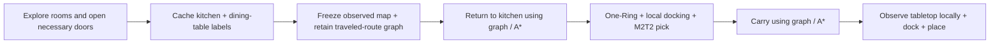
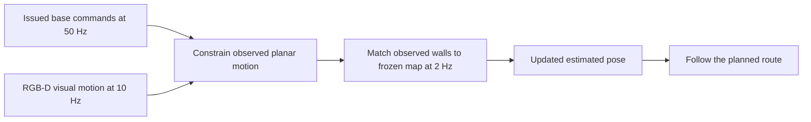
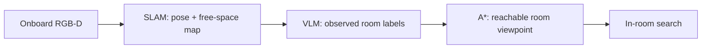
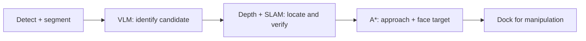
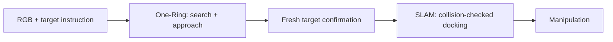
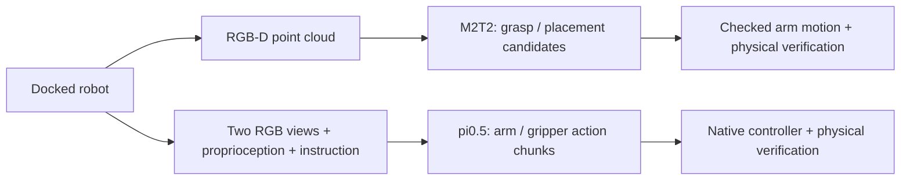

# Navigation and manipulation: diagrams and recorded evidence

Media links below point to local `runs/` artifacts, which are not included in the GitHub code checkout. Camera RGB panels have no segmentation overlays; colored depth and occupancy panels are separate diagnostics.

## November 8 correction: retain the working open-door handoff

**Required contract:** the closed-door case is the same open-door pipeline with
an optional door-opening interruption inside exploration:

`explore → [open necessary door → refresh pose/doorway map] → resume explore`

After exploration, both use identical transit, approach, docking, pick, carry and
place backends. The door reset flag is not an execution-policy selector.

**Unified exploration qualification (run 43 onward, pending):** `explore()` now
invokes the same room-coverage backend for saved/open/closed initial door states.
`room_doors.json` is no longer read to select the execution policy. The initial
door option only configures the harness reset; observed portals drive opening
decisions. Confirmed furniture and the observed map stay in the same session.
After coverage, exploration returns immediately and retains the traveled graph.
Neither the final scan pose nor a remote recognition viewpoint is labelled as a
reached table destination. The existing fixed-map target navigator uses the
observed table geometry until a successful transit/dock is recorded. Exploration
does not add a table-facing approach or call perception again.
The pipeline no longer launches `explore_dining_destination` as a second stage.
Missing coverage/geometry remains an explicit failure, not a successful task.
Run 35 exposed empty CUDA-SIFT detections with a non-None empty descriptor array;
the feature extractor now returns an empty feature set rather than indexing it
as 2D. Run 36 was cancelled to load that fix. Run 37 reached over 96% estimated
coverage in each room but continued scanning because open-door handles were
registered as closed portals and physical open-passage crossings did not create
room-graph edges. It was cancelled for diagnosis; run 38 was not started.

The next correction verifies proposed handles with onboard RGB, records room
connections from accepted SLAM trajectories, and excludes covered-room boundary
noise from frontier utility without altering occupancy. A blocked exploration
decision now ends with its reason instead of silently continuing to scan.
Recorded open and closed camera views exercised the visual state check. Run 39
passed exploration and three complete transfers, then failed the fourth return:
tracking/control drift moved the center about 2 cm outside the inflated transit
corridor. Transit now reuses shape-checked undocking to recover to the existing
free region, retaining the destination and frozen map. A development test from
that failed physical state reached the kitchen in 70.2 wall / 27.22 simulated
seconds, with no contacts and unchanged map. Its map combines saved observed 3D
evidence and the latest 2D occupancy (new columns conservatively extruded); this
is a recovery component test, not a full episode replay.

Run 40 opened the first door to 90.24 degrees but planned the next approach from
the pre-opening sensor packet. The nested opening had moved the base. Exploration
now refreshes cameras/tracking after opening and stowing, and schedules sensing
by elapsed simulation time rather than an outer tick counter that ignores nested
motion. Run 41 confirmed the fresh pose but stopped during the adjacent-leaf
approach. A saved-state local-approach test passed, but live run 44 contacted the
first opened panel and failed final alignment. The local shortcut is therefore
not used in production. Both leaves now use the same ordinary `PortalApproach`,
with a refreshed observed map between openings. The adjacent leaf is completed
before trying to cross. Run 46 exposed a standalone tracker-session setup error,
which was corrected. Runs 47 and 49 opened opposite first leaves successfully,
but failed the second approach. They are failures, not pair qualifications.

The run-47 live obstacle was absent from the frozen map: accumulated free-space
evidence survived a fresh depth hit on the moved panel. A local door refresh now
replaces that stale free history with measured occupied evidence before freezing
again. This only applies to actual sensor hits inside the recently changed door
region; it neither fabricates clearance nor changes unrelated map cells. Tests
cover both outside-region preservation and expiry. Run 50 tests both openings
and subsequent exploration from the initial closed scene; qualification is pending.

Open-door regression run 45 passed exploration, two complete bowl transfers,
and the third kitchen return/approach. The third pick returned `backend_error`;
this is not a full-task success.

Run 42 reached both coverage targets but failed the redundant final table
approach on a live-depth clearance veto. Run 43 passed coverage, but was stopped
before manipulation because its first table sighting was a remote viewpoint
incorrectly registered as a table destination. That association was removed.
Neither unit tests nor component results establish a full-task physical pass.
The narrower forced-single-leaf case remains separately unqualified.

### Original pulling integration — November 8

The full M2T2 pipeline uses the same original handle-pulling command as the
successful run-50 continuation. Dispatch is:

`M2T2SkillInterface.explore → SensorSetTablePipeline.explore →
demo_room_coverage_exploration → LiveDoorOpener → door_open_command →
test_sensor_hinged_cycle`.

`handle_then_push=False` and the fast contact profile are the defaults. Both
observed leaves use this backend when needed. Each opening logs its exact
command, backend and diagnostic-only tracking policy as `door_execution`.
After opening, the existing handoff refreshes onboard pose and doorway occupancy,
then resumes exploration with its semantic memory and traveled routes. Subsequent
transit, approach, pick, carry and place retain their shared existing backends.
The oracle skill interface is unchanged.

Integration regression checks: 17 passed (default opening command, pipeline
dispatch for saved/open/closed doors, navigation backend and observed support).
Fresh closed-door qualification was attempted in
`runs/set_table_pipeline_development/full_attempt_66_original_pull`, starting at
the initial scene, with no saved-grasp continuation. Execution recordings are
rendered offline. The first opening passed (90.30 degrees observed; 71.82
simulated seconds). The robot reached the second handle, but its Molmo request
failed at 16:30:36 EST with `UNAVAILABLE / connection refused`. The four model
services under the old launcher had exited; One-Ring remained alive. Their logs
do not establish which worker exited first or why. The old launcher terminated
all siblings after any worker exit.

`scripts/launch_sensor_services.py` now supervises workers independently, records
exit codes/restarts, preserves sibling workers and cleans up each failed worker's
process group before restarting it. RPC requests wait for an available connection
within their existing deadline, without blindly retrying interrupted inference.
One-Ring is stateful: a detected server-instance change requires a session reset,
not silent reuse of lost policy history. Six lifecycle/RPC tests passed, including
restart after an existing One-Ring output directory. Each restarted One-Ring
worker now uses a fresh session subdirectory and retains earlier recordings.

The replacement service bundle is `services_run67` and the new initial-scene
attempt is `full_attempt_68_supervised` (67 stopped during startup while the
One-Ring output-directory bug was being resolved; no physics ran). All five
services passed RPC health checks before 68 was launched. **Full pipeline success is pending**,
not established by the component pass below.

Run 68 subsequently failed at the second handle **before physical grasping**.
The first opening passed (90.30 degrees observed). Services remained alive. The
grasp planner repeated contact-margin and approach-path rejections; one measured
clearance was 4.92 mm against the unchanged 5 mm planning margin.

The shared handle-grasp executor now deduplicates after panel alignment and jaw
centering, tries the original proposal first, then a 5 mm shallower insertion
when necessary. Both variants use the same collision/path validation. It does
not lower the margin or bypass physics. On the saved run-68 pregrasp state,
`run68_second_handle_auto` rejected the original pose then physically grasped
successfully in 6.62 simulated seconds; both pads contacted the handle throughout
private verification. Nine regression tests passed. Opening from that new grasp
also passed in `run68_second_handle_auto_open`: 88.19 degrees observed,
`full_open_reached=true`, `error=null`, 66.36 simulated seconds including release
and withdrawal. This remains a component continuation, not full-pipeline success.
Its duration exceeds the usual 5–15 second target because it retains the validated
incremental base-following contact routine; this fix targets grasp reliability.
The first-door saved pregrasp regression also passed with its original pose and
zero backoff (5.76 simulated seconds). The combined integration/regression suite
passed 25 tests. `full_attempt_69_handle_recovery` now tests from the initial
closed-door scene after health-checking all five persistent services; full-task
qualification remains pending.

[Automatic grasp recovery log](../runs/set_table_pipeline_development/run68_second_handle_auto.log)
· [Opening continuation log](../runs/set_table_pipeline_development/run68_second_handle_auto_open.log).
· [Successful opening video](../runs/set_table_pipeline_development/run68_second_handle_auto_open/open_success.mp4)
· [Run 69 live log](../runs/set_table_pipeline_development/full_attempt_69_handle_recovery.log).

Run 69 opened both leaves (90.33 and 89.49 degrees observed) and crossed into
the second room. It then regressed room coverage during an unstable enclosure
estimate, returned toward the first room, and created a spurious provisional
third node on a known return crossing. The looping run was stopped for repair.

The topology now retains the last supported enclosure until a replacement is
supported by repeated observations. Stable expanded footprints still replace it
and can lower coverage; occupancy/floor evidence are not fabricated. Known
crossings reuse their existing destination nodes. The exploration graph finishes
reachable current-room frontiers before switching between incomplete rooms.
Forty-four regression tests passed, including temporary boundary loss, genuine
footprint expansion, known return crossings and incomplete-room priority.
`full_attempt_70_room_memory` opened the first leaf (90.03 degrees observed),
then stopped before the second grasp with `fresh_handle_not_visible`.
The navigation camera view was occluded by the arm. With image masking disabled,
the view selector had treated the missing robot mask as an unobstructed view.
This run therefore did not qualify the room-memory repair end to end.
[Exploration log](../runs/set_table_pipeline_development/full_attempt_70_room_memory/explore.log).

The handle handoff now checks camera-to-target rays against calibrated robot
bounds using joint encoders, including when full image masking is disabled.
This is a sparse visibility calculation, not re-enabled navigation masking.
An already identified handle is reacquired from a protruding component in current
RGB-D geometry; a remembered coordinate alone cannot authorize a grasp. Molmo
pointing remains the fallback. Failed fresh perception triggers another local
viewing angle (up to four retries), without restarting the room route. Native
collision-aware grasp planning, physical grasp verification and the original
pulling routine remain in use. Thirty-nine focused regression tests passed.

The saved failed-view test is
`run70_handle_handoff_recovery`; its scope is handle acquisition, grasp and
opening, not full exploration or set-table success. It passed: fresh handle
reacquisition, first planned grasp, and 89.09 degrees observed opening. Total
wall time was 241.22 seconds; opening/release/withdrawal took 64.48 simulated
seconds. The existing incremental contact routine remains a duration exception.
[Recovery log](../runs/set_table_pipeline_development/run70_handle_handoff_recovery.log).

`full_attempt_71_handle_handoff` tests the integrated fixes from the initial
closed-door scene with all five services health-checked. Full-task qualification
is pending; the component pass above must not be counted as set-table success.
[Full-run log](../runs/set_table_pipeline_development/full_attempt_71_handle_handoff.log).

Run 71 subsequently completed both openings and exploration (98.37% and 90.08%
observed room coverage), then failed the initial kitchen transit after 16.42
simulated seconds / 70.56 wall seconds. The terminal reason was
`live_obstacle_no_safe_detour`: a live-depth veto overrode the route selected
from the success graph. No physical collision was recorded by that run.

Following the user's instruction, shared fixed-map transit now uses the frozen
observed costmap alone for obstacle planning and following. The live-depth veto,
temporary obstacle overlay and associated terminal rejection have been removed.
This applies to the room follower and the carry target-follower fallback.
Departure planning also uses frozen geometry. Localization continues; physical
collision geometry, map footprint constraints and task scoring remain intact.
Thirty focused regression tests pass. `run71_frozen_transit` tests the saved
transit start with a graph reconstructed from recorded SLAM samples; it is a
component test, not a fresh full-pipeline qualification.
[Transit test log](../runs/set_table_pipeline_development/run71_frozen_transit.log).

The saved-start transit passed in 32.86 wall seconds / 27.12 simulated seconds,
with zero recorded contacts and identical initial/final frozen-map digests.
Its sparse diagnostic graph has 115 nodes, versus 2,475 in the original live
session, so this is not an exact replay of the original in-memory graph.
The expanded skill-interface/navigation regression suite passes 57 tests.
Fresh `full_attempt_72_frozen_transit` validates the actual continuous pipeline
from the closed-door reset; its result remains pending.
[Run 72 live log](../runs/set_table_pipeline_development/full_attempt_72_frozen_transit.log).

[Full-run log](../runs/set_table_pipeline_development/full_attempt_66_original_pull.log)
· [Exploration log](../runs/set_table_pipeline_development/full_attempt_66_original_pull/explore.log).

**November 8 execution update:** user-requested tracking diagnostics no longer
abort hinged motion. Arm endpoint error, contact pose/handle deviation, and
progress stalls/timeouts are logged as `MOTION_WARNING`; a completed command
chunk proceeds without requiring a 5 mm endpoint match. Collision-aware planning,
physical collision geometry, grasp/release verification and final scoring remain.
This removes the 15 mm abort that stopped run 50's second pull; it does not itself
establish successful opening. Missing pose/geometry and inability to plan remain
distinct execution errors. The original handle-pulling policy was retested
from run 50's saved second-door grasp. `run50_second_pull_log_only` passed in
38.16 simulated seconds but lacked the original inherited floor map. The closer
continuation, `run50_second_pull_with_map`, restores the last accepted recorded
floor map and estimated base pose from before the grasp (never future evidence).
It reproduced the original approximately 18 mm gripper-tracking deviation,
logged `action: continue`, and passed open/release/withdraw in **63.76 simulated
seconds**. Private final angle: **89.81 degrees**; observed estimate: **87.63
degrees**; `success=true`, `full_open_reached=true`, `error=null`. Scoring and
physics were unchanged. This is a saved-state second-door continuation, not a
fresh full exploration/pipeline qualification.

[Successful original pull with recorded map](../runs/set_table_pipeline_development/run50_second_pull_with_map/pull_success.mp4)
· [physical report](../runs/set_table_pipeline_development/run50_second_pull_with_map/report.json)
· [log](../runs/set_table_pipeline_development/run50_second_pull_with_map.log).

### Two-leaf panel-push development (not qualified/default)

Experimental sequence for each leaf: **short handle pull → release → reposition only
 the gripper onto the panel → base-assisted panel push**. The base stays at the
handle dock during the free-space gripper transition. It must not redock merely
to transfer the gripper from the handle to the panel. Both leaves must physically
use this sequence before enabling it for exploration and the full pipeline.

The development staged command (`--handle-then-push`) now requests up to a
45-degree pull-side handle stroke before panel transfer; the push-side initial
stroke remains 15 degrees. This panel-push variant remains unqualified and is
not the successful original-pull continuation described above.
It locates the free edge from observed panel points, then tries nearby measured
contact patches (1.5, 4 and 7 cm inward), rather than measuring that margin from the inboard handle.
The previous target was approximately 23 cm inside the measured edge in run 58.
It uses the calibrated closed-finger hull for contact placement and the full
gripper geometry for collision checks. The cabinet's contact IK seed and tilt
family are tried before the arm approaches; the base moves only after contact.
No fixture coordinates, simulator hinge state, or oracle parking poses enter
execution. Native physics and observed collision checks remain enabled.

Runs 58–60 were stopped during development without qualifying a panel push.
Their pre-push base-repositioning strategy is removed from the staged profile.
Run 61 failed at the first panel transition. Its sampled-state audit measured
less than 1 mm of base translation before the attempted contact, confirming that
the unwanted redock was removed. It did not demonstrate panel pushing.
The next correction preserves the sparse exposed rear edge when the front face
dominates the point count, and tries measured lower panel patches to clear the
handle. An offline check on run 61 validated a contact pose 12 cm below the
handle plus its 3.5-second approach/contact trajectory; this is planning evidence
only. Run 62 reached precontact but stopped because its hand obscured the tiny
contact patch. The staged policy now retains that previously observed patch and
transports it using the visible panel's measured rotation. Run 63 established
gripper contact and physically pushed the first leaf from about 19 to 24 degrees;
the sampled audit found only gripper contact, no unrelated collisions, and under
1 mm precontact base drift. It then failed because the old tracking window still
assumed a held handle. Panel pushing now tracks the visible panel above the hand.
Run 64 failed before contact because the dense front face hid the sparse rear
edge in percentile filtering. Supported depth layers now retain that observed
edge; an offline collision-checked approach was found. Neither leaf nor pair is
yet qualified to full open.

The next revision shares code with the oracle rather than merely copying its
sequence. `control/coordinated_contact.py:prepare_panel_push` is called by both
`fixtures/door_push.py` and `control/observed_panel_push.py`: contact IK → nearby
precontact IK on that branch → validate contact approach → plan joint-space
reach → execute. The sensor caller supplies only observed scene geometry and
robot calibration. `panel_arc_geometry` also supplies the same surface arc and
partial wrist rotation to both executors; calibrated finger placement preserves
contact when wrist rotation differs from panel rotation. Physical execution,
camera feedback, and private outcome scoring remain separate. Unit equivalence
checks are not evidence that either physical leaf has passed.
The test stops after both opening attempts; it is not a full exploration or task
qualification. Only one physical development rollout runs at a time.

For arm-only cuRobo graph proposals, calibrated stationary base boxes are checked
first; approximate base spheres are omitted from that search and restored before
full trajectory validation. Arm/mast/finger geometry remains in the search.
Simulator collisions are unchanged. Fifteen focused tests cover the mirrored
observed-edge contact, exact-base collision handling, and sphere restoration.

Qualification gates: actual gripper-panel contact on both openings, then closed-
door exploration, then the unchanged downstream set-table pipeline. No pass is
claimed for this new staged version yet.

**Default navigation restored after run 33's turn oscillation:** both production
transit scripts now use the existing undock and fixed-map navigator from the
run-57 flow. `FixedRoomWaypointFollower`/`FixedMapNavigator` still consult the
existing success graph, with A* connections. The separate `SuccessGraphTransit`
planner/follower is no longer called by production transit or carry. Carry no
longer enables frozen-wall/planar-motion localization; those modules remain
isolated diagnostic experiments. Closed-door exploration, continuous route
recording, the station handoff and the source map-resolution fix are retained.
This restores the backend choice, not a new physical success claim. Run 33 was
allowed to finish; its experimental carry timed out. Run 34 used the restored
backend but failed undocking through the forced single-leaf opening.

Historical diagnosis: run 32 passed the first carry in 105.6 wall seconds, then failed table
observation. Coverage completion had incorrectly registered its final scan pose
as the dining destination. The interim correction added a station approach;
the current correction above instead retains the observed table location for
normal fixed-map target navigation. An arbitrary coverage endpoint or remote
sighting is never labelled as a reached table. The
proposed placement-memory bypass was reverted before any physical run.

Earlier notes below describing the skipped station approach are historical and
superseded.

## Current exploration handoff — November 7

After successful full-room exploration, confirmed furniture labels are reused.
There is no separate trip to find or approach the dining table again before
starting the task. Station discovery runs only when a required label is missing.
The later tabletop observation is for placement geometry and available surface,
not repeated station discovery. Task transit keeps the map frozen and updates
localization; unknown zones require explicit exploration.

Closed-door full-task validation is still in progress (run 32). Run 29 failed:
the robot crossed the opening, but an exact goal-cell check rejected an endpoint
within the follower's permitted arrival tolerance. The geometric portal endpoint
now uses the follower's tolerance; generic undocking still checks its free-region
destination. The
[successful crossing component video](../runs/set_table_pipeline_development/crossing_route_28_turn_fix/crossing.mp4)
is a saved-state component test, not full-task success. See
[handoff fixes and validation](door_sweep_map_refresh.md) for the continuous SLAM
trajectory, success-graph integration, and physical-test results.

Run 30 passed exploration, the graph-based return to the kitchen, first-object
docking and pickup. Its first carry contacted the closed leaf and stopped with
`blocked_motion`; it was not a full success. Private scoring found about 29 cm
localization error at contact. A depth-to-frozen-wall SE(2) correction reduced
mean error from 20 cm to 8 cm on that recorded segment (about 3 cm near contact).
The corresponding saved-grasp carry test reached the dining destination in
146.0 wall / 61.88 simulated seconds with no recorded door contact and retained
gripper contact. [Carry component video](../runs/set_table_pipeline_development/carry30_corrected_localization/carry.mp4).

Run 31 tests the correction in the continuous tracker, first enabled at carry
handoff and reused across subsequent stages. It aligns onboard depth to the
existing observed wall map at 2 Hz; it does not rebuild the map, restart SIFT,
or use simulator poses. Invalid/uninformative registration retains the original
RGB-D estimate. The component result is not a full-task success claim.

Run 31 passed exploration/return/pick but failed carrying: a well-supported
58 cm map correction was rejected by a fixed 50 cm cutoff, then weak partial
matches were accepted. Support-aware registration improved recorded-segment
accuracy, but live turns exposed translation ambiguity along parallel walls.
The current version corrects only geometrically observable directions and
constrains visual odometry with issued planar commands. Commands bound possible
motion; observed zero progress still means zero progress. Neither robot world
pose nor scene truth is supplied to the estimator.

`carry31_planar_localization` passed the saved-grasp carry in 106.3 wall / 53.28
simulated seconds with no recorded door contact. [Camera views](../runs/set_table_pipeline_development/carry31_planar_localization/carry.mp4)
and [map diagnostic](../runs/set_table_pipeline_development/carry31_planar_localization/carry_map.mp4).
Run 32 validates the integrated version from the original closed-door state;
full-task success is still pending. Eleven motion/localization/session/base tests
passed before launch. Sparse/failed diagnostic variants are not successful demos.

Frozen-map tracking during carry and subsequent navigation now follows this
sensor-only flow:

The wall fit is in XY/yaw using height-filtered observed depth; it does not build
a new dense 3D map. Poorly constrained directions retain the visual/kinematic
estimate. Translation during an in-place turn is suppressed; explicit lateral
contact commands remain supported. Forward progress still comes from observed
motion, so commanded movement against an obstacle is not treated as progress.

The diagrams and media below document the earlier November 3 implementation.

Updated November 3, 2026. Only high-level task planning may be oracle. Execution uses onboard RGB-D, calibration, proprioception and estimated SLAM state. Simulator truth is restricted to private scoring. Fixed room cameras are not policy observations.

## Cross-room navigation

If no route is known, explore observed free-space frontiers and update the map. A* cannot plan through an unseen room as though its geometry were known. Room recognition alone does not mean the robot has reached an appropriate object-search viewpoint.

## In-room: detection / segmentation with VLM

The detector proposes regions; segmentation supplies pixels; the VLM labels the region in context. Depth and estimated camera poses project observations into the map. A label alone neither proves the target exists nor provides a safe manipulation pose.

## In-room: replace local search with One-Ring

Mapping continues while One-Ring moves. Detection, segmentation and VLM confirmation remain in the hybrid pipeline; One-Ring replaces local search behavior, not all perception. The robot uses reconstructed geometry to finish docking and face the target.

## Manipulation alternatives

M2T2 predicts geometric candidates; it does not perform cross-room navigation. pi0.5 predicts arm/gripper commands from observations. Base navigation remains separate. Neither branch receives simulator object poses as execution inputs.

## Successful development continuation and reconstruction

[Full final-cup transfer with onboard views, maps and reconstruction](../runs/set_table_pipeline_development/navigation_manipulation_review/successful_final_cup_with_reconstruction.mp4) · [original four-panel video](../runs/set_table_pipeline_development/last_cup_room_approach_v3/review/last_cup_success.mp4) · [physical report](../runs/set_table_pipeline_development/last_cup_room_approach_v3/report.json).

This continuation starts after two bowls and one cup have been served. It finds, picks, carries and places the final cup, reaching the complete two-person semantic goal. It is **not a fresh, unchanged full-task qualification or a test-set success-rate estimate**. Approximately 134 seconds of simulated playback, at 1×.

The navigation cloud is reconstructed from saved onboard metric depth and estimated SLAM transforms, accumulated in timestamp order. It is sampled, not a reconstruction of every rendered frame. M2T2 panels show the actual point cloud supplied before each action. Carry, docking and retreat retain labeled earlier cloud snapshots; no live reconstruction is invented. Map panels are live where recorded; docking/retreat use labeled preceding-stage map snapshots. [Visualization provenance](../runs/set_table_pipeline_development/navigation_manipulation_review/provenance.json).

| Stage | Example |
|---|---|
| Cross-room / in-room search and evolving reconstruction | [Navigation frame](../runs/set_table_pipeline_development/navigation_manipulation_review/stage_0.png) |
| Pick input geometry and execution | [Pick frame](../runs/set_table_pipeline_development/navigation_manipulation_review/stage_1.png) |
| Carry with online map | [Carry frame](../runs/set_table_pipeline_development/navigation_manipulation_review/stage_2.png) |
| Docking at table | [Docking frame](../runs/set_table_pipeline_development/navigation_manipulation_review/stage_3.png) |
| Placement geometry and execution | [Place frame](../runs/set_table_pipeline_development/navigation_manipulation_review/stage_4.png) |

Separate successful M2T2 clips:

- [Pick with map, 3D input cloud and wrist view](../runs/set_table_pipeline_development/last_cup_room_approach_v3/transfer_04_cup/pick/physics/slam_m2t2_geometry.mp4): about 6.44 simulated seconds; cup lifted about 18.3 cm.
- [Place with map, 3D input cloud and wrist view](../runs/set_table_pipeline_development/last_cup_room_approach_v3/transfer_04_cup/place/slam_m2t2_geometry.mp4): about 7.58 simulated seconds; final scene passes the private semantic scorer.

## In-room failure example: finding the cup in the kitchen

The kitchen cup-search run is the main example for the in-room diagram. It is not evidence of failed cross-room SLAM routing or failed kitchen recognition.

### What the recording shows

[Failed cup-search preview](../runs/set_table_pipeline_development/last_cup_search_preview/cup_search_stall.mp4) · [full navigation report](../runs/set_table_pipeline_development/last_cup_after_three_transfers/transfer_04_cup/navigation/report.json).

The original attempt timed out at 180 simulated seconds without a confirmed cup and without reaching a grasp attempt. This was a **hybrid One-Ring + perception-confirmation failure**, not an independently measured pure-VLM baseline. The recording establishes that target acquisition failed; it does not establish whether the detector, segmentation, VLM, tracking, or approach policy was the sole cause. A small target and poor viewpoint are possible contributing factors. The later room-approach change moves farther into observed room space before local search.

The saved report records `selected_object: null`, `sensor_navigation_success: false`, and 328 detection calls. At 40 seconds the camera faces the kitchen counter, but `Object search verified` is false and the wrist points toward the floor. The cup occupies a small part of the navigation view. This demonstrates unsuccessful in-room target acquisition/confirmation, not failure to recognize the kitchen or a measured failure of cross-room routing. The logs do not isolate the VLM as the sole cause.

### Supporting diagnostic: incorrect table label during target finding

This separate historical example concerns object/receptacle finding in the carry stage. Dining-table detection is not the room-labeling mechanism used for cross-room routing; do not use this image to illustrate cross-room failure.

[Exact input and response](../runs/set_table_pipeline_development/first13_transfer_v2/carry/grounding/query_00001.json): the original model-input mask covers much of the floor. The image above is the clean camera frame near that query; segmentation overlays have been removed from presentation images/videos at the user’s request. The VLM nevertheless returns `category: dining table`, describing a rectangular surface with legs near chairs. Context at the edge of the image does not make the original proposed region a valid tabletop.

The old carry stage reported arrival, but [fresh table observation failed](../runs/set_table_pipeline_development/first13_transfer_v2/table_perception/report.json) with `No freshly observed dining-table surface`. The old geometric proposal handling could accept a small elevated fragment of a much larger bad mask. The subsequent fix requires sufficient support-plane coverage of a segmentation proposal before accepting it. This is one recorded failure and a targeted fix, not proof of general perception robustness.

### Occlusion and output validity also matter

The same sequence's [query 2](../runs/set_table_pipeline_development/first13_transfer_v2/carry/grounding/query_00002.json) has an occluded wrist view and a truncated JSON response; it is safely parsed as `unknown`. [Query 3](../runs/set_table_pipeline_development/first13_transfer_v2/carry/grounding/query_00003.json) returns `cabinet`, outside the requested category enum (`dining table`, `other`, `unknown`), and is also rejected. These are distinct from an incorrect but valid dining-table label.

These examples motivate fresh multi-view confirmation, geometric checks and better approach viewpoints. They do not establish a detector-versus-VLM accuracy ranking.

## pi0.5: training-example success versus test-scene failure

| Diagnostic | Video | Result |
|---|---|---|
| Training-example start | [Successful pick](../runs/pi05_training_grasp_v1/policy/rollout.mp4) | Bowl held; maximum lift about 13 cm |
| Test-scene start after sensor docking | [Failed pick](../runs/pi05_v3_pick_place_v1/pick_fixed/rollout.mp4) | No bowl held; no meaningful lift |

Both use checkpoint `runs/onboard_pi05_training/pi05_onboard_set_table_arm/v3/3749`, config `pi05_droid_jointpos_polaris`, and instruction “Pick up a bowl from the counter and hold it.” Both run for 30 simulated seconds, with stationary base, two separate RGB inputs, and 7 arm joint targets plus gripper. These are pick smoke tests, not full-task evaluations.

The successful initial state comes from training episode `set_table_000162`; it matches exported initial qpos/control, but is not a replay-qualified dynamic checkpoint. The failed scene comes from `test_two_rooms/.../set_table_000000` after sensor docking. That scene has also been used for component development. Different starts/viewpoints mean this pair illustrates a failure to transfer in these conditions; it is not a controlled estimate of generalization or evidence that the camera alone caused failure.

Provenance: [training start](../runs/pi05_training_grasp_v1/start/configuration.json), [training policy config](../runs/pi05_training_grasp_v1/policy/config.json), [test docking config](../runs/docking_distance_smooth1/close_forward/configuration.json), [test policy config](../runs/pi05_v3_pick_place_v1/pick_fixed/config.json).

## Follow-up: visible cup lost before confirmation (full attempt 20)

At approximately 38 simulated seconds of the final-cup search, the navigation
camera already shows the cup close to the counter. An offline replay of the
saved RGB-D frame found a Grounding DINO cup proposal (confidence ~0.36) and
an associated FastSAM mask (270 pixels, box IoU ~0.78). Thus distance or a
missing detector proposal does not explain that particular frame.

The hybrid local-search branch did not honor raw proposal confirmation needs:
its pause required an already VLM-labeled target, whereas BotSort needed repeated
observations before activating the new track. One-Ring could turn away during
that interval. The fix propagates pending proposal categories to the hybrid
navigator and holds a target-category candidate for at most 3.2 seconds. A raw
proposal cannot authorize docking or grasping; existing VLM, depth, freshness
and physical checks remain required. Persistent unconfirmed proposals cannot
hold the robot indefinitely.

Validation so far: 51 focused tests passed. Repeating the saved close-up frame
through the real detector, tracker and Qwen3-VL produced a cup confirmation on
the second observation. This is an offline handoff check, not a physical run.
Physical continuation `last_cup_raw_confirmation_v1` starts from attempt 20's
actual state after three transfers. Fresh full qualification `full_attempt_21`
is scheduled only if that continuation succeeds. Neither is claimed successful
until its report passes. Diagnostic logs: `runs/cup_confirmation_fix/`.

### Follow-up: approach contact after successful cup confirmation

`last_cup_raw_confirmation_v1` completed navigation/docking in 47.74 simulated
seconds, then failed **measured arm settling during approach**. Candidate
rejection messages were not the terminal cause: candidate 34 had been selected.
Private diagnostic inspection found premature gripper–cup contact. Increasing
the pre-grasp offset alone from 2 to 6 cm did not fix the path.

The pick planner now retains the observed target surface as collision geometry
through the free approach. Contact permission begins with the final grasp
insertion. The pre-grasp offset defaults to 6 cm, and settling diagnostics record
joint error and velocity. No simulator contact truth enters the planner.

`cup_pick_target_approach_v1` passed physical grasp/lift/hold verification in about
11 simulated seconds. Approach settling took 0.10 s, with maximum joint error
0.00021 rad. Eighteen focused manipulation tests passed. Carry/placement continue
in `cup_target_approach_transfer_v1`; a successful transfer triggers fresh
`full_attempt_21`. These development retries are not a fresh full-task result.
