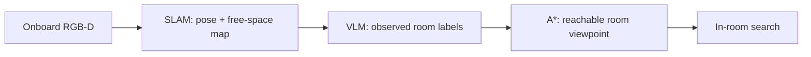
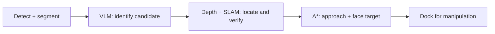
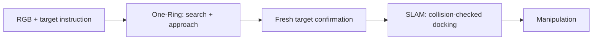
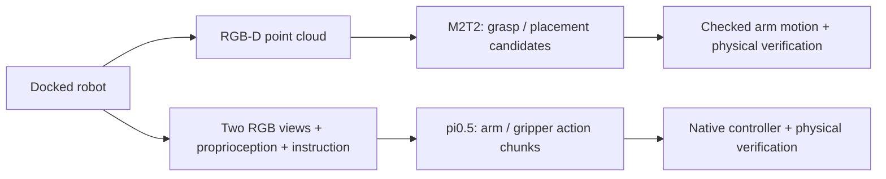

# Navigation and manipulation: diagrams and recorded evidence

Updated November 3, 2026. Only high-level task planning may be oracle. Execution uses onboard RGB-D, calibration, proprioception and estimated SLAM state. Simulator truth is restricted to private scoring. Fixed room cameras are not policy observations.

## Cross-room navigation

If no route is known, explore observed free-space frontiers and update the map. A* cannot plan through an unseen room as though its geometry were known. Room recognition alone does not mean the robot has reached an appropriate object-search viewpoint.

## In-room: detection / segmentation with VLM

The detector proposes regions; segmentation supplies pixels; the VLM labels the region in context. Depth and estimated camera poses project observations into the map. A label alone neither proves the target exists nor provides a safe manipulation pose.

## In-room: replace local search with One-Ring

Mapping continues while One-Ring moves. Detection, segmentation and VLM confirmation remain in the hybrid pipeline; One-Ring replaces local search behavior, not all perception. The robot uses reconstructed geometry to finish docking and face the target.

## Manipulation alternatives

M2T2 predicts geometric candidates; it does not perform cross-room navigation. pi0.5 predicts arm/gripper commands from observations. Base navigation remains separate. Neither branch receives simulator object poses as execution inputs.

## Successful development continuation and reconstruction

[Full final-cup transfer with onboard views, maps and reconstruction](../runs/set_table_pipeline_development/navigation_manipulation_review/successful_final_cup_with_reconstruction.mp4) · [original four-panel video](../runs/set_table_pipeline_development/last_cup_room_approach_v3/review/last_cup_success.mp4) · [physical report](../runs/set_table_pipeline_development/last_cup_room_approach_v3/report.json).

This continuation starts after two bowls and one cup have been served. It finds, picks, carries and places the final cup, reaching the complete two-person semantic goal. It is **not a fresh, unchanged full-task qualification or a test-set success-rate estimate**. Approximately 134 seconds of simulated playback, at 1×.

The navigation cloud is reconstructed from saved onboard metric depth and estimated SLAM transforms, accumulated in timestamp order. It is sampled, not a reconstruction of every rendered frame. M2T2 panels show the actual point cloud supplied before each action. Carry, docking and retreat retain labeled earlier cloud snapshots; no live reconstruction is invented. Map panels are live where recorded; docking/retreat use labeled preceding-stage map snapshots. [Visualization provenance](../runs/set_table_pipeline_development/navigation_manipulation_review/provenance.json).

| Stage | Example |
|---|---|
| Cross-room / in-room search and evolving reconstruction | [Navigation frame](../runs/set_table_pipeline_development/navigation_manipulation_review/stage_0.png) |
| Pick input geometry and execution | [Pick frame](../runs/set_table_pipeline_development/navigation_manipulation_review/stage_1.png) |
| Carry with online map | [Carry frame](../runs/set_table_pipeline_development/navigation_manipulation_review/stage_2.png) |
| Docking at table | [Docking frame](../runs/set_table_pipeline_development/navigation_manipulation_review/stage_3.png) |
| Placement geometry and execution | [Place frame](../runs/set_table_pipeline_development/navigation_manipulation_review/stage_4.png) |

Separate successful M2T2 clips:

- [Pick with map, 3D input cloud and wrist view](../runs/set_table_pipeline_development/last_cup_room_approach_v3/transfer_04_cup/pick/physics/slam_m2t2_geometry.mp4): about 6.44 simulated seconds; cup lifted about 18.3 cm.
- [Place with map, 3D input cloud and wrist view](../runs/set_table_pipeline_development/last_cup_room_approach_v3/transfer_04_cup/place/slam_m2t2_geometry.mp4): about 7.58 simulated seconds; final scene passes the private semantic scorer.

## Why detection / segmentation + VLM can fail

### A bad region receives a confident, incorrect semantic label

[Exact input and response](../runs/set_table_pipeline_development/first13_transfer_v2/carry/grounding/query_00001.json): the original model-input mask covers much of the floor. The image above is the clean camera frame near that query; segmentation overlays have been removed from presentation images/videos at the user’s request. The VLM nevertheless returns `category: dining table`, describing a rectangular surface with legs near chairs. Context at the edge of the image does not make the highlighted region a valid tabletop.

The old carry stage reported arrival, but [fresh table observation failed](../runs/set_table_pipeline_development/first13_transfer_v2/table_perception/report.json) with `No freshly observed dining-table surface`. The old geometric proposal handling could accept a small elevated fragment of a much larger bad mask. The subsequent fix requires sufficient support-plane coverage of a segmentation proposal before accepting it. This is one recorded failure and a targeted fix, not proof of general perception robustness.

### Occlusion and output validity also matter

The same sequence's [query 2](../runs/set_table_pipeline_development/first13_transfer_v2/carry/grounding/query_00002.json) has an occluded wrist view and a truncated JSON response; it is safely parsed as `unknown`. [Query 3](../runs/set_table_pipeline_development/first13_transfer_v2/carry/grounding/query_00003.json) returns `cabinet`, outside the requested category enum (`dining table`, `other`, `unknown`), and is also rejected. These are distinct from an incorrect but valid dining-table label.

### Distant small targets may never reach confirmation

[Failed cup-search preview](../runs/set_table_pipeline_development/last_cup_search_preview/cup_search_stall.mp4) · [full navigation report](../runs/set_table_pipeline_development/last_cup_after_three_transfers/transfer_04_cup/navigation/report.json).

The original attempt timed out at 180 simulated seconds without a confirmed cup and without reaching a grasp attempt. This was a **hybrid One-Ring + perception-confirmation failure**, not an independently measured pure-VLM baseline. Small targets at a poor viewpoint and repeated search motion can prevent the handoff to docking. The later room-approach change moves farther into observed room space before local search.

These examples motivate fresh multi-view confirmation, geometric checks and better approach viewpoints. They do not establish a detector-versus-VLM accuracy ranking.

## pi0.5: training-example success versus test-scene failure

| Diagnostic | Video | Result |
|---|---|---|
| Training-example start | [Successful pick](../runs/pi05_training_grasp_v1/policy/rollout.mp4) | Bowl held; maximum lift about 13 cm |
| Test-scene start after sensor docking | [Failed pick](../runs/pi05_v3_pick_place_v1/pick_fixed/rollout.mp4) | No bowl held; no meaningful lift |

Both use checkpoint `runs/onboard_pi05_training/pi05_onboard_set_table_arm/v3/3749`, config `pi05_droid_jointpos_polaris`, and instruction “Pick up a bowl from the counter and hold it.” Both run for 30 simulated seconds, with stationary base, two separate RGB inputs, and 7 arm joint targets plus gripper. These are pick smoke tests, not full-task evaluations.

The successful initial state comes from training episode `set_table_000162`; it matches exported initial qpos/control, but is not a replay-qualified dynamic checkpoint. The failed scene comes from `test_two_rooms/.../set_table_000000` after sensor docking. That scene has also been used for component development. Different starts/viewpoints mean this pair illustrates a failure to transfer in these conditions; it is not a controlled estimate of generalization or evidence that the camera alone caused failure.

Provenance: [training start](../runs/pi05_training_grasp_v1/start/configuration.json), [training policy config](../runs/pi05_training_grasp_v1/policy/config.json), [test docking config](../runs/docking_distance_smooth1/close_forward/configuration.json), [test policy config](../runs/pi05_v3_pick_place_v1/pick_fixed/config.json).
