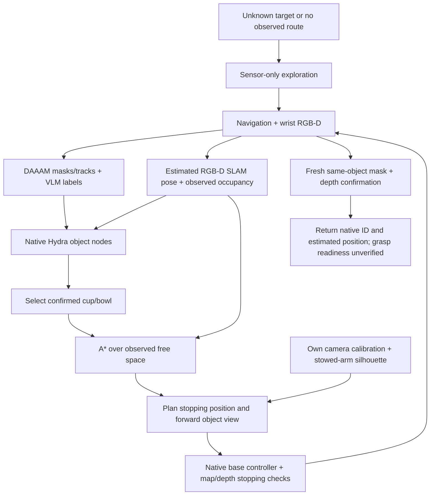
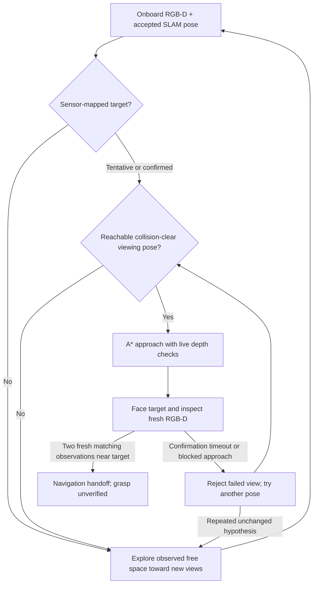

# Sensor-only object navigation

`SemanticNavigator(..., object_mapper=NativeHydraProcess(...))` connects native
Hydra object mapping to observed-map A*. It currently supports cups and bowls.
The demo defaults to this mode. Native Hydra supplies object positions; SLAM
occupancy and live depth supply collision checks. No simulator target positions,
room graph, or ground-truth localization are policy inputs.



## Data boundaries and confirmation

`HydraTargetMap` retains native node IDs and positions. A native node alone cannot
refresh `last_seen`: a current category-consistent mask must contain its projected
position and its measured depth location must agree within 25 cm. Matching is
one-to-one per camera; duplicate timestamps and a second camera do not double
count confirmations. Lost SLAM tracking cannot confirm targets. Removed native
nodes are not retained as active goals.

Persistent map targets remain available during exploration. Arrival still needs
two fresh matching observations after entering confirmation, a nearby stopping
position, and the normal physical-contact audit. A remembered object behind a
wall is not a success. The initial observation phase establishes tracking before
moving; newly seen candidates can trigger a bounded inspection pause. These are
perception verification holds, not video padding.

`visible_object_heading()` uses estimated object position, camera calibration,
and the current stowed robot silhouette. It selects a forward heading within
0.75 rad of the object bearing, with the projected object clear of the robot and
image borders. Candidate stopping cells must be observed free and A*-connected.
This checks self-occlusion only; scene occlusion still requires live confirmation.
Small checked alternate viewing angles are recovery actions. They never disable
map/depth guards or move the arm out of its verified travel posture.

## Run

From the sensor worktree, with native Hydra and perception environments installed:

```bash
CUDA_VISIBLE_DEVICES=6 bash scripts/test_semantic_navigation.sh \
  /path/to/saved/two-room/episode --target cup --seconds 180
# Or --target bowl. The output is a unique run directory.
```

`--object-map visual` selects the earlier standalone visual-target-map ablation.
Receptacle tests must explicitly use `--object-map visual --target 'dining table'`;
Hydra object navigation does not accept table goals.

Each run saves the four-panel video, detailed progress, observed occupancy map,
SLAM estimates, DAAAM/VLM audit, raw Hydra sensor packets, native graph/mesh and
`report.json`. `selected_object` contains native ID, category, estimated map
position and last observation time. `grasp_ready: false` is intentional: this is
navigation, not a manipulation reachability or task-completion certificate.
The simulator reset opens room doors and stows the arm before evaluation;
it does not test closed-door operation or recovery from a manipulation posture.

## Timing

Exploration and repeated perception verification may exceed the typical 5–15 s
atomic target. Videos run at simulated speed; synchronous perception/native
mapping pauses wall-clock execution. No real-time performance claim is made.
No fast-forwarded replay, collision disabling, or success-criterion bypass is used.

## Farther starts and room search

`--initial-backoff 1.2 --initial-yaw-offset 3.141592653589793` changes only
standalone initialization before evaluation. It starts farther from the saved
manipulation pose and facing away. This is not evidence of cross-room travel;
report the measured displacement and contacts before claiming an approach pass.

The policy does not currently classify rooms as kitchens or dining rooms.
When a target is unknown, sensor-only exploration selects reachable observed
space toward unexplored views. A* routes through observed free cells, not through
unknown rooms toward an oracle object coordinate. Once a cup/bowl is confirmed,
its native Hydra position supplies the destination and onboard calibration
supplies a viewing heading. Semantic room recognition from visible appliances
could prioritize future exploration, but is not implemented in this policy.

A mapped target may propose a region for re-detection. It must project into a
current segmentation mask with agreeing measured depth and a verified category;
map memory alone cannot satisfy fresh confirmation.

The RGB proposal model is selectable with `--detector-model`, for example
`IDEA-Research/grounding-dino-base` versus the default
`IDEA-Research/grounding-dino-tiny`. DAAAM masks, VLM verification, SLAM, and
physical navigation checks remain the same. A larger checkpoint is a candidate,
not an established improvement until the matched trials finish.

## Farther-start comparison — November 1, 2026

Same saved set_table_000000 scene, 1.2 m initial backoff, pi yaw offset,
120 simulated seconds, native Hydra and identical navigation settings.

| Proposal model | Result | Travel (m) | External contact pairs |
|---|---|---:|---:|
| Tiny | budget_exhausted | 10.43 | 0 |
| Base | budget_exhausted | 15.26 | 0 |

Neither trial demonstrated confirmed arrival. Tiny retained single-observation
bowl hypotheses; Base did not establish a confirmed target. A larger proposal
model alone is not a demonstrated improvement. The current policy continues
exploration rather than explicitly revisiting single sightings; targeted
reinspection and detection recall need further work. Room classification is
not implemented. Travel is offline diagnostic path length, never policy input.

- [Tiny video](../runs/semantic_navigation_S8VQSS/episode/navigation.mp4), [report](../runs/semantic_navigation_S8VQSS/episode/report.json).
- [Base video](../runs/semantic_navigation_cPmNRI/episode/navigation.mp4), [report](../runs/semantic_navigation_cPmNRI/episode/report.json).

## Unified near/far search and recovery

The same navigator handles all distances; there is no near/far oracle switch.



A single category/mask/depth-verified native target is sufficient to investigate,
not sufficient to declare arrival. Three inspection attempts without additional
observations suppress further attempts at that hypothesis until new evidence
arrives. Failed viewing positions exclude a 35 cm neighborhood for that target;
a short retry cooldown allows other observations and exploration. Confirmation
failure and route failure return to exploration rather than terminating the whole
search. The global time budget, tracking stops, depth/map collision guards, and
fresh arrival checks remain enforced. These heuristics still require broader
physical qualification; this is not a claim of general robustness.

### Recovery qualification status

Additional safeguards reset follower timing on exploration/approach handoff,
and permit two stationary three-second sensing retries for blocked departure.
No occupancy cells or depth checks are cleared. Persistent blockage remains a
failure. Detector/mask candidates request inspection before BotSort activates
a track, so scan motion need not lose them before VLM verification.

These changes do not establish general near/far robustness. In the current
regression trials, the near cup passed, but the intermediate start failed to
build a persistent target despite a VLM cup response, and a farther trial stopped
with `departure_blocked`. Object-directed search coverage and the
proposal/mask/category/native-node association chain remain implementation gaps.
Room recognition and systematic inspection of likely support surfaces remain
future work; geometric exploration alone is not a complete object search policy.

### Measured recovery trials

Development regressions with successive fixes, not a controlled success-rate benchmark.

| Case | Result | Simulated seconds | Travel m | Contact pairs |
|---|---|---:|---:|---:|
| near | target_reached | 31.5 | 0.00 | 0 |
| middle | budget_exhausted | 90.0 | 9.14 | 0 |
| far | departure_blocked | 28.8 | 1.79 | 0 |
| far_resense | budget_exhausted | 120.0 | 12.71 | 0 |
| candidate | budget_exhausted | 90.0 | 8.00 | 0 |

- [near video](/nobackup/le/cross-episode-sensors/runs/semantic_navigation_m74pzE/episode/navigation.mp4), [report](/nobackup/le/cross-episode-sensors/runs/semantic_navigation_m74pzE/episode/report.json).
- [middle video](/nobackup/le/cross-episode-sensors/runs/semantic_navigation_7fpeGs/episode/navigation.mp4), [report](/nobackup/le/cross-episode-sensors/runs/semantic_navigation_7fpeGs/episode/report.json).
- [far video](/nobackup/le/cross-episode-sensors/runs/semantic_navigation_nWS94v/episode/navigation.mp4), [report](/nobackup/le/cross-episode-sensors/runs/semantic_navigation_nWS94v/episode/report.json).
- [far_resense video](/nobackup/le/cross-episode-sensors/runs/semantic_navigation_42bhLw/episode/navigation.mp4), [report](/nobackup/le/cross-episode-sensors/runs/semantic_navigation_42bhLw/episode/report.json).
- [candidate video](/nobackup/le/cross-episode-sensors/runs/semantic_navigation_TCHIvn/episode/navigation.mp4), [report](/nobackup/le/cross-episode-sensors/runs/semantic_navigation_TCHIvn/episode/report.json).

55 focused automated tests passed. Physical search failures remain unresolved; do not advertise this version as robust or ready for full task evaluation. Near success involves rotation with negligible translation.

## Qwen3 close/far qualification — November 1, 2026

Latest fixes: Qwen3-VL-8B-Instruct replaces the Qwen2.5 smoke-test default;
the verifier receives the marked full RGB image plus isolated crop, rather than
only a tiny crop. RGB proposal prompts now include drinking/wine glasses.
Category agreement, mask/depth validation, native Hydra positions, observed-map
A*, live collision guards and two fresh arrival observations remain required.
No simulator target poses or room labels enter the policy.

The old cropped-only verifier called a visible bowl a cup, so category agreement
rejected it. Recorded-frame regression now emits consecutive bowl detections.
The tests below use the same updated policy and the same bowl category goal,
but may select different bowl instances. Doors are initialized open; these are
close/far tests in one two-room scene, not proof of cross-room or general robustness.

| Case | Success | Simulated seconds | Travel m | External contacts |
|---|---|---:|---:|---:|
| close | True | 18.82 | 0.000 | 0 |
| far | True | 36.02 | 2.188 | 0 |

- [close video](/nobackup/le/cross-episode-sensors/runs/semantic_navigation_zed9GL/episode/navigation.mp4), [report](/nobackup/le/cross-episode-sensors/runs/semantic_navigation_zed9GL/episode/report.json), [final view](/nobackup/le/cross-episode-sensors/runs/semantic_navigation_zed9GL/episode/latest_frame.png).

- [far video](/nobackup/le/cross-episode-sensors/runs/semantic_navigation_5hJUdG/episode/navigation.mp4), [report](/nobackup/le/cross-episode-sensors/runs/semantic_navigation_5hJUdG/episode/report.json), [final view](/nobackup/le/cross-episode-sensors/runs/semantic_navigation_5hJUdG/episode/latest_frame.png).

The close trial mostly turns; the far trial starts facing away, discovers a
bowl initially about 3.4 m away and physically approaches. Both exceed the usual
15 s target because of sensor scanning and fresh view confirmation; videos are
not accelerated. Handoff is a confirmed navigation view, not certified grasp
reachability or a completed manipulation task. 55 focused automated tests pass.

To isolate the local verifier from detection/rendering memory, use two visible
GPUs and select the second for Qwen (run trials sequentially):

```bash
CUDA_VISIBLE_DEVICES=3,4 HF_HOME=/nobackup2/le/.cache \
  bash scripts/test_semantic_navigation.sh /path/to/episode \
  --target bowl --vlm-device cuda:1 --seconds 120
# Far reset: add --initial-backoff 1.2 --initial-yaw-offset 3.141592653589793
```

The default checkpoint is Qwen/Qwen3-VL-8B-Instruct. It is not claimed to be
the newest model across all Qwen families. Tested cached revision:
`0c351dd01ed87e9c1b53cbc748cba10e6187ff3b`.

## Oracle-distance alignment — pending physical qualification

The oracle pickup implementation (`controller/manipulation.py`,
`visible_and_reachable`) filters horizontal base-to-object distance to
0.50–0.72 m. Breakfast surface docking instead measures 0.26–0.50 m from
the support edge, with closer candidates for tall supports. These are different
reference distances. The sensor target follower now requests a preferred
0.55 m base-to-object distance (candidate range 0.48–0.72 m), with an
8 cm endpoint tolerance; previous close/far successful videos predate this change.

This is not yet physically qualified. Current navigation uses a conservative
full-height circular footprint; it can reject oracle-valid counter docks. Do
not reduce safety margins or declare success at a distant pose to hide this.
Height- and orientation-aware checks against observed 3D geometry and the
robot's own collision model are needed before claiming oracle-like docking.

### 0.55 m rerun result

`semantic_navigation_CNqtBL/episode`: budget exhausted at 120.04 simulated
seconds, zero recorded external contact pairs, and no accepted target route.
The bowl was detected, but the saved strict free-space map contains zero cells
in the 0.48–0.72 m docking band (28 observed floor cells exist there). Its nearest
strict-free cell is 1.161 m from the target. This isolates map/clearance rejection,
not proof of physical feasibility: the full robot geometry must still be checked
against observed 3D obstacles before allowing closer docking. Repeated rotations
after discovery are fallback exploration, not an inherent SLAM requirement.

[Video](/nobackup/le/cross-episode-sensors/runs/semantic_navigation_CNqtBL/episode/navigation.mp4) ·
[Diagnostic](/nobackup/le/cross-episode-sensors/runs/semantic_navigation_CNqtBL/episode/docking_diagnostic.json)
