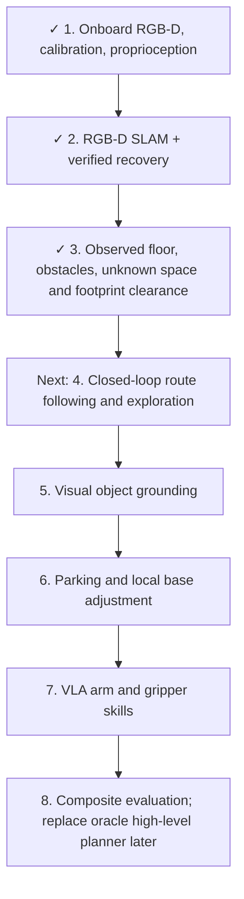

# Step 3: observed navigation map

The reusable `ObservedNavigationMap` converts onboard metric depth and accepted causal SLAM poses into navigation evidence. It does not read simulator world poses, object identities, room graphs, collision maps, or oracle routes. Camera mounts and physics are unchanged.



Ticks indicate implementation and initial tests, not qualification across arbitrary houses. No autonomous base motion was executed in Step 3.

## Interface

```python
from cross_episode_sim.navigation import MapConfig, ObservedNavigationMap

navigation_map = ObservedNavigationMap(MapConfig())
# camera: metric depth, validity, robot mask, intrinsics, base-to-camera transform.
# tracking: timestamp, accepted flag, estimated map-to-base transform.
navigation_map.update(camera, tracking)
layers = navigation_map.layers()
allowed = navigation_map.is_traversable([x, y])
navigation_map.save(output_directory)
```

Rejected tracking never updates the map. Timestamp and calibration checks reject mismatched streams. A future navigation controller must stop during tracking loss; this map class does not command the robot.

## Evidence and clearance

- The local grid covers 40 × 40 m at 10 cm resolution, with 10 cm vertical bands. Bounds come from configuration, not the house. Out-of-bounds observations are counted.
- Project measured depth using camera calibration and the estimated SLAM pose. Remove the known robot using its sensor mask.
- Count floor evidence once per cell per update; require two observations. These are not necessarily distinct viewpoints.
- Raycast free evidence only before the measured surface. Do not clear behind obstacles or fill missing depth. Retain overhead obstacles.
- Separate floor visibility from vertical clearance. A floor cell alone is not traversable: the complete configured height column must have free evidence and no occupied band.
- Inflate obstacles and unknown regions by the robot radius, clearance and localization margins, and half the cell diagonal. Map boundaries also block the footprint.
- `candidate_free` is a floor-only diagnostic. Only `strict_free` produces zero-cost traversable cells; other cells remain unknown or blocked. Frontiers identify exploration regions, not immediately safe base goals.

The configured empty-hand stowed envelope is radius 0.45 m and height 1.85 m. A robot-only geometry/FK audit measured a conservative radius of 0.4385 m and height of 1.735 m including the camera mast (`runs/navigation_robot_envelope.json`). The audit used authored robot geometry and joint configuration, not scene geometry. Carrying objects or extending the arm requires a different envelope or local 3D checking.

## Demonstrations

Both runs use saved onboard streams and causal estimated poses from the recovery tests. They include an injected camera gap; rejected samples are skipped. The blue line is the estimated recorded trajectory, not a planned route or evidence of free space.

| Recording | Observed floor | Strict robot-center area | Accepted / rejected sampled updates |
|---|---:|---:|---:|
| Two-room | 42.65 m² | 13.57 m² | 297 / 3 |
| Multi-room | 58.85 m² | 15.48 m² | 447 / 3 |

- [Two-room visualization](../runs/navigation_map_two_room_v2/navigation_map.png)
- [Multi-room visualization](../runs/navigation_map_multi_room_v2/navigation_map.png)

Each output folder contains `navigation_map.npz`, `summary.json`, and the image. The archive retains evidence, floor votes and navigation layers. The summary records parameters, coverage, source paths and map-building time.

```bash
PYTHONPATH=. OPENBLAS_NUM_THREADS=1 OMP_NUM_THREADS=4 \
  .venv-vggt/bin/python scripts/demo_observed_navigation_map.py \
  --stream runs/slam_stream_masked/sensors \
  --tracking runs/rgbd_recovery_suite_v2/two_room_short_turn \
  --output runs/navigation_map_two_room_new
```

Use a new output directory. For the multi-room example substitute `slam_stream_multi_90` and `multi_room_short_turn`.

## Validation and limits

Five map tests cover unknown blocking, vertical evidence, obstacle/footprint inflation, tracking rejection, timestamps, robot masks, ray termination, and overhead obstruction. Run alongside the sensor and SLAM tests.

This is an observed clearance estimate, not a guarantee of collision-free execution. SLAM uncertainty, discretization and dynamic obstacles still require live local checks and conservative stopping. A fixed localization margin is not a calibrated pose covariance bound. Rebuild the map if earlier poses are corrected by a future pose graph. The current map does not integrate retrospective corrections. Route planning and physical route-following tests are the next step.

Step 4 startup qualification revealed a missing local scan: see [exploration tests and limitations](frontier_exploration.md). The earlier mapping tests did not validate cold-start movement.

The [local scan primitive](local_exploration_scan.md) now builds maps from physical in-place rotation. Route execution remains a separate qualification.
