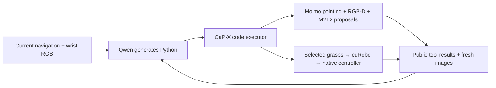

# Qwen code-as-policy trial

Update: [optional redocking for all non-navigation skills and the successful
farther-start navigation/redock/pick test](qwen_redocking.md).

This experiment lives on `codex/qwen-capx-policy`, in the isolated worktree
`/nobackup/le/cross-episode-qwen-capx`. It uses **Qwen3-VL-8B-Instruct** to
generate Python, executed by upstream **CaP-X** against our sensor-based pickup
tools. It does not replace the qualified set-table pipeline.

## Current result — November 10, 2026

The corrected smoke test passed: Qwen selected candidate 0 with an 8 cm
approach offset, the robot lifted the bowl 27.76 cm and maintained physical
contact, and Qwen ended the attempt on its second model turn.

| Measurement | Trial 5 |
|---|---:|
| Physical pickup score | Pass |
| Agent called `finish()` | Yes |
| Model turns | 2 |
| Tool calls | 4 |
| Qwen inference, total | 7.09 s |
| Perception/proposals | 5.00 s |
| Motion tool, wall time | 15.06 s |
| Total wall time, excluding video rendering | 29.69 s |
| Actual simulated motion, including verification | 6.60 s |

[Video](../runs/qwen_capx_pick05/pick.mp4) ·
[Transcript](../runs/qwen_capx_pick05/transcript.json) ·
[Report](../runs/qwen_capx_pick05/report.json) ·
[Live log](../runs/qwen_capx_pick05.log)

These artifacts are local and ignored by Git; the measurements and methodology
are retained in this document. No artifacts were uploaded.

Qwen's final code also printed a poor heuristic: it called the gripper
“holding” based only on TCP height. This did **not** determine the private score:
that score required sustained physical contact and object lift. The model had
also received gripper feedback and fresh images, but this trial does not prove
that its own completion reasoning is reliable.

## What is being tested



The component starts at the initial physical state of a previously recorded,
pre-docked bowl pickup. It obtains fresh target observations and grasp proposals;
it does not replay the reference actions or use the saved target coordinates.
The generated policy chooses a candidate subset and approach offset. The existing
backend ranks feasible variants, plans approach/grasp/lift, and executes at 50 Hz.
Qwen can request new proposals after an attempt. Physics is never reset between
policy turns.

This qualifies only the code-to-tool integration and a stationary-base pickup.
Navigation, placement, full composite tasks, robustness across scenes, and
improvement over the existing scripted baseline still need testing. Qwen does
not currently edit SLAM/M2T2 source code or fine-tune either model. Local RGB-D
tracking supports the pickup geometry; no cross-room navigation is exposed yet.

## Public interface

| Function | Input | Returned information |
|---|---|---|
| `get_robot_state()` | None | Measured arm joints and calibrated TCP in base frame |
| `propose_grasps(target)` | Semantic `"bowl"` | Eight compact candidate summaries: ID, score, position, approach axis, contact point |
| `execute_grasp(candidate_ids, approach_offset=0.06)` | Selected proposal IDs; offset in meters | Execution outcome, gripper encoder feedback, planning errors, simulated duration |
| `finish()` | None | Ends the agent attempt; does not declare task success |

Full-precision candidate poses stay in the executor. Numerical summaries are
rounded only for the language-model prompt. The two RGB images are reduced to a
maximum side of 448 pixels for Qwen; perception tools retain their original input
resolution. Every tool return is delivered automatically on the next turn, even
when generated Python does not print it.

The policy sees onboard observations, estimated geometry and robot
proprioception. It cannot call simulator APIs, read private checkpoints, inspect
object identities/poses, or receive the private physical score. The private
reset and scorer are harness-only. The backend's public exit code is selected
with `SENSOR_SKILL_EXECUTION=1`; a ground-truth success return code is not fed to
Qwen. Final scoring uses the existing backend's sustained physical contact and
lift criterion, after the agent stops.

The Python subset permits ordinary assignments, indexing, conditionals and
loops over returned candidates. Imports, attribute introspection and arbitrary
function calls are rejected. This is an interface restriction for model-generated
code, **not a security sandbox for hostile Python**. Defaults are six model turns
and twelve tool calls; they do not bound the wall time of an individual backend.

## Upstream dependency

- Repository: <https://github.com/capgym/cap-x>
- Pinned revision: `53e9966d7a8e2fa7494676772bccc35280f5c0ed`
- Executor: `capx.envs.tasks.base.CodeExecutionEnvBase.step`
- Patch: `patches/capx_external_only.patch`

The patch adds the opt-in `CAPX_EXTERNAL_ONLY=1` import mode, avoiding unrelated
simulator/robot registrations when using our external environment. The upstream
Python execution method is unchanged. Our subclass validates the policy syntax
and exposes only the public tool facade.

## Run

Use the existing sensor environment and running Qwen, Molmo and M2T2 services.
Do not install CaP-X's entire simulator dependency stack into the shared
environment.

```bash
cd /nobackup/le/cross-episode-qwen-capx
bash scripts/setup_capx_external.sh
export SENSOR_MODEL_ENDPOINTS="$(cat /path/to/endpoints.json)"
CUDA_VISIBLE_DEVICES=5 bash scripts/test_qwen_capx_pick.sh \
  --recording /path/to/pick/physics/state_recording \
  --output runs/qwen_pick_new > runs/qwen_pick_new.log 2>&1
```

The sensor environment must use the approved MolmoSpaces controller checkout
(with the existing yaw fix) under `external/molmospaces`. This worktree links to
`/nobackup/le/cross-episode-robotics-sim/external/molmospaces`.

Choose an unused output directory and available execution GPU. Model services
continue using their own GPUs. The fixture above is a pre-docked pickup, not an
arbitrary episode initial state.

After execution, render the actual physics states; video encoding is outside
the policy execution time:

```bash
CUDA_VISIBLE_DEVICES=5 MUJOCO_GL=egl PYTHONPATH=. \
  .venv-sift/bin/python scripts/render_deferred_rollout.py \
  --recording runs/qwen_pick_new/execute_001/physics/state_recording \
  --output runs/qwen_pick_new/pick.mp4
```

The execution folder number follows the tool call index; inspect `tool_calls.json`.
Video panels are navigation RGB/depth above wrist RGB/depth. Raw metric depth is
distinct from its visualization.

## Artifacts and tests

`transcript.json` contains generated code and public feedback. `tool_calls.json`
records tool arguments and durations. `turn_XX_navigation.png` and
`turn_XX_wrist.png` preserve the current onboard views. `report.json` contains the
final private score and aggregate times; it is never given to Qwen. Motion backend
logs are stored under each execution folder.

```bash
PYTHONPATH=. .venv-sift/bin/python -m pytest tests/test_capx_policy.py -q
```

Eight tests cover actual upstream execution, state continuity after a failed
call, code extraction and rejection of unexposed simulator/filesystem access.

## Development attempts

1. `qwen_capx_pick01`: M2T2 proposals succeeded; Qwen's second inference ran out
   of GPU memory because the prompt repeated full candidate matrices. No grasp
   executed. Compact candidate summaries and smaller Qwen images fixed this
   input-size problem in the following attempts.
2. `qwen_capx_pick02`: physical pickup passed, lifting the bowl approximately
   0.278 m in 6.58 simulated seconds, including the final hold verification. Qwen exhausted its six turns querying state
   because unprinted tool returns were missing from feedback. The adapter now
   includes every public tool result automatically.

3. `qwen_capx_pick03`: physical pickup passed again (6.58 simulated seconds),
   but Qwen did not finish within six turns. It requested redundant lifting and
   generated incorrect dictionary keys/variable names. The tool documentation
   now explicitly states that `execute_grasp` includes the lift and documents
   the exact state keys. No underlying grasp policy was changed.
4. `qwen_capx_pick04`: the new shell wrapper imported a different MolmoSpaces
   installation without the approved yaw fix. All six motion calls failed before
   stepping physics. The worktree now links to the same approved controller
   checkout as the successful trials. This was a launch configuration failure.

5. `qwen_capx_pick05`: passed physical scoring and agent termination with the
   corrected wrapper and explicit tool documentation, as measured above.

These attempts share one initial scene and do not constitute an evaluation set.
