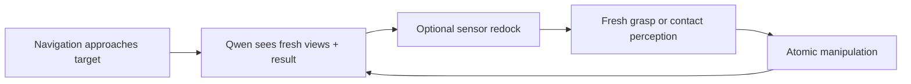

# Qwen redocking for manipulation

Implemented on `codex/qwen-capx-policy`. The Qwen facade adds redocking without
modifying the oracle interface, the underlying fixed atomic catalog, or the
qualified set-table backends.

## Interface

Every atomic skill except `navigate` and `explore` exposes these optional fields
through `QwenSkillInterface.list_skills()`:

- `redock`: boolean, default `false`.
- `redock_target`: semantic object, handle, or receptacle description. Defaults
  to the skill's `target`, or `receptacle` for placement. A targetless skill such
  as `wait` needs an explicit target if redocking is requested.
- `redock_distance`: optional local horizontal standoff. The test backend
  accepts 0.35–1.5 m. Existing navigation backends may choose their own standoff
  and reject this override explicitly.

```python
# Explicit: Qwen sees the navigation result before deciding to reposition.
navigate("bowl")
redock("bowl", purpose="pick", distance=0.55)
proposals = propose_grasps("bowl")
execute_grasp([0, 1], approach_offset=0.06)

# Or request redocking before an atomic call.
execute_skill("pick", {"target": "bowl", "redock": True})
execute_skill("place", {"receptacle": "dining table", "redock": True})
execute_skill("open_door", {"target": "microwave door", "redock": True})
```

These examples describe the interface, not a prescribed policy sequence.
Unavailable manipulation handlers remain unavailable. The pickup trial
registers only pickup and local navigation; exposing a schema does not mean a
door, drawer, knob, or placement rollout has been qualified here.

To wrap an existing complete M2T2 interface, preserving its native docking and
held-object handling:

```python
qwen_skills = QwenSkillInterface.from_navigation(
    existing_m2t2_skills, navigation_operations, navigation_state
)
```

The adapter calls `navigation_operations.dock(target=..., purpose=...,
carrying=...)`, then the unchanged atomic handler. For a custom local backend,
construct `QwenSkillInterface(existing_m2t2_skills, redock_callback)` directly.
The callback returns an observed execution result, never a private task score.

## Motion and perception



The trial's `SensorRedocking` uses Molmo pointing, measured RGB-D, continuously
estimated SLAM poses, and calibrated robot geometry. It prefers a directly
checked route, then uses the existing local lattice/A* planner if needed.
It retains the arm/gripper posture only after checking its swept geometry.
The follower sends acceleration-limited commands at 50 Hz; localization updates
at 10 Hz. Route length and turning determine the speed limit. It does not use
simulator object poses, oracle parking coordinates, or fixed room cameras.

This test backend performs **local visible-target approach**, not whole-house
exploration or cross-room navigation. Existing cross-room operations remain in
the separate sensor navigation interface. The local backend has been physically
tested empty-handed; use the established loaded docking backend for placement.

Base motion invalidates all old camera-frame grasps. Subsequent proposals use
fresh wrist depth. A sensor-derived target point is associated across views so
docking to one bowl does not silently cause pickup of its neighbor. Full pose
precision remains inside the backend; Qwen receives compact candidate summaries.
The displayed candidates use the existing backend's shoulder-distance/confidence
ranking and include diverse contact positions/orientations, rather than eight
near-duplicate high-score grasps.

## Successful farther-start test

Run: `runs/qwen_redock_far07`, November 10, 2026.

The test resets privately to frame 316 of a recorded kitchen transit. Its prior
observed floor map and traveled footprints are restored only up to that frame;
no future recorded poses or actions are supplied to the policy. Live navigation
uses fresh onboard observations and SLAM. This is a warm-map component test,
not exploration from an empty map.

| Stage | Outcome | Simulated time | Tool wall time |
|---|---|---:|---:|
| Local navigation | Observed distance 1.49 → 0.86 m | 8.08 s | 8.65 s |
| Qwen-requested redock | Ended approximately 0.56 m from freshly observed bowl target | 6.18 s | 7.90 s |
| First grasp candidate | IK/planning failed; no physical motion | 0.00 s | 11.11 s |
| Fresh proposals + alternate grasp | Bowl lifted 26.8 cm; sustained contact passed | 8.22 s | 13.72 s for motion tool |

Qwen made **6 model calls**, including a fresh proposal request after the first
grasp failed, and then called `finish()`. Total wall time was **66.28 s** and
simulation advanced **22.78 s**, including 0.30 s used to acquire map observations
before navigation. Video rendering was deferred until after execution.

All three moving calls met the 5–15 s target. No tuck/untuck cycle was inserted;
the retained posture was checked against observed collision geometry. Base
stopping used measured readiness. The pickup backend retained its existing
grasp/hold verification and settling logic. The first failed grasp was retained
in the logs, not treated as success or rolled back.

[Combined navigation → redock → pickup video](../runs/qwen_redock_far07/navigate_redock_pick.mp4)
· [Live log](../runs/qwen_redock_far07.log)
· [Qwen transcript](../runs/qwen_redock_far07/transcript.json)
· [Tool timings](../runs/qwen_redock_far07/tool_calls.json)
· [Private score](../runs/qwen_redock_far07/report.json)

The video shows actual simulated motion at 1×; it does not include wall-clock
model/planning waits during which physics did not advance. It uses navigation
RGB/depth above wrist RGB/depth. Artifacts are local and are not uploaded.

Qualification is limited to this pickup component. The final view also shows
a neighboring cup lying on its side; this trial does not establish disturbance-free
manipulation or full set-table success. The private pickup scorer measures the
requested bowl's lift and sustained grasp, not the entire composite task.

## Earlier failures retained

- `far01`: duplicate camera timestamp was fused twice; fixed in the new wrapper.
- `far02`: artificial backward reset without prior floor context left an unseen
  floor patch, so navigation never moved.
- `far03`/`far04`: an unnecessary retreat preparation could not establish its
  floor support. The successful fixture starts directly at an earlier recorded
  navigation state; no retreat preparation is needed.
- `far05`: navigation and redock passed; pickup perception switched to a neighbor.
- `far06`: association was corrected; nearly identical grasp candidates still
  failed planning. The short candidate list now preserves useful diversity.
- `far07`: navigation, Qwen-requested redock, recovery from one planning failure,
  and physical pickup passed. These development attempts are not an unbiased
  success-rate evaluation.

## Reproduce

```bash
cd /nobackup/le/cross-episode-qwen-capx
export SENSOR_MODEL_ENDPOINTS="$(cat /path/to/endpoints.json)"
CUDA_VISIBLE_DEVICES=5 bash scripts/test_qwen_capx_pick.sh \
  --recording /nobackup/le/cross-episode-sensors/runs/five_task_sensor_20261109/set_table_workspace_full07/transfer_01_bowl/kitchen_transit/state_recording \
  --frame-index 316 --navigate-first --turns 8 --tool-budget 20 \
  --output runs/qwen_redock_new > runs/qwen_redock_new.log 2>&1

PYTHONPATH=. .venv-sift/bin/python -m pytest \
  tests/test_capx_policy.py tests/test_qwen_redock.py tests/test_sensor_skill_interface.py -q
```

**45 tests passed**, including the existing sensor-interface regression suite. Coverage includes redock-before-handler dispatch across
every non-nav/explore skill, unchanged default dispatch, correct placement
receptacle/loaded mode, unavailable-handler rejection before movement, failed
redock handling, and excluding future mapping frames from fixture context.
