# Step 2: sensor-only RGB-D tracking and reconstruction

`RGBDMapper` uses Open3D 0.19's native hybrid frame-to-frame RGB-D odometry
and TSDF fusion. Depth is converted from metres to uint16 millimetres for the
upstream fusion API; the sensor interface retains metric float depth. It does not implement
loop closure, global relocalization, exploration, semantic mapping or navigation.
Those remain acceptance gaps before step 2 is complete for arbitrary houses.

## Interface

```python
from cross_episode_sim.slam import RGBDMapper
mapper = RGBDMapper(device='CPU:0')  # CUDA:0 if supported by Open3D
packet = sensors.capture()
result = mapper.update(packet.cameras['navigation'], packet.timestamp)
if result.accepted:
    estimated_base_pose = result.T_map_base
mapper.save('output/map')
```

Inputs are RGB, metric axial depth, intrinsics, fixed camera-to-base calibration,
and timestamp. The mapper receives no model/data object, world pose, room graph,
object labels, oracle trajectory or action commands. The map frame is the initial
base frame, inferred by applying calibrated camera extrinsics to the first frame.
It is not aligned to the simulator world. The wrist camera is not fused yet.

Near-depth (<0.65 m) rejection and a conservative fixed central/lower image mask
exclude some robot pixels. This is not perfect self-filtering: it must be validated
with other arm poses and carried objects. No simulator segmentation labels are used.
Calibration and resolution must remain fixed. Low projective depth overlap, invalid transforms or
large inter-frame translation reject tracking; no rejected frame is fused. Once
tracking is lost, downstream must stop and request reset/relocalization. Existing
map geometry must not be treated as free space where observations are absent.

## Demonstration

`scripts/demo_rgbd_slam.py` physically replays saved commands to acquire fresh
onboard observations. This is a SLAM validation harness, not autonomous exploration.
The mapper processes only observations, without future frames. Private diagnostic
pose errors are calculated after estimation and never feed back into tracking.
The camera mount, FOV, robot geometry, commands and collision settings are retained.
The video shows navigation RGB/depth, accumulated 3D reconstruction and estimated
base path. Point clouds contain observed surfaces only, not a complete house mesh.
The map plot is refreshed once per second; sensor tracking runs at the configured
frame rate. Video playback preserves simulated duration.

```bash
PYTHONPATH=. MUJOCO_GL=egl OMP_NUM_THREADS=4 OPENBLAS_NUM_THREADS=1 \
 CUDA_VISIBLE_DEVICES=2 .venv-slam/bin/python scripts/demo_rgbd_slam.py \
 --source /path/to/successful/episode --output runs/slam_new --seconds 60 \
 --width 640 --height 480 --fps 20 --device CUDA:0
```

Outputs: `slam_demo.mp4`, `map_and_path.png`, `map.ply`,
`estimated_base_poses.npy`, `tracking.json`, `report.json`. The separate
`diagnostic_ground_truth.npy` is for evaluation only, not a mapper input.

## Upstream implementation

- [Open3D RGB-D odometry](https://www.open3d.org/docs/release/tutorial/pipelines/rgbd_odometry.html)
- [Open3D dense SLAM tutorial](https://www.open3d.org/docs/release/tutorial/t_reconstruction_system/dense_slam.html)
- [Official dense SLAM example](https://github.com/isl-org/Open3D/blob/v0.19.0/examples/python/t_reconstruction_system/dense_slam.py)

This integration uses upstream odometry and volumetric integration; it does not
replace their optimizer. An initial frame-to-model configuration accumulated
large drift in this scene, so it was replaced with frame-to-frame odometry.
Projective depth overlap and depth RMSE are recorded for accepted estimates.
These are consistency diagnostics, not calibrated pose-confidence probabilities.

Install optional dependencies with `pip install -r requirements-slam.txt` in a
separate environment that also has this project’s simulation dependencies.

## Current pipeline

```mermaid
flowchart LR
    A["✓ Existing onboard RGB-D + calibration"] --> B["✓ Hybrid RGB-D odometry"]
    B --> C["✓ Estimated base pose in initial-base frame"]
    C --> D["✓ TSDF observed-surface reconstruction"]
    D --> E["✓ Map + estimated-path visualization"]
    E --> F["Pending: loop closure and relocalization"]
    F --> G["Pending: multi-room qualification"]
    G --> H["Next: semantic mapping and navigation"]
```



A configurable `planar_base=True` assumes a wheeled base moving on a level floor:
estimated roll/pitch and vertical drift are projected out in the initial-base
frame. This uses robot motion constraints, not simulator measurements. Disable
this assumption for ramps or nonplanar robots. This does not remove horizontal
or heading drift; loop closure and relocalization remain needed.

To rotate/zoom the result in a standalone browser view:

```bash
.venv-slam/bin/python scripts/view_rgbd_map.py runs/slam_example
```

This writes `interactive_map.html` with embedded JavaScript. Only reconstructed
points and estimated poses are loaded; no house assets or ground-truth map are
used to produce this view.


## Measured demonstration — November 1, 2026

Source: two-room `set_table_000000`, first 60 simulated seconds of saved physical
commands. Output: `runs/slam_v7`. This is a partial observation of this house,
not a whole-house reconstruction or an autonomous navigation demonstration.

| Measurement | Result |
|---|---:|
| Tracked frames | 1,200 / 1,200 |
| Navigation resolution / rate | 640 × 480 / 20 Hz |
| Reconstructed surface points | 131,189 |
| Base position RMSE | 0.278 m |
| Final position error | 0.433 m |
| Heading RMSE / final error | 4.30° / 5.07° |
| Estimated path / diagnostic true path | 9.27 m / 6.44 m |
| End-to-end processing, including rendering/plots/encoding | 401.3 wall seconds |
| Tests | 4 mapper + 4 sensor tests passed |

Tracking continuity is not accuracy: the path-length discrepancy also reveals
jitter/drift. This is **not qualified for navigation or manipulation parking**.
Real-time throughput is not demonstrated. Loop closure, relocalization, improved
self/dynamic-object filtering, map-consistency checks and multi-room qualification
remain open before marking step 2 complete. The earlier 320×240 / 10 Hz run had
0.330 m position RMSE and 0.606 m final error. These trials changed multiple
settings and are not an isolated ablation.

- [Video: RGB-D → growing map → estimated path](../runs/slam_v7/slam_demo.mp4)
- [3D reconstruction and top-down path](../runs/slam_v7/map_and_path.png)
- [Interactive map](../runs/slam_v7/interactive_map.html)
- [Diagnostic comparison with simulator truth](../runs/slam_v7/diagnostics.png)
- [Report](../runs/slam_v7/report.json)
