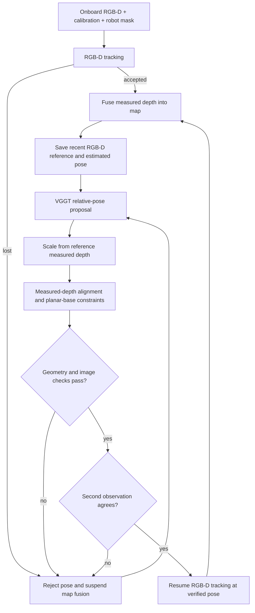

# RGB-D tracking with verified VGGT recovery

The RGB-D mapper remains responsible for metric tracking and reconstruction.
VGGT is an optional recovery proposal generator, not a second source of map
geometry. This code is experimental; qualification and limits are recorded below.



## Interface

```python
from cross_episode_sim.slam import RGBDMapper
from cross_episode_sim.slam.recovery import VGGTProposal, VerifiedRGBDRecovery

proposal = VGGTProposal(upstream_path, weights_path)
mapper = RGBDMapper(recovery_factory=lambda K, mount:
    VerifiedRGBDRecovery(K, mount, proposal))
result = mapper.update(camera_observation, timestamp)
if not result.accepted:
    # A live robot must stop goal-directed base motion until localization returns.
    pass
```

Only onboard observations, static calibration, known base kinematics, and prior
sensor-estimated poses enter this interface. No room graph, object identity,
world pose, collision map, or ground-truth trajectory is accepted.

VGGT is lazy-loaded on the first recovery attempt. The reference cache is bounded
to 12 frames, sampled every ten accepted observations. Normally the existing
RGB-D tracker runs without neural inference. During loss, proposals are attempted
every five valid observations, with immediate follow-up for candidate verification.

The geometric check excludes points outside the shared view or hidden behind
observed foreground surfaces. It still requires at least 20% overlap, sufficient
metric alignment support, bounded residual, and a well-constrained planar pose.
Bidirectional projected depth and image-color checks reject inconsistent views.
Two geometrically verified poses must agree within the per-observation motion
bound before recovery is accepted. Textureless single planes are rejected.

Only **measured depth** enters the existing TSDF map. VGGT's predicted depth is
used to scale the initial pose proposal, never fused. Rejected observations do
not update the map or estimated trajectory.

## Qualification harness

```bash
PYTHONPATH=. MUJOCO_GL=egl CUDA_VISIBLE_DEVICES=2 \
  OPENBLAS_NUM_THREADS=1 OMP_NUM_THREADS=4 \
  .venv-vggt/bin/python scripts/run_rgbd_slam_stream.py \
  --stream runs/slam_stream_masked/sensors \
  --diagnostics runs/slam_stream_masked/diagnostics \
  --output runs/my_recovery_test --vggt-recovery --dropout 300 310

.venv-vggt/bin/python scripts/test_rgbd_recovery_suite.py \
  --output runs/my_recovery_suite --gpus 4 5 6 7
```

The suite uses two distinct recorded houses, uninterrupted controls, and 0.5-,
1-, and 2-second camera gaps. Sensor recording is separate from estimation.
Ground truth is loaded only after the estimator finishes, for diagnostic scoring.
Saved actions move the robot only during the original sensor capture; they are
not inputs to reconstruction or recovery.

The playback harness deliberately continues the recorded motion while tracking
is lost, to stress recovery. It does **not** implement a closed-loop robot stop,
active relocalization scan, or collision-safe exploration controller. Those are
required before deploying the estimator for autonomous navigation.

## Tests and current limits

The tests cover rejection of a wrong pose, wrong image, nonfinite pose, and an
underconstrained blank plane, plus two-observation confirmation and clearing a
pending neural proposal when native feature matching recovers first.

### Measured qualification — November 1, 2026

The main suite is saved in `runs/rgbd_recovery_suite_v2`. It uses the same
Open3D 0.20 environment for all eight runs; older prototype comparisons used
Open3D 0.19 and a different keyframe threshold, so use the controls below for
this suite rather than copying old error figures.

| Recorded house | Missing frames | Recovery route | Error at resumed pose | Final position error |
| --- | --- | --- | ---: | ---: |
| Two-room | none (control) | uninterrupted | — | 2.6 cm |
| Two-room | 0.5 s, fast turn | VGGT + measured-depth verification | 2.3 cm | 0.8 cm |
| Two-room | 1 s | native RGB-D keyframe matching | 1.6 cm | 14.5 cm |
| Two-room | 2 s | native RGB-D keyframe matching | 3.6 cm | 2.8 cm |
| Multi-room | none (control) | uninterrupted | — | 6.8 cm |
| Multi-room | 0.5 s, turn | VGGT + measured-depth verification | 3.4 cm | 6.3 cm |
| Multi-room | 1 s | native RGB-D keyframe matching | 1.4 cm | 6.6 cm |
| Multi-room | 2 s | native RGB-D keyframe matching | 7.4 cm | 6.9 cm |

All six interrupted runs resumed on the second valid observation. This is a
sample-count result, **not 50 ms wall-clock inference latency**. The first
learned proposal lazily loads the model; model loading and inference take actual
wall time. Proposal/refinement timings are now logged for subsequent runs.
VGGT was necessary for the two fast-turn cases; do not attribute native matching
recoveries to VGGT.

A further five-second blackout (`runs/rgbd_recovery_long_gap`, frames 300–399)
recovered at frame 426, after withholding poses for 26 additional frames.
Error at recovery was 1.9 cm; final error over the 35-second clip was 9.3 cm.
Rejected proposals were not fused into the map.

The first-house clip is 60 seconds / 6.44 m of base travel; the second is
90 seconds / 7.58 m. This is two scene recordings, not exhaustive exploration
of every room or a full manipulation episode. Ground truth is diagnostic-only.

A repeated-loss test (`runs/rgbd_recovery_repeated`) injects three gaps in one
40-second clip. All three recover on the second valid observation, with
2.3/1.5/1.5 cm errors at recovery and 1.2 cm final error. The first uses VGGT;
the subsequent two recover through native keyframe matching. The pending neural
candidate is explicitly cleared on native recovery, preventing stale proposals
from confirming a later interruption.

Across these **eight interrupted runs, all ten injected interruptions recovered**;
four used verified VGGT proposals and six used native matching. Two uninterrupted
controls also completed. This is a small, fixed qualification set, not a claimed
population-level success rate. Fifteen automated sensor/mapping tests pass.

In the instrumented repeated-loss run, the cold first proposal took 16.25 seconds
(including model construction/loading); the warm second proposal took 0.16 seconds.
Depth refinement and verification took about 0.04 seconds each. A live system
should preload the model if cold-start latency is unacceptable; playback-time
recovery delay must not be confused with these wall-clock costs.

The one-second two-room case has good initial recovery but later drifts to
14.5 cm. The multi-room runs end with roughly 4° heading error, including the
uninterrupted control. Recovery is improved; global drift remains unresolved.

Artifacts:

- [30-second recovery demonstration](../runs/rgbd_vggt_recovery_v2/recovery_demo.mp4)
- [Suite metrics](../runs/rgbd_recovery_suite_v2/summary.json)
- [Five-second blackout metrics](../runs/rgbd_recovery_long_gap/report.json)
- [Repeated interruption metrics](../runs/rgbd_recovery_repeated/report.json)

The video runs at the recorded simulated duration. It shows navigation RGB/depth
and the estimated path on the **final** measured-depth map, explicitly labeled
as a diagnostic view; the final map is not supplied to the estimator in advance.

Do not infer robustness across all houses, lighting, or dynamic scenes from this
small qualification set. No merge or production-default switch is implied.
