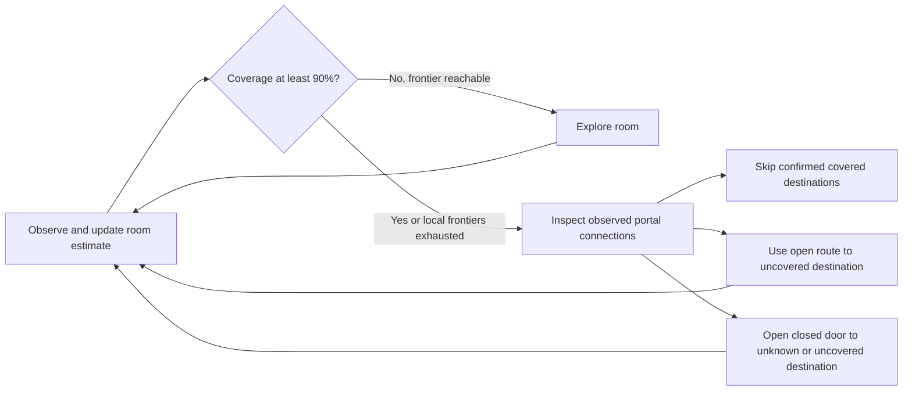
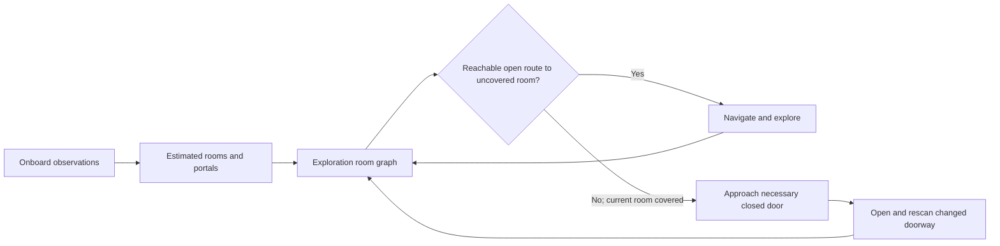

# Room coverage and closed doors

User decision: explore each estimated room to at least 90% before treating it as
covered. Skip a closed door only when observed topology confirms its destination
is already covered. Unknown destinations remain exploration candidates.



Coverage = observed navigable cells / estimated navigable room cells. The
estimated footprint must include occluded navigable area, not just mapped free
cells. Without supported room boundaries, coverage is unknown. Room footprint
growth can reduce coverage and resume exploration. This estimates coverage; it
cannot certify the true extent of an unseen room. No layout file, simulator room
graph or private scoring geometry may supply execution inputs.

A portal destination needs observation-based association, such as a previously
traversed connection or uniquely identified supported room footprints on opposite
sides of an observed portal after an alternative route was explored. Do not guess the room
behind an unseen closed door. Open routes are preferred over opening another
door. Failed/unreachable doors leave unresolved work; they never count as
explored. Pending doors elsewhere in the known topology prevent completion.

## Implementation and physical test

The live test driver is `scripts/demo_room_coverage_exploration.py`. It keeps one
simulator, camera interface, SLAM mapper and model-service connections alive.
Door grasp/open stages use the current simulator state; they do not restore a
previous successful grasp. Videos are rendered afterward from recorded states.

Reusable components:

- `navigation/room_exploration_policy.py`: coverage and portal decisions.
- `navigation/observed_room_topology.py`: room footprints from tall observed wall
  columns. Contours are preferred; a rectangular fallback requires support on
  all four sides. It bridges occlusion only for estimating coverage, never for
  declaring navigation space free.
- `perception/observed_portals.py`: RGB-pointed handles projected with measured
  depth and SLAM pose; repeated observations confirm candidates.
- `navigation/portal_approach.py`: observed-map approach and handle alignment.
- `control/live_door_open.py`: fresh M2T2 handle proposals, checked grasp execution,
  sensor-based hinge estimation and the shared contact-opening primitive.

Coverage is an estimate, not a guarantee about hidden floor area. The standalone
physical harness privately resets connecting doors closed and scores room visits
and navigation contacts afterward. Those values are never supplied to the policy.
Failed door operations remain unresolved; they cannot count as explored.

### Validation status (November 6, 2026)

35 policy/topology and hinged-contact regression tests pass. The first continuous
closed-door pilot (`runs/closed_room_exploration_03`) reached **96.8% estimated
first-room coverage**, navigated to a handle and physically grasped it. Opening
then pushed against the stop and failed its tracking check. A reporting error in
the live-state path was also corrected. A bounded opposite-direction probe now
uses observed resistance/rotation, without querying hinge limits.

Subsequent fresh tests confirmed handle grasping but exposed a pull-side early
push transition and then an arm reach limit at **34°** (`closed_room_exploration_06`).
The experimental automatic pull-side branch retains the handle for an initial
arc, then checks withdrawal, lateral repark and push continuation. Contact motion receives the exploration floor map transformed by
SLAM, so it does not discard already-observed support. Its repark timing and increment length back off after tracking failure. These changes remain under
physical qualification; they do not change explicit pregrasped benchmark flags.
The [34° failed opening video](../runs/closed_room_exploration_06/door_attempt.mp4)
is diagnostic evidence, not a successful exploration demo.

**The complete two-room closed-door rollout is not yet qualified.** Fresh reruns
are testing grasp/open/resume and room association. Do not interpret the unit
tests or the earlier pregrasped door demos as whole-house success. This harness
has not replaced the existing working set-table exploration default.

Run with persistent Molmo/M2T2 workers configured in `SENSOR_MODEL_ENDPOINTS`:

```bash
MUJOCO_GL=egl .venv-sift/bin/python scripts/demo_room_coverage_exploration.py \
  --source /path/to/saved/two_room_episode \
  --output runs/closed_room_test --coverage 0.9 --seconds 240
```

`progress.jsonl` and the terminal report coverage, current room, stage and elapsed
wall/simulation time. `report.json` separates observed completion from private
physical scoring. `scan_map.png` is the final observed navigation map.

### Remaining physical limitation

Fresh kitchen-start tests with both connecting leaves closed repeatedly reach
roughly 97% estimated first-room coverage and usually acquire a handle. They
have not yet completed door opening and second-room exploration. Tests exposed
pull-side reach, push-approach clearance, and short base-motion tracking failures.
No run in this series should be described as a complete two-room success.

The [continuous failed attempt](../runs/closed_room_exploration_12/attempt.mp4)
shows scanning, approach, grasp and partial opening. Diagnostic videos are
rendered after physics. The existing successful pregrasped door benchmarks and
working set-table exploration remain separate from this unqualified live loop.

Latest completed fresh run: `runs/closed_room_exploration_15`. First-room estimated
coverage **97.47%**; handle grasp and initial pull succeeded. Opening stopped at
about **24.1°** during the second checked lateral repark increment with
`Contact retreat pose deviated`. The first increment completed. The observed
translation lag exceeded the existing 15 mm monitor; it was not disabled.
Second-room entry and 90% coverage were **not achieved**.

The immediate remaining work is reliable local base tracking/control during
empty-hand repark, followed by fresh validation of door crossing, post-open
stowing and second-room coverage. The new exploration loop stays opt-in.

## Precision repark correction

The strict repark stop was not solely actuator lag. In run 16, private offline
diagnostics measured about 1.7 cm of base motion while feature SLAM reported
5.9 cm. Pinning a feature keyframe alone did not eliminate the error.

`RGBDMapper.fixed_reference()` now uses Open3D's GPU multi-scale hybrid RGB-D
odometry against a fresh fixed RGB-D reference during a short local motion. It retains the global map frame, mapper and model instances; it does not
reconstruct a new map. Normal navigation continues using the existing tracker.
After the local operation, its sensor-estimated pose is synchronized into the
keyframe tracker. During active opening, depth nearer than 1.5 m is excluded so alignment uses
the background rather than the moving door. This is a depth filter, not a
simulator object mask.

Observation-only replay of run 17: 63/63 frames accepted, mean position error
1.17 mm, maximum 4.62 mm, mean update 39.8 ms (median 36.4 ms), on GPU. Simulator
truth was used only to calculate these offline errors. This replay result does
not establish end-to-end success. Evidence: `runs/closed_room_exploration_17/precision_replay_report.json`.

`ObservedProgressGovernor` also retimes repark commands against measured progress
with a 6 mm lead and bounded speed. A planned zero-velocity pause retains the
validated actuator target so it can settle; an ordinary stop cancels it. The
existing 15 mm tracking monitor, collision checks and endpoint verification remain.
Run 18 completed all three lateral repark increments; the next push approach
still failed collision/IK checks. Run 19 instead retained the handle and pulled
with coordinated base motion. It reached an observed 47.65 degrees before a
progress timeout, not full opening. Inspection found the arm path coordinate
was reset to measured progress while the base continued on commanded progress;
run 20 corrects this mismatch and is undergoing fresh physical validation.

Saved active-pull observation replay (run 08), using background-only alignment:
151/151 frames accepted, maximum position error 3.35 mm, mean update 38.5 ms.
These are diagnostic replay measurements, not full exploration success.
The latest regression subset passes 28 tests. Full two-room success remains
unqualified until an uninterrupted physical test passes.

Run 20 reproduced the near-48-degree timeout despite the arm/base coordinate
correction. The six-second segment timeout expired with measured progress still
at 82%. Run 21 uses a two-second progress watchdog (at least 1 mm advancement)
and a 15-second maximum local segment allowance. Tracking/collision/endpoint
thresholds are unchanged. This is an experimental physical validation, not a
claim that the full exploration is fixed. Contact opening currently exceeds the
5–15-second atomic target; conservative measured-progress following is the
remaining duration exception.

## Latest physical result: run 21

Autonomous approach, M2T2 handle acquisition and sensor-driven opening passed:
89.99 degrees observed opening, no opening execution error. The subsequent
crossing failed (`target_not_reachable_yet`), then the alternate-leaf approach
stopped with `departure_blocked`. Full exploration is still unsuccessful.
Run 22 adds a fresh observation scan after opening before crossing, because
opening changes both the robot pose and previously occupied doorway geometry.
It does not delete occupied cells by fixture identity or use simulator geometry.
Video: [90-degree opening](../runs/closed_room_exploration_21/doors/door_000/opening/rollout.mp4).

Run 22 result: first leaf opened to 89.98 degrees again. Post-open scanning
allowed navigation to the other leaf after no crossing route was found. Its
handle was acquired, but opening stalled at 19.42 degrees observed (24.11 degrees
private diagnostic). The watchdog stopped motion. Thus the first-leaf fix has
passed twice, but the opposite-leaf contact/reposition remains unresolved and
full two-room exploration has NOT passed. Do not call this batch-ready.

## Open-route priority (user decision)

Explore reachable free-space frontiers and already-open passages before selecting
closed doors. Completing the current room's 90% target does not exhaust open
routes to undiscovered rooms. The frontier planner must run after a scan before
a closed-door candidate is selected. Open-portal navigation never calls the
handle/opening skill. After physically opening a door, rescan the changed scene
and resume frontier exploration; do not use an object stand-off goal behind the
handle as a doorway-crossing target. Failed/unreachable portals stay unresolved.

`--initial-doors open|closed|saved` configures private reset only; defaults to
closed for this qualification demo. These values are never passed to perception
or navigation. Open and closed physical qualification remains in progress.

### Exploration-loop corrections and qualification

- Reachable open frontiers are tried before closed-door candidates, including
  the first planning tick after a completed scan.
- Frontiers beyond a covered room's observed footprint rank before corners
  inside it. This priority does not grant clearance to unknown cells.
- Observed interior cores separated by narrow necks are partitioned with a
  watershed; all observed interior cells remain assigned. Room identity matching
  is one-to-one per update so two partitions cannot overwrite one room record.
- Open-portal execution resumes geometric frontier exploration; it never calls
  the handle skill. Post-opening scans refresh occupancy from measured depth.

49 exploration/topology/navigation regression tests pass. Fresh closed-door
run 26 did not pass: it exhausted local exploration, then could not depart for
the selected handle. Fresh open-door run 27 is testing the updated frontier
priority and partitioning. These changes are not yet a qualified full-house
exploration baseline.

### Door approach scheduling and labeled maps

The previous loop incorrectly passed `explorer.terminal is None` as proof of
an open route. That delayed a closed-door approach while exploring already
covered room corners. The loop now checks the selected frontier's priority:
a route beyond covered observed footprints can take priority; merely having a
live explorer cannot. This correction still requires fresh physical validation.

`exploration_labeled_map.png` now shows the estimated robot path, start/stop,
and repeatedly observed door hypotheses. These are not verified door identities;
drift can create duplicates. The underlying occupancy map is unchanged.

## Dedicated exploration graph

`RoomExplorationGraph` owns observed room nodes (coverage and visits) and portal
edges (open/closed, known/unknown destination, reachability, crossing count,
failure). It is separate from the successful physical-route graph. Confirmed
open connections are bidirectional. Unknown associations cannot be used as
cross-room routes. A failed approach is unresolved, never counted as explored.
The live demo saves `exploration_graph.json`, changed high-level decisions in
the terminal, and labeled observed-map room centroids and portal hypotheses.

Open-route priority must refer to the **reachable selected waypoint** outside
covered room footprints, not just a distant frontier visible through a gap.
53 graph/topology/navigation tests pass. Physical qualification is still pending;
run 30 tests the corrected decision in the two-room closed-door scene.

### Current physical validation

Run 30 selected the necessary closed portal at 9.2 simulated seconds, finished
the initial scan, reached the handle and opened the first leaf to 90 degrees.
This passes the previous departure failure point. Full exploration did not
finish before the run was interrupted to apply the post-opening scheduling
correction: one rescan, then require an actually reachable new-room waypoint
rather than continue circling the covered room. Run 31 is the fresh validation
of this correction. Do not describe full two-room exploration as passed yet.



The separate successful-route graph stores validated motion routes/docks;
it is not the authority for room coverage or which room needs exploration.

Known open graph edges now use `RoomApproach`, which selects reachable observed
floor inside the destination footprint and plans to that room. It does not use
object visibility or handle stand-off. 55 navigation/graph regression tests pass.

Physical follow-up: run 31 reached the handle but stopped on contact progress;
run 34 passed that early stall with a 10 mm command lead, then reached an arm
limit with the experimental low-yaw preference. That yaw preference was reverted.
Run 35 uses the prior coordinated-turn strategy with the 10 mm command lead
inside the unchanged 15 mm tracking monitor. Full exploration remains unqualified.

### Closed-door recovery audit (November 6)

Run 37 opened the first leaf to 89.9 degrees with no reported navigation
contacts, then failed finding a transit-safe handle viewpoint for the second
leaf. This is not whole-house success. Run 38 widened the observation ring but
exposed an expired progress timer: every subsequent replan immediately stalled.
The target follower also ignored failed viewpoints when selecting its next goal.
Both recovery bugs are covered by `tests/test_portal_approach_recovery.py`.
Run 39 tests those changes from the original closed-door initial state. The
observation fallback changes permissible viewing distance only; it preserves
occupancy, swept clearance, grasp verification and physical opening checks.
Do not qualify this exploration variant until the full physical report passes.

The subsequent full tests exposed two additional navigation/viewpoint defects:

- A reached intermediate waypoint whose outgoing segment became blocked was
  retained, making the follower turn toward a point millimetres away. It now
  stops and replans the remaining route against the updated observation map.
- Portal alignment ignored the camera-clear heading and faced the handle
  directly, placing it behind the stowed arm. Alignment now uses that heading,
  a 0.015 rad endpoint tolerance, and a wider robot-silhouette viewing margin.
  This changes visibility planning, not physical collision clearance. In the
  saved run-41 failed viewpoint test, handles became detectable after 2.5
  simulated seconds of rotation. This is a component result, not a full-house
  qualification.

Run 41 opened the first leaf to 89.98 degrees and reached the second doorway
without reported navigation contacts, but failed fresh handle confirmation.
Run 43 is the full closed-door test of the combined changes. Until its physical
report passes, the implementation remains unqualified for batch generation.

### Remove duplicate gates, retain physical scoring

The run-43 saved map admitted a swept robot-shape route through the opened
doorway, but the room follower's 0.56 m radius inflation disconnected it.
`PortalCrossing` now executes this short route with the existing shape-checked
`ObservedUndock` executor. It does not apply the circular gate a second time.
Goals must be observed floor beyond the observed door plane; geometry and
support are still checked, and unknown floor is not made free.

The saved-state physical crossing test completed in **20.72 simulated seconds**
with **zero recorded navigation contacts**. The route was 1.54 m with turns;
this remains above the typical 5–15 second target and is not claimed optimized.
[Crossing video](../runs/closed_room_cross_physics_43/rollout.mp4).
This proves the crossing component, not full exploration. Run 45 tests the
combined implementation from both leaves closed.

Removed the premature `goal_leaves_covered_room` rejection after opening and
the repeated explorer reset when selecting the same open portal. Prioritize
uncovered candidate points *within* each frontier cluster. Crossing creates
only an unknown provisional room node; it never invents a footprint or coverage.
A short wrist-depth refresh during the existing post-opening observation phase
can clear stale near-field evidence through actual measured free rays.

Run 45 correctly rejected crossing with only one leaf open, but exposed a stale
room-graph handoff: the observed portal track was marked unreachable while the
graph still selected it. The failure is now applied to the graph immediately,
so the next decision selects the other closed leaf. A regression test exercises
that choice without requiring another sensor update. Run 46 validates the full
sequence. No failed run is counted as successful, and no final score was relaxed.

Run 47 encountered a separate two-leaf perception failure: the probe fit the
neighbouring stationary panel. `fit_held_panel` compares nearby visible patches
using the held handle's stand-off during measured motion, rather than choosing
only the patch with the most inliers. Replaying the exact failed grasp with
`--probe-only` now produced a 4.96-degree observed rotation and a valid hinge
estimate in 2.12 simulated seconds. This is probe qualification only; the
probe-only report correctly does not claim full opening success. Run 48 is the
full validation of the combined changes. Run 46 failed at GPU startup because
other jobs occupied that GPU; it is not a policy result.

### November 7: opened-door handoff regression (run 48)

Run 48 physically opened both leaves (88.86° and 88.30° observed), but did
**not** complete exploration. The coarse crossing search failed, then a moved
handle was treated as another closed-door hypothesis. The approach repeatedly
replanned the same corner without moving. Do not count that run as successful.

The mapping backend remains `create_mapper(fuse_dense=False)` plus
`ObservedNavigationMap`: estimated RGB-D tracking and a bounded-height occupancy
grid projected into 2D for navigation. Dense TSDF reconstruction is disabled.
This standalone exploration harness does not run the pipeline's furniture
semantic-labeling stage. Its door hypotheses are not verified scene identities.

Corrections under physical validation:

- Finish necessary near-corner waypoints rather than repeatedly skipping and
  replanning them; reject a truly blocked goal without resetting the stall timer.
- Track the moved handle from the observed hinge motion, so re-detection does
  not create another closed-door target. Retire duplicates in the room graph.
- Refresh local doorway occupancy at 5 cm from the existing post-opening scan.
  Retain measured floor samples and previously occupied estimated footprints;
  do not interpolate unknown floor or use simulator geometry.
- Align with the observed doorway normal in open space, then sweep-check a
  straight crossing. Coarse start-relative heading bins can miss a valid gap.
- Select shape-valid candidate exits before applying the candidate-count limit.
- End the crossing in observed space accepted by the ordinary room follower,
  then hand back to frontier exploration. Cache the crossing goal mask once;
  continue updating observed collision evidence while following the route.

The clean diagnostic map is `exploration_labeled_map.png`: unknown gray,
observed floor white, obstacles dark, opened doors green, closed hypotheses
amber, and the estimated path blue. No visual smoothing changes occupancy.
Component tests and full-run qualification must be reported separately.

Saved-state physical crossing qualification:
`runs/closed_room_cross_refresh_support_48/report.json` reports `portal_crossed`,
zero recorded navigation contacts, and 40.28 simulated seconds total (12.92 s
fresh scan, approximately 27.36 s crossing). Video:
`runs/closed_room_cross_refresh_support_48/rollout.mp4` (403 frames at 10 fps,
actual recorded states, no speed-up). This component exceeds the typical 5–15 s
motion target because it includes multiple alignment turns and conservative
0.2 m/s local motion; it is not yet a speed-qualified atomic demo. The full
closed-door rerun is separate and must pass room coverage/private scoring.

Full run 50 stopped during the second opening (not at crossing):
`Contact retreat lost handle tracking`. Its measured arm-joint target tracking
was good (~2 mm at TCP), but base translation lag plus yaw produced ~16 mm tool
error. The translation-only 10 mm progress lead omitted the tool's lever arm.
`contact_progress_length()` now bounds translation plus `abs(yaw) * tool_radius`
and the governor limits the tool-space lead to 8 mm. The 15 mm hard tracking
limit and physical success scoring are unchanged. This is motion retiming, not
removal of grasp/contact validation. The exact saved second grasp is being
requalified before another fresh full run.

Additional qualified components on November 7:

- `runs/closed_room_cross_handoff_48`: crossing with an exit inside the normal
  room follower's traversable region passed in 41.28 simulated seconds including
  the fresh scan; zero recorded navigation contacts.
- `runs/closed_room_second_contact_stop_50/opening`: replay of the previously
  failing second grasp passed open/release/withdraw, observed angle 88.66°,
  unchanged private full-open score true, 98.80 simulated seconds. Near-target
  motion cessation is confirmed from three fresh panel observations before
  release; collision and physical scoring thresholds are unchanged.
- Reproduce a contact component with
  `scripts/replay_observed_door_contact.py --source RUN --door-index 1 --output NEW`.
  This supplies the saved observed-map memory and is explicitly a debug replay,
  not a causal fresh-run qualification.

The fresh end-to-end qualification is run 51. Do not infer its success from these
component results; consult its final report and private physical checks.

Configuration parity correction: the production `SensorSetTable.explore()` calls
`demo_semantic_navigation.py --map-resolution .05` and records kitchen/dining-table
semantic memory. The standalone room-coverage harness previously used 10 cm and
omitted that semantic-labeling stage. Sharing `create_mapper()` did **not** mean
identical pipeline configuration. The harness now defaults to `--map-resolution
.05`; run 52 validates that default from closed doors. Run 51 retains the old
10 cm global grid and is a separate regression. Door/room labels in this harness
must not be presented as the production furniture semantic map.

### Opened-door occupancy refresh (November 7)

An open edge in the exploration graph does not itself remove the old closed
panel from the shared navigation map. `LiveDoorOpener.open()` now requests
`ObservedNavigationMap.refresh_opened_portal()` after observed opening succeeds.
This applies to the global map used by normal exploration, not only the temporary
crossing map. The refresh starts at the post-motion sensor timestamp.

For 30 simulated seconds, within 1.25 m of the observed handle location, two
separate accepted RGB-D timestamps whose rays pass through a voxel replace its
stale occupied evidence with free evidence. A current surface hit resets that
voxel's refresh votes. Merely reporting opening success clears nothing. Unseen
cells, walls blocking the rays, the moved panel, and geometry behind depth hits
remain unchanged. Both cameras at the same timestamp count as one temporal
observation. Room-partition seams are classification boundaries, not collision
walls, and never modify occupancy.

Regression tests cover stale saturated panel evidence, same-timestamp camera
fusion, occlusion, new obstacle hits, and rejected tracking. Physical regression:
`runs/closed_room_global_refresh_53` (saved-state component; not a fresh full-house
qualification). Full exploration still needs qualification; run51 crossed the
opened passage but subsequently mis-associated room/door hypotheses and failed.

Component result: `closed_room_global_refresh_53` passed `portal_crossed` with
zero recorded navigation contacts, 41.38 simulated seconds including the fresh
scan (13.0 seconds) and crossing (28.38 seconds). Near the doorway, 263 of 662
previously occupied voxels became observed free; 398 remained occupied. This is
not wholesale removal of a wall. Comparison image:
`runs/closed_room_global_refresh_53/doorway_map_refresh.png`.
The regression suite passed 20 tests. These results qualify the map-refresh and
crossing component, not full exploration or room/door identity association.

### Closed-door set-table pipeline integration

`run_sensor_set_table.py --initial-doors closed` now invokes observed door
exploration inside the existing public `explore` call. The first physically
completed doorway crossing hands its live state and observed map to the normal
semantic two-station exploration stage. That stage must confirm kitchen and
dining-table memory before any pick/carry stages run. `passage_ready` means only
that crossing completed; it is explicitly distinct from whole-house coverage.
Saved door states are preserved unless the evaluation reset explicitly requests
closed doors. The persistent runtime retains its simulator, cameras and tracker.
No scene reset occurs at the handoff. The map grid uses matching 5 cm horizontal
and height resolution across both exploration stages.

Physical attempt: `runs/set_table_pipeline_development/closed_two_room_01`,
source `set_table_000162` (two rooms, two place settings). Started with both
connecting leaves closed. Full outcome pending; this is not yet a qualified
closed-door pipeline. Twenty dispatch/map regression tests passed. Older mock
pipeline tests now explicitly select the nonpersistent mode so they do not
require real GPU services to test orchestration.

`closed_two_room_01` finished unsuccessfully after 1190.68 wall seconds
(19m51s). Both leaves opened successfully (observed 89.25° / 89.46°).
The post-second-opening scanner stopped with `obstacle_near_scan_envelope`
before passage handoff; no object transfers ran. This is a post-contact
exploration/posture failure, not a successful closed-door set-table result.
Report: `runs/set_table_pipeline_development/closed_two_room_01/report.json`.
Detailed exploration report: `door_exploration/report.json` under that run.

### No forced scan after opening (November 7)

`OpenedPortalHandoff` retains the global observed map and waits for two distinct
accepted RGB-D timestamps, then calls the shape-checked portal A* crossing. It
never instantiates `LocalScanSkill`; it does not clear unknown floor or disable
collision tests. The live exploration harness invokes this handoff immediately
after open/release/stow. Existing policy tests require skipping confirmed covered
destinations and prioritizing observed open routes over closed doors.

Thirty relevant regression tests passed. Fresh two-room physical exploration is
running as `closed_two_room_02_no_scan` through the set-table runner with
`--exploration-only`; full task success is not claimed. Saved-state direct-cross
checks (`post_open_no_scan_54/55`) correctly stopped at unverified mapped routes:
removing the forced spin alone does not establish route robustness. The fresh
run uses 5 cm horizontal and vertical map cells, unlike the older snapshots.

The first fresh no-scan attempt (`closed_two_room_02_no_scan`) removed the
post-first-opening rotation as intended and selected the second leaf immediately
when the passage route remained unverified. It then exposed a separate crash at
62.84 degrees of the second opening: the static observed cuboid list was empty
and `Rotation.from_quat` rejected its shape. The observed planner now represents
empty static geometry with correctly shaped arrays; its static-world queries
return clear for that empty list only. Robot self-collision and moving-panel
checks remain separate and unchanged. Empty/nonempty regressions plus related
motion and exploration tests: 49 passed.

Fresh rerun: `closed_two_room_03_no_scan`, original closed-door scene, exploration
only. Physical completion is pending. Neither the unit tests nor the first
successful opening qualify complete closed-door exploration.

## Covered-room map freeze (November 7)

During exploration, a room with supported observed boundaries and coverage at or
above the configured target (default 90%) uses its existing map for approach.
Localization continues, but occupancy fusion, room-topology recomputation and
periodic portal labeling stop while the estimated base remains in that observed
room footprint. Live motion clearance checks remain active. Unknown cells are
not marked free. Door crossing/changed-door refresh explicitly resumes fusion;
leaving the covered footprint also resumes mapping. This is a computation freeze
while moving within a covered room, not permanent suppression of future evidence.
The current crossing exception fuses full sensor frames, not only a cropped door
region. Repeated turns in the route follower are a separate remaining issue.

Progress includes `exploration_map_mode` transitions and `map_frozen` on each
status row. `tests/test_room_map_freeze.py` covers the threshold, unsupported room
boundaries and entering unknown/under-covered space. Along with map and crossing
regressions, 19 focused tests pass. Fresh physical validation is recorded under
`runs/set_table_pipeline_development/closed_two_room_05_freeze`; do not infer
physical success or timing improvement from the configuration alone.

Freeze validation correction: `closed_two_room_05_freeze` stopped with
`undock_route_unverified`, surfaced by the skill wrapper as `backend_error`.
It froze at 9.2 simulated seconds, before the initial scan finished, so the
remaining scan did not contribute floor/support observations. Freezing now
requires both >=90% supported coverage and a completed initial scan. Regression
coverage also checks unfreezing for changed doors, crossing and unknown space;
20 focused tests pass. Stage failures now print the underlying report status.
Fresh verification: `closed_two_room_06_freeze_scan` (result pending).

## Directed post-opening refresh

The covered-room freeze now remains disabled after opening until a successful
crossing. `DoorwayViewRefresh` turns toward the observed doorway using camera
calibration and estimated pose, with swept robot clearance, then requires three
distinct aligned frames. `OpenedPortalHandoff` uses the refreshed map and makes
at most two further evidence-refresh retries on an unverified route. Crossing
rejections include goal counts and shape-check details. If no other portal action
exists, the runner reports `opened_portal_crossing_failed` instead of restarting
room scans. This is not permission to delete unobserved occupancy.

23 focused tests pass. Physical validation is pending in
`closed_two_room_08_doorway_view`. The previous run's saved final map is not an
immediate post-opening snapshot, and its post-opening estimated pose was not
saved for a synchronized isolated replay, so a fresh physical run is necessary.

## Oracle sequence audit: staged opening and paired leaves

The sensor script had explicitly set `push_after=None` after detecting pull-side
motion. Thus sharing the endpoint/base-contact primitive did not mean it reused
the complete oracle procedure. `--handle-then-push` preserves the panel transition;
pull-side continuation reaches 45 degrees (as in the oracle's continuation limit),
while push-side uses the 15-degree initial stroke. Geometry still comes from depth,
M2T2 and measured panel motion. `--oracle-contact-poses` selects the shared pad
placement formula, not simulator fixture poses.

`adjacent_closed_leaf` selects a nearby same-plane observed room-door handle and
`LocalDoorApproach` runs shape-checked local planning before crossing is attempted.
This is a new sensor coordinator around the per-leaf policy, not an upstream
oracle function for opening two leaves. Pairing is a geometric heuristic and
needs physical qualification; nearby unrelated doors are a remaining ambiguity.
No fixed fixture IDs, true hinges, or simulator poses are used for selection.

Tests: 17 focused tests pass. Component `room_door_staged_push_10` tried the push
at 15 degrees and found no checked approach in its first candidate pass.
`room_door_staged_push_11` tests the corrected pull-side continuation. Physical
qualification of the staged push and combined two-leaf sequence is pending;
these changes must not be described as successful yet.

### Single-leaf two-room validation

Per user request, `--single-left-leaf` selects the left observed room-door handle
when facing the doorway, locks that choice, and keeps the other leaf closed.
It cannot fall through to another opening when crossing is rejected. The fresh
exploration-only run `closed_two_room_12_single_left` tests crossing and subsequent
semantic exploration of the two rooms; result pending. This is visual left, not
selection by hidden simulator hinge identity.

The room map now exposes `fusion_region`: during doorway updates in a covered
room, only a 2 m radius around the observed doorway can receive occupancy/floor
updates. Outside evidence is unchanged; topology and portal relabeling are skipped.
Full mapping resumes in unexplored space. A regression test verifies outside
occupancy remains bit-for-bit unchanged while local ray evidence updates.

The staged pull-then-panel-push variant remains unqualified: 15-degree transition
failed approach planning and the 45-degree test also encountered rejected push
approaches. It is opt-in via `door_open_command(..., handle_then_push=True)`;
the single-leaf validation retains the previously successful handle-follow opening.

### Door-footprint invalidation / single-leaf passage center

After observed opening, the live opener transforms the estimated hinge and original
handle from the final contact frame into the SLAM frame. The interior of that
closed leaf segment is invalidated to unknown (occupied evidence becomes zero,
affected floor votes reset). The hinge/frame endpoints, adjacent leaf, and cells
outside the thin local footprint are retained. This is not free-space carving:
new depth rays and floor measurements must establish traversability. Passage
planning targets the estimated leaf midpoint rather than the handle at the seam.

The portal's goal candidates no longer undergo the generic undock destination-mask
erosion: every candidate, route sweep and execution still uses full robot-shape
collision and observed support checks. Unknown support remains blocked. The
current crossing planner still requires observed exit support; invalidation alone
does not guarantee that its current viewpoint can see enough floor to cross.

24 focused tests pass, including preservation of the frame and neighboring leaf
and rejection of invalidated unknown support. Fresh run:
`closed_two_room_13_local_invalidation` (physical result pending).
