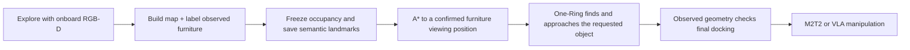

# Furniture landmarks on the frozen navigation map

**Current policy — November 4:** keep exactly two task destinations: `kitchen`
(the observed kitchen work station, not a room classification) and `dining table`.
Each is stored once; repeated surface observations confirm the same landmark.
Stop pointing queries for a destination after two distinct-frame observations.
No separate stove/fridge labels and no room-label queries in the set-table runner.
Local One-Ring navigation with an empty room goal also skips room classification.
The earlier four-category experiments below are retained as historical results.
This task-level singleton policy assumes one kitchen station and one dining table;
multiple independent destinations would need an explicit instance policy.

The robot labels furniture during exploration using its navigation RGB-D camera.
Molmo2 supplies category points; FastSAM supplies their image regions. Calibrated
measured depth and the estimated SLAM camera pose project those regions into the
map. No simulator furniture positions, object IDs or parking poses enter this path.

Supported categories: dining table, kitchen counter, stove and fridge. A landmark
requires observations at two distinct timestamps before it can supply a route
goal. Saved fields include label, observed surface bounds, estimated position,
observation count and robot viewing positions. These are partial observations,
not complete furniture meshes. Repeat observations are a consistency check, not
a calibrated confidence probability.

A* routes to observed free space around a saved viewing position, **not the
furniture center**. This is a coarse approach; the destination is not a certified
manipulation pose. One-Ring and docking remain responsible for the final approach.
The transit uses frozen occupancy, localization and live collision checks. It
neither reruns furniture labeling nor fuses a new map. Missing confirmed furniture
returns `exploration_required` without moving or guessing a location.

## Interface

- `FurnitureMap.observe(packet, tracking)` records sensor-derived landmarks.
- `furniture_viewpoints(memory, label)` returns confirmed viewing positions.
- `semantic_memory.json` preserves landmarks across stage coordinate changes.
- `demo_semantic_navigation.py --record-furniture-device cuda:2` collects them.
- `test_fixed_map_transit.py --start EXPLORATION --output NEW_DIR --receptacle 'kitchen counter'`
  tests frozen-map transit to a landmark.
- `run_sensor_set_table.py --furniture-device cuda:2 ...` enables collection during
  initial exploration and kitchen-counter routing before local object search.
  The separate `--pointing-device cuda:2` enables Molmo2 assistance to One-Ring.

This is opt-in while physical qualification is in progress. The legacy room-only
mode is retained for comparison. This change does not establish full-pipeline
success or general reliability across houses. Furniture detection can still miss
or split surfaces; unknown or disconnected destinations require further exploration.

## Validation

Nineteen tests pass covering repeated-observation confirmation, category isolation,
coordinate continuation, frozen-map navigation and exploration/pipeline wiring.
Physical test artifacts are under
`runs/set_table_pipeline_development/furniture_exploration_01` and
`furniture_counter_route_01`; results are recorded after execution below.

### Physical result — November 4, 2026

| Component | Result | Simulated time | Wall time |
|---|---|---:|---:|
| Fresh two-room exploration + furniture observations | Passed navigation; landmarks saved | 49.02 s | 657.06 s |
| Frozen-map return to kitchen-counter viewing position | Passed | 28.24 s | 156.61 s |

The return executed three A* plans (initial plus two clearance-triggered replans),
zero scans, and recorded zero contact events. Initial and final map SHA-256 hashes
match. Replanning reused the frozen grid; it did not reconstruct the map.
The 28-second cross-room route exceeds the typical atomic 5–15-second target;
route distance, checked turns and clearance recovery were retained. This result
is not a claim that all motion timing has been optimized.

[Exploration video with map](../runs/set_table_pipeline_development/furniture_exploration_01/navigation_with_map.mp4)
 · [Furniture map](../runs/set_table_pipeline_development/furniture_exploration_01/furniture_map.png)
 · [Counter-return video](../runs/set_table_pipeline_development/furniture_counter_route_01/rollout.mp4)
 · [Return report](../runs/set_table_pipeline_development/furniture_counter_route_01/report.json)

The map contains several surface fragments for a single piece of furniture and
some overlapping stove/fridge predictions. Thus, this validates the tested
counter-return route, **not reliable recognition of every furniture category**.
The new semantic-route-to-One-Ring handoff is wired but has not yet been qualified
in a complete manipulation run. No full set-table success is claimed here.

## Navigation reconstruction default — November 4 update

Navigation now disables dense 3D fusion (`create_mapper(fuse_dense=False)`),
including exploration and carry. The navigation demo also disables Hydra 3D
frame exports. A* consumes the 2D occupancy layer and furniture labels.
RGB-D pose tracking and height-aware clearance evidence remain: removing height
checks would incorrectly treat some tables/counters as traversable floor. This
is a 2D navigation representation, not a claim that the tracker never uses 3D
measurements internally. M2T2's local manipulation cloud remains separate.

The counter-return physical test above already used localization-only tracking
with dense fusion disabled. The exploration test above predates this default
change; a fresh exploration run with dense fusion disabled is not yet qualified.

### Fresh exploration with dense fusion disabled — November 4

`furniture_exploration_2d_01` starts from the original scene, not a checkpoint.
It passed (`target_reached`, cross-room success), visited both rooms and recorded
zero external contacts. Runtime: **52.02 simulated seconds, 692.18 wall seconds
(11m32s)**. Private diagnostic floor coverage was 85.70% in the kitchen and
88.29% in the dining room; these truth-derived numbers were not execution inputs.
Saved mapper configuration confirms `fuse_dense: false`. Continuation artifact
validation passed, including confirmed dining-table memory and four saved
kitchen-counter viewing positions after coordinate re-anchoring.

[Exploration video with 2D map](../runs/set_table_pipeline_development/furniture_exploration_2d_01/navigation_with_map.mp4)
 · [Saved furniture map](../runs/set_table_pipeline_development/furniture_exploration_2d_01/furniture_map.png)
 · [Physical report](../runs/set_table_pipeline_development/furniture_exploration_2d_01/report.json)

This was slightly slower than the prior dense-enabled run (657.06 wall seconds,
49.02 simulated seconds), with additional doorway clearance replans. It is not
an isolated throughput benchmark and shows **no end-to-end speedup**. Furniture
pointing alone ran 248 calls totaling 183.19 seconds; object detection separately
reported 81.19 seconds. Those figures do not account for all runtime. Label
fragmentation and stove/fridge ambiguity remain. This qualifies one exploration
case, not full manipulation or all-house coverage reliability. The full pipeline
was not launched as part of this exploration-only check.

## Furniture-query caching

The old scheduler accelerated **all four categories** to every 0.8 seconds while
any fragment had only one observation, even if that fragment was no longer visible.
This caused 248 calls in the 52-second exploration above.

The replacement keeps per-category viewpoint records using estimated planar pose.
A viewpoint is reused within 0.75 m and 45 degrees. Confirmed and negative results
are cached there; elapsed time alone does not relaunch inference. A positive but
unconfirmed candidate gets up to two confirmation retries, at least 0.8 seconds
apart, for that category only. New viewpoints remain eligible at an 8-second
minimum discovery interval per category, so finding a kitchen table does not
prevent finding another table elsewhere. Segmentation runs only when a query is
due. Tracking and occupancy updates are unchanged.

Regression tests verify category-specific retries, negative caching, revisiting
old viewpoints, discovery at new viewpoints, and bounded retries for fragmented
surfaces. This cache assumes static furniture during the exploration pass; it
must be reset if furniture moves or a new exploration session starts. It does
not increase recognition accuracy or relax the two-observation requirement.

### Cached-query physical validation

`furniture_exploration_cached_01` passed navigation from the original scene with
zero external contacts. Both kitchen counter and dining table have confirmed
landmarks and valid continuation artifacts.

| Measurement | Before caching | Cached |
|---|---:|---:|
| Furniture inference calls | 248 | 52 |
| Furniture inference time | 183.19 s | 37.69 s |
| Executed simulated time | 52.02 s | 82.72 s |
| Total wall time | 692.18 s | 806.52 s |

Furniture calls fell 79%, and their inference time fell 79%. **End-to-end runtime
increased**: this run detected the dining table later, took additional exploration
scans, and made 160 navigation-detector calls instead of 102. This validates the
bounded furniture-query cache, not an overall exploration speedup. The reason for
the changed detector trajectory is not established by this comparison.

[Cached-run video with map](../runs/set_table_pipeline_development/furniture_exploration_cached_01/navigation_with_map.mp4)
 · [Report](../runs/set_table_pipeline_development/furniture_exploration_cached_01/report.json)
 · [Furniture query log](../runs/set_table_pipeline_development/furniture_exploration_cached_01/furniture_observations.json)

Regression validation for the two-destination policy: 17 tests passed. A fresh physical exploration with this policy has not yet been run. Legacy map previews consolidate the strongest saved kitchen-counter and dining-table observations without modifying the original artifacts.

## Two-station exploration runner — implemented and physically tested

`--station-exploration` uses `StationExplorer` and the cached `FurnitureMap`
instead of running an additional DAAAM/Grounding-DINO/Qwen object search. Only
Molmo2 pointing and FastSAM segmentation for the two destinations are loaded.
Horizontal measured support-surface filtering rejects leg/background anchors.
The set-table runner enables this path by default. Occupancy, tracking and
collision checks remain active; dense 3D fusion is disabled.

A* consumes the confirmed table anchor and finds an observed free-space stand-off.
Arrival status `stations_explored` means both station landmarks are confirmed and
the table approach route was physically executed. It deliberately does not run
an additional fresh object-confirmation/alignment phase: One-Ring and local
manipulation perception are subsequent stages. This is **not** a grasp-ready pose
or full set-table success. The first prototype was interrupted after identifying
a low furniture-fragment anchor; the support-surface fix was then tested fresh.

`station_exploration_02` passed from the original scene:

| Measurement | Cached four-category exploration | Two-station exploration |
|---|---:|---:|
| Wall time | 806.52 s (13m27s) | **270.71 s (4m31s)** |
| Simulated duration | 82.72 s | **33.52 s** |
| Furniture queries | 52 | **7** |
| Furniture inference | 37.69 s | **6.36 s** |
| Room classification queries | active | **0** |

Both rooms visited; zero external contacts; saved continuation artifacts and
both station viewpoints validated. Diagnostic observed floor coverage was 85.37%
kitchen / 85.25% dining; truth was used only for scoring. There was one recorded
target A* route. This is an end-to-end workflow comparison, not an isolated
same-trajectory timing benchmark. The new workflow omits duplicate object search
and final manipulation-oriented visual confirmation during exploration.

[Video with map](../runs/set_table_pipeline_development/station_exploration_02/navigation_with_map.mp4)
 · [Map](../runs/set_table_pipeline_development/station_exploration_02/furniture_map.png)
 · [Report](../runs/set_table_pipeline_development/station_exploration_02/report.json)

The unified `dock(name, intent=...)` interface remains to be implemented; the
existing local docking components are separate. No full-pipeline rerun is claimed.
