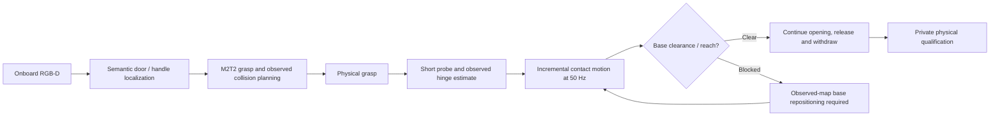

# M2T2 door-opening qualification

**Latest evidence:** see [door-family tests](sensor_door_family_tests.md): left room leaf passes; opposite leaf, cabinet, fridge and microwave remain unqualified. Older status entries below are historical.

Status: **not ready for general execution**. `open_door(target)` covers cabinet,
refrigerator, microwave, and room/main doors conceptually. Drawers remain the
separate `open_drawer(target)` skill. Do not register a partial opening as a
successful interface implementation. The oracle interface is unchanged.

The isolated harness now tests short contact-preserving base repositioning
with onboard SLAM and observed floor support. Cabinet retreats of 4 cm passed;
the room-door forward step was rejected for missing observed floor coverage.
This branch is experimental, not qualified for general execution. Saved pregrasp resets are component-test setup only; they do not
qualify autonomous navigation or an end-to-end skill call.

## November 5 tests

| Component | Result | Evidence |
|---|---|---|
| Cabinet full-range attempt 11 | Partial, about 40 degrees; stopped before full opening | `runs/sensor_hinged_cabinet_full_open_11/report.json` |
| Cabinet refined hinge 12 | Lower TCP tracking error, still blocked before full opening | `runs/sensor_hinged_cabinet_refined_12/report.json` |
| Cabinet alternative wrist 13 | Partial; predicted moving-panel collision with calibrated base sphere | `runs/sensor_hinged_cabinet_refined_13/report.json` |
| Fridge high handle grasp | No reachable approach among eight candidates; no motion executed | `runs/m2t2_appliance_handles/fridge_grasp_01/report.json` |
| Fridge lower handle grasp | Passed, 8.10 simulated seconds, 25/25 sustained two-pad contact samples | `runs/m2t2_appliance_handles/fridge_grasp_02/report.json` |
| Microwave handle localization | No handle detected in either view; no grasp attempted | `runs/m2t2_appliance_handles/microwave_01/report.json` |
| Room door prior component | Partial, about 10 degrees; not full opening | `runs/sensor_hinged_door_cycle_10_fixed_wrist/report.json` |
| Drawer prior component | Full open/close passed; separate skill, prepositioned component | `runs/sensor_drawer_cycle_v6/report.json` |

## Changes and verification

- Hinge fitting can estimate the offset between the visible panel face and its
  hinge axis from multiple RGB-D observations. Rejects poorly conditioned or
  inconsistent fits; no simulator hinge geometry is read for execution.
- Each opening increment starts at the measured TCP rather than accumulating
  deviation from one initial commanded arc.
- Moving-panel collision reports include the robot sphere and observed point
  responsible for rejection. Cabinet attempt 13 identifies a base sphere near
  `[0.206, -0.206, 0.301]` m in the calibrated base frame. This is a predicted
  collision, not evidence that a physical collision occurred.
- The hinged harness uses the drawer's faster occupancy-preserving voxel merge.
  Thirty random partitions matched the original partition exactly.
- Appliance proposal capture accepts semantic descriptions and harness-only
  saved-reach selection. No saved action, fixture pose or joint limit is passed
  to the perception model.
- Seven hinge geometry tests and sixteen interface tests pass. These tests do
  not establish physical full-opening success.

## Visualizations

- [Cabinet partial opening video](../runs/sensor_hinged_cabinet_refined_13/video.mp4)
- [Cabinet observed geometry and tracking](../runs/sensor_hinged_cabinet_refined_13/observed_motion.png)
- [Fridge successful handle grasp](../runs/m2t2_appliance_handles/fridge_grasp_02/video.mp4)
- [Microwave observation](../runs/m2t2_appliance_handles/microwave_01/observation.png)
- [Drawer successful component cycle](../runs/sensor_drawer_cycle_v6/open_close_cycle.mp4)

Videos show saved physical states at original simulated speed. No segmentation
outlines are added. Two onboard RGB-D cameras supply the four panels.

### Appliance follow-up

The fridge opening attempt `sensor_hinged_fridge_01` physically reached 39.6°
in 10.36 simulated seconds, then rejected a swept arm path despite reachable
endpoint IK. A second test uses 2° contact increments to distinguish path
sampling from clearance limits. Both runs start from the verified grasp;
these are still component tests.

Microwave edge pointing (`microwave_02`) found one valid depth target after
explicitly describing the movable door edge. `microwave_grasp_01` had zero
candidates surviving the existing local-contact/surface filters. No physical
grasp was executed. The protruding-handle filter is not qualified for this
flush door edge, and its rejection has not been bypassed.

Private hinge scoring now recognizes a handle's geometry name as well as its
body name. The fridge asset names its handle geometry; the former body-only
lookup returned an empty diagnostic result. This correction happens after
execution and does not change policy inputs or convert failure to success.

- [Fridge partial opening](../runs/sensor_hinged_fridge_01/video.mp4)
- [Fridge observed geometry](../runs/sensor_hinged_fridge_01/observed_motion.png)

The 2° fridge retry (`sensor_hinged_fridge_02`) also stopped near 40.2°, after
17.24 simulated seconds. Smaller increments did not resolve it and increased
duration. Its final rejection is an observed static-world margin at a moving
arm sphere, not an unreachable endpoint. This needs checking the reconstructed
obstacle identity and local base/arm clearance; it is not justification for
removing collision checks. The faster 5° setting remains the default.

Full-opening readiness remains blocked for cabinet, fridge, microwave, and room
door. No full-opening handler was registered or merged. The working set-table
M2T2 interface and oracle skills were not modified.

## Latest follow-up: contact-preserving base movement

None of the four hinged fixtures has passed full opening, release and withdrawal
in these tests. Do not replace the oracle implementation or advertise the M2T2
interface as ready for these fixtures.

| Component | Latest completed evidence | Remaining blocker |
|---|---|---|
| Cabinet | `sensor_hinged_cabinet_retreat_16`: 49.5 degrees, 16.00 simulated seconds; two measured 4 cm retreats retained the handle | Observed collision rejection on continuation |
| Room/main door | `sensor_hinged_room_follow_14`: 15.3 degrees, 4.74 simulated seconds | Forward base support is not observed; must sense before moving |
| Microwave | `sensor_hinged_microwave_04`: 3.80 simulated seconds; door stayed closed despite initial two-pad contact | Grasp slips under opening load; initial contact is not load qualification |
| Fridge | `fridge_grasp_07`: grasp passed, 6.70 simulated seconds | Opening attempt 07 reached 53.6 degrees, 15.50 simulated seconds, then failed IK after a 4 cm retreat |
| Drawer (separate skill) | Previous full component cycle passed | End-to-end interface and duration optimization remain unqualified |

Changes retain collision geometry, contact physics and private physical scoring.
Moving-leaf points now persist across identical-view replans and are transformed
using the estimated base displacement after repositioning. This avoids losing
observed door-trim membership merely because no new door motion occurred.
The calibrated base box replaces its conservative covering spheres only in the
moving-panel narrow-phase check; arm and mast collision checks remain enabled.
Grasp proposals can be centered on the observed handle and ranked across its
long axis. Reports record those configuration flags.

Seventeen focused geometry/handle/retreat tests pass. This is software validation,
not a claim of successful full-door physics. Retiming cannot resolve a blocked
path or slipping grasp, so those failures must be fixed before timing qualification.

### Follow-up corrections

- Rank final aligned grasp poses, rather than their pre-alignment orientations.
  Aligning to a door face can otherwise undo the preference for closing across
  the handle. Microwave grasp 08 tests this correction.
- Attempt shorter contact-preserving base moves when a longer requested move
  cannot pass the same observed-support, collision and IK checks. No floor
  coverage is invented.
- Cabinet attempt 17 was stopped: broad thickness extrapolation expanded the
  moving-leaf classification incorrectly. That extrapolation was removed.
  Attempt 18 retains only directly matched observed points. Attempt 17 is not
  qualifying evidence and must not be counted as successful.

Latest available failure videos (physical speed, no overlays):
- [Cabinet: two short base retreats, incomplete opening](../../cross-episode-robotics-sim/runs/navigation_previews/cabinet_contact_retreat_16.mp4)
- [Microwave: grasp slips during the probe](../../cross-episode-robotics-sim/runs/navigation_previews/microwave_slip_04.mp4)
