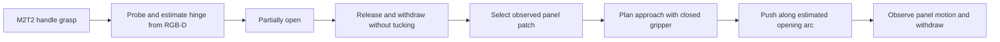

# Sensor-based panel push continuation

Experimental component; **not yet a qualified M2T2 interface skill**.
The oracle interface and the working set-table pipeline are unchanged.

M2T2 proposes the initial handle grasp. It does not predict a door-pushing
trajectory. The contact controller performs the subsequent interaction:



`ObservedPanelPush.candidates(...)` takes observed points, an observed panel
plane, an estimated hinge, an observed handle position, an opening direction,
and robot-calibrated pad vertices. It returns surface/contact/precontact poses.
It does not receive a simulator object, fixture ID, joint angle or mesh.
Candidates are not clearance certificates: the execution harness checks the
approach and subsequent motion against sensed geometry and calibrated robot
collisions. Physical contact remains enabled throughout.

Only the intended local contact patch is excluded from obstacle separation in
the existing contact planner. The rest of the door remains a moving obstacle.
This contact exception still needs end-to-end qualification; candidate geometry
unit tests do not demonstrate that the robot opens a real simulated door.

The harness now supports both arm pushing and `--base-push`. The latter plans
a short base translation together with the changing arm pose and predicts the
observed panel sweep. It uses native base actuation, onboard SLAM tracking,
observed floor support and calibrated collision geometry. This differs from
contact-preserving repositioning: the world-frame TCP advances along the push
while the base moves. Full-opening qualification is still pending. The target is full opening followed by release and withdrawal,
scored privately after execution, never using truth to select the push.

## Component test

From the sensor worktree, with the saved verified cabinet grasp available:

```bash
MUJOCO_GL=egl CUDA_VISIBLE_DEVICES=0 OMP_NUM_THREADS=4 OPENBLAS_NUM_THREADS=1 \
PYTHONPATH=.:external/DAAAM/src:/nobackup/le/cross-episode-robotics-sim/external/molmospaces \
.venv-sift/bin/python scripts/test_sensor_hinged_cycle.py \
  --grasp-run runs/m2t2_handles_v7/cabinet_lower_front_execution \
  --output runs/sensor_hinged_cabinet_push_NEW \
  --max-angle 85 --push-after 25 --open-only
```

The saved grasp reset is harness-only. This is not an autonomous navigation and
handle-acquisition test. `--push-after` currently requires `--open-only`; closing
from a released panel contact is not implemented by this experiment.

Control is 50 Hz. Smooth collision-checked trajectories and measured readiness
replace arbitrary idle holds. No video acceleration is applied. Report actual
simulated duration and failure phases before judging the 5–15 second target.


## November 5 implementation tests

- Cabinet attempts 01/02: release and withdrawal worked; no collision-clear
  push approach was found. Attempt 03 was interrupted during prolonged graph
  fallback and is not a qualifying run. The fallback was replaced with explicit
  checked waypoints around the observed free edge. Attempt 04 still rejected
  the approach. Attempt 05 tests a short observed-support empty-hand repark.
- Room-door attempt 01: reached the commanded panel contact, but the next motion
  was blocked. Attempt 02 used a farther-inboard patch and physically opened to
  **40.8 degrees in 25.80 simulated seconds**, including three base repositioning
  motions. It failed the next IK target; it is **not full-opening success**.
- Room-door attempt 03 tests coordinated base-driven pushing. Report its result
  separately; do not infer success from the enabled flag.

The contact candidate class, coordinated motion geometry and existing hinge/
handle tests pass. The longer-than-15-second component attempts are still
unqualified development runs: release, contact transition and constrained motion
remain explicit. No frames or physical time are removed to hide that duration.

Contact planning reuses the observed collision map across rejected candidates,
since no motion has occurred. It rebuilds after motion and fresh observations.
The observed leaf extent is retained when switching from a handle to an inboard
push point; a smaller contact radius must not erase the rest of the door.

[Partial room-door push video](../../cross-episode-robotics-sim/runs/navigation_previews/room_door_sensor_push_partial_02.mp4).


## Coordinated contact mode

`ContactRetreatPlanner.plan(..., tcp_end=..., base_offset_end=...)` can plan a
changing world-frame TCP together with a planar base displacement. The default
without these arguments still preserves a fixed world-frame contact pose.
`ObservedHingedPlanner.clear_contact_push` rotates the observed leaf for each
candidate base/arm configuration; it keeps arm self-collision, static obstacles,
base boxes and the mast in the checks.

The opt-in `--planar-push` experiment allocates half of the contact's lateral
motion to the base and the remainder to the arm, checking every sampled pose.
`OnboardBaseActuator.step` accepts lateral velocity only with an explicit planar
motion guard. Existing forward/yaw navigation calls retain their prior behavior.
This is local contact motion, not a change to ordinary navigation routing.

The latest harness keeps one SLAM mapper for successive contact motions and
expresses each local trajectory relative to its estimated starting pose. No
simulator base pose is returned to the policy. Private contact-force diagnostics
are computed only after all execution has ended.

Cabinet attempt 05 still failed to find a collision-clear approach after its
short retreat. Do not describe it as a push success. The next necessary cabinet
work is a reachable observed docking/contact configuration, not weaker scoring
or disabled collision checks.


### Contact audit and later trials

Room attempt 03 physically reached **45.2 degrees in 26.08 simulated seconds**,
then failed its next collision-checked reposition. It is a partial opening.
The post-execution audit found contact on the left/right gripper followers
(maximum sampled normal forces 2.09 N / 0.86 N) and no non-gripper robot contact
in the sampled push phases. The initial pad-only diagnostic was zero: the side
of the closed finger linkage, rather than its fingertip pad, was pushing.

Contact placement now uses the complete calibrated closed-finger geometry,
excluding the gripper mounting base. Room attempt 05 and cabinet attempt 06 test
that correction. Neither has been declared qualified. Run
`scripts/audit_sensor_push_contacts.py --run RUN` only after execution for the
private sampled-state contact audit. Its output never enters the controller.

[Base-driven partial room-door push](../../cross-episode-robotics-sim/runs/navigation_previews/room_door_base_push_partial_03.mp4)
· [Cabinet failed push approach](../../cross-episode-robotics-sim/runs/navigation_previews/cabinet_push_approach_failed_05.mp4)
· [Observed room-door push candidates](../../cross-episode-robotics-sim/runs/navigation_previews/room_door_observed_push_candidates.png).


### Collision representation corrections

- Static and moving-obstacle checks now both use the calibrated base OBBs,
  replacing only the oversized base covering spheres. Self-collision and
  arm/mast checks remain. Tests cover the former false positive, a real base
  overlap, a translated-base overlap, and preservation of arm collision checks.
- Intended contact uses the closed-finger projected footprint on the observed
  panel instead of a fixed circular crop. Off-plane protrusions and unrelated
  surfaces remain obstacles. Physical collisions remain enabled.
- **28 focused software tests pass.** This is not physical qualification.
- Room attempt 04 also stopped around 45.2 degrees on the old static base-sphere
  check. Attempts 06/07 test the calibrated static box; attempt 07 additionally
  uses the projected finger footprint. Cabinet attempt 07 uses both corrections.

### Latest verification and candidate-selection correction

Cabinet attempt 07 still failed at final contact approach (34.7 degrees,
22.10 simulated seconds). The projected footprint did not establish success.
The harness now preflights both precontact and final contact before choosing a
candidate. A rejected contact pose advances to the next candidate without first
moving the robot to that rejected approach. Fresh observations still validate
contact execution after approach. Attempt 08 tests this change; no success is
claimed until its report is complete.

The robot exporter assigns collision spheres by individual body; navigation_mast
is a separate link from base. The exact base OBB replacement therefore does not
remove the mast spheres. The focused 28-test suite was rerun successfully.
Room attempts 05–07 were still running at this update. These component trials
start from verified grasp states and do not qualify autonomous full-door skills.

### Neighboring-leaf repositioning

The oracle's room-door procedure (`skills/room_door_motion.py`) chooses a
35 cm inboard panel patch and can redock facing that patch. Its general door
fallback explicitly shifts toward the target leaf's hinge, away from the
neighboring leaf. Those procedural choices can be transferred; its simulator
hinge, handle poses, and routes cannot.

The sensor harness now tries an empty-hand local shift toward the estimated
hinge before push-side contact (12/8/4 cm candidates, each checked for observed
floor support, arm IK, and swept collision). It uses inboard patch candidates
35/25/14 cm from the observed handle radius. The base shift preserves the
withdrawn hand's world pose and updates geometry using SLAM. This is currently
a translation-only adaptation, not the oracle's complete yaw-aligned redock.
Test: `runs/sensor_hinged_room_push_inboard_08`; physical qualification pending.
The 14 focused contact/geometry/base collision tests passed after this change.

### Floor coverage correction (attempt 09)

Attempt 08 failed after 15.56 simulated seconds: 12/8 cm lateral shifts lacked
observed floor support, the 4 cm fallback was insufficient, and opening stopped
at 10.4 degrees. Wall time from configuration to report was about 216 seconds.

The component now retains repeat-confirmed floor cells across stationary wrist
views instead of discarding everything except the last two captures. It clears
this cache when the base moves, avoiding stale-frame reuse. Before push-side
reparking it tries collision-checked wrist views of the needed lateral floor
strip and returns to the withdrawn posture. Camera poses come from calibration
and proprioception, not fixture truth. Unknown floor still rejects motion.
The ineffective 4 cm fallback is removed. Six focused geometry/contact tests
pass; `sensor_hinged_room_push_floor_09` is the physical trial. Full yaw-aligned
docking and subsequent full-stroke feasibility remain unqualified.

## Verified room-door push: attempt 12

`runs/sensor_hinged_room_push_bounded_12/report.json` reports physical success:
**89.20° final opening**, clean release/withdrawal, **66.44 simulated seconds**.
Configuration-to-report wall time was **450.93 seconds** (7m31s), excluding
subsequent video rendering. This is a difficult-contact prototype exceeding the
5–15 second motion target, not a speed-qualified production skill.

The successful procedure observes the lateral/rear floor with the wrist,
retains repeat-confirmed floor coverage until base motion, shifts 12 cm toward
the estimated hinge, selects an observed inboard contact patch, and pushes with
coordinated native base/arm commands. The mast and physical collisions remain.
M2T2 supplies the previously verified handle grasp; this trial starts from that
grasp state (component harness), not autonomous navigation to the door.

The private post-execution audit examined 589 recorded push-phase states:
only left/right closed-finger followers contacted the target (peak sampled
normal forces 3.36/0.97 N), with **no sampled non-target contacts** and no sampled
non-gripper contacts. This includes no detected neighboring-leaf contact in
those recorded states; the audit is sampled, not every physics substep.

The speed correction bounds nearest-neighbor queries at the existing geometric
thresholds, rather than computing irrelevant distant distances. A regression
test verifies identical moving-leaf classifications against the unbounded
calculation. The observed moving-scene builds in this trial were around 2–3 s.
No collision margins or physical scoring criteria were relaxed.

This establishes one room-door opening component. Cabinet, fridge, microwave,
closing, diverse starts and public-interface registration remain unqualified.

[Successful room-door video](../../cross-episode-robotics-sim/runs/navigation_previews/room_door_sensor_base_push_success_12.mp4). Rendered from recorded physical states at original speed; rendering took 32.96 seconds. The full focused suite passes 30 tests. Slower attempt 11 was interrupted after attempt 12 passed and is not counted as a completed success.
