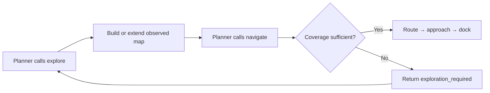

# M2T2 skill interface

## Current migration status

`M2T2SkillInterface` (`cross_episode_sim.skills.m2t2_interface`) provides `list_skills()` and `execute_skill(name, arguments)` for continuous observation-based execution. It retains failed physical state, forbids concurrent/nested public calls, journals stage progress, validates semantic arguments, and never falls back to oracle execution or checkpoint trials.

The actual set-table pipeline now calls explicit `explore` at startup, then routes object navigation and carrying through this API. `explore` extends the sensor vocabulary; the oracle/datagen catalog is unchanged. Its existing stage implementations, ordering, recovery, and shared runtime are preserved. This is an incremental refactor: the physical routines still live in stage scripts. Pick/place are now registered handlers using the same live runtime; drawer/door component demos are not yet registered. Run57 completed a fresh two-person set-table episode through this interface:17/17 public calls,33/33 backend stages, and semantic task success. See [the measured result](m2t2_interface_run57.md). This is one development-scene qualification, not a test-set robustness rate. Fixture integration remains incomplete.

The oracle/datagen `SkillInterface` and its rollback behavior remain separate. They have not been replaced by this sensor interface.

## Navigation contract

```python
interface.execute_skill('explore', {})
interface.execute_skill('navigate', {'target': 'bowl', 'search_at': 'kitchen'})
interface.execute_skill('navigate', {'target': 'bowl', 'destination': 'dining table'})
```

Omitting `destination` means find and approach the target. Providing it means carry an already-held target to that receptacle. Neither form grasps or releases. All names are semantic; coordinates, object IDs, oracle dock indices, checkpoint paths, and reference poses are not planner arguments.



`SensorNavigation` is the reusable router. It accepts an injected `NavigationOperations` implementation with `check_coverage`, `transit`, `approach`, and `dock`. All four must share the same live simulator/sensors, SLAM pose, frozen map, route graph, models, held-object estimate, and target evidence. A coverage check on an existing map must not rebuild it. The coverage check is read-only. Missing coverage returns `exploration_required`; navigation never calls exploration or consults a simulator map. The planner decides when to issue the separate `explore` call.

Generic router modes:

| Mode | Internal work |
|---|---|
| `auto` | Coverage gate, optional station transit, visual approach, docking |
| `transit` | Coverage gate and semantic station transit |
| `approach` | Coverage gate and visual approach |
| `dock` | Coverage gate and local observed-geometry docking |

`purpose` distinguishes pick/place/handle docking. Local base motion inside door/drawer contact skills should reuse the same observed navigation components, not invoke a nested public skill or duplicate the navigation stack.

**Actual set-table adapter limitation:** currently only `auto`, kitchen search and dining-table carrying are wired. Other modes return `mode_not_migrated`; other stations/destinations are explicitly rejected. Initial exploration is explicitly journaled as an `explore` skill call. The current set-table adapter supports initial empty-hand two-station exploration only; repeated exploration returns `exploration_resume_not_migrated` until live continuation is migrated. The reusable exploration contract supports an optional semantic `target`, but the current physical adapter accepts only its existing dining-table/two-station objective. This is not whole-house exploration qualification. Its existing local-navigation script combines visual approach and docking. The generic router is tested with injected operations but is not yet a replacement for every physical stage.

## State, outcomes, and scoring

A registered handler accepts semantic arguments and a progress callback, returning `SkillOutcome(success, reason)`. This is an observed skill outcome, never a private task score. Failure does not trigger simulator restoration. Private diagnostics stay outside planner-facing results; exceptions are sanitized. Full task scoring remains a harness responsibility after execution.

Pick acceptance uses completed motion and gripper-encoder occupancy evidence; place acceptance reports command completion, not a certified semantic goal. Private simulator scores remain diagnostic and do not gate these handlers or the subsequent carry. Final task success is scored separately. These observed signals can still produce false positives; a completed command is not proof of successful placement. In particular, do not register standalone handle tests as complete `open_drawer` until they use the live runtime and perform the public contract's release/withdrawal without private scoring as feedback.

Logs: `sensor_skill_catalog.json`, `sensor_skill_calls.json`, and the existing detailed stage logs. Original oracle/datagen logs are unchanged.

## Appliance controls

The live runtime now registers sensor-based `rotate_knob` and `push_button`
handlers lazily. See [appliance control implementation and physical results](m2t2_appliance_controls.md)
for Molmo pointing, M2T2 knob grasps, observed-axis motion, button pressing,
supported fixture conventions, and current qualification limits.

## Remaining migration

1. Extract concrete navigation operations from the combined stage scripts, preserving observed-map and route-graph reuse.
2. Physically qualify the registered pick/place handlers and their observed outcomes.
3. Move the tested handle primitives into live fixture skills, including release/withdrawal. Grasp-only door demos are not complete open-door implementations.
4. Qualify the resulting interface with fresh continuous physical rollouts before calling the full migration complete.

Validation includes navigation ordering, carrying semantics, held-target mismatch, failure state retention, no oracle argument/fallback, concurrency rejection, journaling, and the actual set-table pipeline call order under mocked stages.

## Explicit exploration update

`explore()` is a public skill, not a hidden navigation stage. `explore(target="kitchen")` is supported by the generic contract when that backend implements targeted exploration. Unsupported targets fail explicitly. During navigation, missing floor/map coverage propagates `exploration_required`; the old hidden floor-scan recovery has been removed from the set-table navigation wrapper. No map reset or oracle fallback is performed.

Tests cover separate exploration registration/journaling, missing coverage causing no navigation operations, and propagation of exploration requests without exposing private map details. The physical initial exploration algorithm is unchanged. Full attempt 47 executed through the interface, completed the first bowl, then failed on the second carry with `room_route_unobserved`. It is not a successful complete rollout. Attempt 48 reruns from the beginning after retaining cached route destinations for local repair and braking before tight turns; physical validation is pending.

## Physical validation, November 5

Attempt 47 (`runs/set_table_pipeline_development/full_attempt_47_skill_interface`) completed exploration, the first bowl transfer and the second bowl pick. The second carry failed after a mapped braking-arc stop. Public calls were exploration, navigation, pick, navigation, place, then the next transfer; fixture handlers were not used. First placement's private physical score passed.

Interface/runtime tests: 26 passed. Route-memory/fixed-map tests after the repair: 20 passed. These do not establish full pipeline success. Attempt 48 is the fresh physical retest.

Attempt 48 failed on first carry (`live_obstacle_no_safe_detour`). The new global brake-before-turn behavior was reverted because it was not physically qualified. Cached-route destination retention remains. Audit also found private contact diagnostics gating route storage and empty-hand transit acceptance; these truth-based gates were removed. Observed navigation completion/map integrity now determine acceptance; private contacts remain report-only. This matters because intended held-object contact had suppressed successful carry route reuse. Attempt 49 is running from the beginning to validate the correction; no complete pipeline success is claimed. Current interface/navigation regression suite: 42 passed.

Fixture work in parallel: [drawer complete component cycle](sensor_drawer_cycle.md) passed; [hinged fixture status](sensor_hinged_cycle_status.md) remains experimental. These are not registered production handlers yet.

## Backend names and compatibility

- **Oracle skill interface:** existing `SkillInterface` / `FixedSkillInterface`, retained for oracle execution and datagen. Neither implementation nor its catalog was replaced by this refactor.
- **M2T2 skill interface:** `M2T2SkillInterface`, observation-based exploration/navigation plus M2T2 manipulation. The name identifies the backend, not a claim that M2T2 itself performs navigation.
- The old `sensor_interface.SensorSkillInterface` import is a compatibility alias. Existing `sensor_skill_calls.json` and catalog filenames remain compatible.

## Regression status after attempt 49

Attempt 46 (`full_attempt_46_continuous_clearance`) passed the full two-person task and all four transfers. Attempt47 failed on its second carry;48 and49 failed on the first carry. Attempt49 is finished, not running. Its final clearance event was `map_braking_arc` at estimated map position [-2.40056, -0.89362], followed by `room_route_unobserved`. The exact first divergence from46 has not been isolated. A successful earlier rollout is not superseded by these failed reruns.

The interface migration was mixed with navigation/acceptance changes; behavioral equivalence is not established. The unqualified global turn change was reverted. Route-memory truth-gate removal fixes an execution-boundary bug but has not established improved physical robustness. Do not call this backend fully qualified or replace the oracle interface. Naming/compatibility and runtime tests pass (27); this does not resolve the physical navigation regression.

## Thin-wrapper requirement

The M2T2 dispatcher must only delegate to existing execution functions. `_navigate_to_object`, `_pick_object`, `_navigate_with_object`, and `_place_object` own the physical stage calls; handlers add argument validation, logging and estimated bookkeeping only. Oracle `SkillInterface` and `FixedSkillInterface` remain separate.

Run50's clearance-cost experiment was stopped and removed from active navigation; its patch is saved separately for review. The successful run46 did not save a complete source snapshot, so exact historical code equivalence is not established. Stage ordering matches the original pipeline; remaining known differences include sensor-only outcome/route-memory acceptance and explicit exploration requests. These must be disclosed rather than claiming an exact reproduction. No full physical success through the renamed wrapper is claimed yet.

## Run51 placement-docking diagnosis and targeted fix

Run51 completed two bowls and carried the first cup successfully. It failed before placement docking moved: 3,924 candidates collided,32 lacked support, and all220 collision-clear proposals were rejected by arm reachability. The last logged collision was not evidence that every possible dock collided.

Reproducing `RobotGeometry.reach` using the saved robot calibration and measured carrying joint posture isolated a numerical IK basin: all targets at0.50/0.58/0.66m and height0.9060278m failed from the run51 posture, but succeeded from the calibrated travel posture. Run46's measured carrying posture also solved these targets. The fixed reachability check tries the original seed first, then a standard numerical seed; it validates the same FK residuals and joint limits. It does not command a tuck, move/teleport the robot, or authorize unchecked arm execution. Collision checks and physical planner execution are unchanged.

Saved diagnosis: `runs/m2t2_dock51_diagnosis/{reach.log,reach_fixed.log}`. Regression covers the failing posture, all3 target distances, an unreachable5m target, and unchanged input joints.58 tests pass. Run52 is a fresh full-task physical validation, currently pending; no end-to-end success is claimed from the IK check alone. Oracle interfaces remain unchanged.

## Run52 departure failure

First bowl completed. Return transit failed after0.02 simulated seconds: departure eligibility used only frozen-map support, while transit's live-depth circle rejected a tabletop point atz=0.816m. The close dock therefore skipped shape-aware undocking and entered an incompatible transit clearance model. `departure_region` now excludes live depth footprint conflicts when selecting undock goals, using the transit guard's radius without altering frozen-map cells. Existing swept shape checking handles actual retreat.16 navigation/undock tests passed; run53 is the fresh physical validation. The run51 IK fix remains active.

## Concrete dispatch audit and run54

The interface regression test now inspects concrete command paths and inputs for two consecutive transfers: carry calls `test_m2t2_carry_dock.py` with that transfer's `pick/physics`, and placement docking uses that same carry output for physical start and continuation map. The next empty-hand transit starts at the previous transfer's return state. Stage reports now record the command and acceptance key for traceability.45 interface/navigation tests passed.

Run53's second carry failed `unchanged_live_obstruction`: the estimated base approached to0.502m from the recorded blocker, with a0.49m instantaneous guard radius. Replanning now reserves an additional0.05m around live blockers in both A* rasterization and cached-route segment validation. The physical guard remains unchanged. Run54 is the physical validation; no success claimed until final scorer passes.

## Run54 localization failure and run55 validation

Run54 failed on the first carry. Comparing its saved physical states with the
sensor pose trace (diagnostics only) found a false `revisited` keyframe correction:
from simulated time118.16 to118.26 the estimated lateral position jumped about
0.116m, while physical motion remained continuous. Estimated lateral error became
0.125m. This put the estimated base into the retained obstacle region; adding
route clearance did not resolve the cause.

`KeyframeTracker` now verifies an old-keyframe revisit during continuous tracking
against registration of the immediately preceding RGB-D observation. A disagreement
over0.04m or0.06rad rejects that candidate before it changes the tracked pose.
Recent keyframes and the existing RGB-D odometry bridge remain available; genuine
lost-state recovery retains its separate verification. These are sensor estimates,
not simulator coordinates. The tolerances are provisional and require broader
qualification. Synthetic regression covers both false and consistent revisits.

43 tracking/interface/navigation tests passed. Run55 is a fresh full physical
validation through the M2T2 interface, not yet a successful result. Its source
snapshot is `runs/set_table_pipeline_development/full_attempt_55_source`; live log
is `runs/navigation_previews/full55_m2t2_interface_live.log` in the main checkout.
Oracle interface files remain unchanged.

## Run55 result and grasp-insertion fix

Run55 completed both bowls and the first cup, including all attempted cross-room
transits and carries. The final cup failed during grasp insertion: measured arm
error0.176rad, with physical contact at the left finger linkage. Private contact
inspection was diagnostic only. No full success is claimed for run55.

The observed target was excluded from the final insertion world to permit pad
contact, but this also allowed non-pad linkage contact. `target_linkage_clearance`
now checks the insertion path against target RGB-D points using calibrated open
finger geometry. Pads remain contact-permitted; linkages/palm do not. It rejects
candidates before execution, without relaxing physical checks or using scene truth.

Offline checks against the recorded commanded insertion paths accept all three
successful run55 grasps and reject the failing fourth at
`robot_0/gripper/left_follower/collision`. Two regression tests cover intermediate
sweep obstruction, permitted pad contact, and a clear linkage. Run56 is the fresh
full physical test, pending final scoring. Source snapshot:
`runs/set_table_pipeline_development/full_attempt_56_source`.

## Run56 departure-region correction

Run56 again completed two bowls and one cup, then timed out during the final
empty-hand undock before A* transit began. Its0.25m departure had a15s simulated
budget. The estimated endpoint oscillated around two nearby poses, roughly2cm
from the selected goal, despite having reached open transit space. No contact
violation was reported. This was not a skill dispatch error.

`ObservedUndock` now brakes within the same eroded free-space goal region used
for selecting its departure target. It no longer requires a particular final
pose or heading once that region is reached. Acceleration-limited braking and
swept geometry checks remain active, and completion requires zero commanded
velocity. No occupied cells or unknown space are accepted.41 regression tests
passed, including the long departure and non-exact endpoint cases. Run57 is a
fresh full test; pending final result.


## Run57 final qualification

Fresh full episode passed:17/17 public skill calls,33/33 backend stages, semantic task success, zero checkpoint restores and one runtime renderer initialization. Wall execution2310.88s; offline rendering444.01s. All33 video recordings rendered successfully. See [result, source snapshot and measured stage timings](m2t2_interface_run57.md). Earlier pending-run statements above are historical, not the current status. Broader evaluation and fixture integration remain unqualified.
