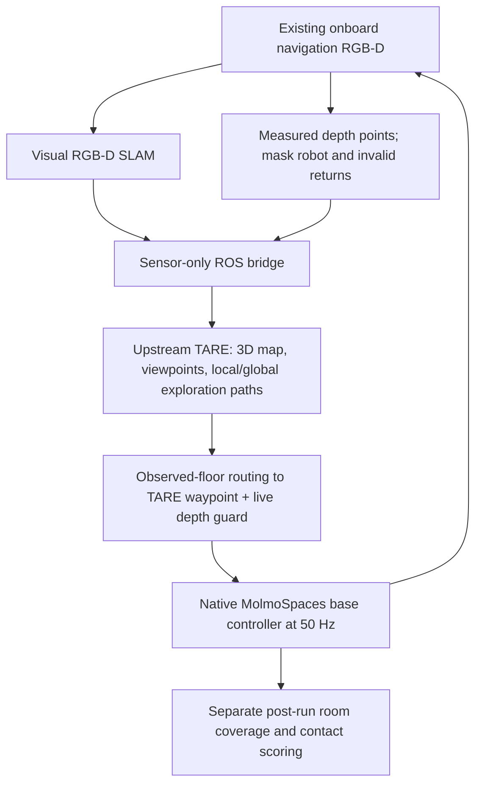

# Upstream TARE exploration trial

Current follow-up: earlier fixed-map turn/shortcut tests passed 5/5 and 7/7
rooms with zero audited contacts (also after correcting full-room coverage).
The growing-map trials subsequently exposed a turn/forward retry bug: six-room
v3 stopped at 5/6 rooms; seven-room v4 stopped at 2/7 rooms. Both stopped without
audited contacts. A latched turn recovery is implemented and passes regression
tests; full physical qualification is pending in six-room v4 and seven-room v5.
Do not treat the entire exploration stack as robustly qualified yet.

We use the original [TARE ground-robot planner](https://github.com/caochao39/tare_planner),
`melodic-noetic` revision `44500592b86138257273e0cab264e6a847ccefc7`.
The associated paper is *TARE: A Hierarchical Framework for Efficiently Exploring
Complex 3D Environments*, RSS 2021. This trial does not replace its planner with a
Python reimplementation.



## Inputs and coordinate conventions

`TarePlanner.update(camera, tracking)` accepts one onboard RGB-D camera record
and an accepted visual tracking result. It returns the upstream exploration
path, waypoint, finish flag, and path sequence counter. It has no simulator
model/data access. The robot continues using the existing mast camera and wrist
camera; no new sensor or mounting change is introduced.

Depth is back-projected using the actual camera intrinsics, transformed using
the calibrated base-to-camera transform and estimated SLAM pose. Unknown depth,
robot pixels, and returns beyond 6 metres are omitted; missing rays are not
filled. `/registered_scan` contains observed points only. The odometry supplied
to TARE is the estimated optical origin, so its occupancy rays start at the
camera rather than at a fictitious LiDAR at the base centre. No true world pose,
room count, room graph, scene mesh, saved actions, or task object locations enter
the planner.

The local follower translates a sensor waypoint to a base goal using the current
calibrated sensor offset, routes through observed floor, and checks live depth.
This is an approximation for turns with an offset sensor, and must be physically
qualified. It does not select an alternative custom frontier if TARE fails.
Upstream's initial forward waypoint is ignored until an exploration path arrives.

## Sensor-model limitation

Upstream TARE has an omnidirectional LiDAR coverage heuristic, including a fixed
vertical field-of-view approximation. Supplying a depth point cloud does not
turn that model into a calibrated RGB-D sensor model. The trial retains the
upstream code, performs physical full-turn scans at viewpoints, and explicitly
records this mismatch. This can test the integration but does not establish
equivalent robustness to the paper's LiDAR system. TARE's `finished` flag is not
the evaluation success criterion.

`configs/navigation/tare_rgbd.yaml` overrides the upstream indoor configuration:
finer map/viewpoint resolution, shorter lookahead, and a 0.55m sensor-centred
proposal envelope. The initial 1m circumscribed envelope was too restrictive for
doorways. The smaller proposal envelope is not a whole-base safety certificate:
independent base-route and live depth checks remain required. No fabricated terrain map is published;
the optional terrain-map collision input is disabled, while upstream 3D cloud
collision checks, the independent live guard, and MuJoCo collisions remain on.

The first physical trials crashed inside upstream `LocalCoveragePlanner::SelectViewPoint`
(native GDB backtrace saved in `runs/tare_house_5room_v2/tare/planner.log`). The
selection loop erases entries from `queue_copy` but computes its subsequent
random sampling range from the original `queue`. This can index outside the
remaining candidates. The trial config sets the supported
`kGreedyViewPointSampleRange: 1` to select the best remaining entry deterministically,
and `kLocalPathOptimizationItrMax: 1` to avoid repeating identical selections.
This is a configuration workaround, not an upstream source fix, and changes the
sampling tradeoff relative to the original random range of three.

## Installation and commands

ROS Noetic is isolated in `.venv-tare`; simulation stays in `.venv-slam`.
The build uses `.tools/tare_ws` because the upstream workspace has an absolute
`/opt/ros/noetic` symlink. On this Ubuntu 24.04 x86-64 host, build flags explicitly
link the host OpenGL library required by PCL/VTK and include `<stack>` for the
newer GCC toolchain. These are build compatibility settings, not planner edits.

```bash
bash scripts/setup_tare.sh

# Interface test on cached onboard data; not a physical rollout.
PYTHONPATH=. .venv-slam/bin/python scripts/test_tare_observations.py \
  --stream runs/slam_stream_masked/sensors \
  --estimates runs/slam_hybrid_masked \
  --output runs/tare_sensor_trial

# Physical test, using the same saved initial scene as the custom explorer.
MUJOCO_GL=egl CUDA_VISIBLE_DEVICES=0 OPENBLAS_NUM_THREADS=1 OMP_NUM_THREADS=4 \
PYTHONPATH=.:/nobackup/le/cross-episode-robotics-sim/external/molmospaces \
.venv-slam/bin/python scripts/demo_house_exploration.py \
  --planner tare --source PATH_TO_EPISODE --output runs/tare_house_trial --seconds 600
```

Each instance owns a private local ROS master and planner process. Logs and all
planner responses are retained under the run's `tare/` directory. Closing the
interface terminates its processes. The physical runner records the normal four
RGB/depth panels, executed motion, estimated path, and offline contact/room scores.

## Qualification

Require successful physical tests on the existing 5-, 6-, and 7-room scenes with
open doors before replacing the custom baseline. Report per-room observed-floor
coverage, interior visits, collisions, stuck events, travel distance, simulated
duration, and wall runtime. Layout geometry is read only after execution for
scoring. A valid ROS path, a complete local scan, or an upstream finish signal
alone is not a whole-house success.

Long exploration is a documented exception to the 5–15 second atomic-motion
target. Scans and travel are executed in physics and rendered at their original
simulated speed; no accelerated video, disabled collision, or pose reset is used.

## Measured results so far

- Upstream C++ build succeeded. `git diff` of the upstream checkout is empty.
- Sensor transport tests passed, including calibration, invalid-depth/robot
  masking, rejected tracking, and no substitution of a custom frontier goal.
- `runs/tare_sensor_trial_v4`: 600 observations from 60 seconds of recorded RGB-D
  with matching visual-SLAM estimates, 50 published path updates, no process
  crash with greedy sampling. This is **not physical execution**.
- `runs/tare_house_5room_v2`: native crash in viewpoint selection, captured under GDB.
- `runs/tare_house_5room_v3`: greedy sampling plus the initial 1m proposal envelope;
  physically visited 1/5 rooms in 107.12 simulated seconds, zero audited external
  contacts, then stopped at `tare_goal_at_current_position` after returning toward
  the start. Not successful whole-house exploration. Its `exploration.mp4` and
  `coverage.png` are retained.
- `runs/tare_house_5room_v4`: revised 0.55m proposal envelope and periodic scans
  instead of scanning at every lookahead waypoint. Reached 3/5 rooms (kitchen,
  dining, bedroom) in 149.20 simulated seconds, zero audited external contacts.
  The local follower stopped when grid snapping put a TARE lookahead inside its
  arrival threshold, although TARE still had a longer path available. This
  transient handoff now waits for the next upstream update, with a bounded timeout.
  A regression test covers it. Video and `coverage.png` are saved in this run.
- `runs/tare_house_6room_v1`: visited 1/6 rooms in 53.90 simulated seconds,
  zero audited external contacts. Stopped at `obstacle_near_scan_envelope`
  when a full-turn scan at a doorway failed the dense depth clearance check.
  This is a scan-location/follower integration failure, not a native TARE crash.
  The guard remains enabled; video and `coverage.png` are retained.
- `runs/tare_house_5room_v5`: 4/5 rooms entered in 378.40 simulated seconds.
  Zero audited external contacts. Gracefully interrupted after sustained
  local-clearance livelock; no whole-house success.
- `runs/tare_house_7room_v1`: 4/7 rooms entered in 412.10 simulated seconds.
  Zero audited external contacts. Gracefully interrupted after 30 simulated
  seconds at an unchanged estimated base position, repeatedly rejecting the
  same braking arc. No whole-house success.
- Both had a 600-second configured budget but were stopped early after the
  demonstrated livelock. Each has an `operator_stop.json` recording why. These
  are not completed equal-duration comparisons with the custom baseline.
- The combined bridge, exploration, local-scan and observed-map test suite
  passes: 25 tests. These tests do not establish physical coverage.

The initial physical trials used a 180-second integration budget. They must not
be presented as a matched-budget comparison with the custom 600-second tests.

### Scan-clearance retry

`runs/tare_house_6room_v2` tests an additional follower change: defer periodic
full-turn scans unless the observed supported-floor clearance exceeds the scan
radius + scan margin + localization margin + half the grid-cell diagonal
(about 0.681m with this configuration). At narrow intermediate waypoints it
continues toward TARE's next waypoint instead. The initial parked scan and all
live dense-depth collision checks remain unchanged. This is a conservative
2D screening rule, not proof that unseen vertical geometry is clear.
The five- and seven-room trials above started before this change; their saved
`policy_source.py` records that distinction. The retry stopped after 44.84 simulated seconds at `departure_blocked`, with
1/6 rooms visited and zero audited external contacts. New observed map evidence
left the current base cell outside the follower's traversable set. This retry
does not validate the change as a fix; a safe recovery/repositioning policy is
still missing. Planner timing also makes trials non-identical even with the
same scene. No whole-house reliability claim is justified.

## Final trial artifacts and remaining work

| House | Run | Rooms entered | Simulated time | Outcome |
|---|---|---:|---:|---|
| 5 rooms | `tare_house_5room_v5` | 4/5 | 378.40s | Local follower livelock; operator stopped |
| 6 rooms | `tare_house_6room_v1` | 1/6 | 53.90s | Dense scan-clearance rejection |
| 6 rooms, scan-clearance retry | `tare_house_6room_v2` | 1/6 | 44.84s | Departure blocked by updated observed map |
| 7 rooms | `tare_house_7room_v1` | 4/7 | 412.10s | Local follower livelock; operator stopped |

Every row has zero audited external contact events, but **zero whole-house
passes**. Seeing a room through a doorway does not count as entering it. Success
requires at least one second inside each room, at least 35% observed floor in
each room, and no audited external contacts.

- Five-room [video](../runs/tare_house_5room_v5/exploration.mp4),
  [coverage/path](../runs/tare_house_5room_v5/coverage.png),
  [report](../runs/tare_house_5room_v5/report.json).
- Six-room retry [video](../runs/tare_house_6room_v2/exploration.mp4),
  [coverage/path](../runs/tare_house_6room_v2/coverage.png),
  [report](../runs/tare_house_6room_v2/report.json).
- Seven-room [video](../runs/tare_house_7room_v1/exploration.mp4),
  [coverage/path](../runs/tare_house_7room_v1/coverage.png),
  [report](../runs/tare_house_7room_v1/report.json).

The five/seven-room failure occurs when a translating turn's predicted braking
arc leaves observed traversable space, even though a grid route exists. Repeated
replanning previously reset the progress timer, preventing a bounded failure.
The latest code retains the progress timer across replans, resets it after an
actual scan completion, and reports `tare_local_stalled` on persistent failure.
Regression tests cover both timer preservation and termination. This bookkeeping
fix was made after those physical runs; **it does not demonstrate recovered
motion or a successful new rollout**.

Next work is a sensor-checked local recovery: evaluate a pure rotation or a safe
repositioning route before retrying a translating turn, and choose full-scan
locations with enough observed clearance. Do not lower collision margins or
clear unknown cells just to accept a route. The LiDAR-versus-RGB-D coverage-model
mismatch still needs explicit treatment. Keep `--planner tare` experimental and
do not replace the current default based on this trial.


## Checked turn recovery (follow-up)

The shared follower now evaluates a separate zero-translation rotation when its
translating braking arc is rejected. Both candidates use the same observed-map
and live-depth collision checks. Recovery starts only with zero commanded
forward velocity; it retains yaw acceleration limits and does not modify map
occupancy, collision margins, or physics. If pure rotation is also blocked, the
robot stops. A regression exercises a corridor-edge turn and verifies that a
nearby depth obstacle still prevents rotation.

Fresh 600-second-budget physical trials: `tare_recovery_5room_v1`,
`tare_recovery_6room_v1`, `tare_recovery_7room_v1`. Results pending. The 26 passing
unit/regression tests alone do not establish recovery in physics.


### Exact shortcut validation

The first follow-up six-room test stopped at 181.70s with `tare_local_stalled`.
Its straight shortcut clipped an inflated blocked cell for only a few
millimetres. Fixed 2.5cm sampling missed that cell, but the stopping-arc check
correctly rejected motion. `_line_free` now enumerates grid boundary crossings
and tests every crossed cell. A regression uses the recorded start/goal and
blocked cell, in both directions. The route may retain its initial cell-centre
waypoint rather than clipping that corner. Collision margins are unchanged.

The first five/seven-room follow-up tests were gracefully interrupted to restart
with this fix; their partial reports are not completed qualification results.
The new tests are `tare_recovery_5room_v2`, `tare_recovery_6room_v2`, and
`tare_recovery_7room_v2` (pending). There are now 27 passing regression tests.
The runner also preserves the shared follower source and terminal diagnostic
state/observation for reproducing failures without replaying an entire house.
These diagnostic states are not inputs to the exploration policy.


### Sensor-driven map growth

`tare_recovery_6room_v2` reached 4/6 rooms with zero audited contacts, then stopped
at 297.72s. The initial 40m grid was centred on the starting pose, so this long
house reached its -20m edge. It discarded 1,824,935 observed endpoints outside
the grid and could not route to TARE's next waypoint. This was an implementation
boundary, not an observed physical wall.

The map now grows symmetrically when observed RGB-D points approach its edge.
Evidence and robot-support history retain their SLAM coordinates; new cells
remain unknown. No room graph or house size is supplied. Regression tests verify
obstacle/floor preservation, coordinate consistency, and no invented free space.
The follower also waits for a new observation before retrying a snapped goal,
instead of running the same expensive plan at every 50Hz control tick. Timeout
behavior remains bounded. The test suite now has 30 passing tests.

The saved-state local boundary test without rescanning timed out safely: growing
an old clipped map cannot restore observations it previously discarded. A
second local test performs a guarded scan first (`tare_map_boundary_recovery_v2`).
The fresh full test `tare_recovery_6room_v3` uses growing maps from the start.
Five/seven-room v2 tests are still running with the earlier fixed-size map; do
not describe them as tests of map growth.

Local regression command (requires a run with terminal diagnostic snapshots):

```bash
MUJOCO_GL=egl CUDA_VISIBLE_DEVICES=3 OPENBLAS_NUM_THREADS=1 OMP_NUM_THREADS=4 \
PYTHONPATH=.:/nobackup/le/cross-episode-robotics-sim/external/molmospaces \
.venv-slam/bin/python scripts/test_exploration_recovery.py \
  --failed-run runs/tare_recovery_6room_v2 --source PATH_TO_SOURCE \
  --output runs/local_recovery --scan-first
```

This diagnostic restores a recorded physical state and uses the recorded
sensor-derived map and TARE goal. It is explicitly a local follower regression,
not a fresh whole-house run or an oracle-generated exploration route.


The guarded-rescan local regression passed in `tare_map_boundary_recovery_v3`:
16.14 simulated seconds, no audited external contacts, and the planned waypoint
reached within the unchanged 0.2m follower tolerance. The report includes both
the original requested goal and its reachable snapped grid goal. This establishes
local physical recovery, not whole-house completion. The earlier v2 diagnostic
moved successfully too, but its harness missed the renamed `tare_waypoint_reached`
status and therefore reported failure; the corrected harness was physically
rerun rather than silently rewriting the old result.

[Local recovery video](../runs/tare_map_boundary_recovery_v3/recovery.mp4).
The test suite now has 31 passing tests, including enforcing the overall budget
while waiting for an upstream waypoint. Full-house qualification is pending.


### Completed seven-room turn/shortcut qualification

`tare_recovery_7room_v2` passed the offline whole-house criterion: 7/7 rooms
entered, 86.17–100% observed-floor coverage per room, zero audited external
contacts, 600.12 simulated seconds. Termination was the configured exploration
budget, not a native completion claim. This run used the fixed-size map and
validates the turn/shortcut changes. The fresh growing-map versions are
`tare_recovery_5room_v3`, `tare_recovery_6room_v3`, and
`tare_recovery_7room_v3` (pending).

[Seven-room video](../runs/tare_recovery_7room_v2/exploration.mp4) ·
[Path and coverage](../runs/tare_recovery_7room_v2/coverage.png).


`tare_recovery_5room_v2` also passed: 5/5 rooms entered with required coverage,
zero audited external contacts, and termination at the 600-second budget. Like
the seven-room v2 run, this qualifies the turn/shortcut fixes with the old fixed
map. [Video](../runs/tare_recovery_5room_v2/exploration.mp4) ·
[Coverage/path](../runs/tare_recovery_5room_v2/coverage.png).

### Waypoint handoff and complete-area scoring follow-up

The growing-map seven-room v3 trial stalled after visiting 4/7 rooms, with no
external contacts. Its follower circled an intermediate corner despite already
being within the existing 0.2 m TARE lookahead tolerance. TARE lookaheads now
request a new waypoint at that tolerance rather than requiring precision parking.
Full scans still require their separate clearance check. Forward speed also
reduces with remaining waypoint distance, within the existing acceleration and
braking limits. This does not change room visitation or task success criteria.

The physical continuation regression `tare_corner_recovery_v1` reached the next
reachable sensor-derived waypoint in 9.14 simulated seconds with no audited
external contacts. It is a local recovery result, not a full-house pass.
[Recovery video](../runs/tare_corner_recovery_v1/recovery.mp4).
The fresh seven-room test incorporating these changes is `tare_recovery_7room_v4`.
Five/six-room v3 tests started before this final handoff change.

Offline coverage scoring now uses the full room polygon area, including parts
outside the map. Previously, clipping to the map understated the denominator.
Original reports are retained; `coverage_rescore.json` records corrected v2
results. Five-room v2 still passes (90.9–98.0% coverage), and seven-room v2 still
passes (72.5–98.8%). The earlier 86.17–100% seven-room figures above are superseded
by this correction. Six-room v2 remains a failure. No ground-truth room geometry
is provided to the exploration policy.

The navigation regression suite has 32 passing tests, plus a passing offline
coverage regression proving that an observed 2×2 m map covers only 25% of a
4×4 m room. Full growing-map qualification is still pending. These tests use
open doors and a stowed arm; closed-door manipulation is outside this trial.
Waypoint handoffs still stop the base, so continuous motion optimization is
not yet fully qualified by these results.

### Finish checked turns before retrying translation

Six-room v3 stopped at 509.20 s with `departure_blocked`, 5/6 rooms visited,
and zero audited contacts. Seven-room v4 also stopped with `departure_blocked`.
The follower chose a safe rotation when a forward arc failed, but retried forward
motion on the next tick. Those repeated small arcs accumulated lateral drift
until the current cell crossed the inflated safe-corridor boundary.

The recovery now latches rotation until the heading error is below 0.03 radians.
Every rotation still passes the same map and live-depth checks. No obstacle
cells are cleared and no clearance threshold or contact check is reduced.
The regression explicitly verifies that opening a forward arc during recovery
does not prematurely restart translation, and a live obstacle still stops it.
All 33 navigation/scoring tests pass. Full runs `tare_recovery_6room_v4` and
`tare_recovery_7room_v5` test this change; five-room v3 predates it. The upstream
TARE tracked source remains unchanged.

The latest-code corner continuation regression `tare_corner_recovery_v2` also
passes in 9.14 simulated seconds with zero audited contacts:
[video](../runs/tare_corner_recovery_v2/recovery.mp4). This route does not exercise
the latched-turn branch itself; that branch has a targeted unit regression and
still requires the full-house reruns for physical qualification.
