# Tasks

All tasks run in the same three-room house: a native RoboCasa kitchen, a dining room whose
table serves as the office desk, and a living room with a side table. The robot is a TidyBot++
holonomic base (0.481 m square footprint) with a Franka FR3 arm mounted 0.335 m above the floor
and a Robotiq 2F-85 gripper with finite rubber pad contacts.

Every run writes to its `--output` directory:

| File | Contents |
|---|---|
| `report.json` | `success`, the measured goal predicates (`composite_goal_evidence`), every stage with its measurements, accepted and rejected trials |
| `task_manifest.json`, `instruction.txt` | the episode as authored, and the instruction a policy would receive |
| `trace.json` | full simulator state every 0.04 s of the accepted execution |
| `trace_trimmed.json` | the same with motionless pauses removed; the videos are rendered from it |
| `rejected_trials/` | diagnostics for every candidate the controller tried and rolled back |
| `*.mp4` | overview, manipulation detail and wrist camera, rendered after physics ends |

## Breakfast for two

```bash
python -m cross_episode_sim.tasks.breakfast.gather --seed 17 --output runs/breakfast
```

**Instruction** (`instruction.txt`, the only text a policy should see):

> Prepare breakfast for 2 people at the office desk. There are exactly 2 cups and 2 bowls in the
> household. Find the empty vessels and gather them on clear kitchen work surfaces: counters,
> islands, kitchen tables, or a switched-off stovetop. Open and close storage as needed. An empty
> vessel already at the desk must come back for filling. Withdraw, leave your gripper empty, and
> wait for the human to put small food pieces in the bowls and small edible pieces in the cups.
> After observing the filled contents, carry those same vessels to the office desk and arrange
> one cup and one bowl per person. Finish with the contents retained, storage closed, and your
> gripper empty.

The "office desk" is the table in the dining room.

**Episode.**

1. *Gather.* Two mugs and two bowls start in the dining room, living room and kitchen
   (`initial_sources` in the config); one mug starts on the desk itself. Each is picked,
   carried upright and placed on a free kitchen work surface. Surfaces are chosen before
   navigating, ranked by clearance around the vessel and for the approach; a switched-off stove
   top is allowed.
2. *Fill.* A simulated person drops food into each vessel: free rigid bodies chosen at random,
   per seed, from 98 qualified food assets in 12 categories (sugar cubes, ice, dough balls, fruit,
   potatoes, …) that fit the vessel's measured cavity. Mugs exclude non-drink foods.
3. *Serve.* Each filled vessel is carried to its place setting on the desk without
   tipping, released and the arm withdrawn.

**Success** (`composite_goal_evidence`): every vessel is supported by the desk within 10 cm of
its setting and within 20° of upright, its food is still inside the cavity, the fill event
happened, storage is closed and the hand is empty.

**Variation.** `--seed` selects food fillings, source positions along reachable table edges and
small furniture offsets. `configs/breakfast_gather_fill_serve.json` defines a schedule of
day-to-day changes (objects every day, furniture and clutter every two days), producing a
history of past episodes in the same house. `--people 1` serves one setting; `--sources storage`
starts one mug in a drawer and one bowl in a cabinet.
`--randomize` also moves the desk and side table and puts 1-2 clutter objects in every
room; `--floor-objects N` scatters N loose objects on the floor (one room after another), each on
clear floor away from doorways and the robot's start, settled at rest; `--episode-label TEXT`
puts a banner in every video frame (blue for "History…", orange for "Current…").
`--table-objects N` puts N loose objects on the dining and side tables, clear of the place
settings. `--table-setting dining` drops the office equipment and calls the table the dining
table in the instruction and the video captions (default `office`).

**Validated.** Seed 17 (816 s simulated, 13 trips, no in-place turns); seeds 17 and 18 for
randomized fillings; seed 17 with `--sources storage` (1381 s simulated: drawer and cabinet
opened, emptied and closed; [preview](previews/breakfast-storage.gif),
[video](videos/breakfast-storage.mp4)).

## Making espresso

```bash
python -m cross_episode_sim.tasks.coffee.workflow --output runs/coffee
```

The espresso machine is MoonlakeAI's model, converted to MJCF with regenerated collision hulls.

1. Grasp the seated portafilter handle, twist 50° to unlock the bayonet, lower and withdraw it,
   and set it on the counter.
2. Pick up the open grounds box and pour its 32 granules into the basket.
3. Park the empty box, regrasp the filled portafilter, insert it and twist it locked.
4. Place the mug on the drip tray under the spout.
5. Press the power button and withdraw; wait for the ready state.
6. Press the brew button and withdraw; wait for the brew cycle.

**Success:** all 32 granules in the installed basket, portafilter locked, mug under the spout,
both buttons pressed by finger contact and released, the brew cycle completed, an empty hand,
and contact penetration within limits (robot/scene ≤ 1 mm, finger/object ≤ 1.5 mm).
`--through <stage>` stops after a stage (`remove`, `dose`, `reinstall`, `cup`, `power`, `press`).

**Physics.** The portafilter is a free body held by friction; two passive connect constraints
model the bayonet axis and disengage only after a measured unlock twist, and a weld models the
locked state. Buttons are spring-return slide joints moved by the fingertip. Brewing is a timed
state model with no fluid or heat simulation.

**Validated.** One run, 330 s simulated, 32/32 granules captured, none spilled.

**Placement.** `--machine-slot main_counter|right_counter [--placement-seed N]` places the
apparatus at a random spot in a counter slot, or `--machine-offset DX DY` shifts it exactly.
The machine, portafilter, grounds box, mug spot and the robot's starting dock move together
(`tasks/coffee/placement.py`), so the episode is a rigid copy of the validated one. The main
counter slot spans -0.25 to +0.22 m between the sink and the stove (the paper towel holder is
removed when in the way); the right counter slot spans +1.53 to +1.60 m between the stove and the
fridge (its toaster and knife block are removed). Validated at -0.25, -0.08, 0, +0.08 and
+0.22 m on the main counter and +1.53 and +1.60 m on the right counter, 330-342 s each.

The apparatus can also stand on another surface at any facing:
`--machine-pose DX DY DZ YAW_DEG --support BODY` turns it about the machine mount and moves it,
and `placement.surface_placement(edge_point, outward, surface_z)` computes the pose that sets it
at a surface edge facing out, with the edge as far in front of the machine as the counter edge
was. All coffee geometry is expressed in the machine's frame (portafilter withdrawal, button
press, mug insertion, pour yaws, docks, robot spawn, cameras), and loose objects standing where
the apparatus goes are removed. A placement is rejected before the run when a room wall enters
the robot's working area (0.7 m left to 0.9 m right of the mount, from behind the dock to the
back wall line). Validated on the dining table's north edge at three spots along it (turned
180°, 9 cm lower) and the living-room side table's west edge (turned 270°, 14 cm lower),
322-337 s each; the side table's other edges are rejected for the east wall, and the dining
table's other edges have a chair where the robot parks.

**Clutter.** `--clutter N` puts N loose objects on the dining table, side table and right
counter, `--floor-objects N` on the floor; both keep the dock, the machine, its parked parts and
the mugs clear. `--episode-label TEXT` adds the video banner.

**Two cups.** `--cups 2` brews two separate Mug_1 cups through the one spout. A second mug
starts on the counter right of and in front of the first (`--second-mug-xy X Y` in the
machine's validated frame, default 2.55, -0.48). After the machine is prepared, each cup in
turn is fetched, placed under the spout, brewed, taken back out and set down at its own counter
spot; the power button is pressed once.

The mugs are moved with the atomic pick-and-place skills instead of an arm-only reach. The robot
tucks, docks beside the mug (`navigate_to_site`), grasps it by the top of the handle, folds it
in by the torso with the standard loaded carry (`tuck_for_navigation`), and drives back to the
machine dock; a brewed cup is carried folded to a dock beside its counter spot and set down.
`--mug-navigation off` keeps the robot at the machine dock and reaches the mugs from there.

Mug_1 is 104.2 mm tall and the spout leaves 105.1 mm above the drip tray, too little to take a
cup back out reliably, so the drip tray is seated 3 mm lower (`TRAY_DROP` in `brew.py`). The
cup slides out level at its resting height; pressing it down onto the tray tipped it, because it
is held by the handle. Mug poses are held to 1 mm and 0.5° under the basket.

**Success** with `--cups 2`: every cup brewed (two completed cycles, none aborted), every cup
back at its counter spot within 2 cm, and the portafilter, button, empty hand and penetration
checks above. Checkpoints are saved after each cup is placed and retrieved and at each switch
to the next cup; `--resume-from X --start next` resumes at placing the next mug (diagnostic
only: resumed runs are skipped by the data exporter).

**Validated.** Driving to each mug: one run, 738 s simulated, both cups brewed and returned.
Arm-only (`--mug-navigation off`): one run, 498 s simulated.

## Cross-episode examples

```bash
python -m cross_episode_sim.tasks.full_breakfast --seed 7 --gpus 0 1 3
```

The default `--layout-profile varied` samples **1–3 paired place settings** (one
cup and one bowl per person). Both histories and the current episode share that
count, with independently seeded layouts. It adds 1–3 pieces of distractor furniture
per episode (stools, side tables or low cabinets), translates the dining table/chairs
and living-room side table, and randomizes task-vessel and clutter positions. Each
coffee machine independently samples a kitchen, living, or dining location. Kitchen
placements vary along the reachable main counter, with up to 1.5 cm of depth variation.
Other rooms receive a dedicated coffee table with reserved robot workspace, keeping
the dining table available for serving. These functional tables are separate from
the distractor count. Cup homes and bowl/ordinary cup food preparation stay in the
kitchen; brewing happens at the machine. The apparatus support is recorded separately
as `supports.coffee_station`, with `coffee.machine_room` in the manifest. New room
layouts still require physical execution validation; preparation alone is not a pass.

Current episodes now contain a fixed pool of six cups and six bowls, so the
planner must infer the required count from the histories. Any suitable vessels
may be served; success checks the exact number of filled, paired cups and bowls.
`--extra-vessels 0` disables this pool; positive values set each pool to
`3 + extra_vessels`, independently of the requested count. New videos use a
2x2 view of kitchen, dining, living from fixed high wall-corner cameras, plus
the robot model's wrist camera.
Existing generated examples and videos remain unchanged.

For a standalone coffee episode, select `--machine-room living|dining|kitchen`.
Outside-kitchen machine placement always enables navigation to the kitchen cup homes.
Local checks: `runs/full_breakfast_seed19_hx4c6xzy/room_validation.json` verifies
the authored seed-19 dining-room machines and kitchen vessel homes. The separate
`runs/living_machine_detach_e4md_apk/demo` physically passed portafilter detachment
at a living-room station and rendered its videos. A full composite run with these
new placements has not yet been qualified.

Three-cup scenes add a kitchen work table for vessel capacity. Smaller coffee scenes
also add one if the main counter cannot accommodate their vessels. This functional
table is separate from the distractor count. Furniture candidates must pass floor
support, conservative collision bounds, protected task-area clearance and a base-grid
connectivity check. All sampled poses and counts are saved in the manifests.
Randomized cups and bowls also stay outside a reserved arm workspace around the
coffee machine, including the portafilter-lowering path; static separation from
the apparatus alone does not prevent forearm collisions. This reservation moves
with the machine and does not replace physical skill validation.

Check preparation before starting a long robot execution:

```bash
python -m cross_episode_sim.tasks.full_breakfast --seed 19 --people 3 --extra-furniture 2 --prepare-only
python -m cross_episode_sim.tasks.full_breakfast --seed 19 --people 3 --extra-furniture 2 --gpus 0 1 2
```

`--people 1|2|3` overrides the shared serving count; `--extra-furniture 0..8` overrides
the distractor count. Preparation writes `preparation.json` and per-episode scenes;
it does not execute skills or produce videos. Failure to find enough clear space is
an explicit preparation failure, never a silently reduced serving count.
The previously validated seed layouts remain available with `--layout-profile baseline`
(two settings and no added furniture unless explicitly overridden).

Each launch prints and uses a fresh, unique output directory under `CES_RUNS_DIR`
(default: `runs/`). `--output` is optional; if its directory already exists, a unique
sibling directory is created instead, preserving the earlier run.

All three episodes generated by this launcher execute through the same public
`SkillInterface.execute_skill(name, arguments)` API. Navigation, pickup, and placement
are separate calls; dosing is pick/pour/place. For 1, 2 or 3 settings, coffee starts with
16, 25 or 34 calls, and the current breakfast-with-coffee episode starts with 25, 42 or 59.
The breakfast history skips objects already
at a valid kitchen filling surface. Human filling and machine waits are explicit
skills describing environment events, not robot manipulation.

The launcher prints progress every 10 seconds (change with `--progress-interval`).
Each line shows the public skill step/total, status, arguments, and latest motion stage.
These are not percentages or equal-duration units. Scene setup precedes the skill plan.
`composite_plan.json` saves the plan; `skill_catalog.json` saves the available names and
closed argument schemas; `skill_calls.json` saves each call's precondition checks,
success/failure, error, and timings. The default oracle can recover from a blocked
pick/place by issuing separate `navigate` and retry calls, with at most four alternate
docks per object/destination. Those calls increase the displayed total and appear in
the saved plan. Other failures stop execution. `requested_skill_plan.json` preserves
the initial request; `successful_skill_plan.json` contains the accepted action sequence.
The final result
also requires measured task goals and evidence that every action used the interface.

An oracle or VLM client uses the same live executor:

```python
catalog = controller.skill_interface.list_skills()
result = controller.skill_interface.execute_skill(
    "navigate", {"role": "coffee_mug", "destination": "source"})
if result["success"]:
    result = controller.skill_interface.execute_skill(
        "pick", {"role": "coffee_mug", "source": "surface"})
```

The controller's episode factory binds available objects and supports. A client
must obtain its observations separately; this interface does not supply privileged
scene state to a VLM. The room-based breakfast and continuous coffee workflows accept `--skill-plan FILE`,
a JSON list of `{"operation": "skill_name", "arguments": {...}}` calls.
Supplied plans stop on any failed call; an interactive planner can inspect the result
and submit `navigate(..., dock="1")` through `dock="4"` itself.
The default plan is an oracle-provided grounded witness, not a general symbolic
search algorithm. Only a successful full physical execution establishes feasibility
of that plan under the simulator's recorded checkpoint-trial semantics. Neither the
API nor an older scripted video establishes learned-planner performance.

This boundary applies to the standard room-based breakfast history, 1–3-cup coffee
history, and current episode. Standalone storage diagnostics and other legacy task
entry points are not certified by this interface. Previously launched processes
continue their already loaded execution path; restart to use the new interface.

To watch an already running example from another terminal:

```bash
python -m cross_episode_sim.tasks.full_breakfast.progress
```

The watcher selects the example with the most recent log activity under `CES_RUNS_DIR`
(default: `runs/`) and prints the selected directory. Use `--output` to select a specific
example, `--interval` to change the 10-second refresh, or `--once` for a single snapshot.
Stopping the watcher does not stop the episodes.
The watcher supports existing standard three-episode runs without saved plans;
unknown totals are shown as `?`. Physics completion and video rendering are reported
separately, and an active step is labeled `running`, not `failed`.
Interrupted workers are labeled `interrupted`. The watcher exits when all three
episodes have completed, failed, or been interrupted; it continues while any are active.

One example for testing a policy's memory: two history episodes it is shown, and the episode it
must solve. The output directory holds:

| File | Contents |
|---|---|
| `history_1.mp4`, `history_2.mp4` | the given episodes, in the order a policy sees them |
| `current.mp4` | a demonstration of the episode to solve |
| `prompt.txt` | the instruction for the episode to solve |
| `episode.json` | the history order, every episode's settings, layout and outcome, and what the current episode takes from each history |
| `runs/` | each episode's full run directory |

The histories are breakfast and coffee for the sampled number of people, in a seeded random
order. The current episode, *breakfast with coffee*, starts with the mugs and bowls on kitchen work surfaces:
the robot brews coffee in each cup, a person fills the bowls (visual food), and the robot serves
every cup and bowl to the dining table, each cup beside a bowl. Its prompt gives neither the
number of place settings nor how to make coffee; those come from the histories.

Each episode has its own layout from the seed: furniture offsets, 2-4 objects on the tables and
counters, 6-10 objects on the floor, the dining table setting, the coffee machine at a random
location in the kitchen, living room, or dining room. The three episodes run in parallel. `--gpus` selects
physical `nvidia-smi` indices or GPU UUIDs for both cuRobo planning and EGL rendering.
The launcher matches EGL devices by PCI address because EGL and CUDA enumeration orders
can differ. Assignments are printed at launch and saved in `run_manifest.json`; this applies
to newly started workers. Runtime depends on scene complexity and planning retries.

Coffee now defaults to `--pour-step-deg 30`: four forward tilt stops instead of 21,
retaining the 105-degree endpoint and 5-degree preflight screening. The dosing-only
physical check captured all 32 grounds without spills; the pour took 37.37 simulated
seconds versus 68.71 with 5-degree stops. The same 30-degree pour also passed in both
shifted coffee layouts of the seed-7 interface integration run.

`--portafilter-step-deg 25` is the new default for removal and attachment. Its gripper
path follows the basket's rotation arc with samples at most 1.5 degrees apart; a straight
Cartesian shortcut across a 25-degree turn was rejected by collision checking. Default-layout
physical checks passed removal and loaded attachment with unchanged clearance, grip,
socket alignment, and zero-spill requirements. Removal took 58.79 simulated seconds
instead of 67.45; attachment took 54.99 instead of 63.65. The faster 2.5-degree arc
sampling trial exceeded the 1 mm coffee collision limit and was not accepted.

Both options also work on `tasks.coffee.workflow` and are recorded in manifests.
Use `--pour-step-deg 5 --portafilter-step-deg 5` for the previous motion settings.
The baseline seed-7 interface run passed all three episodes and rendered all videos
(`runs/full_breakfast_seed7_2dpk282j`, 2026-10-09). This does not establish a one-hour
runtime: that run took about 3 hours 38 minutes including setup and rendering.

**Current episode success:** all requested cups brewed, all bowls filled, every requested vessel on the dining
table at their settings, each cup within 35 cm of its bowl, the hand empty. The coffee part is
held to the coffee task's 1 mm contact limit, the serving part to breakfast's 3 mm.

The current episode alone: `python -m cross_episode_sim.tasks.coffee.workflow --cups 2
--serve-breakfast --table-setting dining --output runs/current`.

**Status.** Baseline seed 7 passed end to end in `runs/full_breakfast_seed7_2dpk282j`:
breakfast history, two-cup coffee history, and the combined current episode all passed
their physical goals and finished rendering. All three reports verify execution through
the public skill interface. Breakfast history made 28 calls, including one rejected
placement followed by explicit navigation and successful placement recovery. Coffee
history's 25 calls and current's 42 calls all succeeded. The current episode's final bowl
pick selected an alternate grasp after a rejected cuRobo candidate. This validates one
seed and the recorded layouts, not arbitrary seeds or planner search.

Current episode skill execution took about 203 minutes: 79 for coffee preparation and
124 for serving. Navigation skills accounted for 133 minutes, including their carrying
posture preparation, planning, and motion. These measured timings identify the remaining
runtime bottleneck; faster pouring and portafilter rotation alone do not meet the one-hour
target. Per-call timings and results are saved in each episode's `skill_calls.json`.

The expanded 1–3-setting population and furniture variations are covered by preparation
and regression checks. They are not yet qualified by full robot executions; the baseline
seed-7 result does not certify the newly sampled layouts.

## Atomic skills

Portafilter detach and attach are standalone tasks using the exact skills called by
coffee and full breakfast:

```bash
scripts/run_skill.sh detach-portafilter runs/pf_detach
scripts/run_skill.sh attach-portafilter runs/pf_attach
```

Both accept the coffee workflow's scene options, such as `--run`, `--asset`, and
`--machine-slot`. Detach grasps the handle, twists to unlock, removes the basket, and
releases it upright on the counter. Attach starts with an empty detached basket, picks
it up, inserts and twists it into the socket, and withdraws the hand. Coffee calls the
same attach skill with grounds already in the basket. Both standalone skills passed
physical checks on the default layout (empty basket, 2026-10-09). The complete refactored
single-cup coffee workflow also passed on that layout, including pouring all 32 granules
without spills and attaching the loaded portafilter (`runs/coffee_composed_check`). The
seed-7 two-cup coffee and full breakfast workflows also passed through the public skill
interface (`runs/full_breakfast_seed7_2dpk282j`); other seeds and layouts remain unqualified.

Each skill family is validated on at least one fixture and object. Launch a demonstration with
`scripts/run_skill.sh <skill> [output_dir]`.

The ten family demos (`cross-room`, `drawer-pick-place`, `cabinet-door`, `drawer`,
`stove-knob`, `faucet`, `microwave-button`, `toaster-insertion`, `oven-rack`, and
`blender-lid`) now use the public `SkillInterface.execute_skill(name, arguments)`
entry point by default in that script. Navigation, pickup, placement, fixture
opening/closing, insertion, and button presses are separate calls. For example,
the stove exposes `twist_knob(state="on"|"off")`, and the oven exposes
`set_door(state="open"|"closed")` and `slide_rack(state="open"|"closed")`.
The removable lid's `open_lid(fixture="blender")` ends holding the lifted lid;
`place` sets it down. Closing uses a separate `pick` and `close_lid`.

Bind a prepared scene controller with
`fixture_skill_interface(controller, demo)` from `skills.fixture_interface`.
`list_skills()` supplies the scene's closed argument schemas and the same API
accepts calls from an oracle or VLM planner. Fixture demos write
`skill_catalog.json`, `requested_skill_plan.json`, `skill_calls.json`, and physical
goal evidence just like the breakfast/coffee episodes. Arbitrary callbacks and
whole-demo execution are not registered skills.

Run all ten family demos on separate worker GPUs, with a fresh suite directory:

```bash
python scripts/run_atomic_suite.py --gpus 0 1 2 3
```

The suite prints per-demo progress and writes `suite_results.json`. A pass requires
successful physical goals, a verified public interface execution, and completed video
rendering. Use `--demos drawer faucet` to run a subset. Direct calls to the legacy
`manipulation.robocasa` CLI select this executor with `--skill-interface`.
Object navigation also accepts an optional `dock` string (`"0"` for the normal
dock, `"1"`–`"13"` for alternate source docks; the in-place drawer demo only
accepts `"0"`). Grasp recovery in the default oracle plan uses explicit navigation
and retry calls. Rejected calls remain in the journal and suite recovery count;
they are not relabeled as successful actions.

All ten interface family demos passed in the October 2026 local verification, with
20 readable videos and successful physical goal checks. The accepted-run index is
`runs/atomic_interface_suite_jyiboa4i/accepted_results.json`; it retains the original
suite results and points to the successful drawer and lid reruns. This validates
those demonstration scenes, not every randomized composite layout.

| Family | Skill demos (video) | Validated on |
|---|---|---|
| Navigation | [cross-room](videos/cross-room.mp4) | same-room and cross-room routes, empty and carrying, honey bottle |
| Pick and place | [cross-room](videos/cross-room.mp4), [drawer-pick-place](videos/drawer-pick-place.mp4), [oven-pick-place](videos/oven-pick-place.mp4), [cabinet-transfer](videos/cabinet-transfer.mp4)¹ | table, counter, drawer and oven rack; honey bottle and egg |
| Open/close doors | [cabinet-door](videos/cabinet-door.mp4), [oven-rack](videos/oven-rack.mp4) | native cabinet door; Oven031 drop-down door |
| Open/close drawers | [drawer](videos/drawer.mp4), [drawer-loop](videos/drawer-loop.mp4) | one native kitchen drawer, with release and regrasp |
| Twist knobs | [stove-knob](videos/stove-knob.mp4) | Stove002 burner knob on and off |
| Turn levers | [faucet](videos/faucet.mp4), [toaster-lever](videos/toaster-lever.mp4) | sink faucet on and off; Toaster033 lever |
| Press buttons | [microwave-button](videos/microwave-button.mp4) | microwave Start and Stop |
| Insertion | [toaster-insertion](videos/toaster-insertion.mp4) | SandwichBread005 into Toaster033 |
| Slide racks | [oven-rack](videos/oven-rack.mp4), [oven-pick-place](videos/oven-pick-place.mp4) | Oven031 upper rack, empty and loaded |
| Open/close lids | [blender-lid](videos/blender-lid.mp4) | Blender008 lid removed, set down and reseated |

Time-lapse previews (click a name for the full video, or see the
[project page](https://plnguyen2908.github.io/cross-episode-robotics-sim/)):

| | |
|---|---|
| 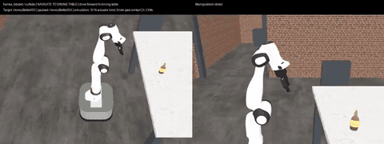<br>[cross-room](videos/cross-room.mp4) | 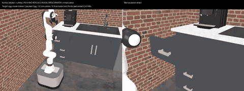<br>[drawer-pick-place](videos/drawer-pick-place.mp4) |
| 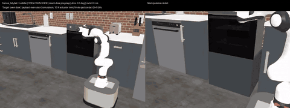<br>[oven-pick-place](videos/oven-pick-place.mp4) | 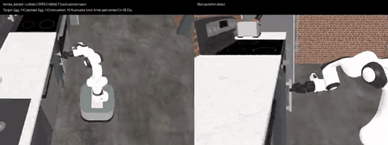<br>[cabinet-transfer](videos/cabinet-transfer.mp4) |
| 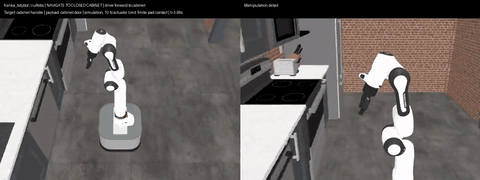<br>[cabinet-door](videos/cabinet-door.mp4) | 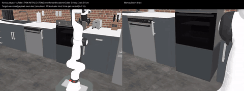<br>[oven-rack](videos/oven-rack.mp4) |
| 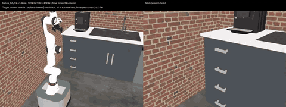<br>[drawer](videos/drawer.mp4) | 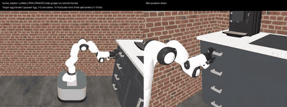<br>[drawer-loop](videos/drawer-loop.mp4) |
| 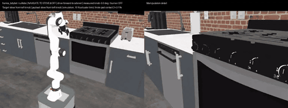<br>[stove-knob](videos/stove-knob.mp4) | 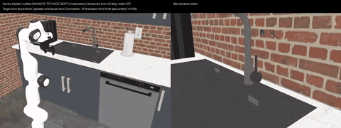<br>[faucet](videos/faucet.mp4) |
| 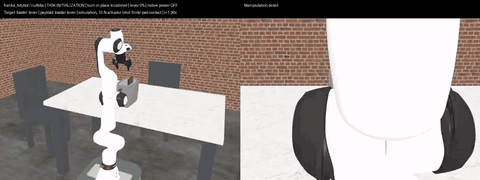<br>[toaster-lever](videos/toaster-lever.mp4) | 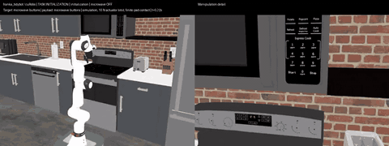<br>[microwave-button](videos/microwave-button.mp4) |
| 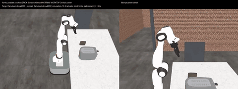<br>[toaster-insertion](videos/toaster-insertion.mp4) | 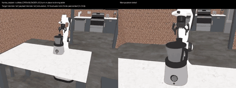<br>[blender-lid](videos/blender-lid.mp4) |

These are the tested ranges, not promises for every RoboCasa asset: the drawer travelled 20 cm
(35 cm in the transfer setup), the oven door opened 65.9° within its 1.15 rad limit and the rack
extended about 15 cm.

### ¹ Known issue: cabinet round trip is unreliable

`cabinet-transfer` passed once with the old slow motion profile, and 1 of 6 runs with the shared
fast profile. It fails at one of two points, depending on where the object comes to rest after it
is released on the shelf:

- **The object is released tilted, so it rolls or tips.** The hand stays horizontal to fit the
  cabinet opening, which leaves the held object leaning (the egg's side grasp, or about 30° for the
  honey bottle), and the gripper body hangs below the object, so it cannot be lowered onto the
  shelf; it drops about 1.5 cm. The egg then rolled 4-6 cm forward or back at random; the bottle
  tipped over toward the robot.
- **Shallow releases fall off, deep releases are out of reach.** Released 5 mm inside the front
  edge, the object rolls or tips off the shelf. Released 6 cm in, it can end up beyond the reach
  of every cabinet dock, and retrieval finds no plannable grasp (`No saved grasp plan after
  bounded alternate navigation stances`).

Ruled out: the base yaw (blended turning leaves `base_theta` at -4.712 rad, but the planner uses
the live base transform), the door (89° open in every run) and the grasp set (diagonal shelf
grasps raised the retrieval hypotheses from 8 to 36 without a success).

The fix is to release the object upright: choose the hand pitch, within the opening's limits,
that makes the held object vertical, so it cannot tip or roll and a shallow placement stays put
and within reach.

## How demonstrations are produced

The demonstrator is an oracle: it reads object poses and collision geometry from the simulator,
plans base routes with an SE(2) A* over MuJoCo collision probes, and plans arm motion with
cuRobo. Each skill is a transaction (see [architecture.md](architecture.md)): the simulator is
checkpointed, a candidate dock or grasp is tried, a measured postcondition decides, and failures
are rolled back before the next candidate. The saved trace therefore contains only the accepted
branch; rejected tries are kept separately for analysis.

Every task shares one motion profile. The base turns while it drives (`--base-motion blended`,
falling back to turn-then-drive where a blended sweep is not clear) and turns at 0.4 rad/s. After
each arm, gripper or base motion the controller advances as soon as the measured motion is
finished instead of waiting a fixed time, bounded by the old fixed wait; while an object is held,
the arm must be four times stiller (0.005 rad/s per joint) and the object itself at rest, so a
released object is not knocked. Videos drop idle pauses. Compared with the earlier slow profile,
the skill demonstrations take 1.0-4× less simulated time (about 105 min to 55 min in total).

Scratch route, grasp, and placement probes use MuJoCo's position pipeline instead of
solving contact forces at every hypothetical pose. Live physics and force checks still
use the full solver. On saved seed-7 breakfast-with-coffee states, 128 nearby probes
had exactly matching poses and contact geometry and took 8.8–9.3× less time; the actual
route-clearance checker was 6.2× faster across 27 poses with identical decisions.
These are probe timings, not end-to-end speedups: physical pouring and repeated
cuRobo searches can still dominate. The change applies to newly started processes.

Cross-room A* unwraps headings before collision sweeps. With blended base motion,
it also checks the executable slide/turn segments before rejecting an XY route
whose in-place turn is blocked. This lets a holonomic base slide away from nearby
floor clutter. A route accepted only through that check cannot fall back to an
unchecked in-place turn during execution. The saved seed-8 first-cup delivery
failure passes this route check; a complete rerun is still needed to qualify the
whole episode.

`scripts/benchmark_collision_probes.py --model MODEL.mjb --checkpoint CHECKPOINT.npz`
repeats the geometric comparison. Supply a compiled **controller** model exported with
`mujoco.mj_saveModel(controller.model, path)`: the authored scene can have a different
joint layout because controller initialization freezes background objects. The benchmark
does not advance the episode or modify its saved inputs. Extra physics threads are not
enabled by default; 2, 4, and 8 threads were slightly slower on the sampled coffee states.
