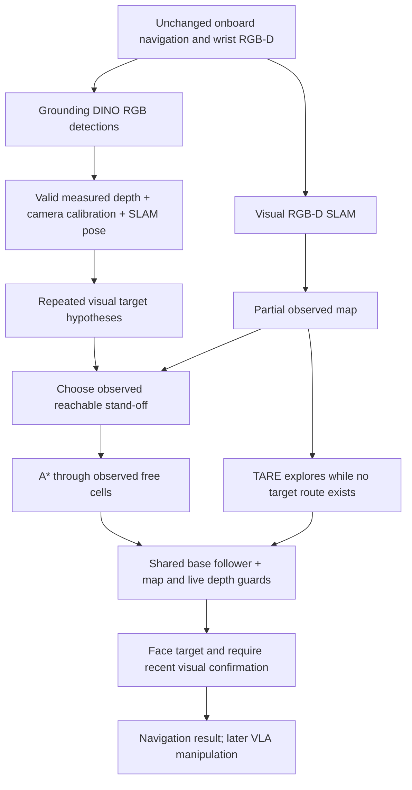

# Two-room baseline: partial mapping, perception, navigation

The default perception backend is now the [DAAAM component/VLM integration](daaam_semantic_interface.md). The Grounding DINO trial described below is retained as an explicit legacy backend, not the default.

Implements steps 2–4 only. The task planner supplies a category such as `cup`,
`bowl`, or `dining table`; it never supplies an oracle coordinate. This does not
execute pick/place or claim complete set-table success.



## Interface

`cross_episode_sim.navigation.SemanticNavigator(grid, detector, target, explorer,
config)` exposes `step(packet, tracking, now)`. It returns a base forward/yaw
command and status; `terminal` indicates completion/failure. Update `grid` with
accepted RGB-D/SLAM measurements before calling it. Execute at 50 Hz; sensor
updates in the demo are 10 Hz and detections default to 1 Hz. Detector inference
is synchronous: simulation pauses during compute, wall time includes inference.
No real-time hardware latency claim is made.

The detector is replaceable through the `ObjectDetector.detect(rgb)` protocol.
`GroundingDinoDetector` uses the upstream Transformers model, with RGB-only input:
[official documentation](https://huggingface.co/docs/transformers/model_doc/grounding-dino).
It searches for cups/mugs, bowls, and dining tables. Mug aliases normalize to cup.
`VisualTargetMap` uses valid central-box depth and calibrated projection into the
estimated SLAM frame, then associates repeated observations. Track numbers are
created by perception, not simulator object IDs. Two distinct timestamps are
required before routing to a target.

A* does not connect unknown cells or cut diagonally through corners. Exploration
continues if a target is visible but its stand-off is not yet reachable. Reuse of
the shared follower retains map/depth stopping checks and checked turn recovery.
The navigation goal is a 0.65–1.5 m stand-off; it is not an IK/reachability
certificate. Arrival also requires facing the target and recent visual evidence.

## Run

From the sensor worktree (`/nobackup/le/cross-episode-sensors`):

```bash
.venv-slam/bin/python -m pip install -r requirements-perception.txt
# Existing RGB-D SLAM and native-controller setup is also required.
# Default exploration uses scripts/setup_tare.sh; --explorer frontier is explicit.
CUDA_VISIBLE_DEVICES=6 bash scripts/test_semantic_navigation.sh \
  /path/to/successful/two_room/set_table_episode \
  --target 'dining table' --seconds 180
```

Each invocation creates a unique output directory. It saves a four-panel video,
annotated current frames, terminal progress, detected-target histories, A* routes,
sensor map, timing, and an offline physics contact audit. The source episode is
used only by the simulator harness to restore the scene. Doors start open and the
arm starts stowed; no scene graph, object list, or true pose enters the policy.
Ground-truth robot positions are recorded only for offline diagnostics.

## Qualification and remaining limits

Unit tests cover unknown-space separation, diagonal corner checks, calibrated
projection, robot masking, rejected tracking, and distinct-frame confirmation.
Physical validation results are recorded below when available. Do not treat
unit tests as evidence of successful cross-room execution.

Bounding boxes are not segmentation masks. Background depth, false detections,
association drift and duplicate tracks remain possible. Navigation success is
reported separately from task success and requires offline visual review.
The fixed-radius guard assumes a stowed arm; carrying and manipulation are not
qualified. The existing camera geometry and native controller are unchanged.
Long exploratory routes and scans may exceed the 5–15 s motion target. This
baseline retains their measured timing rather than accelerating the video or
claiming that all motion optimizations are complete.

### Initial physical trials

`semantic_nav_two_rooms_v1` was stopped after visual review found robot/floor
false positives. Robot-overlap and tabletop-height filtering were added.
`semantic_nav_two_rooms_v2` then exposed a countertop/table confusion; its visual
review explicitly rejects it as a valid dining-table trial. A CLIP RGB crop
verifier now contrasts dining tables against counters, floors, robot parts and
cabinets before accepting a table detection. This is model-based perception,
not an environment-label filter. Both detector and verifier can still be wrong.
The v3 table and v1 cup physical trials are pending.


## Hybrid local approach integration

See [Hybrid sensor navigation](hybrid_navigation.md) for One-Ring local approach, visual room memory, A* redocking, setup and current validation gaps. This experimental mode is separate from the qualified semantic-only stand-off trials above.

## Open-door two-room qualification — November 3, 2026

Source: held-out `test_two_rooms/batches/round_continuous/set_table_000002`.
The standalone harness retains the saved base spawn, initializes the arm stowed,
and opens room doors before execution. No spawn backoff or oracle route is used.
Execution receives onboard RGB-D, calibration, proprioception and online SLAM.
Private room polygons and the diagnostic true trajectory are used only after
execution to score room visits and floor coverage.

This trial uses custom frontier exploration and observed-map A*, with DAAAM
FastSAM/BotSort perception, local Qwen3-VL verification, and `VisualTargetMap` 3D
association. It does **not** qualify native Hydra's room/place hierarchy. The
current native Hydra object interface remains limited to cup/bowl targets.

| Run | Outcome | Simulated seconds | Room interiors visited | Audited collisions |
|---|---|---:|---:|---:|
| `two_room_table_exploration_v1` | Exploration visited both rooms; final target confirmation failed | 180.04 | 2/2 | 0 |
| `two_room_table_exploration_v2` | Reached and freshly confirmed dining table | 73.92 | 2/2 | 0 |
| `two_room_table_exploration_v3` | Latest code: reached and freshly confirmed dining table | 48.02 | 2/2 | 0 |

The first run observed 93.3% of the kitchen floor and 95.0% of the dining floor.
These are depth-observed area ratios against whole room polygons, including
furniture footprints—not an oracle-free-space coverage guarantee.

Fixes: table-specific detector proposals; table-aware VLM verification; current
mask/depth-gated re-observation of mapped dining tables (previously cup/bowl only).
A further refinement replans the stand-off when the observed table estimate
changes beyond the accepted distance, rather than spending 20 s rotating at an
obsolete stopping point. The latest code passed a separate physical
rerun (`two_room_table_exploration_v3`). This run did not trigger the refined-target
replan branch, so its shorter time is not isolated evidence of that branch’s speedup;
the regression test covers the stale-stand-off case. The latest run took 364.31 wall
seconds and retained 6.9 simulated seconds inside the dining room.

Semantic perception updates at a nominal 1 simulated Hz throughout exploration,
travel and alignment; SLAM and collision mapping update at 10 Hz, base commands
at 50 Hz. Inference is synchronous and wall-clock time is longer than simulation.
The shared hybrid navigator also calls semantic observation before its One-Ring
and docking branches; the older standalone M2T2 diagnostic runners do not maintain
the complete native semantic map across every motion stage.

- [Successful video with online map](../runs/two_room_table_exploration_v3/navigation_with_map.mp4)
- [Onboard views only](../runs/two_room_table_exploration_v3/navigation.mp4)
- [Final view and map](../runs/two_room_table_exploration_v3/latest_map_frame.png)
- [Report](../runs/two_room_table_exploration_v3/report.json)

This is navigation/search qualification on one two-room scene, with an empty
hand and open doors. It is not loaded doorway traversal, manipulation-ready
parking, closed-door operation, or complete set-table qualification.

Reproduce with the existing runner (a unique output directory is created):

```bash
CUDA_VISIBLE_DEVICES=0,1 bash scripts/test_semantic_navigation.sh \
  /path/to/two_room/set_table_episode \
  --target 'dining table' --object-map visual --perception daaam \
  --vlm-device cuda:1 --explorer frontier --goal-room '' \
  --preferred-distance 1.1 --seconds 180
```

Validation after these changes: 64 tests passed across DAAAM grounding, semantic
navigation, hybrid navigation and shaped docking. These are two successful runs
on the same scene, not two independent house layouts or a general success rate.
