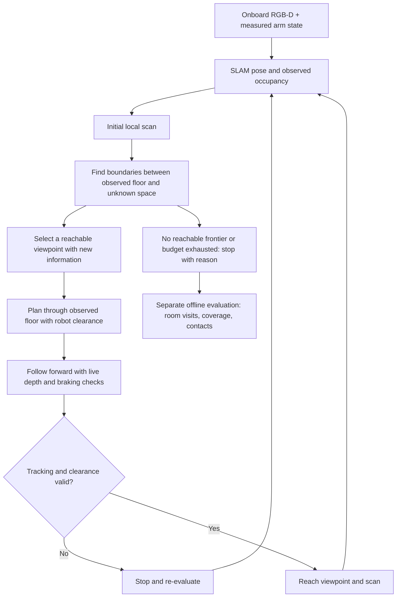

# Whole-house exploration (in qualification)

The objective is to visit and map every accessible room, not to spin once in the starting room. `HouseExplorer` repeats local scanning, frontier selection, route following and observation updates. It does not receive the house room count or room graph. A stop because no frontier is reachable is not by itself proof of house coverage.

## Observation boundary

`cross_episode_sim/navigation/house_exploration.py` imports no simulator API. It consumes the navigation RGB-D packet, measured arm posture, causal SLAM estimate and depth-derived grid. Neither the saved action trajectory nor fixture/object locations, true base poses, house polygons or room graph are used to select goals or routes.

The simulator-side `OnboardBaseActuator` executes body-forward/yaw commands through native MolmoSpaces controllers. Encoder coordinates stay inside the actuator bridge. Scene setup initializes the requested open doors and stowed arm before evaluation. The original base position is retained.

## Planning layer versus the strict diagnostic map

The earlier strict map required every vertical band to be observed free. This was insufficient for cold-start navigation: the robot cannot observe the floor underneath itself, and its body occludes portions of the surrounding volume.

The experimental exploration planner therefore uses a separate layer:

- Camera-observed floor plus a **separately saved ego-support prior** at accepted estimated robot positions. At 10 cm grid resolution, a 40 cm raster footprint represents the area occupied during the stowed base scan; it is not a room-sized free-space seed.
- The support prior never overwrites camera evidence or clears an observed obstacle. It is saved separately as `ego_support_prior.npy`.
- Occupied height bands from 5 cm to 1.85 m block planning, including overhead obstacles. Unobserved floor outside the ego footprint remains blocked.
- Robot-center clearance and live observed-depth checks constrain every commanded stopping arc. The planning layer is **not a guarantee that unobserved vertical space is empty**. Physical collision audits remain necessary for qualification.
- The original strict diagnostic layer is retained, with its stronger observation requirements, rather than relabeling it as passed.

The default planned center clearance is 0.56 m for the stowed footprint. Tracking is visual; localization uncertainty and unknown thin geometry remain limitations. The no-motion-on-tracking-loss rule is retained.

## Exploration policy

The initial scan covers all 24 heading sectors. Connected observed frontiers generate candidate stand-off viewpoints. Reachability is computed over the observed planning layer with a clearance penalty and no diagonal corner cutting. Candidates are ranked by frontier size and path cost, avoiding already-scanned locations. Route shortcuts are checked at 2.5 cm spacing. Forward-only travel is acceleration limited and slows for turns; there is no lateral sliding.

During travel, the map is updated from fresh observations. The predicted braking arc must remain in the current planning layer and clear of measured depth obstacles. A stalled target can be reconsidered rather than waiting indefinitely. Every goal and scan position is recorded in `events.json`; `progress.jsonl` records commands and SLAM states continuously.

## Qualification protocol

Run `scripts/demo_house_exploration.py` on the saved 5-, 6- and 7-room houses with all room doors open. Video contains navigation RGB/depth above wrist RGB/depth, at simulated speed. No hidden room information terminates the policy or selects a goal.

After policy termination only, load the saved house polygons and private true trajectory for scoring. Require at least one second inside each room (with an interior boundary margin), plus observed floor coverage of at least 35% of each room's polygon. Report the complete per-room ratios rather than treating one doorway glimpse as exploration. Physical success additionally requires no audited external or mast-arm contacts. The floor-coverage denominator includes furniture footprint, so report it explicitly; it is not coverage of a hidden collision-free floor oracle.

No success claim is made here until physical results are recorded. Budget exhaustion, loss of tracking and unreachable frontiers are separate failure/stop reasons. Whole-house scans and travel can exceed the normal 5–15 s atomic duration; that exception is inherent to the exploration scope, not video acceleration.

## Algorithm references

The frontier principle comes from Brian Yamauchi, [A Frontier-Based Approach for Autonomous Exploration, IEEE CIRA 1997](https://www.robotfrontier.com/papers/cira97.pdf). This repository currently implements its own frontier selector and execution checks; it is not the author's code or the ROS `explore_lite` package. [m-explore-ros2](https://github.com/robo-friends/m-explore-ros2) is an existing implementation to consider for a ROS/Nav2 integration. No globally shortest unknown-house exploration route is claimed.
# Upstream planner trial

The separate [TARE integration trial](tare_exploration_trial.md) uses the original
upstream ground-robot exploration planner behind an onboard-only ROS bridge.
It is under qualification and does not yet replace this custom baseline.

## Completed custom baseline tests, November 1, 2026

| Run | Interior rooms visited | Simulated seconds | Audited external contacts | Whole-house physical success |
|---|---:|---:|---:|---|
| `house_exploration_5room_v4` | 1/5 | 153.52 | 0 | No; stopped with no reachable frontier after repeated clearance stops |
| `house_exploration_6room_v4` | 5/6 | 600.12 | 0 | No; budget exhausted |
| `house_exploration_7room_v4` | 7/7 | 477.12 | 0 | Yes; all rooms also met the observed-floor threshold |

These are individual physical tests, not a general robustness guarantee. The
seven-room result does not establish that all smaller houses work. Each run
retains `report.json`, `exploration.mp4`, its observation-derived map and the
estimated/diagnostic trajectories under `runs/`. `coverage.png` in the seven-room
run plots the executed path using house geometry only for offline evaluation.

### Upstream TARE trial outcome

The [TARE integration trial](tare_exploration_trial.md) records the initial
failures and subsequent repairs. Earlier fixed-map versions passed 5/5 and 7/7
rooms with zero audited contacts, including corrected full-room coverage scoring.
Growing-map tests then exposed a local turn/forward retry problem; a latched
turn recovery is implemented, with full six/seven-room physics reruns pending.
TARE remains experimental, not a generally qualified replacement. See the linked
report for exact versions, videos, timing, and camera/follower limitations.
